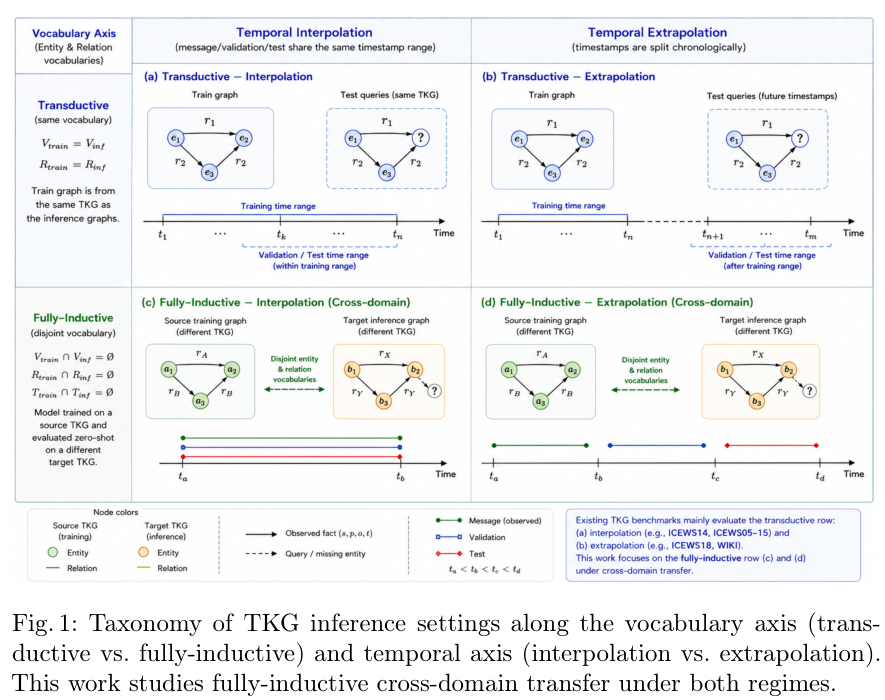

本文补录 **2026-08-12 的精选阅读**，于 2026-10-29 核对公开原文。归档日不是发表日；本文固定使用下列 v1，不混入后续修订。数字为作者报告，本站未独立复现。

## 完全归纳与时序是两条轴

FITTER 研究训练与推理图的实体、关系名称和时间戳都可能不同的迁移。它依据谓词交互模式与相对时间顺序构造表示，再以消息传递结合局部和全局时序上下文，而非为目标图重新训练词表嵌入。

## 实验条件与反例

六个时序图谱用于跨图、跨领域迁移。Table 1 中，在 ICEWS14 训练、GDELT 测试且不微调时，FITTER 的 MRR 为 26.1，ULTRA 为 17.0，均按百分制报告。目标图仍提供用于消息传递的已知事实，不是模型在完全没有目标结构的条件下猜测。

表现也并非每个指标都最高：ICEWS05-15 训练、YAGO 测试时，ULTRA 的 Hits@10 为 90.9，FITTER 为 86.5。时间平移不变性的形式性质只针对所定义编码，不能据此宣称任意时序分布迁移可靠。

## 我的判断

跨域评估要同时记录词表、时间跨度与训练/消息/测试划分。图越密集，训练和推理开销仍可能成为限制；一项平均排名不能代替逐目标检查。

## 原论文视觉证据

图源：Jiaxin Pan , Mojtaba Nayyeri , Osama Mohammed , Daniel Hernandez , Rongchuan Zhang , Cheng Cheng , Steffen Staab，《FITTER: Vocabulary-Agnostic Cross-Domain Inference on Temporal Knowledge Graphs》，arXiv:2608.10668v1，Figure 1，PDF 第 4 页。[原图出处](https://arxiv.org/pdf/2608.10668v1#page=4) · [CC BY 4.0](https://creativecommons.org/licenses/by/4.0/)。裁剪自原文。

## 深读原文与范围

- [FITTER: Vocabulary-Agnostic Cross-Domain Inference on Temporal Knowledge Graphs](https://arxiv.org/abs/2608.10668v1) · v1，公开于 2026-08-11。

本篇深读上述 1 篇；以下是同日公开阅读入口，仅核对标题、版本日期和来源，未逐篇核验实验。

## 同日阅读目录

- [FITTER: Vocabulary-Agnostic Cross-Domain Inference on Temporal Knowledge Graphs](https://arxiv.org/abs/2608.10668v1) · v1，2026-08-11。
- [Curate Before You Connect: Identity and Ontology Tagging in a Production Knowledge Graph](https://arxiv.org/abs/2608.10644v1) · v1，2026-08-11。
- [Stealing Reasoning Traces from Proprietary LLM APIs](https://arxiv.org/abs/2608.09867v1) · v1，2026-08-10。
- [SWE-Bench ProMax: Benchmarking Agents on Large-Scale Multilingual Code Refactoring](https://arxiv.org/abs/2608.09802v1) · v1，2026-08-10。
- [JEPA-WAM: Learning Vision-Language-Action Policies with Joint-Embedding World Modeling](https://arxiv.org/abs/2608.09381v1) · v1，2026-08-10。
- [Learning How the World Evolves: Extrapolative Video World Models via Latent Dynamics Reasoning](https://arxiv.org/abs/2608.09926v1) · v1，2026-08-10。
