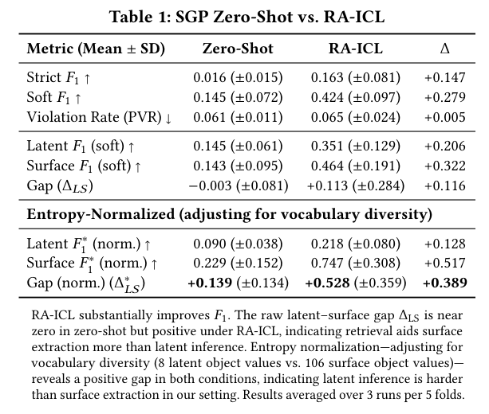
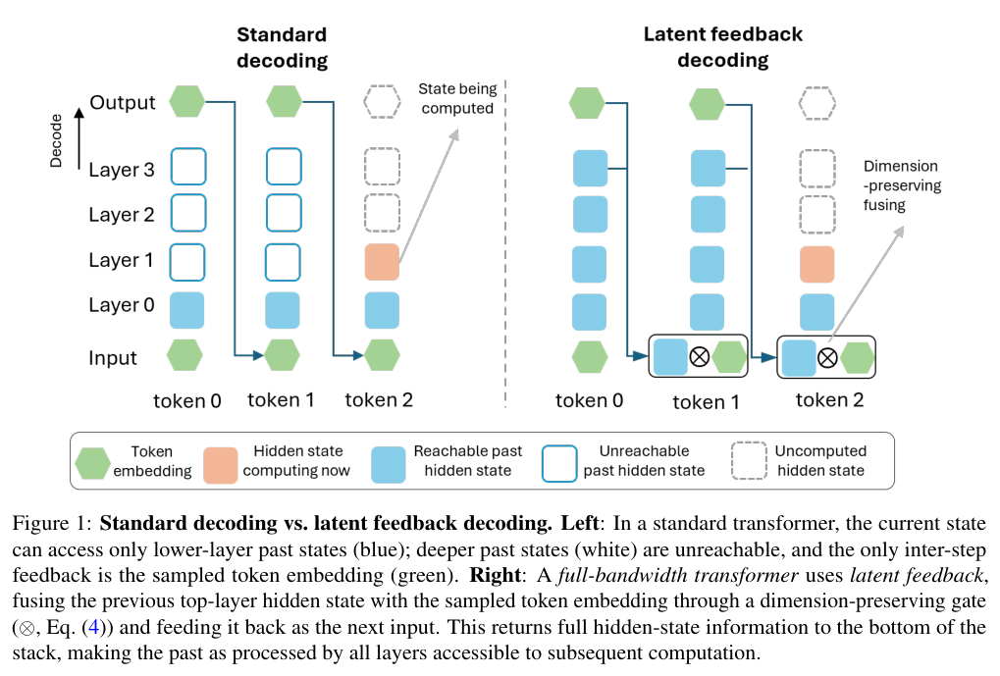
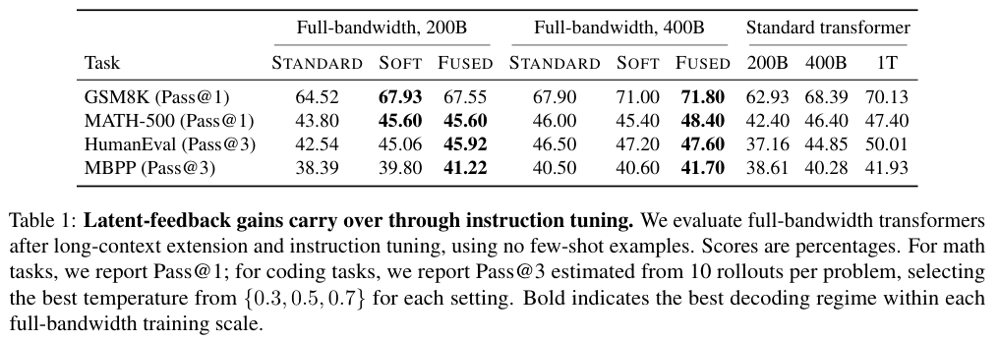

本期六项研究介绍结构化处境推断、图语义检索、循环潜在推理、隐藏状态反馈、失败后果学习与长期生活协助评测。

## 1. Situation Graph Prediction：从材料逆推结构化处境

Situation Graph Prediction 从可观察的多模态材料反推与本体对齐的目标、情绪和语境。结构优先的合成流程先定义潜在图，再生成材料，以避免依赖真实私人数字足迹。

试验为一个虚构人物生成 75 个情境、225 个合成材料，以五折划分进行检索增强上下文学习，每折 60 个检索、15 个测试。GPT-4o 的整体 soft F1 从零样本 0.145 到 RA-ICL 的 0.424；但约束违反率从 0.061 到 0.065，并未同步改善。

RA-ICL 的表层 soft F1 为 0.464，潜在状态为 0.351，说明表面提取与内在处境推断不同。该试验只有单一合成人物及受控生成机制，不是对真实用户心理状态的可靠识别证据。

应将推断保留为可纠正假设，避免把合成任务分数转成对真人的确定判断。下一步需要独立人物、领域和生成机制，以及明确同意和隐私边界；更多结构不自动消除建模偏差。

图源：Jisung Shin , Daniel Platnick , Marjan Alirezaie , Hossein Rahnama，《Situation Graph Prediction: Structured Perspective Inference for User Modeling》，arXiv:2602.13319v1，Table 1，PDF 第 4 页。[原图出处](https://arxiv.org/pdf/2602.13319v1#page=4) · [CC BY 4.0](https://creativecommons.org/licenses/by/4.0/)。裁剪自原文。

- [Situation Graph Prediction: Structured Perspective Inference for User Modeling](https://arxiv.org/abs/2602.13319v1) · v1，公开于 2026-02-10。

## 2. FastInsight：让语义检索与图拓扑交替补充

FastInsight 以图结构感知重排序 GRanker 和语义拓扑扩展 STeX 交替检索，连接向量相似度与图邻域。它还定义 Topological Recall，为靠近目标但未直接命中的节点提供部分分数，使结构探索能接受独立诊断。

五个语料图的平均截断 Recall@10 为 36.6%，GAR 为 33.3%；平均 nDCG@10 为 33.6% 对 30.8%。SciFact-G 的本地 Gemma 3 12B 对照中，相对两步 IRCoT，查询处理时间在 TITAN 从 6.54 到 3.77 秒，在 A100 从 5.03 到 2.12 秒。它是检索阶段耗时，生成质量还使用 LLM 两两裁判，不能直接等同最终答案事实准确率。

[FastInsight: Fast and Insightful Retrieval via Fusion Operators for Graph RAG](https://arxiv.org/abs/2601.18579v1) · v1。

[Figure 1（原文）](https://arxiv.org/pdf/2601.18579v1#page=2)。

## 3. BDH-CQ：用循环记忆进行不必说出来的潜在推理

BDH-CQ 在接收示范时持续更新循环记忆，再通过高维潜在空间中的多次计算回答查询。控制实验改变复制、排序、传播距离与嵌套深度，检查模型是否学到了能跨测试输入应用的变换，而不只是复述规则。

150M 参数配置在 ARC-AGI-1 公开四百题上，严格任务 Pass@1 为 24.25%、Pass@2 为 29.50%；若按四百一十九个测试对计分，后者是 31.03%，分母不同。每题 0.0007 美元为作者估算推理成本，不能视作任意服务报价，也未计成一个端到端训练成本。公开评测表现不等于未见私有任务的通用推理保证。

[BDH-CQ: In-Context Learning with Recurrent Latent Reasoning](https://arxiv.org/abs/2608.09888v1) · v1。

[Figure 1（原文）](https://arxiv.org/pdf/2608.09888v1#page=3)。

## 4. Full-bandwidth Transformer：将上一 token 的隐藏状态送回输入

Full-bandwidth Transformer 在采样 token 的嵌入之外，通过门控线性单元反馈上一位置的顶层隐藏状态，让未文字化的信息重新获得深层计算预算。多遍训练目标和延后引入反馈，试图保留并行 teacher forcing 的训练方式。

*图｜Wang, Xi 等，[Figure 1（PDF 第 2 页）](https://arxiv.org/pdf/2608.08888v1#page=2)，[CC BY 4.0](http://creativecommons.org/licenses/by/4.0/)。裁剪自原文。*

1B 模型、两千亿 token 训练并经指令调优后，FUSED 解码的 GSM8K Pass@1 为 67.55%，同一模型 STANDARD 为 64.52%；HumanEval 的 Pass@3 为 45.92% 对 42.54%。代码成绩从十次采样估计并为各设置选择最佳温度，不能当作单次成功率。基础模型的短推理轨迹收益在指令调优后消失，也不是所有后训练条件下都会更简洁。

*图｜Wang, Xi 等，[Table 1（PDF 第 10 页）](https://arxiv.org/pdf/2608.08888v1#page=10)，[CC BY 4.0](http://creativecommons.org/licenses/by/4.0/)。裁剪自原文。*

[Full-bandwidth transformer](https://arxiv.org/abs/2608.08888v1) · v1。

## 5. FACT：失败动作可以教世界模型后果，不该被模仿

FACT 按实际动作预测未来视频与任务进度，用因果条件把动作和后果连接起来。失败 rollout 仍可监督环境会怎样变化，但屏蔽失败动作的模仿损失；训练后的进度预测还可选择性地为动作候选打分。

已见真机任务中，基础方法平均成功率 82%，加入失败数据后 89%，再加入候选评分为 92%；未见任务变体对应为 67%、77%、82%。单独加评分却只有 79%，直接对失败动作施加模仿损失则降到 63%。这支持后果监督与动作模仿分工，也说明推理评分、失败数据和计算预算必须分开比较。

[FACT: Failure-Aware Causal Training for World-Action Models](https://arxiv.org/abs/2608.10232v1) · v1。

[Figure 1（原文）](https://arxiv.org/pdf/2608.10232v1#page=1)。

## 6. VibeLifeBench：世界悄悄变化时，生活 Agent 会不会复查

VibeLifeBench 用二十二个模拟服务组织两百项跨数周任务，覆盖十个生活领域。消息、通知会唤起 Agent，背景状态变化则静默发生；评分读取留下的服务状态和工件，检查及时性、持续一致性及隐含约束。

同一运行框架下七个模型各题运行三次，最高 Claude Opus 5 的平均加权得分为 32.5/100，GPT-5.5 为 30.1。这里不是“完成了 32.5% 的全部任务”，而是先算每题通过检查的权重比例，再跨任务平均。脚本化生活环境便于检查主动性，却不能直接代替真实长期服务中的用户满意度与可靠性。

[VibeLifeBench: Can Your Life Agent Be Proactive and Persistent in a Living World?](https://arxiv.org/abs/2608.10875v1) · v1。

[Figure 1（原文）](https://arxiv.org/pdf/2608.10875v1#page=2)。
