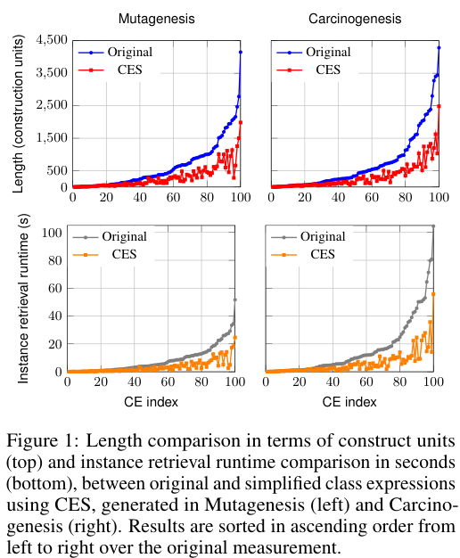
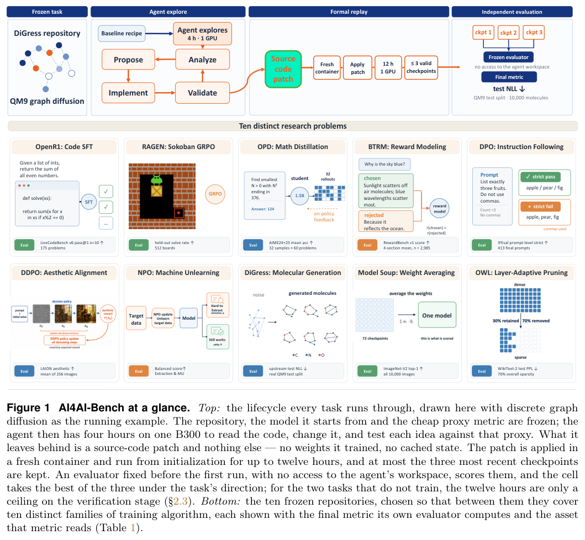
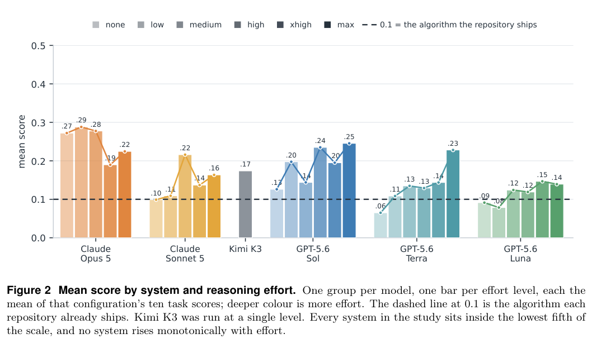
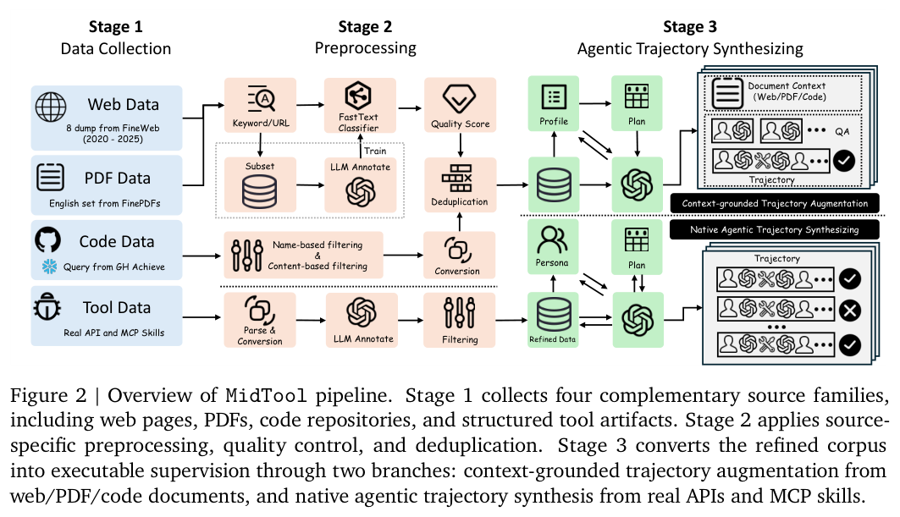
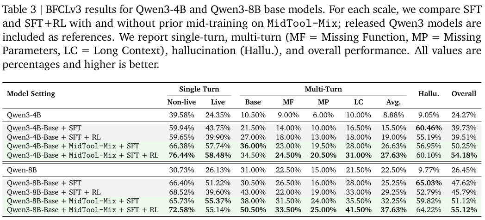

本期六项研究介绍属性图查询重写、OWL 表达式简化、环境组件、训练算法设计、自博弈环境与工具中期训练。

## 1. 本体介导属性图查询

本体与图数据库 · [Rewriting Ontology-Mediated Property Graph Queries into GQL v1](https://arxiv.org/abs/2608.20092v1) · [全文](https://arxiv.org/html/2608.20092v1)

### 方法与原图

论文面向适配属性图的 DL-Lite 本体，以及带嵌套的双向正则路径查询。ARCO 原型输出可在 Neo4j 上执行的 Cypher，合取查询受 join-on-free 限制，覆盖范围不能扩展成任意 OWL 查询。

*图 1｜Bianca Löhnert、Nikolaus Augsten、Cem Okulmus、Magdalena Ortiz，[v1 Figure 1，PDF 第 2 页](https://arxiv.org/pdf/2608.20092v1#page=2)，[CC BY 4.0](https://creativecommons.org/licenses/by/4.0/)。裁剪自原文。*

### 重写与执行需要分别测量

实验使用 400GB 内存、16 核虚拟机及 Neo4j 5.25.0。作者生成 100 个随机路径查询，并针对 MMM 城市排水数据手写 5 个查询。DBpedia 执行评测有 56 次达到 20 秒超时；MMM 的 5 条中 3 条达到 1,000 秒超时。[实验、Figure 4/5 与 Table 3](https://arxiv.org/pdf/2608.20092v1#page=10)。

重写器还有自身的扩展限制。原文报告，MMM 设置下 100 个生成查询中有 62 个因状态数至少为 30，无法进行相应幂集计算。结合数据库执行超时，这些证据支持有条件的原型可行性，不能推断所有查询都能快速重写或执行。

## 2. CES：简化 OWL 类表达式的冗余结构

Class Expression Simplifier 通过吸收律、因式分解和规范化重写，减少 OWL 类表达式的嵌套与重复。实现集成到 OWLAPY，目标是在保持逻辑含义的同时，让概念学习器产生的复杂表达式更易理解和求值。

*图｜Baci, Alkid 等，[Figure 1（PDF 第 4 页）](https://arxiv.org/pdf/2608.18899v1#page=4)，[CC BY 4.0](http://creativecommons.org/licenses/by/4.0/)。裁剪自原文。*

两项中型本体上的二百个 TDL 学习表达式中，最高长度减少 86%，最高实例检索耗时减少 90%，均为最佳个例而非平均值。平均简化耗时分别为 0.11、0.16 秒。论文以原表达式与简化表达式返回相同实例作经验验证，尚未给出任意重写组合的全局汇合与终止证明；更简洁的学习器也未必有同样收益。

[Syntactic Simplification of OWL Class Expressions](https://arxiv.org/abs/2608.18899v1) · v1。

## 3. EnvHarness

Agent 环境工程 · [EnvHarness: Awakening Static Worlds for Agent Learning v1](https://arxiv.org/abs/2608.19880v1) · [全文](https://arxiv.org/html/2608.19880v1)

EnvHarness 用组件改变初始状态、交互信息流或任务连接，保留底层环境逻辑与验证器。EnvRigger 根据失败轨迹编写组件，并用新 rollout 验证。

| 技能来源对照 | 原环境 | EnvHarness 环境 |
|---|---:|---:|
| ALFWorld 分布外成绩 | 61.4 | 70.4 |
| SWE-bench Verified 成功率 | 49.88 | 52.58 |
| SWE-bench Verified 平均步数 | 55.01 | 49.61 |

技能学习实验分离训练与测试任务，环境生成器与策略使用相同模型。以上分别对应 [Table 2/3](https://arxiv.org/html/2608.19880v1#S4)，ALFWorld 提升为 9.0 个百分点。自动主流程使用 Stage/Contract，Chain 组件在独立实验中评测，不能把主结果归因于长任务拼接。

保留验证器明确了验收边界；环境是否引入捷径、技能是否依赖观察格式，仍需结合分布外测试与组件消融判断。

## 4. AI4AI-Bench：真正改了学习算法，还是只调了训练过程

AI4AI-Bench 固定十个研究仓库与隐藏评价器，让 Agent 在单张 B300、四小时探索预算中修改训练算法，再从头运行最多十二小时。评测区分修改损失、监督、更新规则与只改学习率、运行长度或检查点选择。

*图｜Chi, Yizhe 等，[Figure 1（PDF 第 2 页）](https://arxiv.org/pdf/2608.20318v1#page=2)，[CC BY 4.0](http://creativecommons.org/licenses/by/4.0/)。裁剪自原文。*

二十九种系统配置的平均映射分数为 0.166，最佳系统为 0.250；该尺度把无信息模型设为 0、原仓库算法设为 0.1、任务最优设为 1，因此 0.250 不是 25% 任务成功率。不同任务的原指标不可直接相加，分类分析也由另一个模型阅读补丁完成，结果仍依赖任务集、预算与变更分类。

*图｜Chi, Yizhe 等，[Figure 2（PDF 第 8 页）](https://arxiv.org/pdf/2608.20318v1#page=8)，[CC BY 4.0](http://creativecommons.org/licenses/by/4.0/)。裁剪自原文。*

[AI4AI-Bench: Benchmarking LLM Agents in Algorithmic Design for Recursive Self-Improvement](https://arxiv.org/abs/2608.20318v1) · v1。

## 5. SPADE：用可执行环境与特权提示差距形成自博弈课程

SPADE 让同一语言模型轮流担任环境设计者和推理 Agent。设计者生成有状态、可执行的多轮环境，以有无特权提示时的奖励差估计 regret，并结合外部语料与历史环境记忆，让新任务接近学习者的能力边界。

Qwen3-30B-A3B 的八项留出评测均值从最强固定环境对照的 53.0 到 58.3，都是四百轮训练；但 AIME25、AIME26、逻辑等个别项并非全胜。均值混合数学 avg@32、代码 Pass@1 和程序推理胜率，不是统一单次成功率。合成环境仍由生成与验证代码定义，外部语料和质量筛选是必要监督来源。

[SPADE: Self-Play in Adaptive Synthetic Executable Environments](https://arxiv.org/abs/2608.19197v1) · v1。

[Figure 1（原文）](https://arxiv.org/pdf/2608.19197v1#page=1)。

## 6. MidTool：把工具能力提前放入中期训练

MidTool 将网页、PDF、代码中的工具知识与真实 API、MCP skills、文档工作流合成监督结合，形成约 20.3B token 的训练混合。中期训练学习参数落地、工具组合和缺失信息恢复，之后再接监督微调与强化学习。

*图｜Jiang, Fengqing 等，[Figure 2（PDF 第 4 页）](https://arxiv.org/pdf/2608.20314v1#page=4)，[CC BY 4.0](http://creativecommons.org/licenses/by/4.0/)。裁剪自原文。*

Qwen3-4B-Base 经 SFT+RL 的 BFCLv3 总分为 39.51%，先加 MidTool 后为 54.18%；8B 对应为 45.79% 到 55.12%。但 τ²-Bench 的 8B telecom Pass@1 从 5.26% 降到 2.19%，总体改善不代表每类工具任务都提高。新增中期训练本身也有数据与计算成本，不能把收益归为无成本替换后训练数据。

*图｜Jiang, Fengqing 等，[Table 3（PDF 第 8 页）](https://arxiv.org/pdf/2608.20314v1#page=8)，[CC BY 4.0](http://creativecommons.org/licenses/by/4.0/)。裁剪自原文。*

[MidTool: Mid-training Data Synthesis for Agentic Tool Use](https://arxiv.org/abs/2608.20314v1) · v1。
