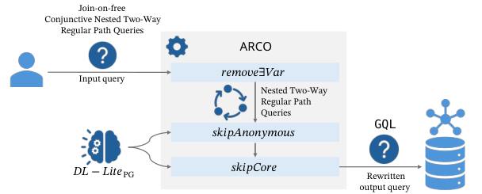

本体查询重写把隐含知识放入数据库查询；EnvHarness 则在既有环境上增加可编程组件。两个外部层都需要分别检查表达能力、执行代价与验收边界。

本文补录 2026 年 8 月 24 日的日报清单，于 10 月 29 日核对公开原文。日报日期不代表论文发表日，以下固定引用 **v1**。数值为作者报告，本站未独立复现。

## 本体介导属性图查询

本体与图数据库 · [Rewriting Ontology-Mediated Property Graph Queries into GQL v1](https://arxiv.org/abs/2608.20092v1) · [全文](https://arxiv.org/html/2608.20092v1)

### 方法与原图

论文面向适配属性图的 DL-Lite 本体，以及带嵌套的双向正则路径查询。ARCO 原型输出可在 Neo4j 上执行的 Cypher，合取查询受 join-on-free 限制，覆盖范围不能扩展成任意 OWL 查询。

*图 1｜Bianca Löhnert、Nikolaus Augsten、Cem Okulmus、Magdalena Ortiz，[v1 Figure 1，PDF 第 2 页](https://arxiv.org/pdf/2608.20092v1#page=2)，[CC BY 4.0](https://creativecommons.org/licenses/by/4.0/)。已裁剪，保留完整重写流程及标记，移除原图注与正文；未改动图内内容。*

### 重写与执行需要分别测量

实验使用 400GB 内存、16 核虚拟机及 Neo4j 5.25.0。作者生成 100 个随机路径查询，并针对 MMM 城市排水数据手写 5 个查询。DBpedia 执行评测有 56 次达到 20 秒超时；MMM 的 5 条中 3 条达到 1,000 秒超时。[实验、Figure 4/5 与 Table 3](https://arxiv.org/pdf/2608.20092v1#page=10)。

重写器还有自身的扩展限制。原文报告，MMM 设置下 100 个生成查询中有 62 个因状态数至少为 30，无法进行相应幂集计算。结合数据库执行超时，这些证据支持有条件的原型可行性，不能推断所有查询都能快速重写或执行。

## EnvHarness

Agent 环境工程 · [EnvHarness: Awakening Static Worlds for Agent Learning v1](https://arxiv.org/abs/2608.19880v1) · [全文](https://arxiv.org/html/2608.19880v1)

EnvHarness 用组件改变初始状态、交互信息流或任务连接，保留底层环境逻辑与验证器。EnvRigger 根据失败轨迹编写组件，并用新 rollout 验证。

| 技能来源对照 | 原环境 | EnvHarness 环境 |
|---|---:|---:|
| ALFWorld 分布外成绩 | 61.4 | 70.4 |
| SWE-bench Verified 成功率 | 49.88 | 52.58 |
| SWE-bench Verified 平均步数 | 55.01 | 49.61 |

技能学习实验分离训练与测试任务，环境生成器与策略使用相同模型。以上分别对应 [Table 2/3](https://arxiv.org/html/2608.19880v1#S4)，ALFWorld 提升为 9.0 个百分点。自动主流程使用 Stage/Contract，Chain 组件在独立实验中评测，不能把主结果归因于长任务拼接。

保留验证器明确了验收边界；环境是否引入捷径、技能是否依赖观察格式，仍需结合分布外测试与组件消融判断。

## 当日其他论文入口

以下已核对公开 v1 的题目与链接，本篇未复核其全部实验。

- [Syntactic Simplification of OWL Class Expressions](https://arxiv.org/abs/2608.18899v1)
- [AI4AI-Bench: Benchmarking LLM Agents in Algorithmic Design for Recursive Self-Improvement](https://arxiv.org/abs/2608.20318v1)
- [SPADE: Self-Play in Adaptive Synthetic Executable Environments](https://arxiv.org/abs/2608.19197v1)
- [MidTool: Mid-training Data Synthesis for Agentic Tool Use](https://arxiv.org/abs/2608.20314v1)

---

本篇外部原图保留 CC BY 4.0，不因本站页脚而增加非商业或相同方式共享限制。其余论文仅保留公开链接。
