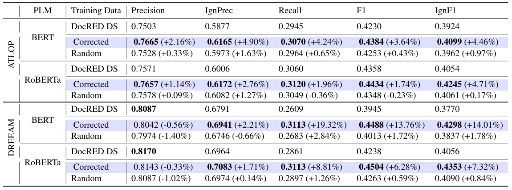

数据接口可以更友好，模型状态可以更紧凑，但都需要核对表达范围与评测条件。本期从知识图谱查询出发，讨论长上下文更新与关系数据的结构质量。

## bikiDATA

RDF 数据探索 · [bikiDATA: A Python Library to Query and Explore Large-Scale RDF Datasets v1](https://arxiv.org/abs/2608.20358v1) · [全文](https://arxiv.org/html/2608.20358v1)

bikiDATA 用 DuckDB 存储转换后的 RDF 关系表，在 Python 中组合筛选、全文搜索与语义检索，并返回 Python 数据结构。接口的简化同时限制了表达范围，原文明确说明无法映射所有 SPARQL 查询。

扩展实验使用 500GB 内存、96 核服务器，与 QLever 在相同硬件上比较。作者选择 Sparqloscope 中耗时超过 3 秒的查询，预先转为 SQL，并以冷缓存计时。短文未给出完整数值表，因此本文不报告任意加速倍数，也不据此推断所有工作负载都更快。[实现与实验范围](https://arxiv.org/html/2608.20358v1#S2)。

作为 Python 分析入口，它的支持范围值得按实际查询逐条确认，尤其是需要完整 SPARQL 语义的应用。

## E²-TTT

测试时训练 · [Rethinking Expressivity and Efficiency in Test-Time Training v1](https://arxiv.org/abs/2608.21308v1) · [全文](https://arxiv.org/html/2608.21308v1)

E²-TTT 在梯度按块起始权重计算的近似下，推导块末快权重与动量的闭式更新。该等价性针对近似中的递推，不能扩大为每 token 重新计算梯度时的无条件等价。

| 1.3B 模型评测 | E²-TTT SwiGLU | 对照 |
|---|---:|---:|
| 16K，S-NIAH-1 准确率 | 93.6% | LaCT 3.0% |
| 2K，真实检索三任务平均分 | 43.6% | Transformer++ 53.3% |

模型从 FineWeb-Edu 的 15B tokens 从头训练，规模包括 340M、1.3B，chunk 大小 512。表中分别来自受控外推实验 Table 5 与真实检索 Table 3，不能把单针外推优势解释为所有检索任务占优。[设置与结果](https://arxiv.org/html/2608.21308v1#S5)。

这项工作展示了保留逐 token 更新结构的并行计算方法；实际选择仍需同时检查多事实检索、长文档表现与资源开销。

## 关系抽取中的结构噪声

数据结构约束 · [Ontology-Driven Structural Regularization for Document-Level Relation Extraction v1](https://arxiv.org/abs/2608.20856v1) · [全文](https://arxiv.org/html/2608.20856v1)

论文清理 DocRED distant 中的结构冲突，在 ReDocRED 测试集评测。DREEAM-BERT 的 F1 从 0.3945 提高到 0.4488；删除同等数量三元组的随机对照为 0.4013，随机对照重复 10 个种子取均值。这里的 DREEAM 比较使用自训练后的学生模型，尚未进行后续人工数据微调。

*图 1｜Laura Menotti、Stefano Marchesin、Gianmaria Silvello，[v1 Table 3，PDF 第 8 页](https://arxiv.org/pdf/2608.20856v1#page=8)，[CC BY 4.0](https://creativecommons.org/licenses/by/4.0/)。裁剪自原文。括号内为相对提升或下降，非百分点。*

结构良构性有助于识别约束冲突，仍不能证明每条关系都受原文事实支持。数据清理的效果需要与语义正确性分开衡量。

## 当日其他论文入口

以下已核对公开 v1 的题目与链接，本篇未复核其全部实验。

- [Beyond Imitation: Self-Improving Robot Policies via Off-Policy Q-Planning](https://arxiv.org/abs/2608.21204v1)
- [WA-JEPA: Rethinking the Video JEPA Paradigm for World-Action Modeling in Autonomous Driving](https://arxiv.org/abs/2608.20974v1)
- [Scaling Muon for Diffusion Transformers](https://arxiv.org/abs/2608.20818v1)

---

本篇外部原表保留 CC BY 4.0，不因本站页脚而增加非商业或相同方式共享限制。其余论文仅保留公开链接。
