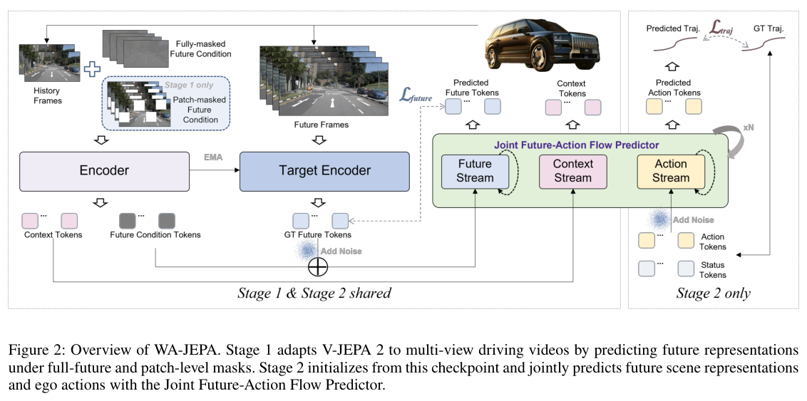
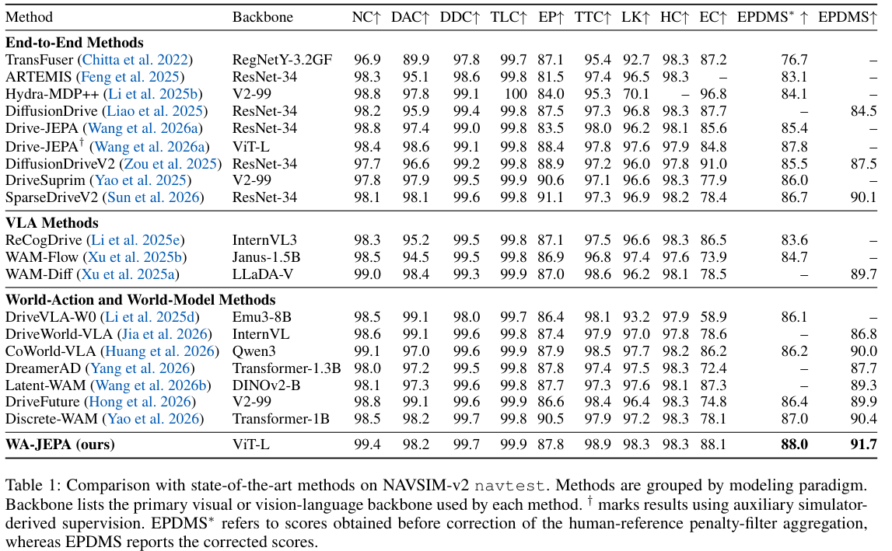

本期六项研究介绍 RDF 查询接口、关系抽取约束、机器人 Q 规划、测试时训练、驾驶世界动作模型与扩散优化器。

## 1. bikiDATA

RDF 数据探索 · [bikiDATA: A Python Library to Query and Explore Large-Scale RDF Datasets v1](https://arxiv.org/abs/2608.20358v1) · [全文](https://arxiv.org/html/2608.20358v1)

bikiDATA 用 DuckDB 存储转换后的 RDF 关系表，在 Python 中组合筛选、全文搜索与语义检索，并返回 Python 数据结构。接口的简化同时限制了表达范围，原文明确说明无法映射所有 SPARQL 查询。

扩展实验使用 500GB 内存、96 核服务器，与 QLever 在相同硬件上比较。作者选择 Sparqloscope 中耗时超过 3 秒的查询，预先转为 SQL，并以冷缓存计时。该比较只覆盖上述选定查询。[实现与实验范围](https://arxiv.org/html/2608.20358v1#S2)。

作为 Python 分析入口，它的支持范围值得按实际查询逐条确认，尤其是需要完整 SPARQL 语义的应用。

## 2. 关系抽取中的结构噪声

数据结构约束 · [Ontology-Driven Structural Regularization for Document-Level Relation Extraction v1](https://arxiv.org/abs/2608.20856v1) · [全文](https://arxiv.org/html/2608.20856v1)

论文清理 DocRED distant 中的结构冲突，在 ReDocRED 测试集评测。DREEAM-BERT 的 F1 从 0.3945 提高到 0.4488；删除同等数量三元组的随机对照为 0.4013，随机对照重复 10 个种子取均值。这里的 DREEAM 比较使用自训练后的学生模型，尚未进行后续人工数据微调。

*图 1｜Laura Menotti、Stefano Marchesin、Gianmaria Silvello，[v1 Table 3，PDF 第 8 页](https://arxiv.org/pdf/2608.20856v1#page=8)，[CC BY 4.0](https://creativecommons.org/licenses/by/4.0/)。裁剪自原文。括号内为相对提升或下降，非百分点。*

结构良构性有助于识别约束冲突，仍不能证明每条关系都受原文事实支持。数据清理的效果需要与语义正确性分开衡量。

## 3. Q-Planning：冻结动作策略，用价值函数吸收失败经验

Q-Planning 在冻结的行为克隆策略外增加较小的 off-policy Q 函数，对策略采样出的动作块做价值加权选择。部署产生的成功和失败都可更新 Q，而不需要把失败动作当作模仿目标，也不训练额外 actor。

十轮自改进后，LIBERO-10 从离线 Q-Planning 的 93% 到 99%，四十七项 RoboTwin 从 83.8% 到 91.4%；冻结 BC 的起点则分别为 90.0%、83.2%。LIBERO 每任务二十次试验、五百四十环境步预算，不能与原 FastWAM 的七百步结果直接混用。仿真使用每任务每轮一百条交互，收益并非没有额外执行数据。

[Beyond Imitation: Self-Improving Robot Policies via Off-Policy Q-Planning](https://arxiv.org/abs/2608.21204v1) · v1。

[Figure 1（原文）](https://arxiv.org/pdf/2608.21204v1#page=1)。

## 4. E²-TTT

测试时训练 · [Rethinking Expressivity and Efficiency in Test-Time Training v1](https://arxiv.org/abs/2608.21308v1) · [全文](https://arxiv.org/html/2608.21308v1)

E²-TTT 在梯度按块起始权重计算的近似下，推导块末快权重与动量的闭式更新。该等价性针对近似中的递推，不能扩大为每 token 重新计算梯度时的无条件等价。

| 1.3B 模型评测 | E²-TTT SwiGLU | 对照 |
|---|---:|---:|
| 16K，S-NIAH-1 准确率 | 93.6% | LaCT 3.0% |
| 2K，真实检索三任务平均分 | 43.6% | Transformer++ 53.3% |

模型从 FineWeb-Edu 的 15B tokens 从头训练，规模包括 340M、1.3B，chunk 大小 512。表中分别来自受控外推实验 Table 5 与真实检索 Table 3，不能把单针外推优势解释为所有检索任务占优。[设置与结果](https://arxiv.org/html/2608.21308v1#S5)。

这项工作展示了保留逐 token 更新结构的并行计算方法；实际选择仍需同时检查多事实检索、长文档表现与资源开销。

## 5. WA-JEPA：把视频预测改成面向驾驶行动的未来预测

WA-JEPA 用混合未来掩码替代随机补全，在潜变量上使用条件 flow matching，再联合去噪未来场景 token 与自车轨迹。动作监督直接塑造世界表示，让自监督视频特征更贴近驾驶规划所需的时间方向与多种可能未来。

*图｜Wang, Xinlin 等，[Figure 2（PDF 第 4 页）](https://arxiv.org/pdf/2608.20974v1#page=4)，[CC BY 4.0](http://creativecommons.org/licenses/by/4.0/)。裁剪自原文。*

nuPlan 预训练、NAVSIM 微调后，NAVSIM-v2 navtest 的修正 EPDMS 为 91.7，表中 Discrete-WAM 为 90.4。论文同时列出修正前的 EPDMS*，不能混排行；其 HUGSIM HD-Score 0.4462 又来自另一闭环协议。基准综合规划分数不能直接当作现实道路事故率或安全保证。

*图｜Wang, Xinlin 等，[Table 1（PDF 第 6 页）](https://arxiv.org/pdf/2608.20974v1#page=6)，[CC BY 4.0](http://creativecommons.org/licenses/by/4.0/)。裁剪自原文。*

[WA-JEPA: Rethinking the Video JEPA Paradigm for World-Action Modeling in Autonomous Driving](https://arxiv.org/abs/2608.20974v1) · v1。

## 6. Periodic Row-wise Muon：把昂贵谱更新分摊到多步

该方法每隔 K 步进行完整 Newton–Schulz 谱更新，其余步骤在分片动量上做行约束更新，再配合分桶通信和计算重叠。它希望保留 Muon 的优化优势，同时减少每一步都物化完整动量与矩阵迭代的成本。

32 个 H100 节点的 15B DiT 设置中，单步时间从 6.527 秒到 5.002 秒，优化器阶段从 2.884 秒到 1.317 秒；对应节省 23.4% 与 54.3%，口径不同。固定六万步的 FID 为 5.63，普通 Muon 为 5.57，表明速度收益仍可能伴随小幅质量取舍，不能把“最佳观察质量”和“同一步数质量”混用。

[Scaling Muon for Diffusion Transformers](https://arxiv.org/abs/2608.20818v1) · v1。

[Figure 1（原文）](https://arxiv.org/pdf/2608.20818v1#page=6)。
