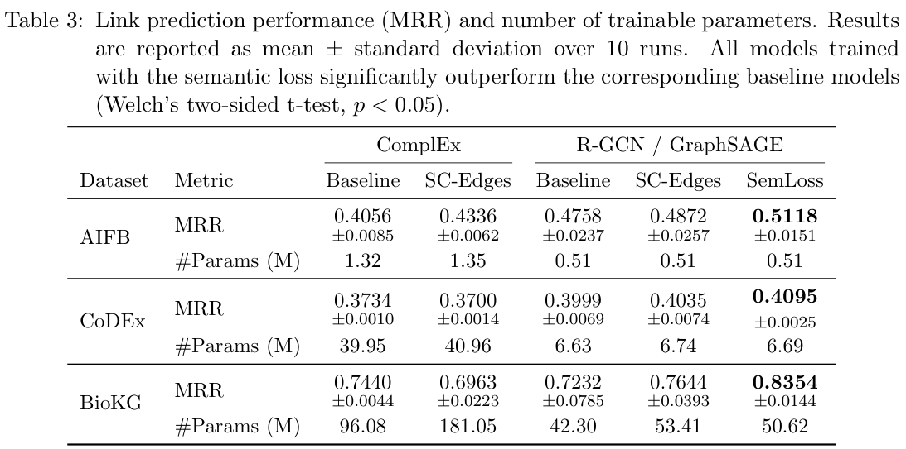
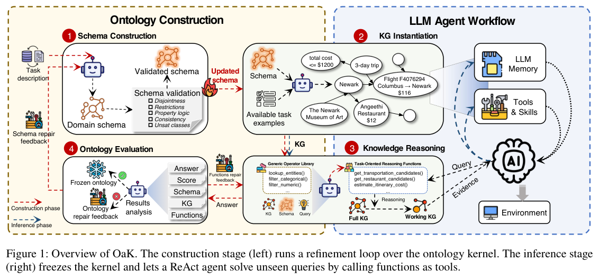
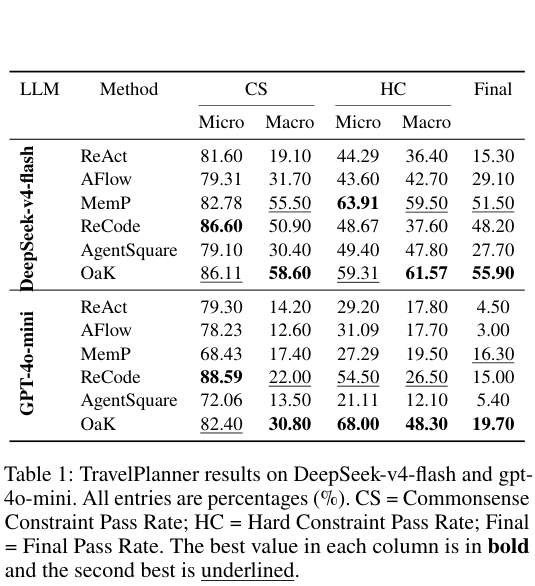
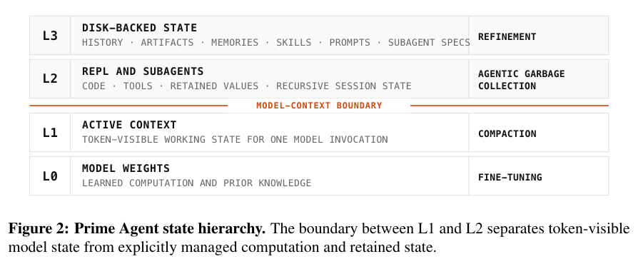
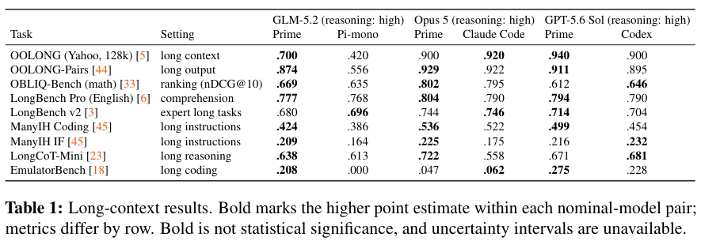
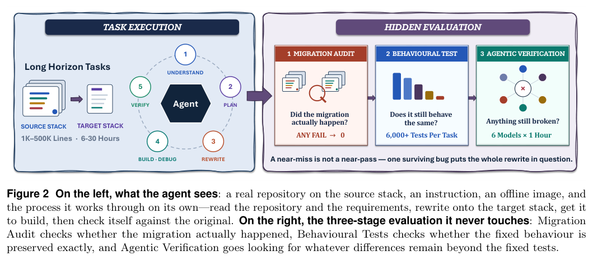
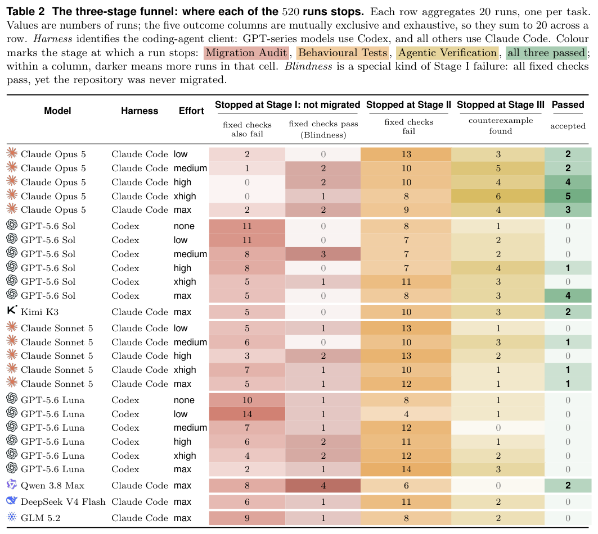
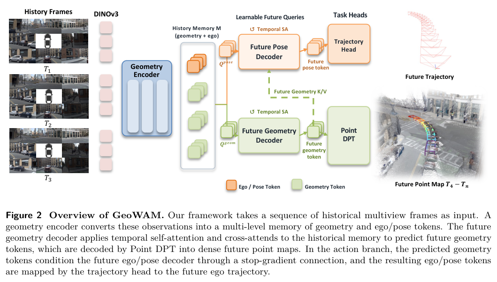
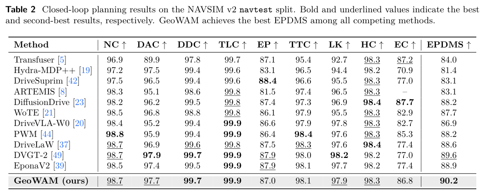

本期七项研究介绍层级损失、任务本体、持久执行框架、全模态世界生成、整仓库迁移、机器人记忆与驾驶几何预测。

## 1. 层级语义损失：让链接表示尊重本体结构

这项工作把 box embedding 的语义损失接到 GNN 编码器，鼓励表示满足本体类层级。对照不仅包括不使用层级的基线，也包括将 subClassOf 直接加入图的 SC-Edges，以区分两种注入方式。

AIFB、CoDEx-L 与 BioKG 的编码器按数据集选择，在固定模型配置下比较，Table 3 报十次训练的均值与标准差。GNN 基线到语义损失版本的 MRR：AIFB 0.4758→0.5118，CoDEx 0.3999→0.4095，BioKG 0.7232→0.8354；对应约 7.6%、2.4%、15.5% 是相对改善，不是百分点。

作者报告 Welch 双侧检验 p<0.05，但这只覆盖所测配置。评测候选负例也有数据集差异：AIFB、CoDEx 每条事实随机采样 1,000 个负例，BioKG 使用基准给定负例，不能将跨集 MRR 当成同等难度排名。

结构边与约束损失不是等价接口。落地前要检查层级覆盖、错层级的影响及参数预算，而不能把鼓励一致性误称为推理器已经证明所有预测符合本体。

图源：Filip Kronström , Ross D. King，《Hierarchy-Aware Semantic Losses for Knowledge Graph Link Prediction》，arXiv:2608.22981v1，Table 3，PDF 第 7 页。[原图出处](https://arxiv.org/pdf/2608.22981v1#page=7) · [CC BY 4.0](https://creativecommons.org/licenses/by/4.0/)。裁剪自原文。

- [Hierarchy-Aware Semantic Losses for Knowledge Graph Link Prediction](https://arxiv.org/abs/2608.22981v1) · v1，公开于 2026-08-24。

## 2. OaK：让任务本体与可执行推理函数一起演化

OaK 根据任务要求和训练数据构造本体及知识图谱，再生成适配该 schema 的检索、计算与推理函数。固定 judge 反馈同时修订语义结构和函数组合，使多步决策能利用显式概念、约束和关系。

*图｜Zhang, Xiaohui 等，[Figure 1（PDF 第 3 页）](https://arxiv.org/pdf/2608.22974v1#page=3)，[CC BY 4.0](http://creativecommons.org/licenses/by/4.0/)。裁剪自原文。*

TravelPlanner 的 DeepSeek-v4-flash 设置中，最终完整计划通过率为 55.9%，MemP 为 51.5%、ReAct 为 15.3%；OaK 的部分单约束指标仍低于其他方法。构建最多五轮、每轮抽取训练集 20%，judge 使用 Sonnet-4.6。可执行任务通过与形式本体完全正确是两种保证，评测也没有消除 judge 的偏差。

*图｜Zhang, Xiaohui 等，[Table 1（PDF 第 5 页）](https://arxiv.org/pdf/2608.22974v1#page=5)，[CC BY 4.0](http://creativecommons.org/licenses/by/4.0/)。裁剪自原文。*

[Toward Effective and Reliable LLM Agents via Dynamic Ontology](https://arxiv.org/abs/2608.22974v1) · v1。

## 3. Prime Agent：让持久 REPL 承接长程信息与计算

Prime Agent 用持久 IPython REPL 操作长上下文，并跨轨迹保留历史、记忆、skills、提示与子 Agent 规格。递归子 Agent 可以直接通信，执行框架记录恢复、完成门控和根任务及后代任务的资源消耗，策略仍由模型决定。

*图｜Karten, Seth 等，[Figure 2（PDF 第 4 页）](https://arxiv.org/pdf/2608.23552v1#page=4)，[CC BY 4.0](http://creativecommons.org/licenses/by/4.0/)。裁剪自原文。*

ARC-AGI-3 的观测配置中，Opus 5 配合 Prime 达到 RHAE 95.5；引用的原生框架 30.2 是外部报告值，且预算不同，不能视为受控的纯框架增益。长上下文配对里也有负例：GPT-5.6 Sol 在 OBLIQ nDCG@10 为 0.612，Codex 为 0.646。更自由的信息管理接口有潜力，但不会让每个模型与任务都获益。

*图｜Karten, Seth 等，[Table 1（PDF 第 7 页）](https://arxiv.org/pdf/2608.23552v1#page=7)，[CC BY 4.0](http://creativecommons.org/licenses/by/4.0/)。裁剪自原文。*

[Prime Agent: A Self-Improving RLM Harness](https://arxiv.org/abs/2608.23552v1) · v1。

## 4. EchoWM：用统一相机意图连接视频、声音与交互

EchoWM 将离散导航命令和连续位姿统一为带尺度的相对六自由度轨迹，联合生成 720p 视频、环境声音、音乐与语音。数据引擎组合游戏录制、网络游戏视频、引擎渲染和通用视频，逐步训练后再进行自回归长程后训练。

WBench 一百五十八项 Navigation 测试中，多步 EchoWM 综合分为 81.7，四步因果 Flash 为 81.0，均为归一化评价分而非任务成功率。SANA-WM-Bench 的短程困难轨迹上，EchoWM 视觉分更高，姿态误差却不如 SANA-WM。音画表现、轨迹跟随和长期状态一致性仍应分别看，第一与第三视角也依赖数据中的相机—角色关系。

[EchoWM: Open and Enterable Omnimodal World Models](https://arxiv.org/abs/2608.23189v1) · v1。

[Figure 1（原文）](https://arxiv.org/pdf/2608.23189v1#page=2)。

## 5. SWE Refactor Bench：测试通过以后，还要确认迁移真的发生

SWE Refactor Bench 包含二十项整仓库技术栈迁移，依次检查迁移完成度、固定行为测试，以及六个独立 Agent 生成的针对性反例。这样既能发现保留原实现逃避迁移的提交，也能发现通过固定测试但破坏其他行为的重写。

*图｜Hong, Deyao 等，[Figure 2（PDF 第 5 页）](https://arxiv.org/pdf/2608.23564v1#page=5)，[CC BY 4.0](http://creativecommons.org/licenses/by/4.0/)。裁剪自原文。*

八个模型、二十六种努力程度配置共五百二十次运行，只有二十八次通过三阶段，约 5.4%；二十项任务中十三项没有被接受的解答。最佳配置综合分 47.0/100 不是 47% 完整迁移成功率，最多接受五项。Agent 反例检查提高了覆盖，但仍不能证明没有所有潜在回归。

*图｜Hong, Deyao 等，[Table 2（PDF 第 7 页）](https://arxiv.org/pdf/2608.23564v1#page=7)，[CC BY 4.0](http://creativecommons.org/licenses/by/4.0/)。裁剪自原文。*

[SWE Refactor Bench: Can Coding Agents Complete a Long-Horizon, Whole-Repository Stack Migration?](https://arxiv.org/abs/2608.23564v1) · v1。

## 6. UniMem：把文本进度与视觉关键帧直接交给动作模型

UniMem 在同一骨干中连接高层多模态记忆和低层控制，用事件分类器决定更新，用关键帧保存空间信息，并缓存编码以减少重复计算。文本适合记操作次数和进度，视觉历史则保留原位置与遮挡前状态。

五项仿真的平均性能为 93.4，对照固定窗口视频为 68.2，但该均值包含子任务成功和连续空间精度，不是统一二元成功率。四项真机任务每项十五次试验，平均成功率为 80.0%，分层 MemER 为 43.5%；简单量尺任务两者同为 87%。记忆价值随任务而变，小样本和特定 xArm6 配置仍限制外推。

[UniMem: Unifying Multimodal Memory and Control for Vision-Language-Action Models](https://arxiv.org/abs/2608.22869v1) · v1。

[Figure 1（原文）](https://arxiv.org/pdf/2608.22869v1#page=1)。

## 7. GeoWAM：预测未来几何，再用几何动态规划驾驶轨迹

GeoWAM 以点图而不是 RGB 像素作为未来预测目标，让视觉几何编码器学习场景结构与运动，再由几何条件动作头预测自车轨迹。多源驾驶数据预训练提供三维结构与时间变化，规划阶段在 NAVSIM 上微调。

*图｜Lu, Yiren 等，[Figure 2（PDF 第 4 页）](https://arxiv.org/pdf/2608.23486v1#page=4)，[CC BY 4.0](http://creativecommons.org/licenses/by/4.0/)。裁剪自原文。*

nuScenes 八个未来帧的平均相对深度误差为 0.257，Epona 生成视频再接 DVGT 为 0.274；一秒处的阈值准确率却由 Epona 组合更高。NAVSIM-v2 navtest 的 EPDMS 为 90.2，navhard 两阶段伪闭环为 36.6。这些协议不同，也不是与别篇论文表值跨表直接排名的依据；几何预测改善仍需真实闭环验证。

*图｜Lu, Yiren 等，[Table 2（PDF 第 8 页）](https://arxiv.org/pdf/2608.23486v1#page=8)，[CC BY 4.0](http://creativecommons.org/licenses/by/4.0/)。裁剪自原文。*

[GeoWAM: Visual Geometry World Action Models for Autonomous Driving](https://arxiv.org/abs/2608.23486v1) · v1。
