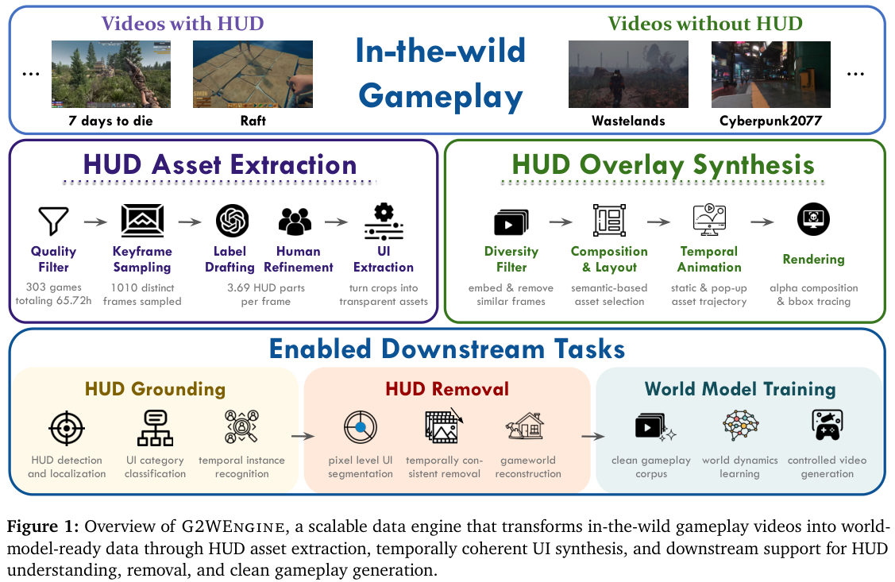
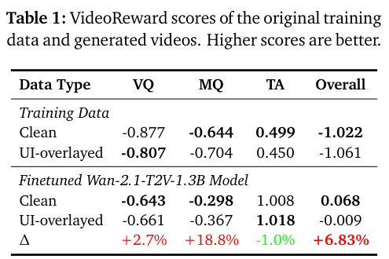

本期七项研究介绍 GQL 形式语义、字段映射、经验记忆、潜在规划、世界模型动作响应、三维高斯监督与游戏视频清理。

## 1. MGQL：用机械化语义检查图查询

MGQL 为 GQL 的一个较大只读片段建立小步操作语义与 schema-aware 类型系统，并在 Lean4 中机械化。它关注表达式、路径模式和完整查询流水线如何共同处理图作用域、重复结果、空值及量化路径绑定。

形式化包含多图、混合有向/无向边、复合查询、bag semantics 与列表类型。类型健全性结论说明：在所定义片段和前提下，良构查询完成求值后的结果符合静态分配的类型。它不是对完整 ISO GQL、任意数据库实现或查询终止性的无条件保证。

论文以 LDBC SNB Interactive v2 工作负载中的查询验证实现，实验关注语义覆盖而非运行时加速。

可执行参考语义为跨引擎差异提供了更明确的检查对象。使用时仍应核对覆盖的查询片段、路径/匹配模式与空值规则，不能将“标准有形式模型”直接当作当前产品已符合标准。

图源：Aditya Thimmaiah , Tong-Nong Lin , Milos Gligoric，《MGQL: An Executable, Small-Step Semantics of GQL》，arXiv:2608.24565v1，Figure 1，PDF 第 3 页。[原图出处](https://arxiv.org/pdf/2608.24565v1#page=3) · [CC BY 4.0](https://creativecommons.org/licenses/by/4.0/)。裁剪自原文。

- [MGQL: An Executable, Small-Step Semantics of GQL](https://arxiv.org/abs/2608.24565v1) · v1，公开于 2026-08-25。

## 2. CGM：先用治理约束缩小字段映射候选

CGM 将源字段到企业目录的映射拆成候选门控与语言判断。硬规则利用类型、取值域和业务治理要求排除明显不兼容项；级联放松与专家通道处理规则覆盖不足，再让模型比较剩余字段。

一百二十个合成源字段、12,094 个目标字段的实验中，GPT-5.4-mini 的集合级宏 F1 从全目录输入的 0.19 到硬门控的 0.66，候选约缩小 480 倍。规则筛选加普通列信息只有 0.32，规范化配置为 0.08，说明约束形式很关键。保留正确候选的结果依赖受控数据和放松机制，并不是任意企业规则都不会漏掉真实映射。

[Constraint-Guided Enterprise Data Mapping with Large Language Models](https://arxiv.org/abs/2608.24218v1) · v1。

[Figure 1（原文）](https://arxiv.org/pdf/2608.24218v1#page=4)。

## 3. Recuris：把工作状态与可复用经验分开维护

Recuris 用 Working Memory 跟踪当前任务状态，用 Experiential Memory 保存跨任务 skills；元 Agent 在局部验证后更新经验，避免一次失败就改写整个执行框架。它分别研究跨任务经验迁移与单任务内的迭代改进。

τ²-Bench 的四次采样平均结果中，GPT-5.6 Sol 的 Retail 从 58.3 到 76.1，Airline 从 79.0 到 86.0；但 Gemini 3.7 Flash 的 Airline 从 86.5 降到 85.0。三十七组完整配对里三十五组提高，经验更新仍有负例。这些跨任务分数与 Terminal-Bench 内部迭代实验属于不同设置，不能合并成通用提升率。

[Recursive Experiential-Working Memory Evolution for Long-Horizon Agent Harnesses](https://arxiv.org/abs/2608.24876v1) · v1。

[Figure 1（原文）](https://arxiv.org/pdf/2608.24876v1#page=1)。

## 4. LeFlow：直接生成潜在路径，再用世界模型筛选

LeFlow 在冻结的 LeWM 表示空间中学习 flow 路径，从当前状态到目标状态生成潜在计划。逆动力学头把路径恢复为动作，冻结世界模型再 rollout 并重排候选，减少在原动作空间反复采样搜索的负担。

同一 LeWM 下，TwoRoom 成功率由 CEM 的 82±2% 到 LeFlow 的 100±0%，PushT 从 89.3±6.4% 到 95.2±3.0%；结果报告五次独立评估运行。TwoRoom 上目标条件行为克隆同样达到 100%，因此不是每项都超过所有对照。路径表示、逆动力学与重排共同决定收益，离开训练分布的可达性仍要检查。

[LeFlow: Generative Latent Flow Planning for World Models](https://arxiv.org/abs/2608.24855v1) · v1。

[Figure 1（原文）](https://arxiv.org/pdf/2608.24855v1#page=1)。

## 5. WorldSync：让世界模型的动作条件真正产生干预效果

WorldSync 把覆盖扩展、动作条件专家和干预一致性训练组合起来。它希望模型不只生成看起来合理的视频，还能根据改变的动作生成相应状态变化；WorldEcho 用视觉完整性与 SE(3) 轨迹对齐，检查模型在专家轨迹之外是否仍响应动作。

五十项 RoboTwin 任务中，WorldSync 的 gated error 为 0.0661，扩展训练的 CtrlWorld 为 0.0670；但原始 NDTW 为 0.0223 对 0.0210，并非所有指标更好。真机叠杯从两者相同的 48% 起点，经过两轮后分别达到 68% 与 56%。各系统训练更新次数不同，结果不能单独归因于某一个损失项。

[Do Robotic World Models Really Follow Actions? Diagnosing and Aligning Action-Conditioned Generation for Policy Learning](https://arxiv.org/abs/2608.24885v1) · v1。

[Figure 1（原文）](https://arxiv.org/pdf/2608.24885v1#page=2)。

## 6. GaussianWAM：用三维高斯教师约束动作表示

GaussianWAM 将冻结几何与视觉教师的信息压入共享三维高斯表示，用语义、深度和覆盖监督训练当前观测特征，再蒸馏给世界动作模型。教师与高斯监督只在训练时使用，执行时保留动作模型。

FastWAM 七万步设置下，LIBERO-Plus 从 52.05 到 71.29，普通 LIBERO 从 96.6 到 97.6；已有 CLIP+VGGT 教师配置在 Plus 为 69.37，说明不能把全部增益都算作高斯结构的贡献。Cosmos 配置的 Plus 总分也提高，但背景扰动项从 77.51 降到 66.17，几何监督没有消除全部视觉分布变化。

[GaussianWAM: Distilling Geometry and Semantics from 3D Gaussian Fields into World-Action Models](https://arxiv.org/abs/2608.24714v1) · v1。

[Figure 1（原文）](https://arxiv.org/pdf/2608.24714v1#page=2)。

## 7. Game2World：先去掉界面覆盖，再学习游戏动态

Game2World 的数据引擎把游戏 HUD 按功能分类，提取界面资产，合成时间一致的覆盖数据，再训练无掩码视频编辑器 GameCleaner。去除界面时既要删除 UI，也要保留底层场景与运动，单看画面干净程度不足以判断数据质量。

*图｜Shen, Wenxuan 等，[Figure 1（PDF 第 1 页）](https://arxiv.org/pdf/2608.24680v1#page=1)，[CC BY 4.0](http://creativecommons.org/licenses/by/4.0/)。裁剪自原文。*

数据包含 21 类、5,132 个 UI 资产，约九万六千对合成样本与来自三百零三款游戏的 1,079 段真实片段。5,442 段同游戏视频的先导实验中，Wan2.1-T2V-1.3B 用干净视频训练后的 VideoReward 总体分为 0.068，UI 覆盖视频为 −0.009；该实验是文本到视频训练，没有训练动作条件控制，不能据此宣称机器人规划提升。

*图｜Shen, Wenxuan 等，[Table 1（PDF 第 4 页）](https://arxiv.org/pdf/2608.24680v1#page=4)，[CC BY 4.0](http://creativecommons.org/licenses/by/4.0/)。裁剪自原文。*

[Game2World Engine: Unlocking In-the-Wild Gameplay Videos for World Model Training](https://arxiv.org/abs/2608.24680v1) · v1。
