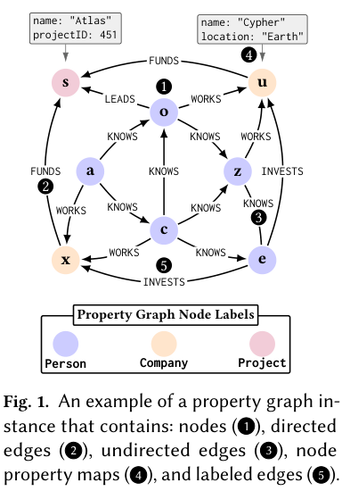

## 从规范文字到机械化语义

MGQL 为 GQL 的一个较大只读片段建立小步操作语义与 schema-aware 类型系统，并在 Lean4 中机械化。它关注表达式、路径模式和完整查询流水线如何共同处理图作用域、重复结果、空值及量化路径绑定。

## 保证的范围是什么

形式化包含多图、混合有向/无向边、复合查询、bag semantics 与列表类型。类型健全性结论说明：在所定义片段和前提下，良构查询完成求值后的结果符合静态分配的类型。它不是对完整 ISO GQL、任意数据库实现或查询终止性的无条件保证。

论文以 LDBC SNB Interactive v2 工作负载中的查询验证实现，没有训练新语言模型，也没有一个可写成生产引擎吞吐提升的数字。配图只是原文属性图实例，帮助理解边方向、标签和属性，不是性能结果。

## 我的判断

可执行参考语义为跨引擎差异提供了更明确的检查对象。使用时仍应核对覆盖的查询片段、路径/匹配模式与空值规则，不能将“标准有形式模型”直接当作当前产品已符合标准。

## 论文图表

图源：Aditya Thimmaiah , Tong-Nong Lin , Milos Gligoric，《MGQL: An Executable, Small-Step Semantics of GQL》，arXiv:2608.24565v1，Figure 1，PDF 第 3 页。[原图出处](https://arxiv.org/pdf/2608.24565v1#page=3) · [CC BY 4.0](https://creativecommons.org/licenses/by/4.0/)。仅裁剪原页面，保留完整图表、图注和必要标签，未重绘或修改数据，不表示作者认可本解读。图片沿用其原许可，本站页脚许可不为它增加非商业或其他限制。

## 论文来源

- [MGQL: An Executable, Small-Step Semantics of GQL](https://arxiv.org/abs/2608.24565v1) · v1，公开于 2026-08-25。

## 同日阅读目录

- [MGQL: An Executable, Small-Step Semantics of GQL](https://arxiv.org/abs/2608.24565v1) · v1，2026-08-25。
- [Constraint-Guided Enterprise Data Mapping with Large Language Models](https://arxiv.org/abs/2608.24218v1) · v1，2026-08-25。
- [Recursive Experiential-Working Memory Evolution for Long-Horizon Agent Harnesses](https://arxiv.org/abs/2608.24876v1) · v1，2026-08-25。
- [LeFlow: Generative Latent Flow Planning for World Models](https://arxiv.org/abs/2608.24855v1) · v1，2026-08-25。
- [Do Robotic World Models Really Follow Actions? Diagnosing and Aligning Action-Conditioned Generation for Policy Learning](https://arxiv.org/abs/2608.24885v1) · v1，2026-08-25。
- [GaussianWAM: Distilling Geometry and Semantics from 3D Gaussian Fields into World-Action Models](https://arxiv.org/abs/2608.24714v1) · v1，2026-08-25。
- [Game2World Engine: Unlocking In-the-Wild Gameplay Videos for World Model Training](https://arxiv.org/abs/2608.24680v1) · v1，2026-08-25。

文中实验结果为论文作者报告，未独立复现。
