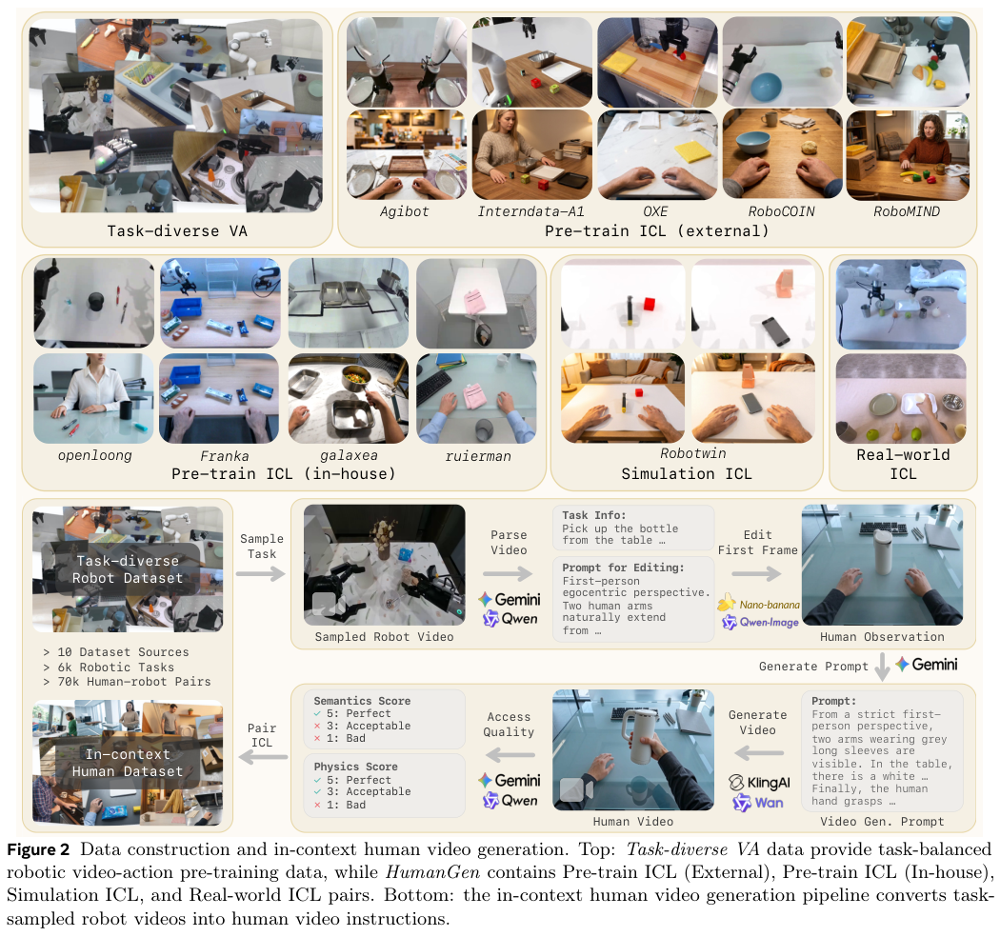
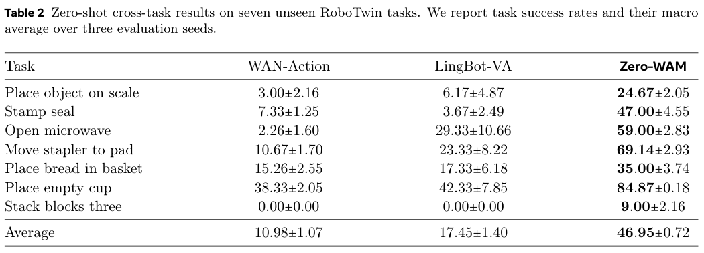
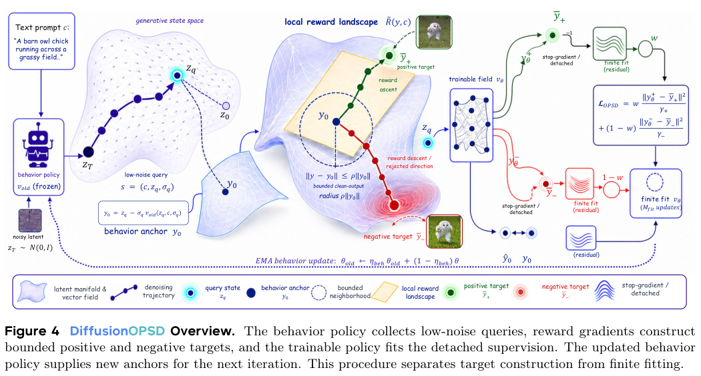
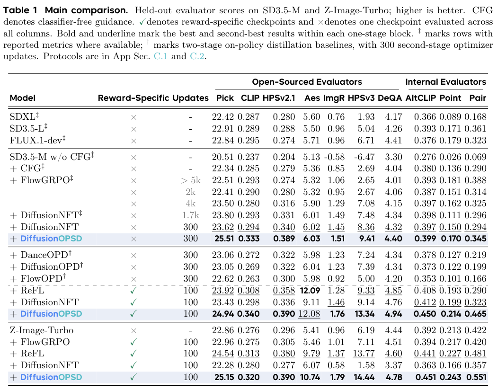

本期六项研究介绍时序弱信号、分片图谱问答、程序世界模型、人类视频动作提示、滑动上下文与扩散自蒸馏。

## 1. C-Unseen：沿时间关系寻找弱信号

C-Unseen 在动态时序图谱中寻找与主叙事有张力的罕见子图，再跨快照跟踪其持续出现。这里的弱信号是作者定义的语义和时序对象，不是任意低频词，也不是未来一定发生的预言。

Wiki-OpenAI 包含 2015—2025 年事实，757 条来自维基编辑，另人工补入 16 条，总计 773 条，并标注五个强信号。模型为 gpt-5.4-mini-2026-03-17。Table 3 中共享锚词门槛 k=1 时，C-Unseen 的 F1 为 0.613±0.061，BEAM 为 0.682；到 k=2 时，二者为 0.432±0.059 与 0.083。

C-Unseen 与 BERTrend 报五次运行均值及样本标准差，BEAM、Yoon 为确定性单次结果。门槛改变会改变覆盖和匹配难度，不能宣称所有条件都领先。单组织历史、人工补事实及事后信号标注也限制外推。

解释性输出可以帮助分析，但解释文本本身不证明预测能力。应在前瞻、未见组织与固定时间窗口下检查误报、遗漏和提前量，并将匹配阈值作为评测协议公开。

图源：Yassir Lairgi , Ludovic Moncla , Khalid Benabdeslem , Rémy Cazabet , Pierre Cléau，《C-Unseen: Weak Signal Detection in Dynamic Temporal Knowledge Graphs via LLM Reasoning》，arXiv:2608.26870v1，Table 3，PDF 第 10 页。[原图出处](https://arxiv.org/pdf/2608.26870v1#page=10) · [CC BY 4.0](https://creativecommons.org/licenses/by/4.0/)。裁剪自原文。

- [C-Unseen: Weak Signal Detection in Dynamic Temporal Knowledge Graphs via LLM Reasoning](https://arxiv.org/abs/2608.26870v1) · v1，公开于 2026-08-27。

## 2. FedV-KGQA：关系分片图谱上的联合问答表示

FedV-KGQA 让各参与方保留关系分片和本地知识图谱嵌入，通过共享实体嵌入的拼接表示，把冻结文本编码器的问句投影到联合空间。建立联合表示后，查询推理无需每次向各分片通信，但训练仍交换相应梯度。

BERT+TransE 在三个、五个、七个分片时，MetaQA 的 MRR 分别为 0.76、0.83、0.74，WebQSP 为 0.54、0.52、0.51，分片增多不保证更好。WebQSP 候选中约 78% 包含正确答案，候选覆盖本身已限制效果。原三元组不外传并不等于形式隐私保证：实体嵌入仍共享，分片顺序和参与方变化也可能要求重新训练投影。

[FedV-KGQA: Multi-Hop Question Answering over Vertically Partitioned Knowledge Graphs](https://arxiv.org/abs/2608.24846v1) · v1。

[Figure 1（原文）](https://arxiv.org/pdf/2608.24846v1#page=2)。

## 3. Code World Model：让程序管状态，让视频模型管外观

Code World Model 用 coding Agent 维护持续场景状态、规则和事件，再渲染逐帧代理视频，引导 MiniMax-H3 生成最终画面。程序层提供可检查的状态转移，生成层负责丰富外观，避免完全依赖视频模型隐式保存长期规则。

实现中的代理在每个空间维度使用四分之一分辨率，约为原空间 token 的十六分之一；这不是整个系统计算量减少十六倍。论文用五小时 GTA V 录制微调，并展示不同人物、风格和相机轨迹的定性结果。当前只实现一种代理设计，动态切换代理带宽仍是后续方向，展示也不足以证明任意长程规则都稳定正确。

[Code World Model: Coding Agent as World Brain](https://arxiv.org/abs/2608.25927v1) · v1。

[Figure 1（原文）](https://arxiv.org/pdf/2608.25927v1#page=1)。

## 4. Zero-WAM：用人类视频示范提示机器人动作

Zero-WAM 在同一因果视频—动作模型里接受语言或人类视频提示，以交互式未来预测任务促使模型真正读取示范。HumanGen 从机器人轨迹生成配对人类视频，让动作条件与示范视觉之间有可学习的联系。

*图｜Zhou, Jiaming 等，[Figure 2（PDF 第 4 页）](https://arxiv.org/pdf/2608.26103v1#page=4)，[CC BY 4.0](http://creativecommons.org/licenses/by/4.0/)。裁剪自原文。*

HumanGen 约含 74.2k 对视频—轨迹、8.6k 项任务和超过四十五种机器人形态。七项未见 RoboTwin 任务上，三组评估种子的宏平均成功率为 46.95±0.72%，LingBot-VA 为 17.45±1.40%；但三块堆叠仍约 9%。这些结果依赖大规模配对预训练和任务定义，不能把零样本理解成没有示范、没有先验或所有对象配置都可靠。

*图｜Zhou, Jiaming 等，[Table 2（PDF 第 11 页）](https://arxiv.org/pdf/2608.26103v1#page=11)，[CC BY 4.0](http://creativecommons.org/licenses/by/4.0/)。裁剪自原文。*

[Zero-WAM: In-Context World-Action Modeling from Human Videos for Open-Ended Task Generalization](https://arxiv.org/abs/2608.26103v1) · v1。

## 5. PrefixSliding：保留任务前缀，把长程计算限制在滑动窗口

PrefixSliding 保留系统指令、工具定义等固定前缀与最近窗口，丢弃中间历史，并用 ContinuePE 维持缓存与位置处理。训练端配合截断反向传播，让模型能在有限显存中经历比更新窗口更长的交互。

单张 H100 80GB、1,024 条序列、vLLM 自动批处理和 4,096 token 窗口的测试中，长序列吞吐稳定在约每秒五千 token；全注意力的资源需求则继续随历史增长。八千窗口与完整八千上下文相近的内存占用支持更长交互，但不表示总计算相同。丢弃历史和截断梯度都是近似，不能保证关键中间证据始终被保留。

[Prefix Sliding for efficient test-time scaling](https://arxiv.org/abs/2608.26070v1) · v1。

[Figure 1（原文）](https://arxiv.org/pdf/2608.26070v1#page=1)。

## 6. DiffusionOPSD：先构造有界目标，再做有限步自蒸馏

DiffusionOPSD 让冻结行为策略产生查询点与干净输出锚点，根据奖励梯度构造有界正负目标，再由可训练模型拟合已分离的监督。完成有限次拟合后才用指数滑动平均刷新行为策略，避免目标随着每步更新同时漂移。

*图｜Zhou, Wei 等，[Figure 4（PDF 第 7 页）](https://arxiv.org/pdf/2608.24646v1#page=7)，[CC BY 4.0](http://creativecommons.org/licenses/by/4.0/)。裁剪自原文。*

SD3.5-M 的单一共享检查点、三百次更新设置下，PickScore 为 25.51，DiffusionNFT 为 23.62；CLIPScore 为 0.333 对 0.294。另一个按奖励分别训练一百步的设置里，美学分 12.08 略低于 ReFL 的 12.09。共享检查点与按奖励挑选检查点不能混用，奖励评估器改善也不等于所有视觉质量与事实正确性同时提高。

*图｜Zhou, Wei 等，[Table 1（PDF 第 11 页）](https://arxiv.org/pdf/2608.24646v1#page=11)，[CC BY 4.0](http://creativecommons.org/licenses/by/4.0/)。裁剪自原文。*

[On-Policy Self-Distillation in Diffusion Models](https://arxiv.org/abs/2608.24646v1) · v1。
