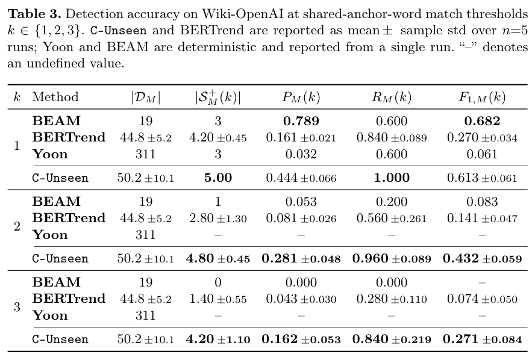

本文补录 **2026-08-28 的精选阅读**，于 2026-10-29 核对公开原文。归档日不是发表日；本文固定使用下列 v1，不混入后续修订。数字为作者报告，本站未独立复现。

## 把罕见事实放回时间和关系中

C-Unseen 在动态时序图谱中寻找与主叙事有张力的罕见子图，再跨快照跟踪其持续出现。这里的弱信号是作者定义的语义和时序对象，不是任意低频词，也不是未来一定发生的预言。

## 一个小基准中的不同权衡

Wiki-OpenAI 包含 2015—2025 年事实，757 条来自维基编辑，另人工补入 16 条，总计 773 条，并标注五个强信号。模型为 gpt-5.4-mini-2026-03-17。Table 3 中共享锚词门槛 k=1 时，C-Unseen 的 F1 为 0.613±0.061，BEAM 为 0.682；到 k=2 时，二者为 0.432±0.059 与 0.083。

C-Unseen 与 BERTrend 报五次运行均值及样本标准差，BEAM、Yoon 为确定性单次结果。门槛改变会改变覆盖和匹配难度，不能宣称所有条件都领先。单组织历史、人工补事实及事后信号标注也限制外推。

## 我的判断

解释性输出可以帮助分析，但解释文本本身不证明预测能力。应在前瞻、未见组织与固定时间窗口下检查误报、遗漏和提前量，并将匹配阈值作为评测协议公开。

## 原论文视觉证据

图源：Yassir Lairgi , Ludovic Moncla , Khalid Benabdeslem , Rémy Cazabet , Pierre Cléau，《C-Unseen: Weak Signal Detection in Dynamic Temporal Knowledge Graphs via LLM Reasoning》，arXiv:2608.26870v1，Table 3，PDF 第 10 页。[原图出处](https://arxiv.org/pdf/2608.26870v1#page=10) · [CC BY 4.0](https://creativecommons.org/licenses/by/4.0/)。裁剪自原文。

## 深读原文与范围

- [C-Unseen: Weak Signal Detection in Dynamic Temporal Knowledge Graphs via LLM Reasoning](https://arxiv.org/abs/2608.26870v1) · v1，公开于 2026-08-27。

本篇深读上述 1 篇；以下是同日公开阅读入口，仅核对标题、版本日期和来源，未逐篇核验实验。

## 同日阅读目录

- [C-Unseen: Weak Signal Detection in Dynamic Temporal Knowledge Graphs via LLM Reasoning](https://arxiv.org/abs/2608.26870v1) · v1，2026-08-27。
- [FedV-KGQA: Multi-Hop Question Answering over Vertically Partitioned Knowledge Graphs](https://arxiv.org/abs/2608.24846v1) · v1，2026-08-25。
- [Code World Model: Coding Agent as World Brain](https://arxiv.org/abs/2608.25927v1) · v1，2026-08-26。
- [Zero-WAM: In-Context World-Action Modeling from Human Videos for Open-Ended Task Generalization](https://arxiv.org/abs/2608.26103v1) · v1，2026-08-26。
- [Prefix Sliding for efficient test-time scaling](https://arxiv.org/abs/2608.26070v1) · v1，2026-08-26。
- [On-Policy Self-Distillation in Diffusion Models](https://arxiv.org/abs/2608.24646v1) · v1，2026-08-25。
