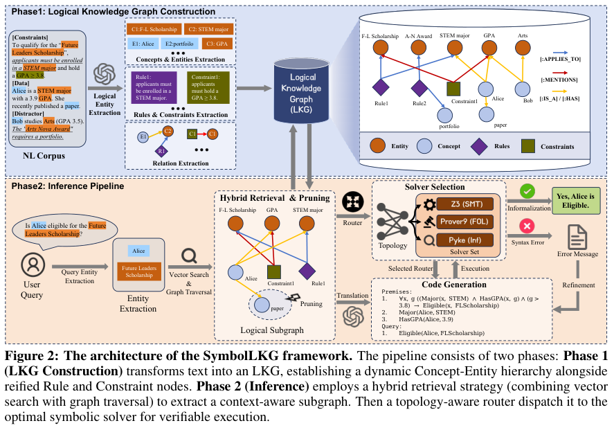
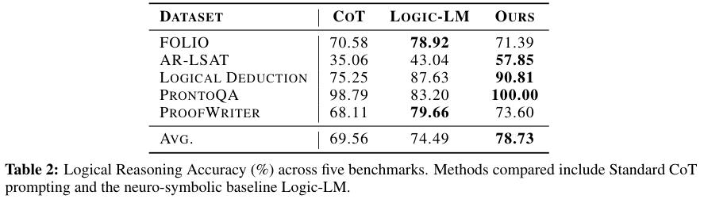
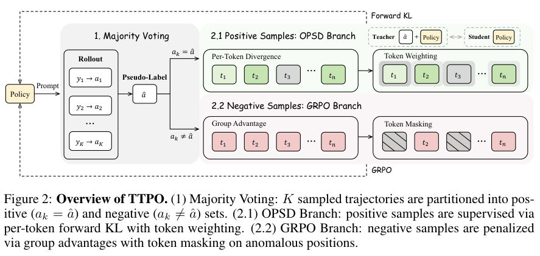
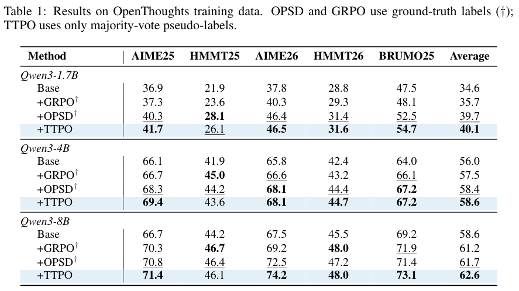
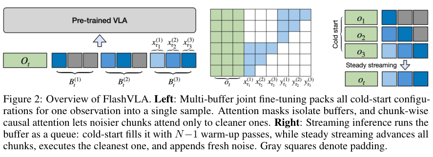
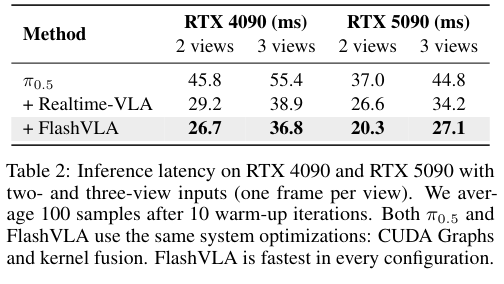
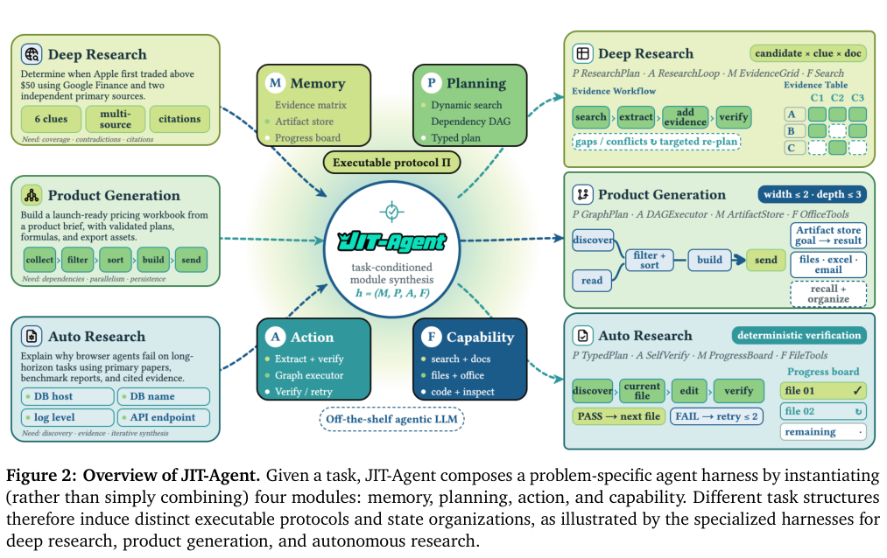
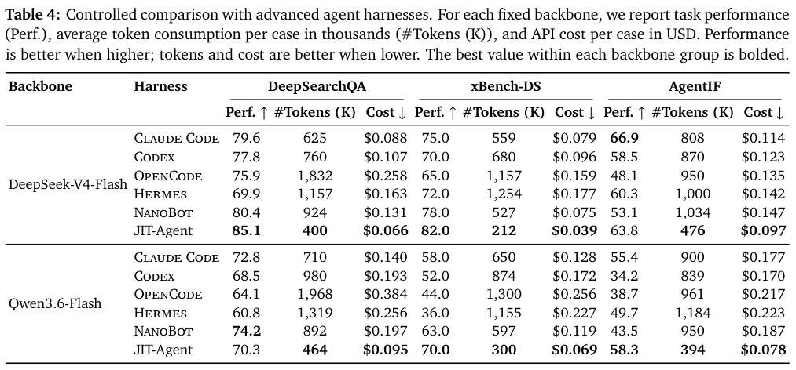

本期七项研究介绍本体学习、逻辑图谱、科学协作、测试时优化、流式动作、灵巧手预训练与即时执行框架。

## 1. pro-team：以检索与词表过滤学习本体

pro-team 的 LLMs4OL 方案使用 Qwen2.5-14B-Instruct、all-MiniLM-L6-v2 与 FAISS，Task A 检索 top-5、Task B top-2。生成后对 Task B 做确定性词表过滤：至少一个端点在样本闭合词表内，且删除初始本体重复项。

Task B 的 Semantic Graph Similarity 为 0.8692，term typing F1 为 0.9200，taxonomy discovery F1 为 0.8540；非分类关系抽取的 precision、recall、F1 却全部为 0。Task A 的 Semantic Graph Similarity 为 0.7416，但 exact match graph similarity 只有 0.5353。

因此高语义相似度不能解释为全部本体结构正确，端点词表约束也不等于每个关系语义正确。论文还承认缺少严格消融，无法单独量化 RAG、规则与过滤各自贡献。

有界词表适合约束输出，但也可能把系统锁在已有分类关系上。复现应按任务和关系类型拆分指标，保留未抽出关系的负结果，而不是只展示最高 F1。

图源：Shivam Mishra , Dhannu Ram Meena , Muneendra Ojha , Krishna Pratap Singh , Kuldeep Singh，《pro-team at LLMs4OL 2026 Tasks Flagship and Reuse: Retrieval-Augmented Generation and Vocabulary-Constrained Filtering for Ontology Learning》，arXiv:2608.27101v1，Table 2，PDF 第 10 页。[原图出处](https://arxiv.org/pdf/2608.27101v1#page=10) · [CC BY 4.0](https://creativecommons.org/licenses/by/4.0/)。裁剪自原文。

- [pro-team at LLMs4OL 2026 Tasks Flagship and Reuse: Retrieval-Augmented Generation and Vocabulary-Constrained Filtering for Ontology Learning](https://arxiv.org/abs/2608.27101v1) · v1，公开于 2026-08-27。

## 2. SymbolLKG：把规则与约束也建成可检索对象

SymbolLKG 将实体、概念、推导规则和算术约束分别建模，用层级与拓扑混合检索寻找相关子图，再把形式化问题路由给 Z3、Prover9 或 Pyke。语言模型主要负责抽取与翻译，符号引擎负责已编码问题的求解。

*图｜Fan, Haizhao 等，[Figure 2（PDF 第 3 页）](https://arxiv.org/pdf/2608.26836v1#page=3)，[CC BY 4.0](http://creativecommons.org/licenses/by/4.0/)。裁剪自原文。*

Llama-3.3-70B 设置中，五项逻辑基准的平均准确率为 78.73%，Logic-LM 为 74.49%；AR-LSAT 为 57.85% 对 43.04%。但 FOLIO 为 71.39% 对 78.92%，ProofWriter 为 73.60% 对 79.66%，并非全面领先。求解器证明的是形式编码的结论，不能反向保证文本抽取与约束翻译没有错误。

*图｜Fan, Haizhao 等，[Table 2（PDF 第 6 页）](https://arxiv.org/pdf/2608.26836v1#page=6)，[CC BY 4.0](http://creativecommons.org/licenses/by/4.0/)。裁剪自原文。*

[SymbolLKG: Towards Verifiable Logical Reasoning via Logical Knowledge Graph and Symbolic Solvers](https://arxiv.org/abs/2608.26836v1) · v1。

## 3. Gemini 科学协作：把实验建议与真实研究执行分开看

这项 co-scientist 工作让 Gemini 参与材料、生物与计算机科学研究，把假设、实验方案、结果分析和研究文稿接到领域人员的工作流。不同学科提供的自主性与反馈条件不同，不能统一称为从头到尾无人参与。

材料工作仍由人员执行和表征，Ti₃C₂Tₓ 的原子相尚未最终确认；生物实验也由人员开展湿实验与指导，四项形态指标中三项匹配。计算机科学中的架构搜索在初始指令后自主进行，另有三十位专家完成四百五十次双盲评审。它展示跨学科研究辅助能力，尚不构成所有发现都独立复现或所有实验环节都自动化的证据。

[Accelerating Scientific Research with Gemini in the Real-World](https://arxiv.org/abs/2608.26701v1) · v1。

[Figure 1（原文）](https://arxiv.org/pdf/2608.26701v1#page=3)。

## 4. TTPO：同意多数答案与反对多数答案，采用不同更新

TTPO 先从多条采样轨迹投票得到伪标签，把同意多数答案的轨迹交给 on-policy 自蒸馏，把不同意的轨迹交给强化学习，并按 token 选择学习信号。目标是避免错误多数标签把全部轨迹都推向同一种答案。

*图｜Wang, Aozhe 等，[Figure 2（PDF 第 4 页）](https://arxiv.org/pdf/2608.27448v1#page=4)，[CC BY 4.0](http://creativecommons.org/licenses/by/4.0/)。裁剪自原文。*

OpenThoughts 问题上的五项数学评测采用十二次采样平均，Qwen3-1.7B 从 34.6 到 40.1，带真实标签的 OPSD 为 39.7；8B 从 58.6 到 62.6。TTPO 选取一百步内检查点，GRPO 对照训练五百步，预算和选点需一起看。这是使用现成问题、预训练模型与投票监督的无答案标签训练，并不是没有监督来源。

*图｜Wang, Aozhe 等，[Table 1（PDF 第 6 页）](https://arxiv.org/pdf/2608.27448v1#page=6)，[CC BY 4.0](http://creativecommons.org/licenses/by/4.0/)。裁剪自原文。*

[TTPO: Test-Time Policy Optimization](https://arxiv.org/abs/2608.27448v1) · v1。

## 5. FlashVLA：用不同噪声阶段的动作块实现流式控制

FlashVLA 让多个动作块处在不同去噪阶段，通过块级因果注意力联合训练，每步输出一个已完成动作块。它同时处理冷启动与连续控制，减少等待整条动作序列完全去噪才开始执行的延迟。

*图｜Li, Zekai 等，[Figure 2（PDF 第 4 页）](https://arxiv.org/pdf/2608.27384v1#page=4)，[CC BY 4.0](http://creativecommons.org/licenses/by/4.0/)。裁剪自原文。*

RTX 4090、两路相机输入下，单次调用从 π0.5 的 45.8 毫秒到 26.7 毫秒；三路输入为 55.4 到 36.8 毫秒，两者都使用相同 CUDA graphs 和融合优化。RoboTwin 的异步端到端加速只有约 1.08—1.10 倍，因为渲染与通信占大部分时间。同步成功率也有改善，但推理毫秒数不能直接换成整个机器人任务的同倍提速。

*图｜Li, Zekai 等，[Table 2（PDF 第 7 页）](https://arxiv.org/pdf/2608.27384v1#page=7)，[CC BY 4.0](http://creativecommons.org/licenses/by/4.0/)。裁剪自原文。*

[FlashVLA: Streaming Action Decoding for Fast and Asynchronous VLA Inference](https://arxiv.org/abs/2608.27384v1) · v1。

## 6. SPD：用仿真遥操作预训练灵巧双手

SPD 从仿真遥操作中学习策略，再用少量真实机器人数据适配高自由度双臂操作。五人一周采集约七十五小时仿真数据，真机微调约一至两小时，把大量交互学习留在可重复的模拟环境。

Table 1 的窗口 32、动作块 8 设置中，叠盘的任务进度为 80.6，行为克隆为 66.9；杯子任务为 55.6 对 35.0。这是任务进度分而非全部完成成功率。真实物体仍接近仿真对象，数据多样性有限，也保留真实微调需求，不能称为完全不使用真机数据的迁移。

[Pre-training Visual Dexterity in Simulation](https://arxiv.org/abs/2608.15917v1) · v1。

[Figure 1（原文）](https://arxiv.org/pdf/2608.15917v1#page=2)。

## 7. JIT-Agent：为当前任务即时生成执行框架

JIT-Agent 用记忆、规划、行动和能力编排四模块协议组织执行框架，从十三个手写种子学习任务条件生成，再通过有界修复与在线档案积累可复用结构。它选择和实例化执行方式，而不只是替换某个固定提示。

*图｜Zhang, Guibin 等，[Figure 2（PDF 第 3 页）](https://arxiv.org/pdf/2608.25593v1#page=3)，[CC BY 4.0](http://creativecommons.org/licenses/by/4.0/)。裁剪自原文。*

固定 DeepSeek-V4-Flash 的比较中，DeepSearchQA 得分为 85.1，Claude Code 为 79.6；平均每题消耗四十万对六十二万五千 token。xBench-DS 为 82.0 对 75.0，但 AgentIF 为 63.8，低于 Claude Code 的 66.9。不同任务的最优框架仍不同，成本还包含调用方式和运行协议，不能把跨骨干比较解释为模型权重的直接增益。

*图｜Zhang, Guibin 等，[Table 4（PDF 第 13 页）](https://arxiv.org/pdf/2608.25593v1#page=13)，[CC BY 4.0](http://creativecommons.org/licenses/by/4.0/)。裁剪自原文。*

[JIT-Agent: Scaling Harness Intelligence via Just-in-Time Harness Evolution](https://arxiv.org/abs/2608.25593v1) · v1。
