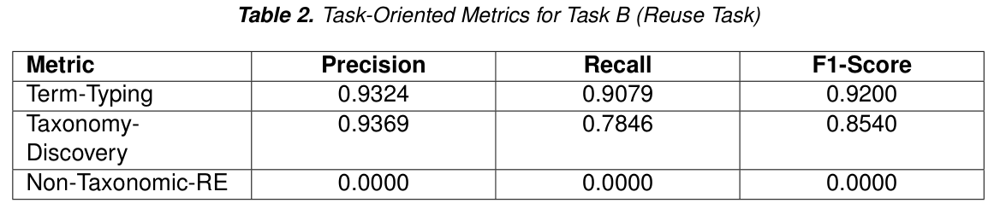

## 检索和词表过滤各做一部分工作

pro-team 的 LLMs4OL 方案使用 Qwen2.5-14B-Instruct、all-MiniLM-L6-v2 与 FAISS，Task A 检索 top-5、Task B top-2。生成后对 Task B 做确定性词表过滤：至少一个端点在样本闭合词表内，且删除初始本体重复项。

## 多个指标不能合成万能正确率

Task B 的 Semantic Graph Similarity 为 0.8692，term typing F1 为 0.9200，taxonomy discovery F1 为 0.8540；非分类关系抽取的 precision、recall、F1 却全部为 0。Task A 的 Semantic Graph Similarity 为 0.7416，但 exact match graph similarity 只有 0.5353。

因此高语义相似度不能解释为全部本体结构正确，端点词表约束也不等于每个关系语义正确。论文还承认缺少严格消融，无法单独量化 RAG、规则与过滤各自贡献。

## 我的判断

有界词表适合约束输出，但也可能把系统锁在已有分类关系上。复现应按任务和关系类型拆分指标，保留未抽出关系的负结果，而不是只展示最高 F1。

## 论文图表

图源：Shivam Mishra , Dhannu Ram Meena , Muneendra Ojha , Krishna Pratap Singh , Kuldeep Singh，《pro-team at LLMs4OL 2026 Tasks Flagship and Reuse: Retrieval-Augmented Generation and Vocabulary-Constrained Filtering for Ontology Learning》，arXiv:2608.27101v1，Table 2，PDF 第 10 页。[原图出处](https://arxiv.org/pdf/2608.27101v1#page=10) · [CC BY 4.0](https://creativecommons.org/licenses/by/4.0/)。仅裁剪原页面，保留完整图表、图注和必要标签，未重绘或修改数据，不表示作者认可本解读。图片沿用其原许可，本站页脚许可不为它增加非商业或其他限制。

## 论文来源

- [pro-team at LLMs4OL 2026 Tasks Flagship and Reuse: Retrieval-Augmented Generation and Vocabulary-Constrained Filtering for Ontology Learning](https://arxiv.org/abs/2608.27101v1) · v1，公开于 2026-08-27。

## 同日阅读目录

- [pro-team at LLMs4OL 2026 Tasks Flagship and Reuse: Retrieval-Augmented Generation and Vocabulary-Constrained Filtering for Ontology Learning](https://arxiv.org/abs/2608.27101v1) · v1，2026-08-27。
- [SymbolLKG: Towards Verifiable Logical Reasoning via Logical Knowledge Graph and Symbolic Solvers](https://arxiv.org/abs/2608.26836v1) · v1，2026-08-27。
- [Accelerating Scientific Research with Gemini in the Real-World](https://arxiv.org/abs/2608.26701v1) · v1，2026-08-27。
- [TTPO: Test-Time Policy Optimization](https://arxiv.org/abs/2608.27448v1) · v1，2026-08-27。
- [FlashVLA: Streaming Action Decoding for Fast and Asynchronous VLA Inference](https://arxiv.org/abs/2608.27384v1) · v1，2026-08-27。
- [Pre-training Visual Dexterity in Simulation](https://arxiv.org/abs/2608.15917v1) · v1，2026-08-16。
- [JIT-Agent: Scaling Harness Intelligence via Just-in-Time Harness Evolution](https://arxiv.org/abs/2608.25593v1) · v1，2026-08-26。

文中实验结果为论文作者报告，未独立复现。
