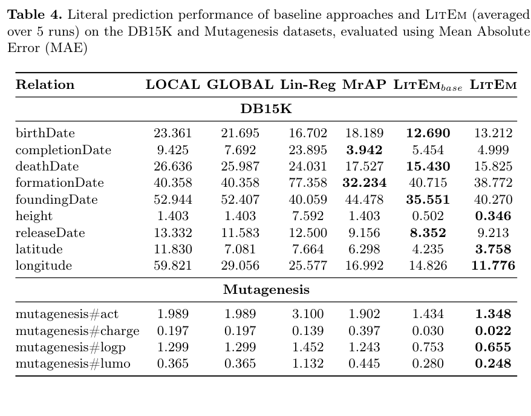

## 将数值属性加入表示学习

LitEm 为传导式知识图谱嵌入增加神经回归，预测数值属性，并通过共同训练让链接预测模型利用 literal 信息。实验涉及 FB15K-237、YAGO15K、DB15K 与 Mutagenesis，回归主要用 MAE，关系预测另用 MRR 和 Hits。

## 先看属性和单位，再看平均收益

Table 4 报五次运行均值。DB15K 的 birthDate 属性，LitEm MAE 为 13.212，低于线性回归的 16.702，但高于 LitEm-base 的 12.690；Mutagenesis 的 charge 为 0.022，对照 LitEm-base 为 0.030。不同属性的量纲不同，不能把这些误差直接相加变成一个通用准确率。

共同训练对双线性模型更稳定，对其他模型有得有失。论文讨论平移型模型的几何约束与回归目标可能冲突，不能称加入数值监督一定改善所有链接预测模型。

## 我的判断

数值预测应同时报告属性缺失机制、归一化、划分和误差单位。更低 MAE 不证明关系事实正确，模型也仍是传导式设置，不能直接外推未见实体或新图谱。

## 论文图表

图源：Rupesh Sapkota , Louis Mozart Kamdem Teyou , Moshood Yekini , Caglar Demir , Axel-Cyrille Ngonga Ngomo，《Neural Regression with Embeddings for Numerical Attribute Prediction in Knowledge Graphs》，arXiv:2608.26729v1，Table 4，PDF 第 9 页。[原图出处](https://arxiv.org/pdf/2608.26729v1#page=9) · [CC BY 4.0](https://creativecommons.org/licenses/by/4.0/)。仅裁剪原页面，保留完整图表、图注和必要标签，未重绘或修改数据，不表示作者认可本解读。图片沿用其原许可，本站页脚许可不为它增加非商业或其他限制。

## 论文来源

- [Neural Regression with Embeddings for Numerical Attribute Prediction in Knowledge Graphs](https://arxiv.org/abs/2608.26729v1) · v1，公开于 2026-08-27。

## 同日阅读目录

- [Neural Regression with Embeddings for Numerical Attribute Prediction in Knowledge Graphs](https://arxiv.org/abs/2608.26729v1) · v1，2026-08-27。
- [Surgical Alignment in Knowledge Graph Training for Clinical Diagnosis with Large Language Models](https://arxiv.org/abs/2608.26587v1) · v1，2026-08-27。
- [LeVJEPA: Efficient & Scalable Video Pretraining without the Heuristics](https://arxiv.org/abs/2608.27395v1) · v1，2026-08-27。
- [WikiSkill: Compiling Agent Experience into Persistent Knowledge for Skill Evolution](https://arxiv.org/abs/2608.27454v1) · v1，2026-08-27。
- [Memory Anchors for Continual Robot Learning](https://arxiv.org/abs/2608.26545v1) · v1，2026-08-27。
- [Puro-2B: Poor Lab's Qwen2-1.5B Trained on RTX 5090 within $5090](https://arxiv.org/abs/2608.27370v1) · v1，2026-08-27。

文中实验结果为论文作者报告，未独立复现。
