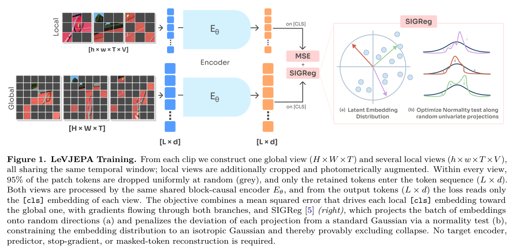
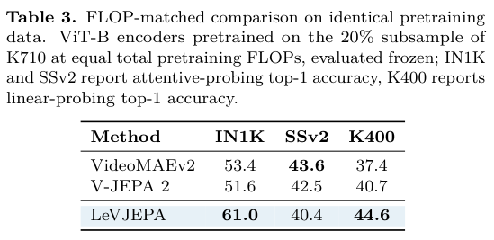
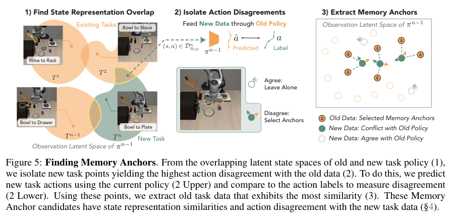
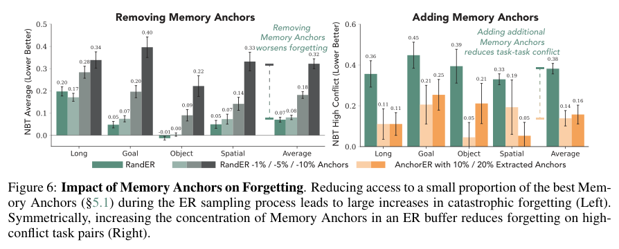
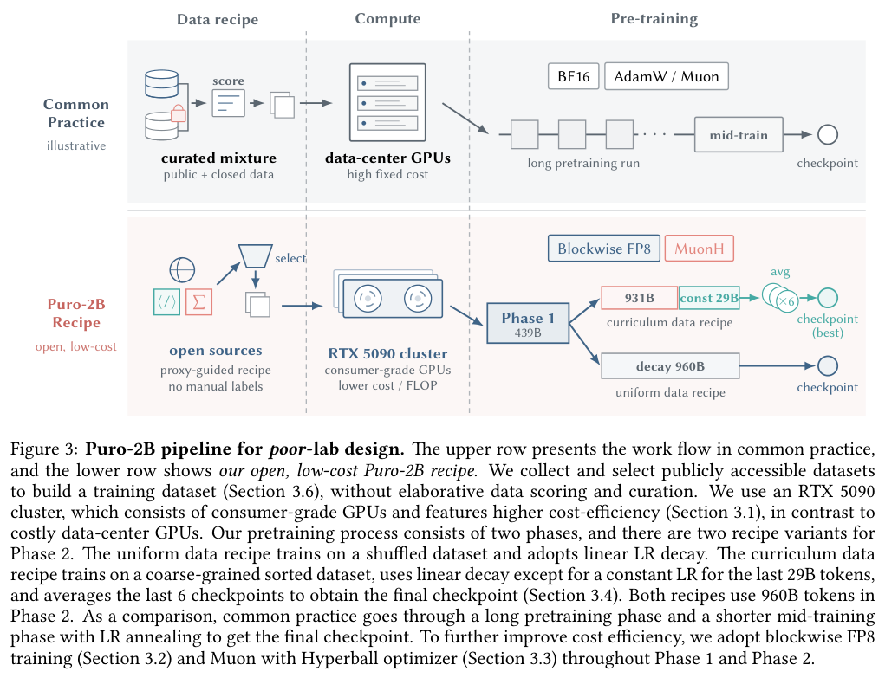
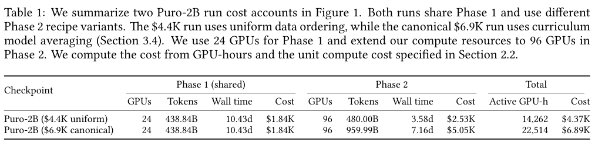

本期六项研究介绍图谱数值属性、医学图谱训练、视频预训练、技能知识、机器人回放与低成本语言模型训练。

## 1. LitEm：联合学习数值属性与关系

LitEm 为传导式知识图谱嵌入增加神经回归，预测数值属性，并通过共同训练让链接预测模型利用 literal 信息。实验涉及 FB15K-237、YAGO15K、DB15K 与 Mutagenesis，回归主要用 MAE，关系预测另用 MRR 和 Hits。

Table 4 报五次运行均值。DB15K 的 birthDate 属性，LitEm MAE 为 13.212，低于线性回归的 16.702，但高于 LitEm-base 的 12.690；Mutagenesis 的 charge 为 0.022，对照 LitEm-base 为 0.030。不同属性的量纲不同，不能把这些误差直接相加变成一个通用准确率。

共同训练对双线性模型更稳定，对其他模型有得有失。论文讨论平移型模型的几何约束与回归目标可能冲突，不能称加入数值监督一定改善所有链接预测模型。

数值预测应同时报告属性缺失机制、归一化、划分和误差单位。更低 MAE 不证明关系事实正确，模型也仍是传导式设置，不能直接外推未见实体或新图谱。

图源：Rupesh Sapkota , Louis Mozart Kamdem Teyou , Moshood Yekini , Caglar Demir , Axel-Cyrille Ngonga Ngomo，《Neural Regression with Embeddings for Numerical Attribute Prediction in Knowledge Graphs》，arXiv:2608.26729v1，Table 4，PDF 第 9 页。[原图出处](https://arxiv.org/pdf/2608.26729v1#page=9) · [CC BY 4.0](https://creativecommons.org/licenses/by/4.0/)。裁剪自原文。

- [Neural Regression with Embeddings for Numerical Attribute Prediction in Knowledge Graphs](https://arxiv.org/abs/2608.26729v1) · v1，公开于 2026-08-27。

## 2. Surgical Alignment：知识图谱训练改动了模型的哪些部分

论文比较五种图谱任务、三类训练范式、UMLS 与 PrimeKG，以及三个基础模型。除了路径判断、补全与诊断表现，还用梯度干预密度和梯度扭曲度观察参数更新是否集中，区分图谱判断目标与任务专用监督微调造成的变化。

Qwen2.5-7B 的 ProbSum 任务专用 SFT 得到 ROUGE-L 26.09，UMLS 路径 SFT 为 22.79；但 PDSQI-9 的平均评分分别为 1.97 与所选 UMLS 模型的 2.68，指标排序不同。后者又低于未微调模型的 2.94。局部梯度与部分质量维度改善值得研究，但文本重合、概念 F 分与质量评分都不是临床诊断安全性的直接证明。

[Surgical Alignment in Knowledge Graph Training for Clinical Diagnosis with Large Language Models](https://arxiv.org/abs/2608.26587v1) · v1。

[Figure 1（原文）](https://arxiv.org/pdf/2608.26587v1#page=3)。

## 3. LeVJEPA：用单编码器与稀疏 token 做视频预训练

LeVJEPA 让同一编码器处理全局与局部视频视图，使用一致性损失和 SIGReg 正则避免表示坍缩，去掉目标编码器、预测器与停止梯度分支。训练只保留约 5% patch token，并使用块因果注意力，使每帧表示只依赖过去。

*图｜Kuhn, Lukas 等，[Figure 1（PDF 第 1 页）](https://arxiv.org/pdf/2608.27395v1#page=1)，[CC BY 4.0](http://creativecommons.org/licenses/by/4.0/)。裁剪自原文。*

K710 的 20% 子集、ViT-B、相同预训练 FLOPs 下，ImageNet 冻结探针 Top-1 为 61.0%，VideoMAEv2 为 53.4%；Something-Something-v2 却是 40.4% 对 43.6%。相同 epoch 下的 5.6—20.8 倍计算节省来自另一组规模对照，不能与等 FLOPs 的精度收益叠加，也不等同于同倍训练墙钟提速。

*图｜Kuhn, Lukas 等，[Table 3（PDF 第 7 页）](https://arxiv.org/pdf/2608.27395v1#page=7)，[CC BY 4.0](http://creativecommons.org/licenses/by/4.0/)。裁剪自原文。*

[LeVJEPA: Efficient & Scalable Video Pretraining without the Heuristics](https://arxiv.org/abs/2608.27395v1) · v1。

## 4. WikiSkill：先把执行经验编成知识，再修改技能

WikiSkill 将不可变执行轨迹、持久 wiki 与可执行 skills 分成三层。更新先总结跨轨迹规律、失败原因与已验证经验，再利用 wiki 维护技能，避免每轮只读取零散日志后重新发现同样的问题。

五项任务、三次独立完整演化运行的平均结果中，Qwen3.6-27B 从无技能的 39.4 到 WikiSkill 的 63.3，EvoSkill 为 53.3；但 OfficeQA 的 53.7 仍低于 SkillOpt 的 54.8。Qwen3.5-4B 的 OfficeQA 更从无技能 30.2 降到 28.5。技能积累有任务依赖，知识维护与多轮执行成本也必须计算。

[WikiSkill: Compiling Agent Experience into Persistent Knowledge for Skill Evolution](https://arxiv.org/abs/2608.27454v1) · v1。

[Figure 1（原文）](https://arxiv.org/pdf/2608.27454v1#page=1)。

## 5. Memory Anchors：优先回放观测相似但动作冲突的经验

Memory Anchors 找出旧任务与新任务在观测表示中重叠、却要求不同动作的区域。算法先筛相似状态，再用旧策略预测新数据动作，定位高分歧样本，最后检索对应旧经验作为回放锚点。

*图｜Du, Maximilian 等，[Figure 5（PDF 第 6 页）](https://arxiv.org/pdf/2608.26545v1#page=6)，[CC BY 4.0](http://creativecommons.org/licenses/by/4.0/)。裁剪自原文。*

在一千条回放预算的实验中，排除最关键的 10% 候选锚点后，遗忘可增至原来的 4.5 倍以上；这不是随机删去任意 10% 数据。另用只占历史数据 1% 的小缓冲，增加锚点使每个套件最冲突的六组任务的遗忘平均减少超过 63%。这些高冲突结果不能解释为所有任务成功率提高 63%；LIBERO-Goal 的整体遗忘下降为另一项 37% 结果。

*图｜Du, Maximilian 等，[Figure 6（PDF 第 7 页）](https://arxiv.org/pdf/2608.26545v1#page=7)，[CC BY 4.0](http://creativecommons.org/licenses/by/4.0/)。裁剪自原文。*

[Memory Anchors for Continual Robot Learning](https://arxiv.org/abs/2608.26545v1) · v1。

## 6. PuRo-2B：把低成本训练拆成可复用配方

PuRo-2B 用 RTX 5090 集群、块级 FP8、MuonH、数据课程与模型平均，训练约二十亿参数的密集模型。它从随机初始化预训练，并非直接微调现成 Qwen 权重；输入输出嵌入分离后的架构基于 Qwen3-1.7B 配置。

*图｜Luo, Kairong 等，[Figure 3（PDF 第 6 页）](https://arxiv.org/pdf/2608.27370v1#page=6)，[CC BY-SA 4.0](http://creativecommons.org/licenses/by-sa/4.0/)。裁剪自原文。*

两阶段分别使用二十四张和九十六张 GPU。Table 1 中约 919B token 的均匀排序版本耗 14,262 GPU 小时、按论文单价计 4.37k 美元；约 1.4T token 的 canonical 版本为 22,514 GPU 小时、6.89k 美元。因此标题中的 5,090 美元不能代表最佳版本全部成本，也不是单卡完成；模型均分与跨模型租赁等价成本均依赖论文指定核算协议。

*图｜Luo, Kairong 等，[Table 1（PDF 第 7 页）](https://arxiv.org/pdf/2608.27370v1#page=7)，[CC BY-SA 4.0](http://creativecommons.org/licenses/by-sa/4.0/)。裁剪自原文。*

[Puro-2B: Poor Lab's Qwen2-1.5B Trained on RTX 5090 within $5090](https://arxiv.org/abs/2608.27370v1) · v1。
