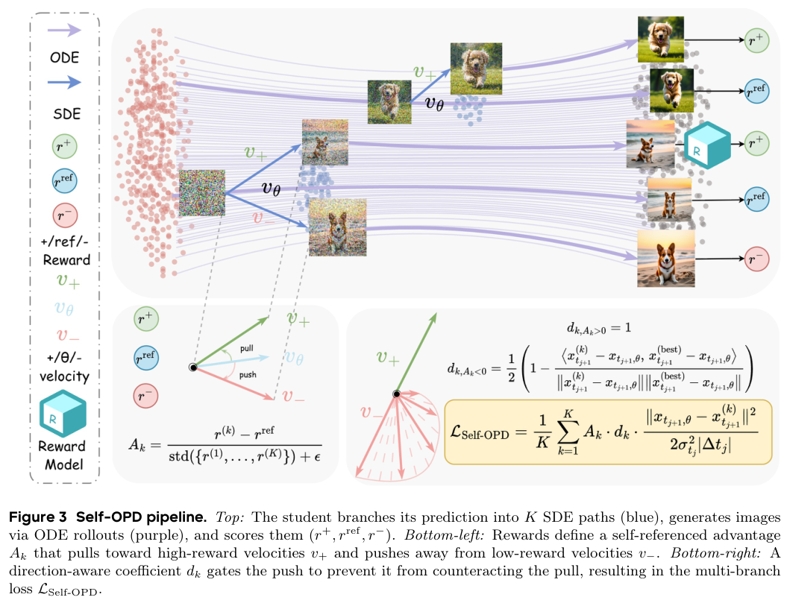
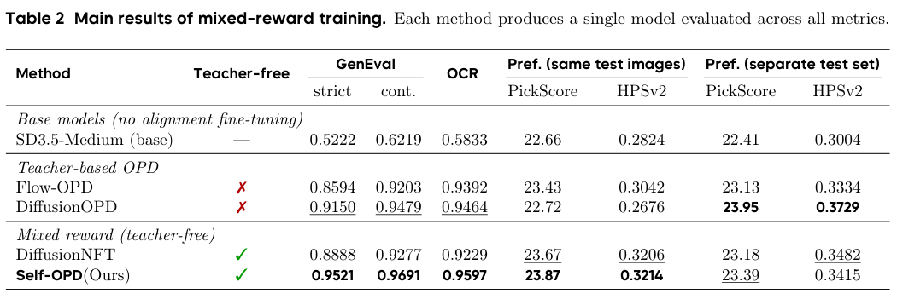
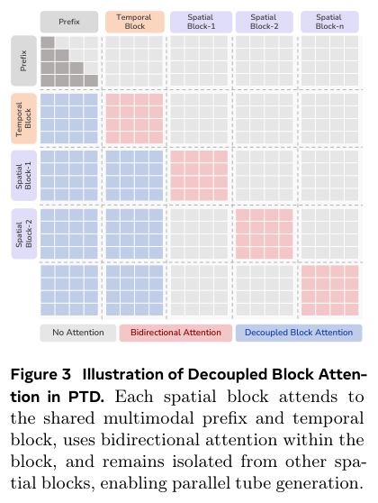
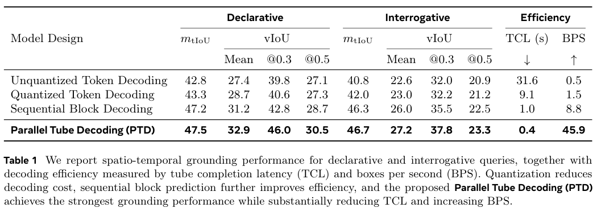
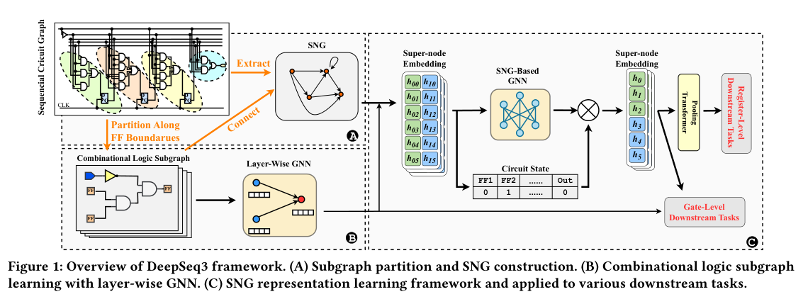
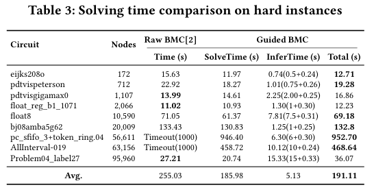

本期五项研究介绍生物通路表示、自蒸馏、群体技术演化、视频并行定位与层级电路图。

## 1. Reactome：比较语义层级与专家拓扑

这项 Reactome 研究从 Homo sapiens 的通路和反应描述出发，用 SPECTER2 表示文本，再通过修改的凝聚聚类与图重构，建立 Semantic Hierarchy，与专家整理的 Reactome Hierarchy 比较。

数据基于 Reactome V95（2025 年 12 月）。作者报告 SH 与 RH 的 Laplacian Spectral Distance 为 0.085，全部重连的 SH 对照为 0.224；bootstrap 检验 p<0.005。平均度约为 2.00 对 2.09，密度都约 0.00011。

这些衡量全局谱和拓扑结构，不是逐边生物关系正确率，更不是临床预测准确率。文本来自已被专家组织的同一知识库，因此重建实验与从独立新文献发现未知机制是不同任务。

值得追问的是哪些关系能由描述恢复、哪些只能依赖实验与专家知识。应增加局部边验证和外部数据对照，防止全局相似掩盖重要子通路错误。本文不把结构接近视作生物因果证明。

[Figure 1，原论文 PDF 第 5 页](https://arxiv.org/pdf/2608.28178v1#page=5)。

- [Expert Knowledge & Machine Understanding: Bridging Reactome's Ontology with LLM Semantic Embeddings](https://arxiv.org/abs/2608.28178v1) · v1，公开于 2026-08-28。

## 2. Self-OPD：从自己的分支采样产生逐步监督

Self-OPD 在确定性下一状态附近采样多个 SDE 分支，经过 ODE rollout 后与确定性自参考比较奖励。高优势分支吸引、低优势分支排斥当前速度场，并按方向与方差修正；多目标时先融合归一化奖励，再形成更新。

*图｜Zhang, Shiyi 等，[Figure 3（PDF 第 4 页）](https://arxiv.org/pdf/2608.26872v1#page=4)，[CC BY 4.0](http://creativecommons.org/licenses/by/4.0/)。裁剪自原文。*

SD3.5-Medium 的单一混合奖励模型中，严格 GenEval 为 0.9521，DiffusionNFT 为 0.8888，OCR 为 0.9597 对 0.9229；但独立偏好测试集的 HPSv2 为 0.3415，低于 DiffusionNFT 的 0.3482。分别为单项奖励训练的最佳检查点属于另一组实验。“无需教师”指不训练专用蒸馏教师，仍需要奖励模型与多分支采样。

*图｜Zhang, Shiyi 等，[Table 2（PDF 第 9 页）](https://arxiv.org/pdf/2608.26872v1#page=9)，[CC BY 4.0](http://creativecommons.org/licenses/by/4.0/)。裁剪自原文。*

[Self-OPD: On-Policy Distillation for Flow Matching Models without Teacher](https://arxiv.org/abs/2608.26872v1) · v1。

## 3. SwarmWorld：通过持久环境积累群体技术

SwarmWorld 让初始同质的 Agent 在空间环境中采集资源、试验材料、建造工件和编写控制器，以共享环境痕迹协调活动。固定动作与材料规则限定可做什么，确定性模拟器检验实际功能，并在移除 Agent 后测试扰动下的持续服务。

五十、一百、二百 Agent 的八百 tick 实验使用四个配对世界种子，并与端点分别取最优的独立搜索基线比较。共享社会在留出扰动韧性、功能组合和有效发明数量上更稳定；单项最早最强发现的 AUC 则有负例，更多通信并不总是更好。这里的技术与韧性均由模拟器定义，不等同于真实材料技术或现实社会实验。

[SwarmWorld: Stigmergic technological evolution in societies of language-model agents](https://arxiv.org/abs/2608.26081v1) · v1。

[Figure 1（原文）](https://arxiv.org/pdf/2608.26081v1#page=3)。

## 4. Parallel Tube Decoding：时间定位后并行输出所有目标框

PTD 把视频目标定位分成一个时间块和多个以时间为条件的空间块。解耦块注意力保留视频与问题上下文，却切断目标框之间的自回归依赖，让整个轨迹用固定两轮输出，再以时间边界和空间几何奖励优化定位。

*图｜Rasheed, Hanoona 等，[Figure 3（PDF 第 5 页）](https://arxiv.org/pdf/2608.28192v1#page=5)，[CC BY 4.0](http://creativecommons.org/licenses/by/4.0/)。裁剪自原文。*

Qwen3-VL-4B、VidSTG 的受控比较中，非量化自回归输出的轨迹完成延迟为 31.6 秒，PTD 为 0.4 秒；陈述式平均视频 IoU 从 27.4 到 32.9。延迟在单张 AMD MI210、BF16、batch 1 下只计解码，排除多模态 prefill；不同方案预测轨迹长度也不同，79 倍不能当作完整视频服务的端到端加速。

*图｜Rasheed, Hanoona 等，[Table 1（PDF 第 8 页）](https://arxiv.org/pdf/2608.28192v1#page=8)，[CC BY 4.0](http://creativecommons.org/licenses/by/4.0/)。裁剪自原文。*

[Locate Anything in Videos: Rethinking Efficient Generative Spatio-Temporal Video Grounding](https://arxiv.org/abs/2608.28192v1) · v1。

## 5. DeepSeq3：让电路表示同时看见逻辑与寄存器状态

DeepSeq3 按触发器边界划分组合逻辑，再构建寄存器传输层级的 Super-Node Graph。两级 GNN 分别学习局部布尔逻辑与全局状态转移，通过状态可达性预训练，为功耗预测和有界模型检查提供表示。

*图｜Zhou, Jingyi 等，[Figure 1（PDF 第 2 页）](https://arxiv.org/pdf/2608.28188v1#page=2)，[CC BY 4.0](http://creativecommons.org/licenses/by/4.0/)。裁剪自原文。*

四十个 HWMCC 实例中，三十一个简单实例的拟合求解时间约减少 18.6%，但该图排除了模型推理开销。九个困难实例的总时间均值为 191.11 秒，原 BMC 为 255.03 秒，包含两项原方法千秒超时；也有实例从 27.21 秒变成 36.07 秒。预测约束搜索失败时回退原搜索维持完整性，收益仍取决于电路规模、逐电路微调与推理成本。

*图｜Zhou, Jingyi 等，[Table 3（PDF 第 6 页）](https://arxiv.org/pdf/2608.28188v1#page=6)，[CC BY 4.0](http://creativecommons.org/licenses/by/4.0/)。裁剪自原文。*

[Beyond Flat Netlist: Hierarchical Graph Representation Learning for Scalable Analysis of Sequential Circuits](https://arxiv.org/abs/2608.28188v1) · v1。
