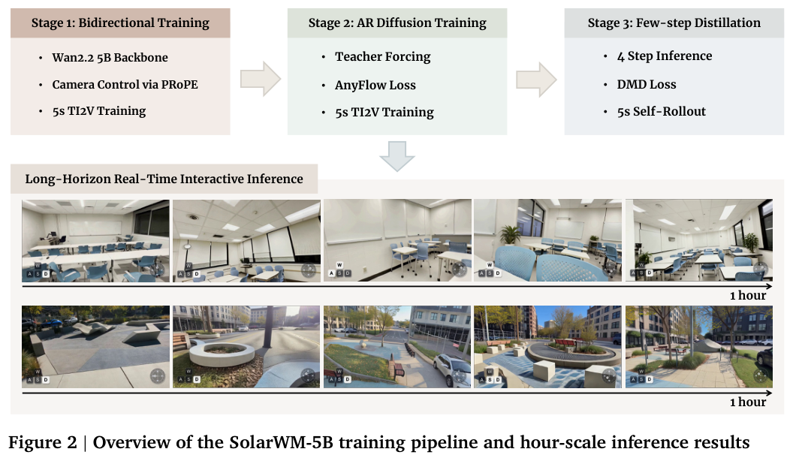
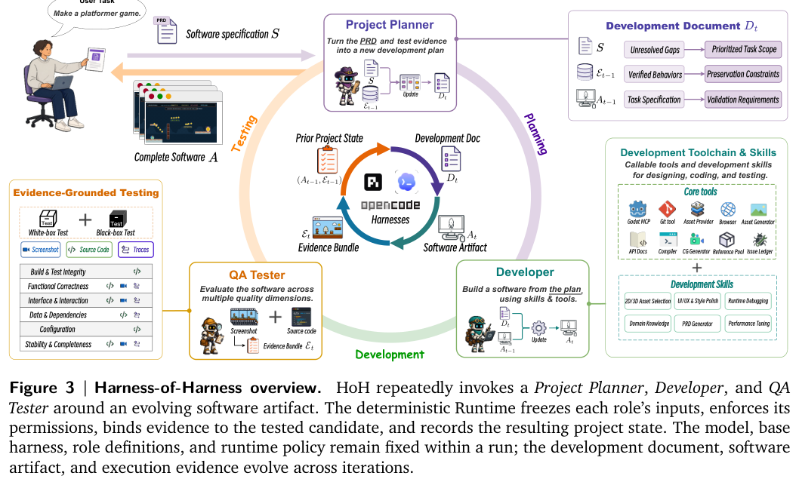
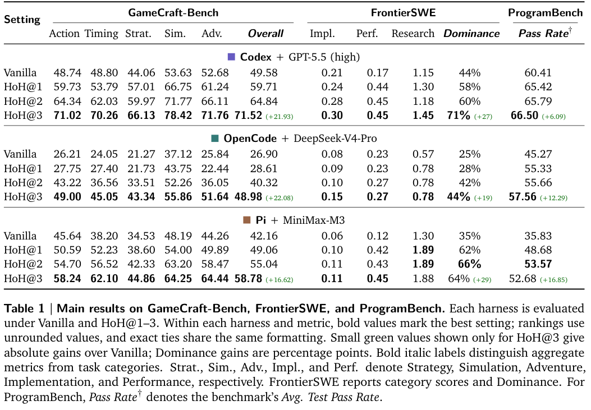
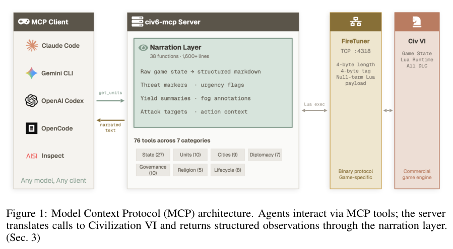
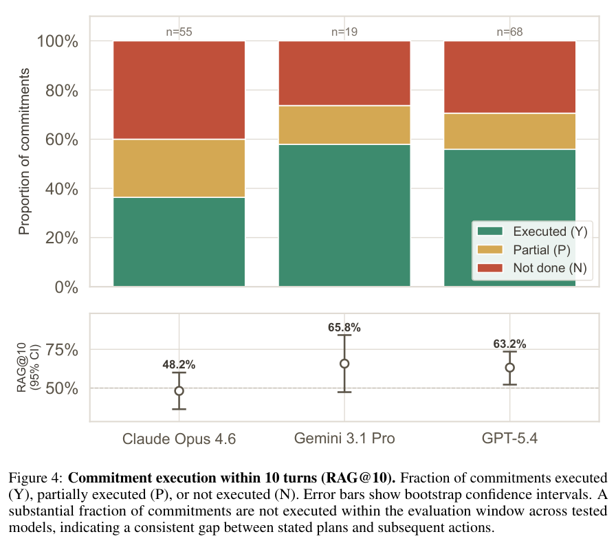
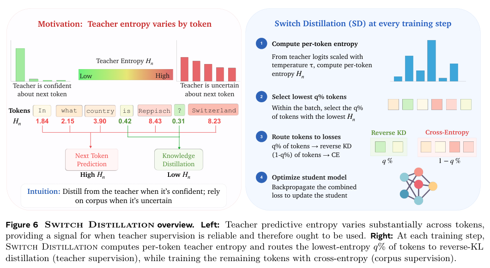
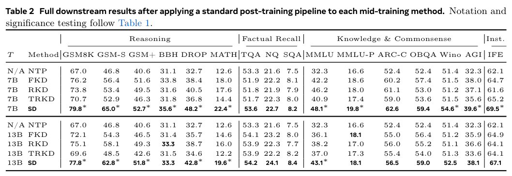

本期七项研究介绍对话冲突本体、归纳图谱补全、接触操作、视频世界模型、持续软件开发、长期游戏评测与中期蒸馏。

## 1. ATFOt：为协作对话中的冲突建立表示

ATFOt 研究以 Activity Theory 表示对话协作中的错误、冲突和知识问题。作者采用 METHONTOLOGY，将自然语言概念定义逐步写成集合论与一阶逻辑，而非只给问题类型命名。

论文给出协作交互及矛盾概念的定义，并提出三个指导交互的原则。它明确属于进行中的基础本体研究，没有提供可据以引用的机器人任务成功率、用户研究效果或自动消解冲突的部署证据。形式化定义能明确讨论对象，却不证明系统可以正确识别真实对话中的所有矛盾。

对多方协作系统，统一表示有助将冲突送到可审查的层面。接下来仍需测试标注一致性、场景覆盖，以及谁有权修改规则和目标。不能把表示冲突等同于已经解决冲突。

[Figure 1，原论文 PDF 第 2 页](https://arxiv.org/pdf/2609.02364v1#page=2)。

- [Towards a Foundational Ontology for Identifying and Resolving Contradictions in Dialogue-based Human-Robot Interactions](https://arxiv.org/abs/2609.02364v1) · v1，公开于 2026-09-02。

## 2. PEARL：让关系路径根据周围实体结构改变权重

PEARL 为查询两端的邻域构建上下文子图，用 LLM 引导的检索蒸馏相关关系路径，再让路径、实体和全局子图表示在二部交互图中交换信息。双视图对比学习减少扩大邻域带来的噪声，目标是迁移到训练时没见过的实体。

五次独立运行的 filtered ranking 中，WN18RR-V1 的 Hits@10 为 93.48%，MRR 为 80.36%；FB15k-237-V1 分别为 72.63%、50.55%。NELL-995-V1 的 Hits@10 为 63.00%，低于 CATS 的 66.10%。训练和测试实体虽分离，关系词表仍共享；归纳补全不等于能直接处理未知关系，排名分数也不是下游问答正确率。

[PEARL: Path-Entity Aligned Relational Learning with Contextual Subgraphs for Inductive Knowledge Graph Completion](https://arxiv.org/abs/2609.02216v1) · v1。

[Figure 1（原文）](https://arxiv.org/pdf/2609.02216v1#page=4)。

## 3. DemoMimic：从一次演示学习可迁移的局部接触

DemoMimic 以接触点附近的几何而非整个对象身份组织灵巧操作奖励，结合接触对齐与持续接触约束，在仿真中生成轨迹，再训练深度条件策略。它希望只要局部接触结构保持，改变对象形状、尺度、摩擦与质量后仍可执行同一动作。

四项任务、十六个对象、两种手型的真机评估平均分约 71%，每个对象二十次 rollout。但论文的“成功”含连续进度分：开盖按相对行程计，搬瓶按四阶段计，不能全部解释为二元完整成功率。弯曲盖沿改变局部几何时分数降到 39%；单次人类演示之外仍使用仿真强化学习、对象随机化与模仿训练。

[One Demonstration, Many Objects: Generalizing Manipulation via Local Contact Geometry](https://arxiv.org/abs/2609.01938v1) · v1。

[Figure 1（原文）](https://arxiv.org/pdf/2609.01938v1#page=1)。

## 4. SolarWM：统一数据合同，同时保留视频骨干的原生接口

SolarWM 将十个数据源约 143 万段规范片段整理为帧对齐图像、相机、文本与质量信息，再分别适配 Wan2.2、LTX-2.5 与 MiniMax-H3。三阶段训练从双向适配，经教师强制自回归初始化，到分布匹配蒸馏，统一相机控制而不强行统一所有潜变量格式。

*图｜Huang, Junchao 等，[Figure 2（PDF 第 6 页）](https://arxiv.org/pdf/2609.02886v1#page=6)，[CC BY 4.0](http://creativecommons.org/licenses/by/4.0/)。裁剪自原文。*

报告展示四条 5B—33B 模型路线，以及 5B-fast 从五秒训练片段扩展出的分钟和一小时连续生成。长序列实验用固定场景提示和预设相机轨迹，因果结果设为每秒十六帧、四采样步。稀疏时间点的定性画面支持持续生成展示，却不能单独证明每一帧几何一致、任意自由交互可靠，或所有骨干都有相同实测吞吐。

[SolarWM: Open Data and Scalable Training for Long-Horizon Video World Models](https://arxiv.org/abs/2609.02886v1) · v1。

## 5. Harness-of-Harness：以小步计划、编码与独立测试持续开发

HoH 在现有 coding harness 外循环调用项目规划者、开发者与 QA 测试者，按可验证增量推进软件，同时保存版本历史。实现阶段测试与独立评价分开，并逐步开放角色工具、技能和交付要求，让修复与能力增长同时进行。

*图｜Yan, Haoyang 等，[Figure 3（PDF 第 5 页）](https://arxiv.org/pdf/2609.01481v1#page=5)，[CC BY 4.0](http://creativecommons.org/licenses/by/4.0/)。裁剪自原文。*

三轮后，Codex+GPT-5.5 的 GameCraft 总分从 49.58 到 71.52，ProgramBench 平均测试通过率从 60.41 到 66.50；OpenCode+DeepSeek-V4-Pro 对应为 26.90 到 48.98、45.27 到 57.56。七十余轮的 FPS 开发展示是另一个多日案例，不能当作三轮基准的平均效果。更多开发循环也消耗更多预算，测试通过率不等于整个产品已满足所有需求。

*图｜Yan, Haoyang 等，[Table 1（PDF 第 11 页）](https://arxiv.org/pdf/2609.01481v1#page=11)，[CC BY 4.0](http://creativecommons.org/licenses/by/4.0/)。裁剪自原文。*

[Harness-of-Harness: Multi-Day Autonomous Software Development with Continual Improvement](https://arxiv.org/abs/2609.01481v1) · v1。

## 6. CivBench：长期游戏中，计划写下了是否真的执行

CivBench 把 Civilization VI 接到七十六个 MCP 工具，用结构化叙述提供游戏状态。单局超过三百回合、数千次工具调用，既检查主动查询潜在战略状态，也检查反思中承诺的行动是否在随后十回合兑现。

*图｜Andrews, Austin Tudor David 等，[Figure 1（PDF 第 3 页）](https://arxiv.org/pdf/2609.02459v1#page=3)，[CC BY 4.0](http://creativecommons.org/licenses/by/4.0/)。裁剪自原文。*

四个模型家族共二十三次有效运行中，承诺兑现率 RAG（十回合）为 48.2%—65.8%；二十次可检测的失败里有七次未在结束前二十回合查询胜利进度。样本是行为诊断先导实验，不能形成稳定模型排名。兑现率衡量计划到执行的衔接，不等于游戏胜率，也依赖工具暴露、叙述层和共同 playbook。

*图｜Andrews, Austin Tudor David 等，[Figure 4（PDF 第 8 页）](https://arxiv.org/pdf/2609.02459v1#page=8)，[CC BY 4.0](http://creativecommons.org/licenses/by/4.0/)。裁剪自原文。*

[CivBench: A Long-Horizon Benchmark for Tool-Mediated Agents in Civilization VI](https://arxiv.org/abs/2609.02459v1) · v1。

## 7. Switch Distillation：教师不确定时，回到真实下一个 token

研究发现同一种蒸馏在预训练与中期训练的效果不同：中期训练的前向 KL 可改善推理，却妨碍事实记忆积累。Switch Distillation 按教师预测熵路由，低熵 token 使用蒸馏，高熵处使用交叉熵，避免把所有知识领域都按同一强度模仿。

*图｜He, Jacqueline 等，[Figure 6（PDF 第 7 页）](https://arxiv.org/pdf/2609.01532v1#page=7)，[CC BY 4.0](http://creativecommons.org/licenses/by/4.0/)。裁剪自原文。*

OLMo-2 1B 学生、7B-Instruct 教师的中期训练后，GSM8K 从 NTP 的 40.4 到 69.7，而 TriviaQA 从 56.7 到 54.9，事实记忆仍有小幅差距。再经相同后训练，二者为 79.8 对 67.0、53.6 对 53.3。训练阶段和教师规模影响取舍，推理题收益不能解释为所有事实都记得更准。

*图｜He, Jacqueline 等，[Table 2（PDF 第 9 页）](https://arxiv.org/pdf/2609.01532v1#page=9)，[CC BY 4.0](http://creativecommons.org/licenses/by/4.0/)。裁剪自原文。*

[Knowledge Distillation During Mid-Training Favors Reasoning over Factual Recall](https://arxiv.org/abs/2609.01532v1) · v1。
