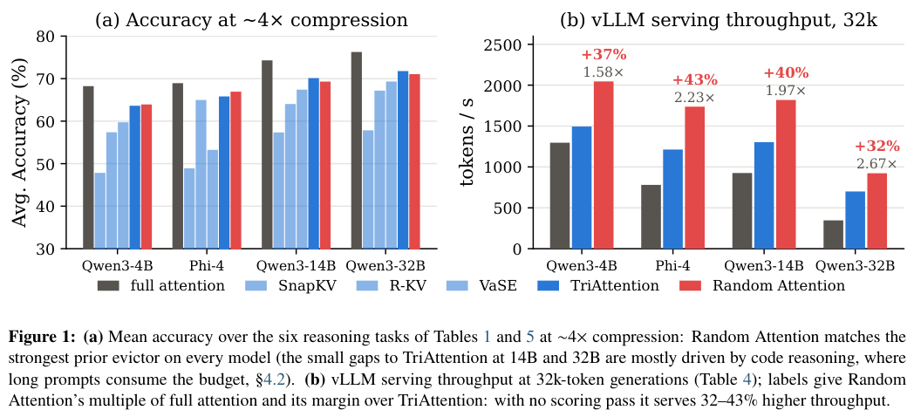
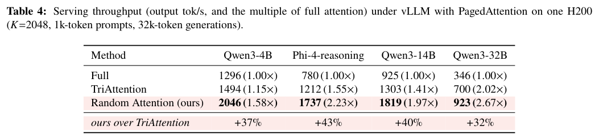
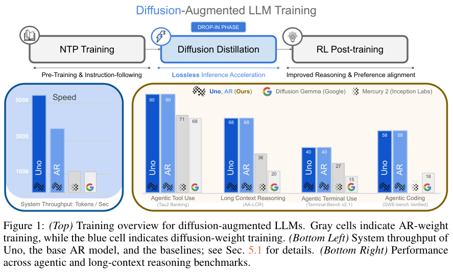
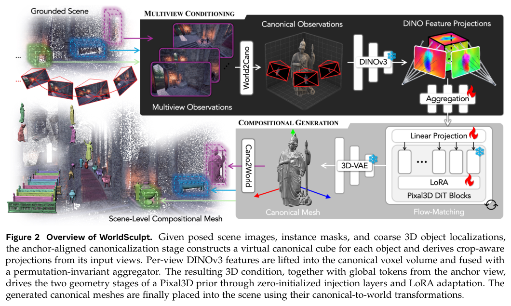
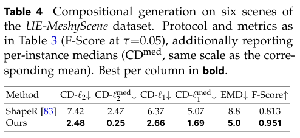

本期七项研究介绍关系发现、文学图谱、终端环境、缓存淘汰、扩散并行解码、递归蒸馏与组合三维世界。

## 1. Hakken：从时序图谱提出新关系假说

Hakken 将论文抽取的时序知识图谱与 LLM 语义信息结合，预测概念之间尚未记录的关系类型，再用模型无关解释框架提供候选路径。它讨论的是新关系假说，不只是已知公理的演绎闭包。

作者在生物医学数据上做时间划分与历史回测，底层语言模型为 Mistral-7B-Instruct-v0.3，提供给实体的文献句子限制在训练时间截点之前。该限制有助减少未来信息，但不能彻底排除基础模型预训练知识的影响。

研究对约 150 万条超过置信门槛的衰老相关假说评分，经过生物学家筛选后，将三条送入湿实验，报告其中两条得到支持。这不是 150 万条的总体验证率，也不是随机抽样估计的三分之二成功率；筛选机制和具体实验决定了可支持的范围。

解释路径适合帮助专业人员决定验证优先级，但不能取代实验。应保留时间截点、候选选择和未支持结果，避免将图中合理的关联写成因果或治疗结论。

[Table 1，原论文 PDF 第 10 页](https://arxiv.org/pdf/2609.04494v1#page=10)。

- [Hakken: Predicting future discoveries to fill the gaps in today's knowledge](https://arxiv.org/abs/2609.04494v1) · v1，公开于 2026-09-03。

## 2. NS-ST-GraphRAG：按叙事时间与场景检索有效关系

NS-ST-GraphRAG 用本体抽取、确定性约束、章节与事件双时间坐标及空间场景属性组织小说知识，再按问题时间和地点选择子图。Red-Chamber-QA 同时保留答案与逐部分证据，用机械复现、语义裁判和引用检查分开评价。

一百二十题留出集上，机械答案复现为 0.733，固定窗口基线为 0.675，配对检验 p=0.092，差异未达统计显著；语义裁判为 0.866 对 0.850，也没有可靠差异。多跳子集仅四题，机械复现为 0.250。结果支持可追溯的时空表示与评估框架，尚不支持“时空图检索已显著解决复杂文学问答”的结论。

[NS-ST-GraphRAG: Neuro-Symbolic Spatio-Temporal GraphRAG for Literary Knowledge Processing](https://arxiv.org/abs/2609.05139v1) · v1。

[Figure 1（原文）](https://arxiv.org/pdf/2609.05139v1#page=5)。

## 3. Terminal-Universe：从执行轨迹恢复可再次求解的环境

Terminal-Universe 回放文件操作，恢复 Agent 修改前的部分工作区，再让补全 Agent 补齐缺失文件与依赖。恢复环境既可重做原任务，也可跨工作区增加任务广度，或用多轮用户反馈增加任务深度。

管线得到约 37.3k 个满足任务的环境，完整训练混合为 32.0k；Qwen3.5-27B 在 Terminus2 下的 Terminal-Bench 2.1 从 46.2% 到 58.1%，EvoCode-Bench 多轮指标 MT（四轮）从 6.3 到 20.1。环境数与训练样本数不同；任务重解还使用更强教师，因此收益不只来自文件恢复。其他系统的部分表值来自各自报告，不能视为全部同环境重跑。

[Terminal-Universe: Turning Agent Trajectories into Scalable Terminal Environments](https://arxiv.org/abs/2609.04148v1) · v1。

[Figure 1（原文）](https://arxiv.org/pdf/2609.04148v1#page=2)。

## 4. Random Attention：保住问题，再随机保留推理缓存

Random Attention 完整保留 prompt，在各注意力头内均匀随机淘汰推理 token，不计算复杂重要性分。实验把问题前缀保护与推理中的文字、跨头冗余分开测试，解释为何随机保留仍可能留下足够证据副本。

*图｜Wang, Heng 等，[Figure 1（PDF 第 1 页）](https://arxiv.org/pdf/2609.03430v1#page=1)，[CC BY 4.0](http://creativecommons.org/licenses/by/4.0/)。裁剪自原文。*

单张 H200、vLLM、缓存预算 2,048、1k prompt 与 32k 生成下，Qwen3-14B 的输出吞吐为每秒 1,819 token，TriAttention 为 1,303、全注意力为 925。四模型相对 TriAttention 提高 32%—43%，不代表准确率提高同样幅度。32B 压缩运行还限制到九十六并发，实际吞吐比较需保留这项条件；只出现一次且不被重述的事实仍可能被淘汰。

*图｜Wang, Heng 等，[Table 4（PDF 第 8 页）](https://arxiv.org/pdf/2609.03430v1#page=8)，[CC BY 4.0](http://creativecommons.org/licenses/by/4.0/)。裁剪自原文。*

[Random Attention: Rethinking KV Cache Eviction for Efficient Reasoning](https://arxiv.org/abs/2609.03430v1) · v1。

## 5. Uno：让扩散分支提议多个 token，再按原模型验证

Uno 将自回归权重与轻量扩散权重分开，用扩散分支并行提议 token 块，由 Ψ-Spec 对原自回归分布执行拒绝采样。扩散适配器可在冻结现成模型时训练，线性和树形候选分别适合高并发吞吐与低 batch 延迟。

*图｜Sahoo, Subham Sekhar 等，[Figure 1（PDF 第 1 页）](https://arxiv.org/pdf/2609.04010v1#page=1)，[CC BY 4.0](http://creativecommons.org/licenses/by/4.0/)。裁剪自原文。*

单张 H200 的 1k 输入、8k 输出测试中，主文报告 Uno 在 batch 64 比原自回归模型快 1.5 倍，batch 1 约 2.2 倍。扩散权重训练约用七十亿 SFT token，并非没有额外成本。“无损”指验证采样保留基准自回归分布，不代表每次生成逐字相同，或任何上下文、采样配置和硬件都得到固定倍数。

[Unlocking Lossless Speedups in LLMs via Discrete Diffusion](https://arxiv.org/abs/2609.04010v1) · v1。

## 6. RISE：沿近期训练方向构造下一轮教师

RISE 对当前策略与滞后锚点在参数或 logit 空间的差作外推，得到合成教师，再把序列级可验证奖励带来的方向转成逐 token 蒸馏信号。每轮刷新锚点和教师，让 RLVR 与 OPD 相互配合，而非固定教师一次性压缩。

Qwen2.5-3B-Instruct 的 ALFWorld 成功率由 GRPO 的 75.0% 到参数外推版的 84.4%，WebShop 准确率由 63.3% 到 74.2%。但 logit 版的 WebShop 得分为 78.8，略低于 GRPO 的 79.8。去掉 RLVR、只沿自蒸馏方向外推的消融在六十步内塌缩，说明结果奖励是必要锚点，不能理解为无验证的自我强化总能进步。

[RISE: Recursive Improvement via Self-Extrapolating Policy Distillation](https://arxiv.org/abs/2609.05295v1) · v1。

[Figure 1（原文）](https://arxiv.org/pdf/2609.05295v1#page=2)。

## 7. WorldSculpt：从多视图生成可单独操作的三维对象

WorldSculpt 给单对象 Pixal3D 生成先验增加多视图条件，让每个对象在共同世界坐标中生成独立 mesh。输入包括已定姿图像、实例掩码与粗三维对象位置；单对象训练的模型由此扩展到大量遮挡对象的组合场景。

*图｜Niu, Muyao 等，[Figure 2（PDF 第 5 页）](https://arxiv.org/pdf/2609.05416v1#page=5)，[CC BY 4.0](http://creativecommons.org/licenses/by/4.0/)。裁剪自原文。*

六个 UE-MeshyScene 场景共有 2,299 个对象，每场九十三至七百零一个。Table 4 的 F-Score（阈值 0.05）为 0.951，ShapeR 为 0.813；但该合成基准提供准确相机、实例掩码与包围盒。几何重建结果不能直接当作含噪感知下的实例发现或物理仿真成功率，被遮挡的几何仍依赖生成先验。

*图｜Niu, Muyao 等，[Table 4（PDF 第 10 页）](https://arxiv.org/pdf/2609.05416v1#page=10)，[CC BY 4.0](http://creativecommons.org/licenses/by/4.0/)。裁剪自原文。*

[WorldSculpt: Generating Compositional Worlds from Grounded Videos](https://arxiv.org/abs/2609.05416v1) · v1。
