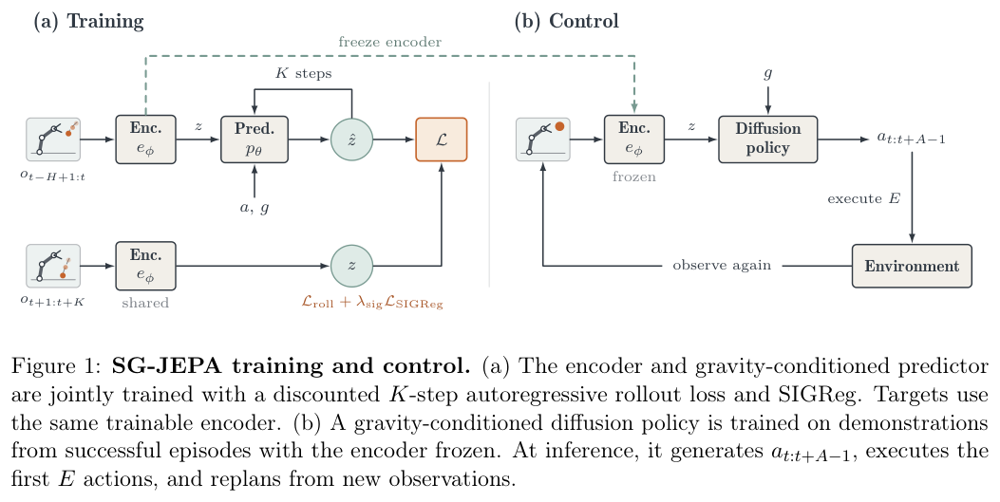
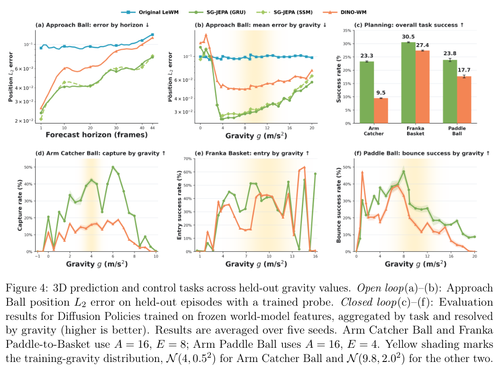
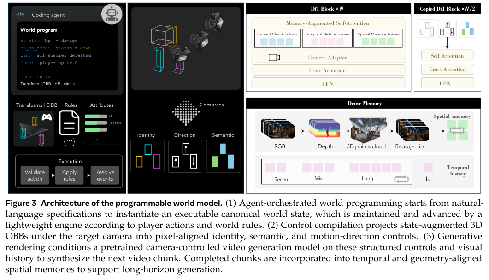
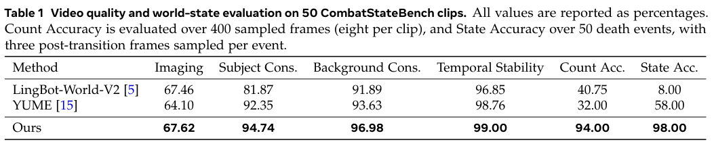
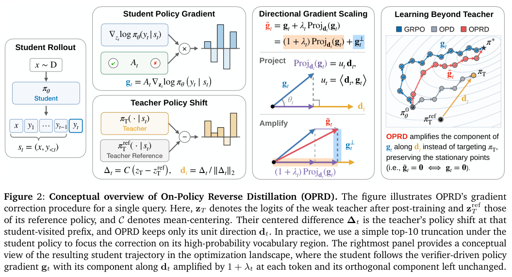
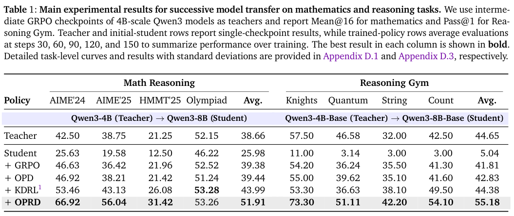

本期七项研究介绍制药文档图谱、企业数据标签、语义动作、潜在物理动态、程序世界、反向蒸馏与循环 MoE。

## 1. CMC 图谱：用词法与领域两层连接文档证据

词法层保存 Document→Section→Chunk 及来源，领域层补充本体对齐实体和跨文档关系，路由器按问题选择路径。

Claude Sonnet 4.5 在 AWS Bedrock 上运行，温度 0.2、输出上限 2,048 tokens。由一个 Sanofi 小分子项目的 38 份开发报告构建 505 道题，词法层 Tier-1 选择题准确率约 95%，Tier-2 自由回答的 LLM 裁判通过率约 85%；两者不一致的案例再交领域专家审查。

这些指标属于不同评价协议，不能平均成统一可靠率，也不是领域图谱层单独贡献的消融结果。比较与全语料问题更难，专有报告与模型出题还限制外部复核。

来源锚定有利于审核，但不能保证提取或答案正确。应保留题目生成、裁判与专家复核各自的误差边界。

图源：Reza Amirmoshiri , Faryad Sahneh , Yasser Jangjou，《From Document Silos to Process Intelligence: A Dual-Layer Knowledge Graph for CMC Process Development》，arXiv:2609.11493v1，Figure 2，PDF 第 5 页。[原图出处](https://arxiv.org/pdf/2609.11493v1#page=5) · [CC BY 4.0](https://creativecommons.org/licenses/by/4.0/)。裁剪自原文。

- [From Document Silos to Process Intelligence: A Dual-Layer Knowledge Graph for CMC Process Development](https://arxiv.org/abs/2609.11493v1) · v1，公开于 2026-09-10。

## 2. Glyph：用代码语义与多路候选标注企业数据列

Glyph 的 Descriptor 从生成数据列的源代码检索含义，Tagger 并行结合描述、业务正则与微调元数据编码器，最后以倒数排名融合选择二百七十五个叶级治理标签。它不读取单元格值，用列结构与代码支撑描述和分类。

一千九百零五张评估表与训练表分离，但仍来自有重叠的企业目录。融合的整体 F2 为 0.890，元数据单路为 0.880；F1 却由 0.912 降到 0.897，中位请求延迟从 40.41 到 57.80 秒。六周人工接受率升至 99.8% 衡量的是已发出建议的接受，不能发现系统没提到的漏标，不能替代召回评价。

[Glyph: A Multi-Strategy Agentic System for Column Description and Sensitivity-Ontology Tagging of Enterprise Data Catalogs](https://arxiv.org/abs/2609.10430v1) · v1。

[Figure 1（原文）](https://arxiv.org/pdf/2609.10430v1#page=4)。

## 3. Show-Harness：把视觉语义动作接到机器人解释器

Show-Harness 让 VLM 直接选择可理解的离散语义动作，由机器人专用解释器确定性落地为局部控制。GUMI 用相同动作空间采集图形界面演示，使前沿模型零样本使用与小模型轻量微调共用接口。

十项物体—容器组合、每项十次真机试验中，Gemini-3.1 Pro 零样本模式平均成功率 89%，Qwen3.5-2B 微调模式为 86%，RATS 为 57%。但香蕉入碗任务零样本模式为 6/10，低于 RATS 的 8/10。这里的泛化依赖明确动作解释器、观察插件和机器人配置，零样本控制也不意味着基础模型没有相关先验。

[Show-Harness: Just a VLM Agent Can Play Robots](https://arxiv.org/abs/2609.10522v1) · v1。

[Figure 1（原文）](https://arxiv.org/pdf/2609.10522v1#page=1)。

## 4. Semigroup-JEPA：把多步动态误差传回表示编码器

SG-JEPA 向时间预测器提供重力参数，通过自回归潜在 rollout 联合训练编码器与预测器。多步损失要求表示能在反复预测后仍携带动态信息，再用冻结特征训练独立 diffusion policy 评价控制。

*图｜Liu, Andy Zeyi 等，[Figure 1（PDF 第 2 页）](https://arxiv.org/pdf/2609.10464v1#page=2)，[CC BY 4.0](http://creativecommons.org/licenses/by/4.0/)。裁剪自原文。*

不同重力下的二维与三维任务显示，优势随 rollout 拉长更明显；三维 Approach Ball 的 GRU、SSM 版本相对 DINO-WM 平均位置误差约少 34%。但三角形短时位置、速度与累计转角有对照更好的情况。未见重力不等于未知物理定律：模型显式接收参数，未见形状测试还训练了该形状的状态探针，不能称为完全无适配的物理理解。

*图｜Liu, Andy Zeyi 等，[Figure 4（PDF 第 7 页）](https://arxiv.org/pdf/2609.10464v1#page=7)，[CC BY 4.0](http://creativecommons.org/licenses/by/4.0/)。裁剪自原文。*

[Semigroup-JEPA: Latent Dynamics Consistency for Zero-Shot Physics Generalization](https://arxiv.org/abs/2609.10464v1) · v1。

## 5. Programmable World Model：用显式状态约束视觉生成

Programmable World Model 让 coding Agent 把指令编译为实体状态和转移规则，由轻量引擎保存离屏对象、生命值与交互结果。状态增强的三维有向包围盒再与相机轨迹一起编译为像素对齐条件，交给预训练视频模型渲染。

*图｜Huang, Zheng-Hui 等，[Figure 3（PDF 第 6 页）](https://arxiv.org/pdf/2609.10540v1#page=6)，[CC BY 4.0](http://creativecommons.org/licenses/by/4.0/)。裁剪自原文。*

CombatStateBench 的五十段片段上，四百个采样帧的对象数量准确率为 94%，五十次死亡事件及各三帧后续观察的状态准确率为 98%。这是明确状态接口上的计数与转移评价，不能换成所有世界动态的 98% 正确率。比较系统缺少同样的外部实例状态接口，控制条件差异也是性能差距的一部分。

*图｜Huang, Zheng-Hui 等，[Table 1（PDF 第 12 页）](https://arxiv.org/pdf/2609.10540v1#page=12)，[CC BY 4.0](http://creativecommons.org/licenses/by/4.0/)。裁剪自原文。*

[Programmable World Model](https://arxiv.org/abs/2609.10540v1) · v1。

## 6. OPRD：用弱教师指导更新方向，而非设置能力上限

On-Policy Reverse Distillation 比较教师与参考策略在学生 rollout 上的策略变化，只沿得到 verifier 支持的梯度分量放大更新。它保留原策略优化的驻点，借弱教师加速学生自身学习，而非要求更强学生完整复现弱教师分布。

*图｜Park, Youngrok 等，[Figure 2（PDF 第 4 页）](https://arxiv.org/pdf/2609.08798v1#page=4)，[CC BY 4.0](http://creativecommons.org/licenses/by/4.0/)。裁剪自原文。*

Qwen3-4B 教师到 8B 学生的数学均值为 51.91，普通 OPD 为 39.44，GRPO 为 39.38；这些训练方法的表值平均了第 30、60、90、120、150 步评价，教师 38.66 则是单检查点。数学用十六次采样均值，Reasoning Gym 用 Pass@1，不能混成同一种准确率；加速依赖可验证奖励和教师参考策略，不是只靠弱标签无条件得到强能力。

*图｜Park, Youngrok 等，[Table 1（PDF 第 6 页）](https://arxiv.org/pdf/2609.08798v1#page=6)，[CC BY 4.0](http://creativecommons.org/licenses/by/4.0/)。裁剪自原文。*

[Eliciting Weak-to-Strong Generalization with On-Policy Reverse Distillation](https://arxiv.org/abs/2609.08798v1) · v1。

## 7. SMELT：在参数、计算与缓存都匹配时重复中间层

SMELT 将 MoE Transformer 中间一半层重复两次，并通过稀疏度与层配置调整，同时匹配每 token FLOPs、非嵌入参数和 KV cache。实验从不同循环范围、深度与次数中选择配方，再分别拟合循环与普通架构的扩展规律。

稀疏网格拟合的计算最优前沿上，相同损失在 10²⁰ FLOPs 预算约节省 6.8%—10.0%，10²¹ 时约节省 14.7%—18.0%；10²² 的更大收益则超出拟合窗口、属于外推。这里是理论 FLOPs 与验证损失的预算比较，不保证等比例墙钟节省；推理重复执行层也需要实际系统优化。

[SMELT: Scaling Laws for Compute-Matched MoE Looped Transformers](https://arxiv.org/abs/2609.01343v1) · v1。

[Figure 1（原文）](https://arxiv.org/pdf/2609.01343v1#page=2)。
