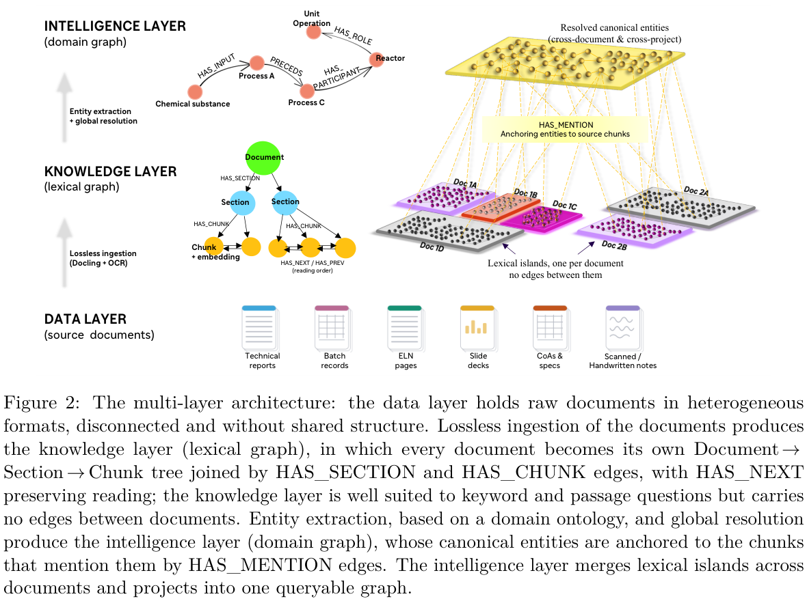

本文补录 **2026-09-11 的精选阅读**，于 2026-10-29 核对公开原文。归档日不是发表日；本文固定使用下列 v1，不混入后续修订。数字为作者报告，本站未独立复现。

## 两层知识承担不同问题

本文采用 9 月 10 日 v1，PDF 页首题名为 From Document Silos to Process Intelligence: A Dual-Layer Knowledge Graph for CMC Process Development；当前公开记录题名已使用 Multi-Layer，不能混用版本结果。词法层保存 Document→Section→Chunk 及来源，领域层补充本体对齐实体和跨文档关系，路由器按问题选择路径。

## 三层评价揭示什么差异

Claude Sonnet 4.5 在 AWS Bedrock 上运行，温度 0.2、输出上限 2,048 tokens。由一个 Sanofi 小分子项目的 38 份开发报告构建 505 道题，词法层 Tier-1 选择题准确率约 95%，Tier-2 自由回答的 LLM 裁判通过率约 85%；两者不一致的案例再交领域专家审查。

这些指标属于不同评价协议，不能平均成统一可靠率，也不是领域图谱层单独贡献的消融结果。比较与全语料问题更难，专有报告与模型出题还限制外部复核。

## 我的判断

来源锚定有利于审核，但不能保证提取或答案正确。该工作是信息工程评测，不是制药流程或监管决策的安全认证；应保留题目生成、裁判与专家复核各自的误差边界。

## 原论文视觉证据

图源：Reza Amirmoshiri , Faryad Sahneh , Yasser Jangjou，《From Document Silos to Process Intelligence: A Dual-Layer Knowledge Graph for CMC Process Development》，arXiv:2609.11493v1，Figure 2，PDF 第 5 页。[原图出处](https://arxiv.org/pdf/2609.11493v1#page=5) · [CC BY 4.0](https://creativecommons.org/licenses/by/4.0/)。裁剪自原文。

## 深读原文与范围

- [From Document Silos to Process Intelligence: A Dual-Layer Knowledge Graph for CMC Process Development](https://arxiv.org/abs/2609.11493v1) · v1，公开于 2026-09-10。

本篇深读上述 1 篇；以下是同日公开阅读入口，题名以核验时公开记录为准，深读题名按指定 PDF 页首；仅核对版本日期和来源，未逐篇核验实验。

## 同日阅读目录

- [From Document Silos to Process Intelligence: A Dual-Layer Knowledge Graph for CMC Process Development](https://arxiv.org/abs/2609.11493v1) · v1，2026-09-10。
- [Glyph: A Multi-Strategy Agentic System for Column Description and Sensitivity-Ontology Tagging of Enterprise Data Catalogs](https://arxiv.org/abs/2609.10430v1) · v1，2026-09-09。
- [Show-Harness: Just a VLM Agent Can Play Robots](https://arxiv.org/abs/2609.10522v1) · v1，2026-09-09。
- [Semigroup-JEPA: Latent Dynamics Consistency for Zero-Shot Physics Generalization](https://arxiv.org/abs/2609.10464v1) · v1，2026-09-09。
- [Programmable World Model](https://arxiv.org/abs/2609.10540v1) · v1，2026-09-09。
- [Eliciting Weak-to-Strong Generalization with On-Policy Reverse Distillation](https://arxiv.org/abs/2609.08798v1) · v1，2026-09-08。
- [SMELT: Scaling Laws for Compute-Matched MoE Looped Transformers](https://arxiv.org/abs/2609.01343v1) · v1，2026-09-01。
