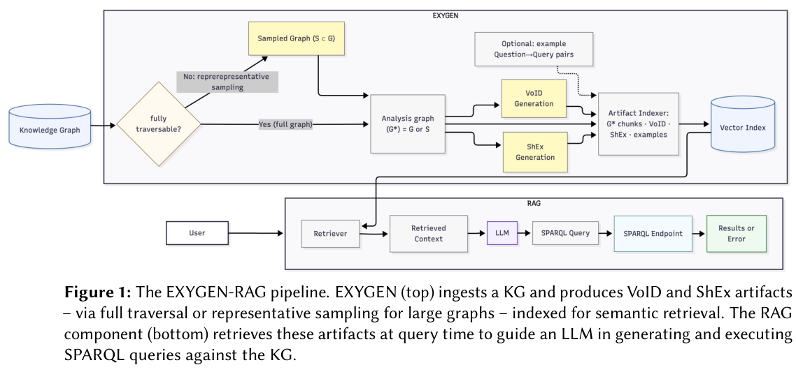

## 结构描述与检索共同约束查询

EXYGEN 将 VoID 统计描述与 ShEx schema 接入 RAG，用图谱派生上下文指导 SPARQL。它同时研究大图如何产生这些元数据，避免完整遍历成为瓶颈。

## 两项实验有不同计时对象

SciQA 共 2,565 对问句—查询，测试集 513 对。结合 ShEx、检索三元组及问句—查询示例的最好配置，执行结果 exact match 为 0.419，未进行 LLM 微调。仍使用策展示例，因此不是完全没有监督；词面 F1 也不能当作查询执行正确率。

另一项采样实验在 OpenCitations Meta、GESIS 等图上，使元数据生成运行时间改善超过 80 倍。它不是最终问答端到端提速 80 倍；在细粒度 ORKG 上完整生成不可行，也不能拿失败基线计算无限加速。谓词覆盖与采样损失仍需分别检查。

## 我的判断

复用 schema 上下文有潜力降低领域微调负担，但应将示例依赖、采样代表性与端点执行纳入验收。单一 SciQA 结果不能直接成为所有企业图谱的性能承诺。

## 论文图表

图源：Harshdeep Singh , Yurui Zhu , Giovanni Colavizza , Matteo Romanello，《Enabling Knowledge Graph Understanding at Scale with the EXplore Your Graphs ENgine (EXYGEN)》，arXiv:2609.11569v1，Figure 1，PDF 第 4 页。[原图出处](https://arxiv.org/pdf/2609.11569v1#page=4) · [CC BY 4.0](https://creativecommons.org/licenses/by/4.0/)。仅裁剪原页面，保留完整图表、图注和必要标签，未重绘或修改数据，不表示作者认可本解读。图片沿用其原许可，本站页脚许可不为它增加非商业或其他限制。

## 论文来源

- [Enabling Knowledge Graph Understanding at Scale with the EXplore Your Graphs ENgine (EXYGEN)](https://arxiv.org/abs/2609.11569v1) · v1，公开于 2026-09-10。

## 同日阅读目录

- [Enabling Knowledge Graph Understanding at Scale with the EXplore Your Graphs ENgine (EXYGEN)](https://arxiv.org/abs/2609.11569v1) · v1，2026-09-10。
- [From Queries to Narratives: Cultural Heritage Data Stories for Knowledge Graph Exploration and Quality Assessment](https://arxiv.org/abs/2609.11403v1) · v1，2026-09-10。
- [Data Scarcity and Model Sparsity: Mixtures-of-Experts Overfit More to Repeated Data](https://arxiv.org/abs/2609.11917v1) · v1，2026-09-10。
- [UniMPA: A Unified Memory-Prediction-Action Model via Action-Grounded Transition Modeling](https://arxiv.org/abs/2609.11875v1) · v1，2026-09-10。
- [World in World: Explore the World with World Models](https://arxiv.org/abs/2609.11548v1) · v1，2026-09-10。
- [BenchShield: Formal Model-Backed Instrumentation for Reward Integrity in LLM-Agent Evaluation Infrastructure](https://arxiv.org/abs/2609.11028v1) · v1，2026-09-10。
- [T1: Terminal Agent Reinforcement Learning for Long-Horizon Tasks](https://arxiv.org/abs/2609.11042v1) · v1，2026-09-10。

文中实验结果为论文作者报告，未独立复现。
