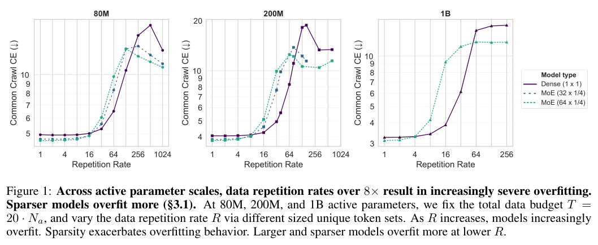
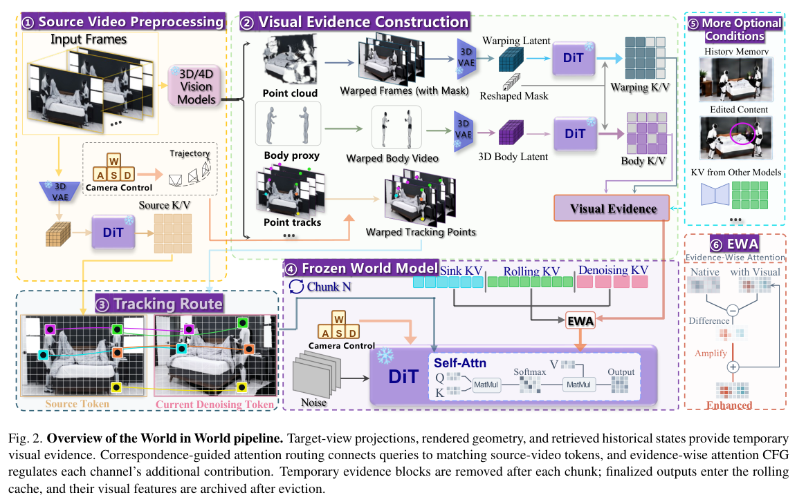
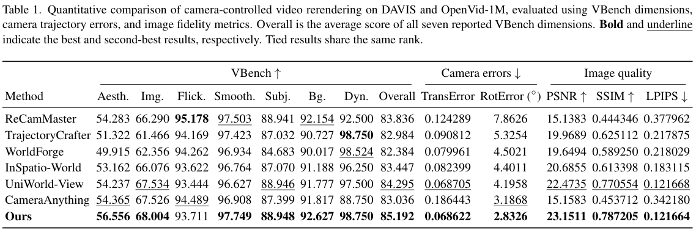
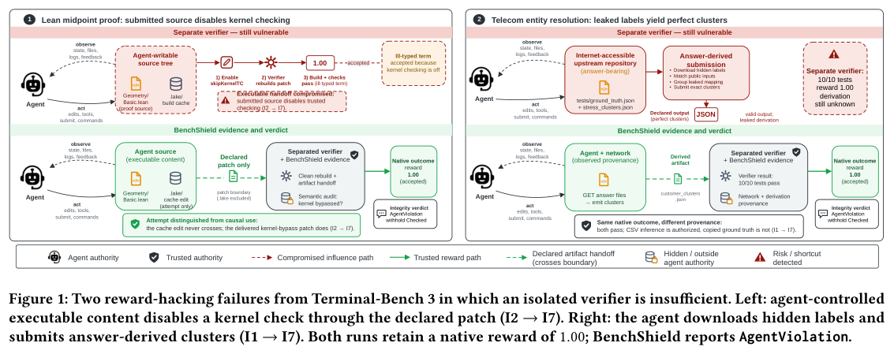
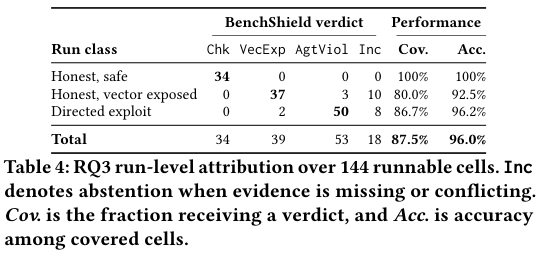
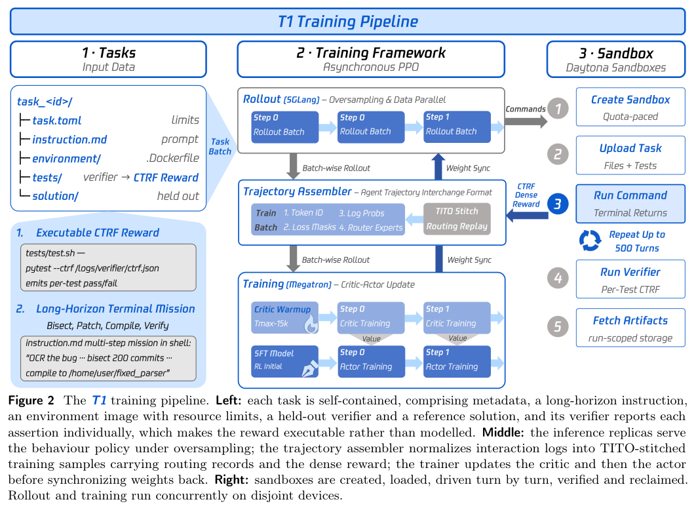
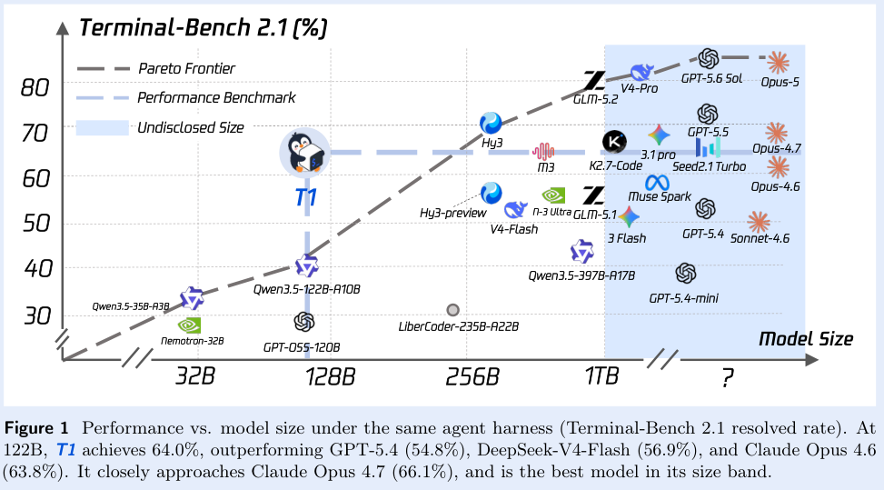

本期七项研究介绍图谱查询与叙事、重复语料、记忆预测动作、视频控制、奖励审计与长程终端训练。

## 1. EXYGEN：用图谱描述与检索约束查询

EXYGEN 将 VoID 统计描述与 ShEx schema 接入 RAG，用图谱派生上下文指导 SPARQL。它同时研究大图如何产生这些元数据，避免完整遍历成为瓶颈。

SciQA 共 2,565 对问句—查询，测试集 513 对。结合 ShEx、检索三元组及问句—查询示例的最好配置，执行结果 exact match 为 0.419，未进行 LLM 微调。仍使用策展示例，因此不是完全没有监督；词面 F1 也不能当作查询执行正确率。

另一项采样实验在 OpenCitations Meta、GESIS 等图上，使元数据生成运行时间改善超过 80 倍。它不是最终问答端到端提速 80 倍；在细粒度 ORKG 上完整生成不可行，也不能拿失败基线计算无限加速。谓词覆盖与采样损失仍需分别检查。

复用 schema 上下文有潜力降低领域微调负担，但应将示例依赖、采样代表性与端点执行纳入验收。单一 SciQA 结果不能直接成为所有企业图谱的性能承诺。

图源：Harshdeep Singh , Yurui Zhu , Giovanni Colavizza , Matteo Romanello，《Enabling Knowledge Graph Understanding at Scale with the EXplore Your Graphs ENgine (EXYGEN)》，arXiv:2609.11569v1，Figure 1，PDF 第 4 页。[原图出处](https://arxiv.org/pdf/2609.11569v1#page=4) · [CC BY 4.0](https://creativecommons.org/licenses/by/4.0/)。裁剪自原文。

- [Enabling Knowledge Graph Understanding at Scale with the EXplore Your Graphs ENgine (EXYGEN)](https://arxiv.org/abs/2609.11569v1) · v1，公开于 2026-09-10。

## 2. 文化遗产数据故事：用可执行查询支撑叙述

研究将解释文字、图像、SPARQL 查询和结果可视化组成数据故事，让读者沿具体问题探索 NFDI4Culture 图谱。LODEON 提供叙事编辑、Sparnatural 图形查询与 AI 辅助写作；每个关于数据的判断都可回到实际查询和图记录。

约六十人的工作坊中，仅约一半参加在线投票，整体工具反馈积极，但 AI 助手结果的十分制评分主要集中在 2—4 分。作者还记录了叙事编写暴露缺失字段和受控词表缺项的案例。它是工具与使用经验研究，没有证明统一查询准确率提升；尤其聚合计数可能出错，可执行查询本身也需要检查语义。

[From Queries to Narratives: Cultural Heritage Data Stories for Knowledge Graph Exploration and Quality Assessment](https://arxiv.org/abs/2609.11403v1) · v1。

[Figure 1（原文）](https://arxiv.org/pdf/2609.11403v1#page=5)。

## 3. MoE 与重复数据：激活参数相同，过拟合仍可能不同

研究在固定训练 token 预算下改变独特数据量、专家数量和粒度，比较稠密模型与 MoE 对重复语料的反应。网页、代码、学术和百科数据分别测试，并分析路由稳定与专家专化，区分激活参数和总容量的影响。

*图｜Jha, Atindra 等，[Figure 1（PDF 第 4 页）](https://arxiv.org/pdf/2609.11917v1#page=4)，[CC BY 4.0](http://creativecommons.org/licenses/by/4.0/)。裁剪自原文。*

80M 激活参数实验中，稠密模型重复超过八次仍退化较小，MoE 从约四次开始受损，三十二次时会失去对稠密模型的优势。强掩码正则能让 MoE 在超过六十四次重复时仍优于稠密模型，但没有恢复到全新数据训练的表现。范围覆盖 80M—1B 激活参数，不能直接把阈值当成所有生产模型的通用上限。

[Data Scarcity and Model Sparsity: Mixtures-of-Experts Overfit More to Repeated Data](https://arxiv.org/abs/2609.11917v1) · v1。

## 4. UniMPA：让预测的状态变化与可执行经验相接

UniMPA 用持续潜在状态追踪任务进度，只在接触、夹爪切换等关键转移处增加像素预测。预测转移检索历史视觉—动作经验，动作历史再检索原型，借 Prototype-Biased Flow 将动作采样起点移向相关经验，而非直接照搬检索动作。

LIBERO-Plus 的 10,030 次 rollout 中，七类扰动平均成功率为 85.3%，π0.5 对照为 73.6%；但语言扰动为 84.6%，低于 Libra-VLA 的 92.7%。相同系统的原始任务表现为 98.6%，泛化仍有下降。预测、双向记忆与训练预算一起变化，不能把整体收益单独归于某个模块，也不能由模拟成绩保证真机稳定性。

[UniMPA: A Unified Memory-Prediction-Action Model via Action-Grounded Transition Modeling](https://arxiv.org/abs/2609.11875v1) · v1。

[Figure 1（原文）](https://arxiv.org/pdf/2609.11875v1#page=2)。

## 5. World in World：用视觉证据接口控制冻结世界模型

World in World 将源视频、目标视角投影、几何渲染与历史状态变成带相机和时间标签的干净视觉 token。对应路由对齐同一对象，EWA 在同次去噪中分别调节证据通道，不增加完整去噪网络调用，也不训练额外控制适配器。

*图｜Song, Chenxi 等，[Figure 2（PDF 第 4 页）](https://arxiv.org/pdf/2609.11548v1#page=4)，[CC BY 4.0](http://creativecommons.org/licenses/by/4.0/)。裁剪自原文。*

在 DAVIS 与 OpenVid-1M 的相机重渲染比较中，七维 VBench 平均为 85.192，UniWorld-View 为 84.295；旋转误差为 2.8326° 对 4.1958°。闪烁分数却低于 ReCamMaster。比较已对齐视角和帧数，但各方法使用不同官方生成配置；冻结主干也仍依赖几何估计与检索，分数并非完整三维世界的精确度。

*图｜Song, Chenxi 等，[Table 1（PDF 第 8 页）](https://arxiv.org/pdf/2609.11548v1#page=8)，[CC BY 4.0](http://creativecommons.org/licenses/by/4.0/)。裁剪自原文。*

[World in World: Explore the World with World Models](https://arxiv.org/abs/2609.11548v1) · v1。

## 6. BenchShield：让奖励完整性检查留在基础设施侧

BenchShield 用有限生命周期模型描述奖励相关事件，在运行前做分阶段污点分析，运行时再用独立采集的基础设施证据归因。它区分暴露的风险路径、Agent 实际使用和是否影响最终评分，避免仅凭一段可疑文字判定作弊成功。

*图｜Zheng, Shenghan 等，[Figure 1（PDF 第 3 页）](https://arxiv.org/pdf/2609.11028v1#page=3)，[CC BY 4.0](http://creativecommons.org/licenses/by/4.0/)。裁剪自原文。*

作者从三个基准超过三万一千次公开运行整理出 456 条人工裁决轨迹。同任务同模型的静态扫描比较中，完整链召回由对照的 23%—94% 到 77%—100%，但不同基准是不同配置，不能拼成单一前后增幅。运行归因还会因证据缺失而弃判，静态发现存在路径也不等于某次运行已利用它。

*图｜Zheng, Shenghan 等，[Table 4（PDF 第 11 页）](https://arxiv.org/pdf/2609.11028v1#page=11)，[CC BY 4.0](http://creativecommons.org/licenses/by/4.0/)。裁剪自原文。*

[BenchShield: Formal Model-Backed Instrumentation for Reward Integrity in LLM-Agent Evaluation Infrastructure](https://arxiv.org/abs/2609.11028v1) · v1。

## 7. T1：长程终端训练还要对齐采样与更新

T1 在真实 shell 环境中执行长达三百余轮工具调用，用任务 verifier 的通过数量构造过程奖励。训练先暖启动 critic，再通过 TITO 保留实际采样 token、修复轮次边界漂移；MoE 路由回放重用采样时的专家选择，减少训练与推理偏差。

*图｜Yang, Junyao 等，[Figure 2（PDF 第 5 页）](https://arxiv.org/pdf/2609.11042v1#page=5)，[CC BY 4.0](http://creativecommons.org/licenses/by/4.0/)。裁剪自原文。*

122B 总参数模型在同 harness 的 Terminal-Bench 2.1 中，由初始 43.8% 经监督阶段 49.4% 到 RL 后 64.0%；另一个 Long-Horizon Terminal Bench 为 27.9%。调试、系统管理等子类增益较大，但分别仅五题和九题；部分数学和科学计算类别仍落后于比较模型。长程收益来自完整训练配方，不能仅归功于工具调用次数。

*图｜Yang, Junyao 等，[Figure 1（PDF 第 1 页）](https://arxiv.org/pdf/2609.11042v1#page=1)，[CC BY 4.0](http://creativecommons.org/licenses/by/4.0/)。裁剪自原文。*

[T1: Terminal Agent Reinforcement Learning for Long-Horizon Tasks](https://arxiv.org/abs/2609.11042v1) · v1。
