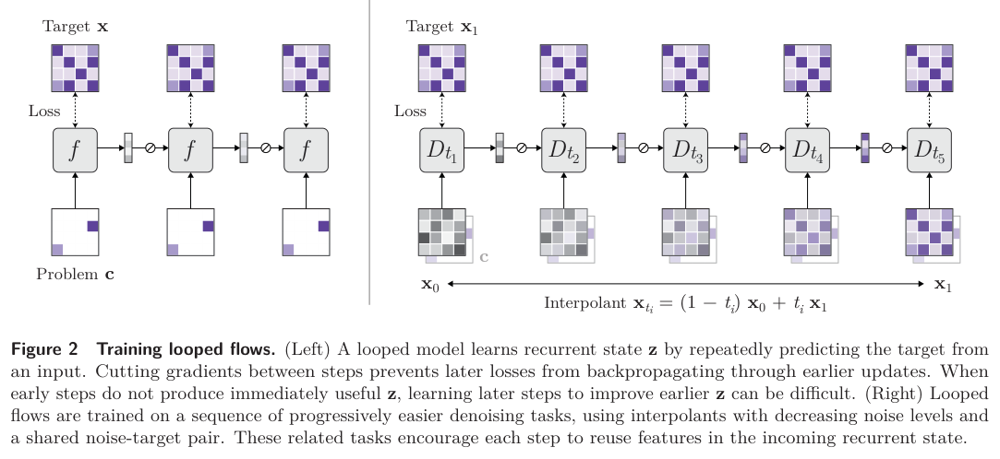
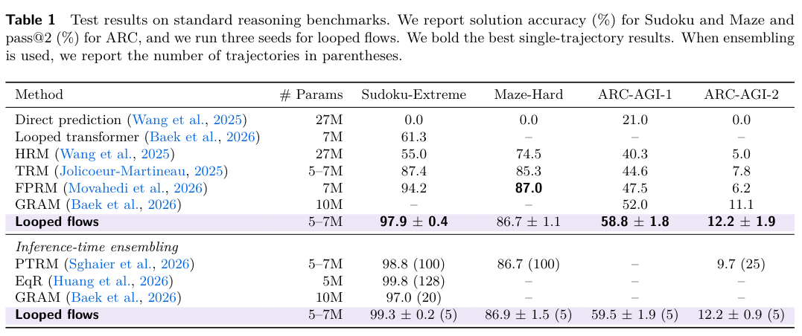
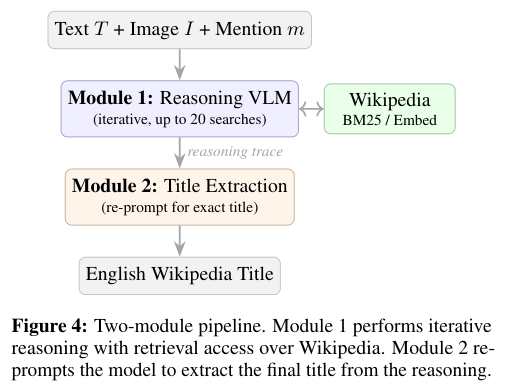
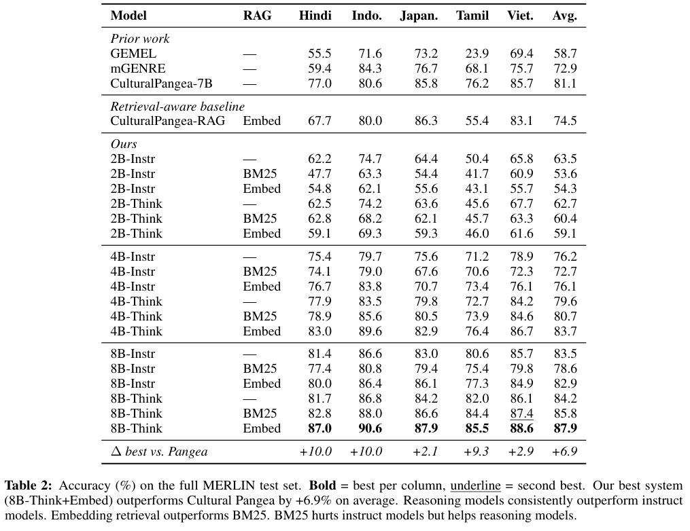
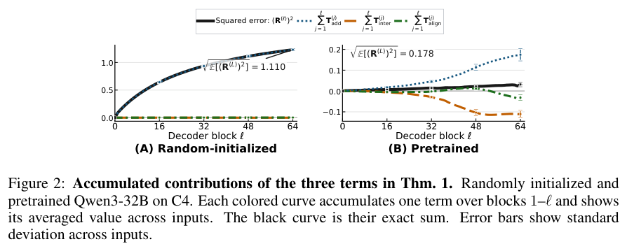
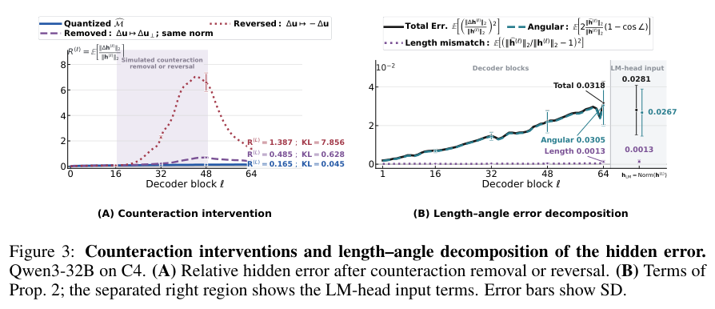

本期七项研究介绍结构文档检索、Wikidata 历史、循环 flow、多语实体链接、量化误差、拓扑任务与概念预测。

## 1. VikingRAG：沿结构定位证据并复用检索路径

VikingRAG 将目录结构与语义检索结合，按证据缺口进行多轮访问；再将已完成检索轨迹物化为经验边，对相似查询复用。自适应升级只在单轮证据不足时调用多轮 Agent。

六个真实结构化文档数据集，最大语料约 8.78M tokens。作者报告基础 VikingRAG 在保持较高准确性的条件下使用所比较方法 11.6%–51.9% 的 tokens；加入经验复用与升级策略后为 5.1%–32.5%。这些比例跨数据、对照与配置，不是一个统一延迟倍数或所有任务的保证。

实验机器为两颗 Intel Xeon 6342 与两张 NVIDIA L20。文档入库、经验构建和维护仍有成本；减少查询交互不等于完整生命周期费用同比下降。相关质量指标仍需逐数据集阅读，不能将 competitive accuracy 改写成完全无损。

经验边可以节省重复探索，但旧路径遇到文档更新可能失效。应记录证据版本、升级触发条件与回退，并测新问题而非只测相似历史问题的收益。

[Figure 1，原论文 PDF 第 3 页](https://arxiv.org/pdf/2609.11390v1#page=3)。

- [VikingRAG: Accurate and Token-efficient Retrieval-augmented Generation over Structured Documents](https://arxiv.org/abs/2609.11390v1) · v1，公开于 2026-09-10。

## 2. WiDiff：把 Wikidata 修订展开为可查询的细粒度变化

WiDiff 从完整 XML 编辑历史中逐次比较实体版本，分别保存值、rank、引用与 qualifier 的创建、删除和更新，再将变化表与修订元数据连接查询。这样能区分一次修订里修改多个事实与同一事实被多次改写，避免只用快照或修订次数概括知识演化。

2025 年 6 月 dump 的处理覆盖约 1.208 亿实体、23.12 亿修订，压缩输出约 4.43TB；仅版本 diff 的平均计算为 0.37 毫秒，不能当作包含读取、排队与写库的单实体总时延。排除天体、学术文章及低变化实体后的分析集为约 3,106 万实体，后续行为统计只适用于这一筛选范围。

[WiDiff: Extracting Changes from Wikidata's Edit History](https://arxiv.org/abs/2609.08508v1) · v1。

[Figure 1（原文）](https://arxiv.org/pdf/2609.08508v1#page=5)。

## 3. Looped Flows：用局部去噪目标训练可继续思考的状态

Looped Flows 让共享去噪器更新循环隐状态，同时沿逐步降噪、共享噪声的 flow 轨迹学习。局部目标把时间上的计算关联起来，推理时可通过更细积分网格增加计算，也可从不同初始噪声得到多个候选解。

*图｜Suleymanzade, Ayhan 等，[Figure 2（PDF 第 2 页）](https://arxiv.org/pdf/2609.11801v1#page=2)，[CC BY 4.0](http://creativecommons.org/licenses/by/4.0/)。裁剪自原文。*

三种子、单轨迹的 ARC-AGI-1 为 58.8±1.8%，ARC-AGI-2 为 12.2±1.9%，两者都按 Pass@2 计；Sudoku 的 97.9±0.4% 则是解题准确率。Maze 为 86.7±1.1%，略低于 FPRM 的 87.0%。增加到五条轨迹是另一种推理预算，不能与单轨迹或其他方法上百轨迹集成直接混比。

*图｜Suleymanzade, Ayhan 等，[Table 1（PDF 第 7 页）](https://arxiv.org/pdf/2609.11801v1#page=7)，[CC BY 4.0](http://creativecommons.org/licenses/by/4.0/)。裁剪自原文。*

[Thinking with Looped Flows](https://arxiv.org/abs/2609.11801v1) · v1。

## 4. Think Before You Link：长尾实体需要检索与推理一起工作

论文用图谱文档量和连接结构补充页面浏览量，重新定义多语实体的稀有程度。方法让推理型 VLM 迭代检索 Wikipedia，逐步比较图文证据，再单独输出最终实体标题；检索由模型继续决定，首轮显式要求搜索以保证实验确实使用工具。

*图｜Pengpun, Parinthapat 等，[Figure 4（PDF 第 5 页）](https://arxiv.org/pdf/2609.10745v1#page=5)，[CC BY 4.0](http://creativecommons.org/licenses/by/4.0/)。裁剪自原文。*

MERLIN 五语言上，Qwen3-VL-8B-Think 配合 embedding 检索的语言宏平均准确率为 87.9%，Cultural Pangea 为 81.1%。8B-Instruct 加同类检索却从 83.5 降到 82.9。收益依赖推理与检索组合，长尾切片定义不同也会暴露不同错误，不能用一个稀有度指标代表全部文化覆盖。

*图｜Pengpun, Parinthapat 等，[Table 2（PDF 第 6 页）](https://arxiv.org/pdf/2609.10745v1#page=6)，[CC BY 4.0](http://creativecommons.org/licenses/by/4.0/)。裁剪自原文。*

[Think Before You Link: Rarity, Reasoning, and Retrieval in Multilingual Entity Linking](https://arxiv.org/abs/2609.10745v1) · v1。

## 5. 后训练量化：误差为何没有随层数简单相加

研究把量化隐藏误差拆成上一层传入的误差与本层新增误差，发现预训练模型中两者常相互抵消；LM head 的几何又使高排名 token 的分数与概率更稳定。随机初始化对照与干预实验用于区分权重接近和模型学到的抗扰动结构。

*图｜Chen, Yuxiang 等，[Figure 2（PDF 第 4 页）](https://arxiv.org/pdf/2609.11716v1#page=4)，[CC BY 4.0](http://creativecommons.org/licenses/by/4.0/)。裁剪自原文。*

Qwen3-32B、C4 的前四十八层中，负误差交互抵消约 50.2% 的新增误差项；随机初始化下每层交互项幅度至多约为新增项的 0.16%。按隐藏状态尺度归一化后的 63.4% 是另一项分解结果，不能与 50.2% 混用。这解释特定模型和量化设置下的误差传播，不是所有低比特格式或敏感任务都无质量损失的保证。

*图｜Chen, Yuxiang 等，[Figure 3（PDF 第 5 页）](https://arxiv.org/pdf/2609.11716v1#page=5)，[CC BY 4.0](http://creativecommons.org/licenses/by/4.0/)。裁剪自原文。*

[Why Does Post-Training Quantization Work?](https://arxiv.org/abs/2609.11716v1) · v1。

## 6. MindTopo：识别拓扑关系与实际操作是两种能力

MindTopo 把连续性、分离、顺序、包围和绳结五类拓扑性质转成十三种可控难度任务，既问视觉场景关系，也让闭环 Agent 执行动作达到目标。程序化标注支持检查拓扑变化，而不仅按画面是否像目标判分。

11,030 个样本、十四个多模态模型中，GPT-5.6-Sol 的任务宏平均为 61.42%，观察到的人类结果为 97.87%；其关系推理为 66.83%，规划成功率为 52.75%。两类指标分母与任务不同，差距不能解释为同一道题上纯增加动作造成的因果下降。人评主要为每题一人，三人共同标注二百题子集，仍需留意标注与程序环境的覆盖边界。

[MindTopo: Can Foundation Models Reason in Topological Space?](https://arxiv.org/abs/2609.11900v1) · v1。

[Figure 1（原文）](https://arxiv.org/pdf/2609.11900v1#page=1)。

## 7. NCP-ArchPreview：同时预测下一 token 与下一概念

NCP-ArchPreview 从隐藏状态构建乘积量化的离散概念词表，让 Concept Module 预测跨多个 token 的未来概念，再把概念表示反馈给 token 解码。概念和 token 目标联合训练，推理仍保留普通自回归生成。

8.9B 模型在 Dolma-3 上训练 5.73T token，Stage-1 总体宏平均为 49.04，OLMo-3 基线为 46.59，GSM8K 为 45.26 对 39.27；但基线规模为 7B，不能把全部差值归因于目标。后训练 Stage-2 的代码均分反而为 38.77 对 39.42。参数匹配消融和原模型比较是不同证据，token 节省比例也不等于相同算力节省。

[NCP-ArchPreview Technical Report: Moving towards Latent Space Language Models through Next Concept Prediction](https://arxiv.org/abs/2609.10715v1) · v1。

[Figure 1（原文）](https://arxiv.org/pdf/2609.10715v1#page=2)。
