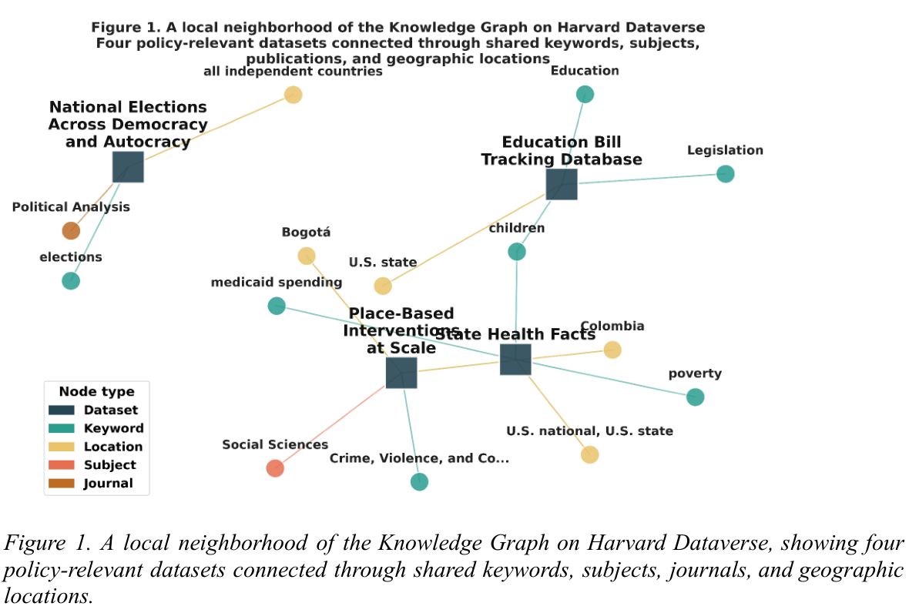

## 元数据图连接数据集，而非只保存文件

这项 Harvard Dataverse 研究将数据集、关键词、出版物、学科和地点连接成图，讨论地理研究中的地点解析、实体链接及跨数据集导航。其对象是公开元数据组织，不是一个新的通用地理预测器。

## 图规模与检索范围

研究图包含 102,650 个数据集、215,985 个节点、528,003 条边，其中 43,991 个数据集有地理元数据。对标题、描述与关键词使用一组政策相关词后，识别出 7,654 个地理数据集。这是特定规则下的检索子集，不是政策相关性的完整召回或分类准确率。

地点名称缺少统一受控词表，边界框也不能表达所有真实覆盖区域。不同空间粒度、同名地点和描述不完整，会使看似可连接的数据难以直接合并；图边存在不等于语义或统计口径相容。

## 我的判断

应把来源标识、版本、空间粒度与消歧决定一起保存。拓扑能帮助发现候选，却不能自动解决因果推断、代表性和缺失元数据问题，使用者仍需检查原数据。

## 原论文视觉证据

图源：Danny EBanks , Devika Jain，《Geospatial AI, Dataverse Metadata, and the Study of Place-Based Government》，arXiv:2609.11674v1，Figure 1，PDF 第 3 页。[原图出处](https://arxiv.org/pdf/2609.11674v1#page=3) · [CC BY 4.0](https://creativecommons.org/licenses/by/4.0/)。裁剪自原文。

## 论文来源

- [Geospatial AI, Dataverse Metadata, and the Study of Place-Based Government](https://arxiv.org/abs/2609.11674v1) · v1，公开于 2026-09-10。

## 同日阅读目录

- [Geospatial AI, Dataverse Metadata, and the Study of Place-Based Government](https://arxiv.org/abs/2609.11674v1) · v1，2026-09-10。
- [Reification as a Transferable Vocabulary: Zero-Shot Link Prediction with Vanilla GNNs](https://arxiv.org/abs/2609.11347v1) · v1，2026-09-10。
- [The Last AI Built by Humans: Toward Genuine Recursive Self-Improvement](https://arxiv.org/abs/2609.11873v1) · v1，2026-09-10。
- [SenseNova-U1.5: Towards Native Unified Visual Intelligence](https://arxiv.org/abs/2609.11929v1) · v1，2026-09-10。
- [Vidu S2: Real-Time Interactive, Editable, and Spatial Video Generation](https://arxiv.org/abs/2609.11638v1) · v1，2026-09-10。
- [Learning Realistic Athletic Sprinting Without Demonstrations](https://arxiv.org/abs/2609.11083v1) · v1，2026-09-10。
