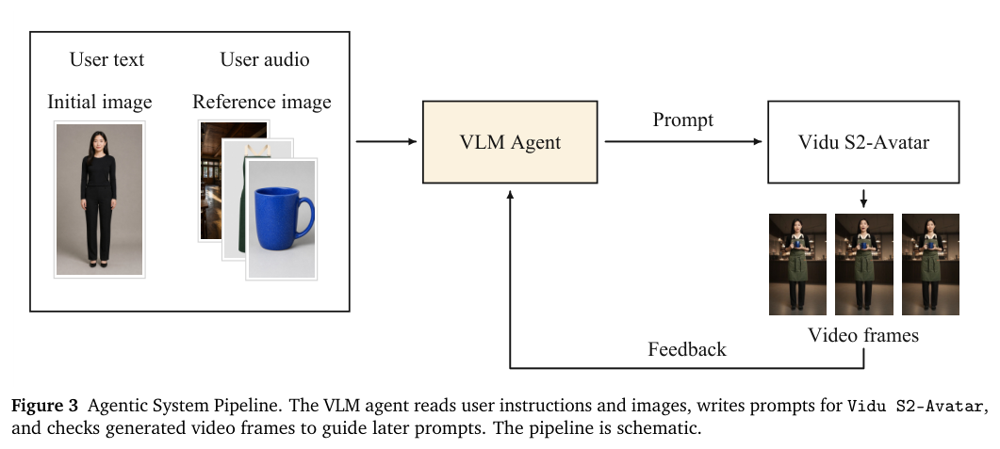
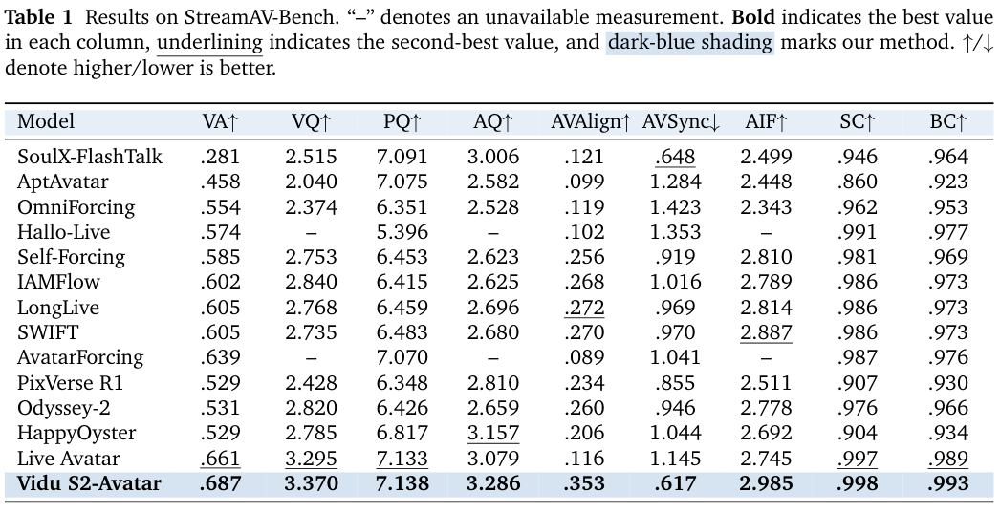
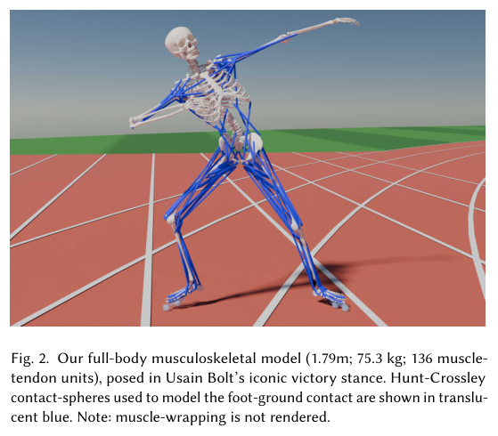
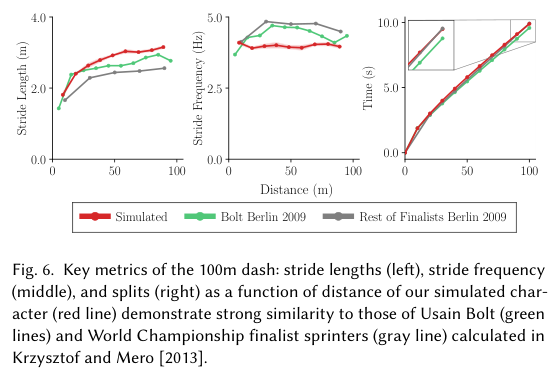

本期六项研究介绍地理元数据、图结构迁移、递归改进、统一视觉生成、交互视频与无演示的肌肉控制。

## 1. 地理元数据：连接数据集、地点与研究问题

这项 Harvard Dataverse 研究将数据集、关键词、出版物、学科和地点连接成图，讨论地理研究中的地点解析、实体链接及跨数据集导航。其对象是公开元数据组织，不是一个新的通用地理预测器。

研究图包含 102,650 个数据集、215,985 个节点、528,003 条边，其中 43,991 个数据集有地理元数据。对标题、描述与关键词使用一组政策相关词后，识别出 7,654 个地理数据集。这是特定规则下的检索子集，不是政策相关性的完整召回或分类准确率。

地点名称缺少统一受控词表，边界框也不能表达所有真实覆盖区域。不同空间粒度、同名地点和描述不完整，会使看似可连接的数据难以直接合并；图边存在不等于语义或统计口径相容。

应把来源标识、版本、空间粒度与消歧决定一起保存。拓扑能帮助发现候选，却不能自动解决因果推断、代表性和缺失元数据问题，使用者仍需检查原数据。

图源：Danny EBanks , Devika Jain，《Geospatial AI, Dataverse Metadata, and the Study of Place-Based Government》，arXiv:2609.11674v1，Figure 1，PDF 第 3 页。[原图出处](https://arxiv.org/pdf/2609.11674v1#page=3) · [CC BY 4.0](https://creativecommons.org/licenses/by/4.0/)。裁剪自原文。

- [Geospatial AI, Dataverse Metadata, and the Study of Place-Based Government](https://arxiv.org/abs/2609.11674v1) · v1，公开于 2026-09-10。

## 2. 重化图表示：把迁移词汇放进数据结构

研究将每条事实转为一个节点，经六种固定元关系连接主语、宾语和匿名关系类型。这样普通 GAT、GINE、GraphSAGE 或 R-GCN 可在同一词汇下处理新图，不必为每个新关系学习独立参数；关系数据库也可将行与外键变为类似结构。

仅用含 4,245 条三元组的一张图、单 A100 训练约三十分钟，GAT 在四十个归纳评测上的 filtered MRR 为 0.3565，ULTRA 重跑为 0.3732。双方都未见过的十三项子集上表现接近，但该子集在看到结果后选择，且主要来自 NELL。它显示表示设计的迁移潜力，尚非在全部任务上击败专用模型。

[Reification as a Transferable Vocabulary: Zero-Shot Link Prediction with Vanilla GNNs](https://arxiv.org/abs/2609.11347v1) · v1。

[Figure 1（原文）](https://arxiv.org/pdf/2609.11347v1#page=3)。

## 3. 真正递归自改进：改进执行之后，还要改进策略

这篇综述用 Headroom-Closed Index 对不同领域的进展做归一化比较，并把递归自改进分为执行自主、策略自主、经验获取、环境适应和递归元改进。它关注能否把反馈转成持久变化，以及变化是否改善下一轮改进过程。

文中汇总显示，受限且易验证的任务进展与长期有状态工具任务并不均衡。部分网络安全序列还更换了任务子集或采样聚合，因此不能直接画成同协议能力增长。图中 2026 年后的延伸是按剩余空间构造的示意假设，并非预测准确率或已完成训练结果；案例与路线图不能替代可重复的闭环改进实验。

[The Last AI Built by Humans: Toward Genuine Recursive Self-Improvement](https://arxiv.org/abs/2609.11873v1) · v1。

[Figure 1（原文）](https://arxiv.org/pdf/2609.11873v1#page=1)。

## 4. SenseNova-U1.5：在统一模型中改善空间重建与专家蒸馏

SenseNova-U1.5 使用约 8B 的 Mixture-of-Transformers，直接处理视觉 patch，不另设视觉编码器或 VAE。空间 decoder 结合 Pixel Shuffle 与卷积减轻 patch 边界问题，支持最高 4K 的分辨率条件，再将美学、文字、信息图与编辑专家通过 on-policy 蒸馏合入。

Qwen-Image-Bench 英文综合分中，带提示增强为 60.22，不带为 52.82，前代 U1 为 48.28。提示增强的额外处理与模型更新不能混为同一变量；表内 GPT-Image-2 为 65.23，仍更高。综合生成分不是理解准确率，计划开放训练代码也不能当作所有资产已经发布。

[SenseNova-U1.5: Towards Native Unified Visual Intelligence](https://arxiv.org/abs/2609.11929v1) · v1。

[Figure 1（原文）](https://arxiv.org/pdf/2609.11929v1#page=2)。

## 5. Vidu S2：把动态参照与编辑接入实时视频

Vidu S2-Avatar 支持随时更新参考条件的 720p 角色生成，Vidu S2-Editing 处理流式风格、衣服、人物与背景替换。数据管线分别筛选音视频同步、动作与编辑条件，Agent 则读取指令并根据生成帧调整控制，空间生成作为进一步扩展。

*图｜Zhang, Jintao 等，[Figure 3（PDF 第 8 页）](https://arxiv.org/pdf/2609.11638v1#page=8)，[CC BY 4.0](http://creativecommons.org/licenses/by/4.0/)。裁剪自原文。*

StreamAV-Bench 的 VQ 为 3.370，Live Avatar 为 3.295；音画同步误差为 0.617，后者为 1.145。该表同时包含不同原生尺度和模型评分，不能求一个无定义的总准确率。公开基准与二十位评估者的内部配对偏好分开报告；质量表也不足以证明任意负载和设备的端到端实时延迟。

*图｜Zhang, Jintao 等，[Table 1（PDF 第 14 页）](https://arxiv.org/pdf/2609.11638v1#page=14)，[CC BY 4.0](http://creativecommons.org/licenses/by/4.0/)。裁剪自原文。*

[Vidu S2: Real-Time Interactive, Editable, and Spatial Video Generation](https://arxiv.org/abs/2609.11638v1) · v1。

## 6. 无动作演示的冲刺控制：以肌肉动力学约束学习

系统用 31 自由度、136 个肌肉—肌腱单元的人体模型，在 GPU 仿真中训练肌肉激活策略。奖励鼓励速度并减少关节限位力，不使用动作示范；改变越界、姿态或脚步顺序等终止条件，即训练短跑、跨栏、后退和交叉步等任务。

*图｜Wang, William 等，[Figure 2（PDF 第 4 页）](https://arxiv.org/pdf/2609.11083v1#page=4)，[CC BY 4.0](http://creativecommons.org/licenses/by/4.0/)。裁剪自原文。*

RTX 6000 PRO 上并行 4K 世界的累计仿真吞吐约为实时一千倍。百米动作的髋膝运动、地面反力与实测短跑数据有较好一致，但部分峰值力矩和肌肉激活仍不一致。这个一千倍是并行累计经验速度，不是单个人体动作播放速度；没有动作示范也仍依赖生物力学模型、参数校准与任务终止设计。

*图｜Wang, William 等，[Figure 6（PDF 第 7 页）](https://arxiv.org/pdf/2609.11083v1#page=7)，[CC BY 4.0](http://creativecommons.org/licenses/by/4.0/)。裁剪自原文。*

[Learning Realistic Athletic Sprinting Without Demonstrations](https://arxiv.org/abs/2609.11083v1) · v1。
