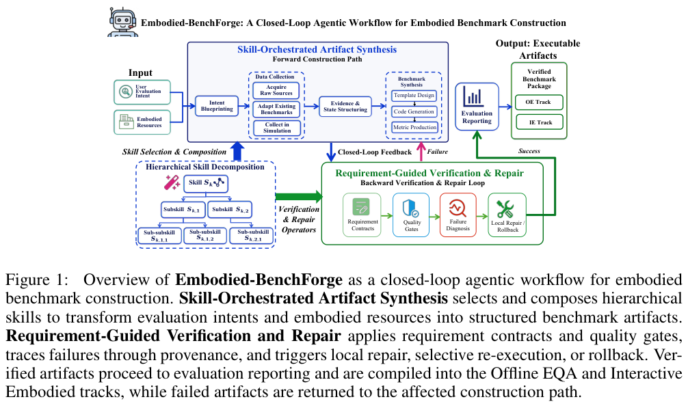

今天关注可靠性的基础设施：执行轨迹怎样进入数据库，生成评测怎样逐项验收，遗忘评测怎样覆盖工具与检索通道。最终答案正确，仍不足以说明中间过程受控。建议先读 TrajectoryDB 的数据模型，再看 Embodied-BenchForge 的工件验证，最后用 K-Bench 检查单答案评测会漏掉什么。

## 1. sheval: An RDF data shapes evaluation tool and test-suite for recursive shapes

[原论文](https://arxiv.org/abs/2609.05944v1) · 2609.05944v1，版本提交 2026-09-05 · [PDF](https://arxiv.org/pdf/2609.05944v1)

sheval 将递归 RDF shape 的语义差异做成可运行测试。ShEx 对递归有明确语义，SHACL 则留给实现处理，因此同一图与约束可能得到不同结果。它适合定位引擎行为，不能据此宣称某一引擎全面更快。质量门禁应同时固定引擎版本与递归策略。

## 2. TrajectoryDB: A New Database for Agent Trajectories

[原论文](https://arxiv.org/abs/2609.07782v1) · 2609.07782v1，版本提交 2026-09-07 · [PDF](https://arxiv.org/pdf/2609.07782v1)

TrajectoryDB 主张将轨迹视为独立数据类型：嵌套且有序的执行结构、需要语义分析的文本，以及状态与工件的血缘要一起保存。摄取、存储和查询共同保留这些关系，才便于记忆提取、微调与审计。这是一篇系统愿景论文，不能读成已经通过吞吐基准的通用数据库产品。

## 3. FlashREINFORCE: Critic-Free Single-Rollout Asynchronous RL for Agentic Language Models

[作者官方论文](https://github.com/yifanzhang-pro/FlashREINFORCE/blob/a1ebe22c6951e40b7be83395f9f15e9b41ab36dc/FlashREINFORCE.pdf) · 固定提交 `a1ebe22c6951e40b7be83395f9f15e9b41ab36dc`，2026-09-14。

FlashREINFORCE 用每个 prompt 一条轨迹的异步更新，结合批内奖励中心化、序列级信任筛选与轨迹平均损失。在 Qwen2.5-Math-1.5B 的五项基准上，作者报告平均准确率 38.0，对照所引 GRPO 为 36.3，rollout 为 256k 对 512k。ALFWorld 的 98.3%/96.5% seen/unseen 成功率则来自 Qwen2.5-7B-Instruct，不能混成同一个模型的结果。部分基线取自既有报告，不能推广为任意异步设置都节省一半总成本。

## 4. Embodied-BenchForge: A Closed-Loop Agentic Workflow for Embodied Benchmark Construction

[原论文](https://arxiv.org/abs/2609.13082v1) · 2609.13082v1，版本提交 2026-09-11 · [PDF](https://arxiv.org/pdf/2609.13082v1)

Embodied-BenchForge 将中间工件连接为依赖图，按类型验证，失败后局部重跑或回滚。系统构建六个 Offline EQA benchmark，以及含 220 项可执行任务的交互 benchmark。我的判断是，可追溯的错误定位与恢复比单次生成题目更值得复用；但特定环境中的质量与消融结果不能替代开放世界长期验证。

图：工件合成、验证与局部修复闭环。Baoyang Jiang , Fengchun Zhang , Leyuan Wang , Haotian Li , Yida Wang , Zhe Ji , Jinshan Lai , Xi Ren , Danyang Li , Zheng Yang , Jianwei Hu , Qiang Ma，arXiv:2609.13082v1，Figure 1，PDF 第 4 页。[原始图源](https://arxiv.org/pdf/2609.13082v1#page=4) · [CC BY 4.0](https://creativecommons.org/licenses/by/4.0/)。仅裁剪页面，保留完整原图及图注，未重绘或修改图内数据，不表示作者认可本解读。该图沿用 CC BY 4.0，本站页脚许可不为其增加非商业或相同方式共享限制。

## 5. Autonomous Research for Open-Ended Problems: A Case Study on Telecom Ticket Retrieval

[原论文](https://arxiv.org/abs/2609.13073v1) · 2609.13073v1，版本提交 2026-09-11 · [PDF](https://arxiv.org/pdf/2609.13073v1)

电信工单检索案例中，有限人工监督的自动研究达到 Recall@1=0.34，人工系统为 0.38。作者报告约十周开发，对照约十个月人工工作，单次 Cursor campaign 最高约 200 美元；评估含 7.6k 留出查询。时间与费用不是相同资源预算的随机对照。更稳妥的用途是让 Agent 做可测搜索与优化，由人保留问题定义和研究判断。

## 6. K-Bench: A Benchmark for LLM Unlearning in Agentic Deployments

[原论文](https://arxiv.org/abs/2609.12808v2) · 2609.12808v2，版本提交 2026-09-14 · [PDF](https://arxiv.org/pdf/2609.12808v2)

K-Bench 同时检查 ReAct Agent 六类可见通道，只有不泄漏且仍可用才算选择性遗忘。秘密位于 prompt 或检索库时，单答案评测可能显示零泄漏，部署全通道仍观察到 22%–86% 查询泄漏。范围依赖秘密来源、观察者与 harness；拒答不能当作知识移除，也不是对模型内部遗忘的理论证明。

## 7. Unified Agentic Video Editing Across Levels of Complexity and Creativity

[原论文](https://arxiv.org/abs/2609.12769v1) · 2609.12769v1，版本提交 2026-09-11 · [PDF](https://arxiv.org/pdf/2609.12769v1)

这项视频编辑工作把 scene preview、视频摘要与电影预告片放在不同复杂度和创作要求下评价，结合 Agent 规划与多模态检索。阅读应区分任务约束遵循和创作判断：三类任务上的产出质量不能推广为自动导演能力或对任意素材都稳定有效。

文中实验结果为论文作者报告，未独立复现。
