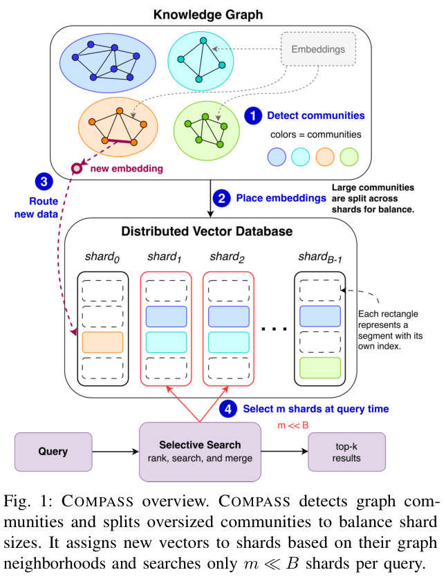

语义结构进入了两个具体位置：COMPASS 用图决定向量分片，EvoOntology 让数据 Agent 查询和修订语义层。工具副作用与 CoT 监控则提醒我们，接口成功和文本正常都不足以保证工作流可靠。工程读者可先看 COMPASS 与工具边界，后训练读者再看 NGU 的计算分配。

## 1. COMPASS: Steering Distributed Vector Search with Scientific Knowledge Graphs

[原论文](https://arxiv.org/abs/2609.13452v1) · 2609.13452v1，版本提交 2026-09-11 · [PDF](https://arxiv.org/pdf/2609.13452v1)

COMPASS 按知识图谱社区放置向量，并按图结构选择少量分片。在四个生物医学图谱上，作者报告只搜索约 13%–18% 语料仍保留接近广播的召回，多跳证据最高为嵌入基线的 2.6 倍；15 个 HPC 节点上吞吐最高为哈希广播的 7.9 倍。这些收益依赖图覆盖、分片配置、硬件和比较对象，不能当作所有向量库的通用倍数。

图：知识图谱社区与查询分片。Song Young Oh , Amal Gueroudji , Seth Ockerman , Rob Latham , Orcun Yildiz , Ian Foster , Kyle Chard , Robert Ross，arXiv:2609.13452v1，Figure 1，PDF 第 1 页。[原始图源](https://arxiv.org/pdf/2609.13452v1#page=1) · [CC BY 4.0](https://creativecommons.org/licenses/by/4.0/)。裁剪自原文。

## 2. EvoOntology: A Self-Evolving Ontology Layer for Data Agents

[原论文](https://arxiv.org/abs/2609.15779v1) · 2609.15779v1，版本提交 2026-09-14 · [PDF](https://arxiv.org/pdf/2609.15779v1)

EvoOntology 把 schema、内容与工具组织为 MCP 语义层，由构建 Agent 建立本体，再以归因驱动的类型化编辑修订。编辑须通过针对当前骨干模型的配对评估，而非只靠 Agent 自评接受。三个数据 Agent benchmark、四个骨干模型支持该设置中的改进；新数据源仍需检查权限、语义覆盖与对已有任务的过拟合。

## 3. Atria Dawn: The Dawn of Agentic Superintelligence

[原论文](https://arxiv.org/abs/2609.15818v1) · 2609.15818v1，版本提交 2026-09-14 · [PDF](https://arxiv.org/pdf/2609.15818v1)

Atria Dawn Preview 将工具交互接入可执行环境和外部验证，在 16 项研究、工程与数字工作基准中有五项达到所比较系统最高报告分数。另有 56 名参与者的 769 条研发任务记录。参与者对已完成任务可行性的回顾，不是严格因果生产率估计；宏大的模型命名也不能替代能力证据。

## 4. Learning to Solve Hard Problems in RL for LLMs by Never Giving Up

[原论文](https://arxiv.org/abs/2609.13443v1) · 2609.13443v1，版本提交 2026-09-11 · [PDF](https://arxiv.org/pdf/2609.13443v1)

Never Give Up 用异步采样持续尝试一道题，直到出现正确解，把计算从容易题移向缺少成功样本的难题。Deepscaler 数学和 Manufactoria 编程实验支持这种课程分配思路。它仍依赖可验证判分与离策略稳健性；缺乏可靠正确性信号时，持续尝试未必带来有效学习。

## 5. Generalized Agent Iteration: One Formal Framework for Iterative Policy Improvement and Recursive Self-Improvement

[原论文](https://arxiv.org/abs/2609.13406v1) · 2609.13406v1，版本提交 2026-09-11 · [PDF](https://arxiv.org/pdf/2609.13406v1)

Generalized Agent Iteration 用两项选择组织自改进：改进机制是否成为 Agent 的一部分，评价标准是否固定在系统之外。框架区分外部锚定、目标漂移与完全自指。它提供形式化描述和条件分析，未经验性证明系统能无限变强；评价循环首先要检查外部标准如何保留。

## 6. When Tool Calls Succeed but Workflows Fail: Anomalies at the Agent-Tool Boundary

[原论文](https://arxiv.org/abs/2609.15397v1) · 2609.15397v1，版本提交 2026-09-14 · [PDF](https://arxiv.org/pdf/2609.15397v1)

工具成功响应之后，工作流仍可能留下重复、缺失或应撤销的副作用。论文区分外部真实事件与运行时观察，归纳八类异常，并检查 98,291 个注册 MCP 工具的注解表达能力。这个数量不是故障率样本。工程上需要明确重试、补偿、暂存与提交契约，调用级成功提示无法独自证明业务完成。

## 7. Corrupt Plans, Clean Traces: Evading Chain-of-Thought Monitoring with Plan Injection

[原论文](https://arxiv.org/abs/2609.15989v1) · 2609.15989v1，版本提交 2026-09-14 · [PDF](https://arxiv.org/pdf/2609.15989v1)

Corrupt Plans, Clean Traces 研究外来计划被模型改写为自身推理后，监控会漏掉什么。所测任务的规避率为 25%–33%，部分条件下更多监控信息或思考预算反而降低检测。这里只讨论防护含义，不展开构造步骤；结论限于论文模型与任务，应结合不可信上下文隔离和外部行为验证。

预印本结论可能随修订变化。
