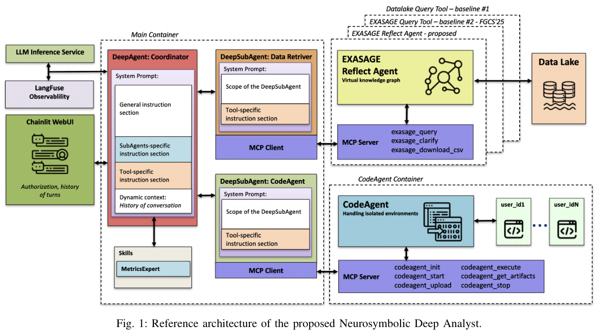

本文补录 **2026-09-17 的推荐日报清单**，于 2026-10-29 核对公开来源。推荐日不等于论文提交日；以下固定到当日及此前存在的版本，不混入后续修订。数字为作者在指定条件下的报告，本站未独立复现。

eolas 将科学文本转成符合本体的数据，Symbolic Separation 则让数据动作经过验证的语义接口。其余工作涉及少步生成、世界动作建模和研究诊断。共同的问题是：验证发生在哪一步，结论由哪些实验支撑？企业数据 Agent 可先看执行前契约，文献抽取读者可先看专家验收。

## 1. Extracting ontology-compliant knowledge from scientific text describing irradiated materials using large language models

[原论文](https://arxiv.org/abs/2609.17291v1) · 2609.17291v1，版本提交 2026-09-15 · [PDF](https://arxiv.org/pdf/2609.17291v1)

eolas 将辐照材料文献转为符合给定本体的图谱，并提供分面表格供专家核验。168 组实验比较模型与提示；起点为五篇代表文章的 111 个相关片段，加 15 个无关片段。作者称专家每篇约需 30–90 分钟，而管线几分钟生成待验图谱。这个速度对比不包含取消专家验收的证明，领域与小样本也限制泛化。

## 2. Symbolic Separation: Grounding Deep Agents in Knowledge Graphs for Trustworthy Operational Data Analytics

[原论文](https://arxiv.org/abs/2609.17107v1) · 2609.17107v1，版本提交 2026-09-15 · [PDF](https://arxiv.org/pdf/2609.17107v1)

Symbolic Separation 允许深度 Agent 规划，但数据动作须经本体约束的虚拟知识图谱和执行前验证，避免模型自行猜测跨源 join。在 49.9 TB 超算遥测上，作者报告端到端成功率从 43% 到 86%，token 成本约为对照的 1/2.4。比较含刚性工作流与非符号消融；收益属于该契约、任务集与系统组合，不能理解成任意接入本体即可获得。

图：Neurosymbolic Deep Analyst 的数据接口与子 Agent 架构。Baibek Davletiyarov , Junaid Ahmed Khan , Andrea Bartolini，arXiv:2609.17107v1，Figure 1，PDF 第 5 页。[原始图源](https://arxiv.org/pdf/2609.17107v1#page=5) · [CC BY 4.0](https://creativecommons.org/licenses/by/4.0/)。裁剪自原文。

## 3. Dream-RSI: Recursive Self-Improvement through Evolving Worlds

[原论文](https://arxiv.org/abs/2609.14858v1) · 2609.14858v1，版本提交 2026-09-14 · [PDF](https://arxiv.org/pdf/2609.14858v1)

Dream-RSI 将已完成发现树作为回放模拟器，先比较探索策略，再把选择的策略放回在线搜索。基础编码 Agent 保持不变，变化发生在探索编排层。算法工程、数学优化与 GPU kernel 案例有启发，但离线回放只覆盖历史已实现空间，回放高分不能直接证明未知分支的真实收益。

## 4. Discrete Beckmann Transport Models for One-Step Language Modeling and Reasoning

[原论文](https://arxiv.org/abs/2609.15903v2) · 2609.15903v2，版本提交 2026-09-15 · [PDF](https://arxiv.org/pdf/2609.15903v2)

DBTM 以时间无关的离散输运映射直接从数据学习守恒残差，替代先训教师再蒸馏的两阶段路线，并可增加迭代细化。论文比较一步与少步语言生成及推理。固定点性质建立在指定构造与假设上，不等于部分训练模型一次调用就能稳定产出高质量文本；须将函数调用次数和质量一起读。

## 5. Modality-Autoregressive World-Action Models

[原论文](https://arxiv.org/abs/2609.17524v1) · 2609.17524v1，版本提交 2026-09-15 · [PDF](https://arxiv.org/pdf/2609.17524v1)

ModAR 依次去噪未来点轨迹、DINO 特征、深度等模态，再预测动作；消融中未来 RGB 并不总有益。从零训练的 ModAR 观察平均成功率约 75%，视频模型初始化的 Flex-π 约 72%，训练 FLOPs 约少 20 倍，另含三项真实双臂任务。不同初始化路线参与了比较，不能宣传成等架构、等预训练条件下的纯算法加速。

## 6. GPU-Accelerated Presolving for Linear Programming

[原论文](https://arxiv.org/abs/2609.16182v1) · 2609.16182v1，版本提交 2026-09-14 · [PDF](https://arxiv.org/pdf/2609.16182v1)

cuPSLP 将 LP presolve 搬到 GPU，以负载均衡与并行归约处理不规则步骤。在 Mittelmann 与 GAMS 大规模 LP 集上，相对 PSLP 的 presolve 时间移位几何均值分别改善 11 倍、42 倍，约简质量相近。该倍数只描述预处理阶段，不能移作整个 LP 求解器端到端加速。

## 7. PaperDoctor: Evidence-Grounded and Actionable Feedback for Scientific Papers in Progress

[原论文](https://arxiv.org/abs/2609.16995v1) · 2609.16995v1，版本提交 2026-09-15 · [PDF](https://arxiv.org/pdf/2609.16995v1)

PaperDoctor 把反馈分为表面筛查、类型化证据验证与预算内重现实验，要求发现带证据位置和修改建议。30 篇进行中论文报告 70.6% 反馈认同，另评 40 篇跨领域稿件。认同率并非错误检测精确率，也不是发表质量保证；我更愿把它作为可追溯的诊断助手。

## 阅读说明

本篇覆盖 7 项公开论文，逐项核对指定历史来源及文中方法、数字和限制，不代表完整复核每项附录或独立重复实验。系统愿景和理论贡献不补造性能分数；模型裁判、模拟任务和作者报告均保留各自边界。预印本结论可能随修订变化。
