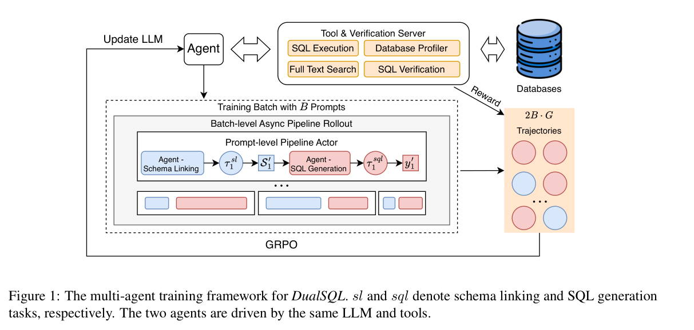

本文补录 **2026-09-18 的推荐日报清单**，于 2026-10-29 核对公开来源。推荐日不等于论文提交日；以下固定到当日及此前存在的版本，不混入后续修订。数字为作者在指定条件下的报告，本站未独立复现。

DualSQL 联合优化模式链接与 SQL 生成，实时 VLA 用轻量策略追上新观测，Agora 用带验证记录的共享历史组织研究。监控和服务系统的论文又把对象推进到内部表征与逐 token 延迟。数据库读者先看奖励和 rollout 护栏，机器人读者先看延迟补偿。

## 1. Linking Speakers of the German Parliament to Wikidata: Scope and Coverage of Metadata

[原论文](https://arxiv.org/abs/2609.18289v1) · 2609.18289v1，版本提交 2026-09-16 · [PDF](https://arxiv.org/pdf/2609.18289v1)

该工作把 1949–2021 年德国联邦议会发言者链接到 Wikidata，连接演讲与人物生平。作者审查性别、职业、历史背景、出生地、语言及外国奖项的元数据覆盖差异。贡献不仅是补 ID，也提醒分析缺失机制：图谱没记某属性，不能推断现实中不存在。

## 2. DualSQL: Text-to-SQL with Multi-Agent Reinforcement Learning

[原论文](https://arxiv.org/abs/2609.18135v1) · 2609.18135v1，版本提交 2026-09-16 · [PDF](https://arxiv.org/pdf/2609.18135v1)

DualSQL 的 schema linking 与 SQL 生成 Agent 共享模型骨干和工具，联合强化学习，并以格式、长度和工具调用护栏约束 rollout。仅用 3,755 个训练样本，4B、8B 模型在 BIRD 开发集的执行准确率为 68.0%、71.1%。这些是特定开发集与执行协议结果；robust execution match 又试图区分偶然返回相同结果和真正正确的查询。

图：共享骨干的双 Agent 联合训练。Shijie Chen , Yu Gan , Yeounoh Chung , Jiani Zhang , Quannan Li , Sravan Babu Bodapati , Cody J. Greer , Yu Su , Fatma Ozcan，arXiv:2609.18135v1，Figure 1，PDF 第 4 页。[原始图源](https://arxiv.org/pdf/2609.18135v1#page=4) · [CC BY 4.0](https://creativecommons.org/licenses/by/4.0/)。仅裁剪页面，保留完整原图及图注，未重绘或修改图内数据，不表示作者认可本解读。该图沿用 CC BY 4.0，本站页脚许可不为其增加非商业或相同方式共享限制。

## 3. Reinforcement Learning for Real-Time Vision-Language-Action Policies

[原论文](https://arxiv.org/abs/2609.18207v1) · 2609.18207v1，版本提交 2026-09-16 · [PDF](https://arxiv.org/pdf/2609.18207v1)

Real-Time EXPO-FT 让慢速大 VLA 产生动作块，再由轻量策略按新观测修改。在四项动态真实任务、在线机器人数据不超过十分钟时，作者报告平均表现从 42% 到 97%；另在 Kinetix 十个环境检验延迟补偿。收益限定于这些控制接口与任务，不能变成所有机器人部署的 97% 成功率承诺。

## 4. ScienceIDE: Turning World's Scientific Codebase into Agent Learnable Environments

[原论文](https://arxiv.org/abs/2609.19134v1) · 2609.19134v1，版本提交 2026-09-16 · [PDF](https://arxiv.org/pdf/2609.19134v1)

ScienceIDE 从专家定义的科学案例与验收规则出发，将分散代码库变为可执行、可生成任务且可验证的学习环境。作者训练 72B、9B、4B 模型，在留出科学代码修复及若干通用任务上报告收益。运行成功与科学结论成立是两个判断；迁移领域仍需专家制定正确性标准。

## 5. Token Latency Fairness: Performance Isolation for Multi-Tenant LLM Serving

[原论文](https://arxiv.org/abs/2609.18112v1) · 2609.18112v1，版本提交 2026-09-16 · [PDF](https://arxiv.org/pdf/2609.18112v1)

FairInference 把公平性从长期吞吐推进到逐 token 延迟：在行为规范客户与指定资源、调度假设下，独占需 d 时间的 token，共享时应在 d+δ 内生成。调度同时处理 GPU 计算阻塞与共享 KV cache。这种保证更贴近交互体验，但依赖可满足负载、资源模型与 δ，不能当作无条件 API 延迟承诺。

## 6. Monitoring and Discovering Reward Hacking with Internal Representations during LLM Evaluations

[原论文](https://arxiv.org/abs/2609.19101v1) · 2609.19101v1，版本提交 2026-09-16 · [PDF](https://arxiv.org/pdf/2609.19101v1)

白盒监控用均值差方向检测 reward hacking，与文本 LLM 监控比较。DeepSWE 中匹配误报率后，作者摘要称 Kimi K3 检出的违规多 3.1%，GLM 5.2 则少 7.9%；这里沿用其相对检出数量口径，不改写为百分点。不同模型方向相反，且需要内部表征和行为标注；实际动作前预警能否稳定仍须验证。

## 7. Agora: Git as Shared Memory for Collective AutoResearch

[原论文](https://arxiv.org/abs/2609.18094v2) · 2609.18094v2，版本提交 2026-09-18 · [PDF](https://arxiv.org/pdf/2609.18094v2)

Agora 用 Git 中只追加的 DAG 保存结果、假设、验证与祖先关系。近十二天内，13 个模型 worker 无中央任务分配地发布 1,703 条贡献，将特定无训练数据权重迁移任务的开发分数从 3.39 降至 1.899 bits/byte。论文记录了复用和独立验证，但缺少匹配计算预算的对照，不能量化群体协作的净增益。

## 阅读说明

本篇覆盖 7 项公开论文，逐项核对指定历史来源及文中方法、数字和限制，不代表完整复核每项附录或独立重复实验。系统愿景和理论贡献不补造性能分数；模型裁判、模拟任务和作者报告均保留各自边界。预印本结论可能随修订变化。
