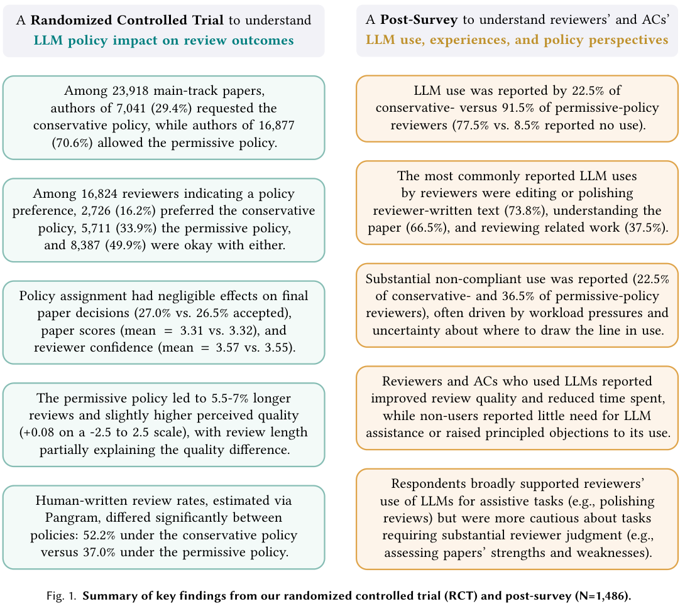

本文补录 **2026-09-19 的推荐日报清单**，于 2026-10-29 核对公开来源。推荐日不等于论文提交日；以下固定到当日及此前存在的版本，不混入后续修订。数字为作者在指定条件下的报告，本站未独立复现。

今天的阅读重点是对照：视觉记忆是否优于相同路径文本，harness 的收益来自什么，评审政策的随机分配改变了什么。建议先读 harness 组件研究与 ICML 政策实验，再按方向选择视觉记忆、离策略训练与世界模型。机制、基线与观察窗口应分别判断。

## 1. VisKG-LM: Compiling Knowledge Graphs into Visual Memory for Multiple-Choice Question Answering

[原论文](https://arxiv.org/abs/2609.19158v1) · 2609.19158v1，版本提交 2026-07-29 · [PDF](https://arxiv.org/pdf/2609.19158v1)

VisKG-LM 离线将候选相关路径渲染、编码为可缓存视觉记忆，在线在文本模型末层读取。相对 GreaseLM，CommonsenseQA、OpenBookQA、MedQA-USMLE 提高 1.2、0.8、4.3 点；相同路径文本对照支持视觉接口的额外收益。约 400M 指在线参数，离线编码和缓存仍有成本。范围是多选问答；该 v1 的来源页提交日期为 7 月 29 日，推荐日不等于发表日。

## 2. Semantic Layer Induction from Raw Telemetry via Hierarchical LLM and RAG Abstraction

[原论文](https://arxiv.org/abs/2609.19615v1) · 2609.19615v1，版本提交 2026-09-17 · [PDF](https://arxiv.org/pdf/2609.19615v1)

遥测语义层归纳先识别业务特征，再用混合检索、过滤、聚类与规范命名形成业务节点。生产规模案例报告人工语义质量从百分制 50 到 80 以上、维护工作量减少 80%。度量依赖业务数据和人工协议；LLM 裁判的一致性不能独立证明语义正确，更不能替代业务验收。

## 3. Score Centering Stabilizes Off-policy Reinforcement Learning

[原论文](https://arxiv.org/abs/2609.20807v1) · 2609.20807v1，版本提交 2026-09-17 · [PDF](https://arxiv.org/pdf/2609.20807v1)

Score Centering 将训练与推理引擎失配中的累积偏移显式校正。在 0.6B–30B 的量化实验中，加性校正与重要性采样相当或更好；策略陈旧实验中二者可以组合。价值在于把系统偏差纳入更新，但收益仍受失配来源与校正估计限制，不是所有离策略问题的统一解。

## 4. JEPA-Anything: Learning Predictive Models across Different Worlds

[原论文](https://arxiv.org/abs/2609.20800v1) · 2609.20800v1，版本提交 2026-09-17 · [PDF](https://arxiv.org/pdf/2609.20800v1)

JEPA-Anything 用正交预测因子分解不同潜在因素，再重组预测，跨视觉、生物、控制、分子与天气等领域测试。十项匹配动力学任务均优于对应 JEPA 基线，Interventional Pong 单次干预预测误差降低 34.8%。各领域指标不能合成通用智能分数，生物实验支持也只对应指定干预。

## 5. In-Context Robot Learning with VLM Agents

[原论文](https://arxiv.org/abs/2609.19138v1) · 2609.19138v1，版本提交 2026-09-16 · [PDF](https://arxiv.org/pdf/2609.19138v1)

GPT-Policy 用上下文编译器保留示范的关键视觉变化，VLM 提动作，再交约束控制器验证、执行和反馈。真实实验中无动作标签的人类视频有帮助，接触敏感任务进一步受益于对齐动作参考。虽无梯度更新，仍有控制器、工具与上下文设计，不能称为裸 VLM 一次提示掌握任意任务。

## 6. An Empirical Study of Harness Design for Coding Agents

[原论文](https://arxiv.org/abs/2609.20804v1) · 2609.20804v1，版本提交 2026-09-17 · [PDF](https://arxiv.org/pdf/2609.20804v1)

harness 研究固定执行循环，比较规划、动作空间与上下文管理，覆盖四模型、两个基准的 176 组匹配设置。上下文管理的收益很大部分来自避免溢出，先规则删减再模型摘要总体更高效；规划与工具价值随模型变化。它支持按预算和模型设计接口，未找到对所有模型通用最优的配置。

## 7. The More It Says, the More You Pay: A Black-Box Audit of Provider-Side Token Inflation in LLM Services

[原论文](https://arxiv.org/abs/2609.20370v1) · 2609.20370v1，版本提交 2026-09-17 · [PDF](https://arxiv.org/pdf/2609.20370v1)

输出膨胀审计在四个开放权重模型上报告平均检测率 85.1%、误报率低于 2%；十五个真实 API 中七个出现与其机制一致的行为。后者是黑盒信号，不能据此指控故意多收费。输出长度也受任务、停止条件与模型影响，必须保存原始请求和对照协议。

## 8. Use and Effects of LLMs in Peer Review: A Randomized Experiment and Survey at ICML 2026

[原论文](https://arxiv.org/abs/2609.19420v1) · 2609.19420v1，版本提交 2026-09-16 · [PDF](https://arxiv.org/pdf/2609.19420v1)

ICML 2026 随机试验比较严格禁用与有限许可两种 LLM 政策。政策分配对决策、分数与评审信心的平均效应接近零，许可组评审约长 5.5%–7%；1,486 份后续问卷显示明显不遵从。政策分配效应与实际使用 LLM 的效应不能混淆，前者接近零不等于 LLM 对评审完全无影响。

图：ICML 评审政策随机试验与问卷发现。Sunnie S. Y. Kim , Wesley Hanwen Deng , Jennifer Wortman Vaughan , Buxin Su , Weijie Su , Alekh Agarwal , Sharon Li , Martin Jaggi , Daniel G. Goldstein , Nihar B. Shah , Miroslav Dudík，arXiv:2609.19420v1，Figure 1，PDF 第 3 页。[原始图源](https://arxiv.org/pdf/2609.19420v1#page=3) · [CC BY 4.0](https://creativecommons.org/licenses/by/4.0/)。裁剪自原文。

## 阅读说明

本篇覆盖 8 项公开论文，逐项核对指定历史来源及文中方法、数字和限制，不代表完整复核每项附录或独立重复实验。系统愿景和理论贡献不补造性能分数；模型裁判、模拟任务和作者报告均保留各自边界。预印本结论可能随修订变化。
