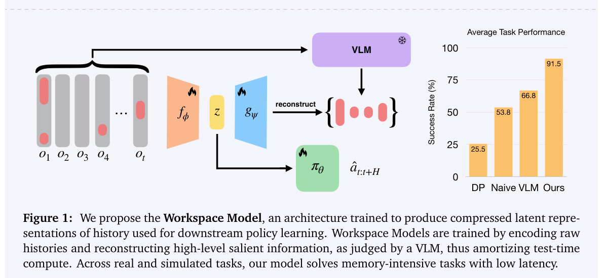

效率可以来自压缩缓存、在训练期蒸馏任务记忆，也可以来自更合理的上下文处理与蒸馏对照。部署读者先核对 DeepSeek 的缓存口径与 SoL-Pi 的计费条件；机器人读者关注 workspace token 如何前移昂贵计算。知识图谱清洗与液体重建则提醒我们，只保证观测和约束能支持的性质。

## 1. WiCleanData: Guaranteeing the Type Consistency of Wikidata by Taxonomy Refinement and Constraint Enforcement

[原论文](https://arxiv.org/abs/2609.20057v1) · 2609.20057v1，版本提交 2026-09-17 · [PDF](https://arxiv.org/pdf/2609.20057v1)

WiCleanData 用语言模型辅助清理 Wikidata 分类层级，聚合类型约束，再按约束过滤事实，得到在该体系下无类型违例的图谱。约束一致不等于事实真实；过滤会影响覆盖率，约束也可能不完整。我的判断是，一致性证书应连同约束版本和被删事实一起检查。

## 2. DeepSeek-V4.1-Flash: Pushing the Limits of KV Cache Compression

[原论文](https://arxiv.org/abs/2609.19969v1) · 2609.19969v1，版本提交 2026-09-17 · [PDF](https://arxiv.org/pdf/2609.19969v1)

DeepSeek-V4.1-Flash 面向输入密集型 Agent 工作负载，以 CED 在 prefill/decode 激活不同规模参数，结合 CSA2 跨层复用和 FP4 缓存，将始终位于 HBM 的全局 KV 占用降至每 token 890 字节。约四分之一描述全局缓存，约八分之一描述持久缓存，比较口径不同，不能改成端到端费用倍数。百万上下文也不保证所有位置与任务同样有效。

## 3. SoL-Pi: Recursively Scaling Auto-Research Loops for Efficient Agent Harness

[原论文](https://arxiv.org/abs/2609.20519v1) · 2609.20519v1，版本提交 2026-09-17 · [PDF](https://arxiv.org/pdf/2609.20519v1)

SoL-Pi 在 harness 层自动研究，最终保留动作执行、上下文压缩、观测处理与委托阅读四类机制。51 项 EdgeBench 中表现与 Pi 相近，记录 token 流量减少 44.7%–49.0%，API 成本约少三分之一。费用估算依赖当时定价、缓存和任务分布，可复用机制应与按小时折算的节省分别评价。

## 4. What Does Privileged Information Add to On-Policy Self-Distillation?

[原论文](https://arxiv.org/abs/2609.20612v2) · 2609.20612v2，版本提交 2026-09-18 · [PDF](https://arxiv.org/pdf/2609.20612v2)

OPSD 研究以 5,319 道数学题、六种共享答案的推理视图，隔离特权参考信息的额外贡献。匹配的无参考蒸馏已解释 Qwen3-1.7B 很多收益；长思考 rollout 下，两个模型家族的增益转负。结论不是参考过程一律无用，而是依赖学生、训练模式和匹配检查点，不能只看教师多拿到哪些信息。

## 5. Workspace Models: Lightweight Robotic Memory via Saliency-Driven Supervision

[原论文](https://arxiv.org/abs/2609.20820v1) · 2609.20820v1，版本提交 2026-09-17 · [PDF](https://arxiv.org/pdf/2609.20820v1)

Workspace Models 在训练期调用 VLM 提取当前与历史中的任务显著信息，再蒸馏为轻量 workspace token。模拟和硬件结果支持部署时无需把昂贵 VLM 放入控制闭环，并能改善策略表现。前移计算不等于取消成本：监督生成、显著性选择与压缩目标仍决定保留什么，长尾任务必须重新验收。图中汇总任务分数也不代表任意新机器人任务的成功率。

图：显著性监督蒸馏为轻量机器人记忆。Nitish Dashora , Douglas Chen , Idan Shenfeld , John Marangola , Pulkit Agrawal , Max Simchowitz，arXiv:2609.20820v1，Figure 1，PDF 第 1 页。[原始图源](https://arxiv.org/pdf/2609.20820v1#page=1) · [CC BY 4.0](https://creativecommons.org/licenses/by/4.0/)。裁剪自原文。

## 6. SplashSplat: Reconstructing Splashing Liquids from Real-World Multi-View Videos

[原论文](https://arxiv.org/abs/2609.20818v1) · 2609.20818v1，版本提交 2026-09-17 · [PDF](https://arxiv.org/pdf/2609.20818v1)

SplashSplat 提供二十个真实液体场景，由七台同步标定的 4K、60fps 相机拍摄，配人工修订掩码。方法以逐帧 SDF、粗速度场和随流移动载体约束动态高斯重建。实拍与合成基准上的改进依赖远比普通单目视频严格的观测；更合理的运动并不等于识别了可用于任意流体仿真的完整动力学。

预印本结论可能随修订变化。
