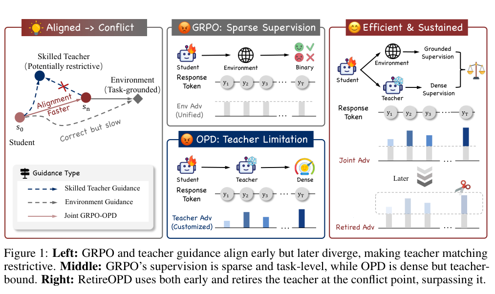

本文补录 **2026-09-21 的推荐日报清单**，于 2026-10-29 核对公开来源。推荐日不等于论文提交日；使用当日及此前已有的指定版本，不混入后续修订。数字为作者在特定条件下的报告，本站未独立复现。

DASE 先筛高召回证据，SIFT 用补丁比较分配搜索预算，RetireOPD 在教师开始限制学生时退出蒸馏。效率来自中间信号，但信号与最终结果仍需独立验证。数据系统读者可先看相似度 join，后训练读者看退休条件；视频加速则要拆开架构、步数与 serving。

## 1. Efficiently Linking Unstructured Data for Multi-step Reasoning

[原论文](https://arxiv.org/abs/2609.19491v1) · 2609.19491v1，版本提交 2026-09-16 · [PDF](https://arxiv.org/pdf/2609.19491v1)

DASE 联合处理属性过滤、多向量搜索、关系 join 与阈值相似度 join，用稀疏物化索引保留罕见近邻对，再做阈值聚合。科学发现负载中，相近召回下比所比系统快 6–46 倍；SemBench 电商任务中，下游 BigQuery 质量从 0.67 到 0.80，成本从 2.42 美元到 0.54 美元。收益属于该查询计划与预筛配置，索引构建和更新成本仍应另算。

## 2. DexTouch-WM: Learning Action-Conditioned Tactile World Models from Human Touch for Dexterous Robot Manipulation

[原论文](https://arxiv.org/abs/2609.20649v2) · 2609.20649v2，版本提交 2026-09-18 · [PDF](https://arxiv.org/pdf/2609.20649v2)

DexTouch-WM 在人手与机器人手上使用兼容触觉布局，将人类动作重定向至机器人动作空间，联合预测 RGB 和双侧触觉。固定五小时机器人监督，将人类交互从零增至一百小时，留出机器人域的视觉、几何和接触预测得到改善。迁移依赖传感器与动作对齐，不能解读成任意人类视频可替代机器人触觉数据。

## 3. RetireOPD: Self-Retiring On-Policy Distillation for Agentic Reinforcement Learning

[原论文](https://arxiv.org/abs/2609.20784v1) · 2609.20784v1，版本提交 2026-09-17 · [PDF](https://arxiv.org/pdf/2609.20784v1)

RetireOPD 先用环境奖励优化带技能的独立教师，再让无技能学生联合接受 RL 与 OPD。当差距不再缩小、学生达到教师成功率的指定比例时退出蒸馏，之后只做 RL。Qwen2.5 1.5B–7B 的 ALFWorld、WebShop 设置均有改善，并超过自身教师。我的判断是，监督应随阶段改变，但结果依赖教师质量与退休条件，不是越早取消越好。

图：早期结合教师与环境奖励，后期退出教师。Yan Yu , Zhengxi Lu , Yizhou Liu , Yichen Pan , Aozhe Wang , Qipeng Chen , Hua Yang , Wenqi Zhang , Weiming Lu , Qianglong Chen , Yongliang Shen，arXiv:2609.20784v1，Figure 1，PDF 第 1 页。[原始图源](https://arxiv.org/pdf/2609.20784v1#page=1) · [CC BY 4.0](https://creativecommons.org/licenses/by/4.0/)。裁剪自原文。

## 4. Characterizing Web Search by Conversational LLM Agents: From Search Decisions and Strategies to Results and Responses

[原论文](https://arxiv.org/abs/2609.19244v1) · 2609.19244v1，版本提交 2026-09-16 · [PDF](https://arxiv.org/pdf/2609.19244v1)

该搜索研究结合真实用户交互与受控 API 实验，观察四个平台何时搜索、如何改写、偏向哪些域名，以及答案怎样引用。搜索更频繁不必然回答更好，部分使用过的证据也未被引用。界面、API 模型与搜索后端不完全相同，结果应连同采样期和配置阅读，不能当作平台永久排名。

## 5. Video DeltaNet: A Video-Native Hybrid Attention for Livestream Video Generation

[原论文](https://arxiv.org/abs/2609.20744v2) · 2609.20744v2，版本提交 2026-09-21 · [PDF](https://arxiv.org/pdf/2609.20744v2)

Video DeltaNet 结合局部 Softmax 注意力与双向线性记忆，线性分支按帧更新空间 token。八步蒸馏与优化 SGLang serving 后，八张 B200 用 6.70 秒完成 14.3 秒、768p 视频的 DiT 去噪，比同卡数五十步稠密 H3 基线快 14.5 倍。这个倍数捆绑架构、步数与系统优化，计时仅是去噪，不能移作完整视频服务延迟。

## 6. Self Improvement via Fast Tree-search

[原论文](https://arxiv.org/abs/2609.19526v1) · 2609.19526v1，版本提交 2026-09-17 · [PDF](https://arxiv.org/pdf/2609.19526v1)

SIFT 用 LLM 两两比较候选自修改补丁，以正则化 Bradley–Terry 分数指导树搜索，把昂贵的下游任务测试留给有希望的节点。完整 Polyglot 评价支持该设置的资源效率。便宜 judge 在这里负责预算分配，不能替代真实测试；若偏好与任务收益失配，搜索也可能系统性走偏。

## 阅读说明

本篇纳入 6 项公开论文，核对指定历史来源及文中方法、数字与限制，不代表完整审查所有附录或独立复现实验。模型裁判、私有评测、模拟任务和概念验证均保留各自边界。预印本结论可能随修订变化。
