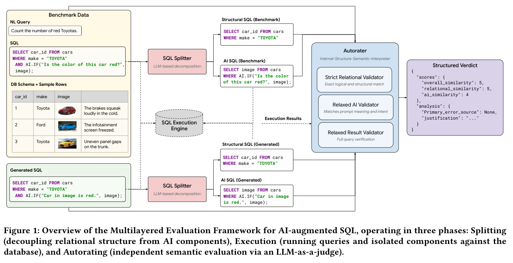

本文补录 **2026-09-22 的推荐日报清单**，于 2026-10-29 核对公开来源。推荐日不等于论文提交日；使用当日及此前已有的指定版本，不混入后续修订。数字为作者在特定条件下的报告，本站未独立复现。

带 AI 算子的 SQL 需要区分关系逻辑与随机语义，逆问题需要检查整个后验，稀疏蒸馏也要同时衡量监督用途与梯度可靠性。建议先读 Stochastic Shift 与 PosteriorBench，再看 MiMo 和 IER。稀疏监督比例不能直接当作整体计算节省。

## 1. kgsteward: a tool for building, reproducing and maintaining distributed knowledge graphs

[原论文](https://arxiv.org/abs/2609.21564v1) · 2609.21564v1，版本提交 2026-09-18 · [PDF](https://arxiv.org/pdf/2609.21564v1)

kgsteward 从单个版本化配置文件构建和维护 RDF 图谱，支持源更新、转换、SPARQL UPDATE 修订及兼作示例的验证查询，在两个国际生命科学项目展示。价值是把维护流程变成可复现配置，并非自动保证上游正确；源版本、私有或禁运数据访问与变更审计仍需项目自行管理。

## 2. The Stochastic Shift: A New Evaluation Paradigm for Text-to-SQL with AI Operators

[原论文](https://arxiv.org/abs/2609.21133v1) · 2609.21133v1，版本提交 2026-09-17 · [PDF](https://arxiv.org/pdf/2609.21133v1)

SQL 含随机 AI 算子时，完整执行结果精确匹配会误拒正确查询。本文拆开关系结构与 AI 语义，在 BigQuery、ThalamusDB 比较；传统执行准确率对正确翻译的检测最低为 25%，分层框架总体准确率最高为 97.2%。这是各自实验条件的数值，不能当成同一个分母的简单提升；LLM autorater 仍会犯错，分层改善诊断而未消除随机性。

图：关系结构与 AI 语义的分层评估。Tarfah Alrashed , Fatma Ozcan , Per Jacobsson , Tal Neiman , Xianshun Chen，arXiv:2609.21133v1，Figure 1，PDF 第 4 页。[原始图源](https://arxiv.org/pdf/2609.21133v1#page=4) · [CC BY 4.0](https://creativecommons.org/licenses/by/4.0/)。裁剪自原文。

## 3. MiMo-V2.6: Scaling Reinforcement Learning Towards Self-Improvement

[作者官方论文](https://huggingface.co/XiaomiMiMo/MiMo-V2.6-Pro-RL/blob/73875d00b30a89ef8cc353a0b60b0e9f9561952d/MiMo_V2_6_technical_report.pdf) · 固定提交 `73875d00b30a89ef8cc353a0b60b0e9f9561952d`，2026-09-22。

MiMo-V2.6 沿异步批量、环境与 harness 多样性、比较式 grader 计算三轴扩展 RL。摘要称每步处理 1,568 样本和约 2.7–3.7B tokens；训练设置进一步说明 1,568 是 prompt batch，每题 16 条 rollout，全局约 25K 轨迹，最高上下文 1M。成功轨迹之间再按代码质量分配优势值得研究，但整体曲线同时改变多因素，不能把全部收益归为单个打分机制。本篇固定到 9 月 22 日官方报告，不倒填 10 月 arXiv。

## 4. 1% of Tokens Can Be Enough: On Gradient Estimation in On-Policy Distillation

[原论文](https://arxiv.org/abs/2609.24432v1) · 2609.24432v1，版本提交 2026-09-21 · [PDF](https://arxiv.org/pdf/2609.24432v1)

IER 从固定前缀的梯度信噪比出发，为稀疏 OPD 增加监督可靠性尺度，再与 token 用途分数组合。在一些数学与医学推理配置中，0.1%–1% 监督预算可接近完整 OPD。比例指承担蒸馏损失的响应 token，不是只生成这些 token；完整轨迹、教师打分与选择仍可能有成本，不能直接承诺训练同比提速。

## 5. CodeMidas: Scaling Agentic Coding RL Environments from Code Itself

[原论文](https://arxiv.org/abs/2609.22068v1) · 2609.22068v1，版本提交 2026-09-18 · [PDF](https://arxiv.org/pdf/2609.22068v1)

CodeMidas 仅将源代码作为任务特定输入，生成行为规范、测试与可执行 RL 环境，经执行检查和重复求解筛选。数据含 3,185 个代码库的 5,545 项任务，覆盖 23 种语言；MiMo-V2.5 经 GRPO 后五项基准均有收益。测试锚定已有实现能减少空想规范，也可能继承原代码缺陷，仍须检查正确性来源。

## 6. PosteriorBench: From Point Estimates to Posterior Matching in Evaluating Generative Inverse Solvers

[原论文](https://arxiv.org/abs/2609.20794v1) · 2609.20794v1，版本提交 2026-09-17 · [PDF](https://arxiv.org/pdf/2609.20794v1)

PosteriorBench 对四类物理逆问题建立高保真参考后验，以均值、标准差、MMD、sliced Wasserstein 和频谱误差共同评价。单张重建合理仍可能掩盖模式坍缩或过度自信，当前求解器也存在分布匹配缺口。参考依赖昂贵采样、先验和噪声模型，评方法之前必须先核对这些假设。

## 7. RBS-Attention: Radius-Bounded Sparse Prefill for Long-Context Large Language Models

[原论文](https://arxiv.org/abs/2609.20971v1) · 2609.20971v1，版本提交 2026-09-17 · [PDF](https://arxiv.org/pdf/2609.20971v1)

RBS-Attention 用块中心估计平均相关性、块半径补回被平均稀释的关键 token。H100、128K、Qwen3-30B-A3B-Instruct-2507-FP8 上，独立注意力、vLLM 注意力、端到端首 token 时间分别加速 20.65、11.92、5.97 倍。口径不可互换；另一稠密 Qwen3-32B 的 RULER 为 88.65，对照 89.52，质量与保留密度必须同时读。

## 阅读说明

本篇纳入 7 项公开论文，核对指定历史来源及文中方法、数字与限制，不代表完整审查所有附录或独立复现实验。模型裁判、私有评测、模拟任务和概念验证均保留各自边界。预印本结论可能随修订变化。
