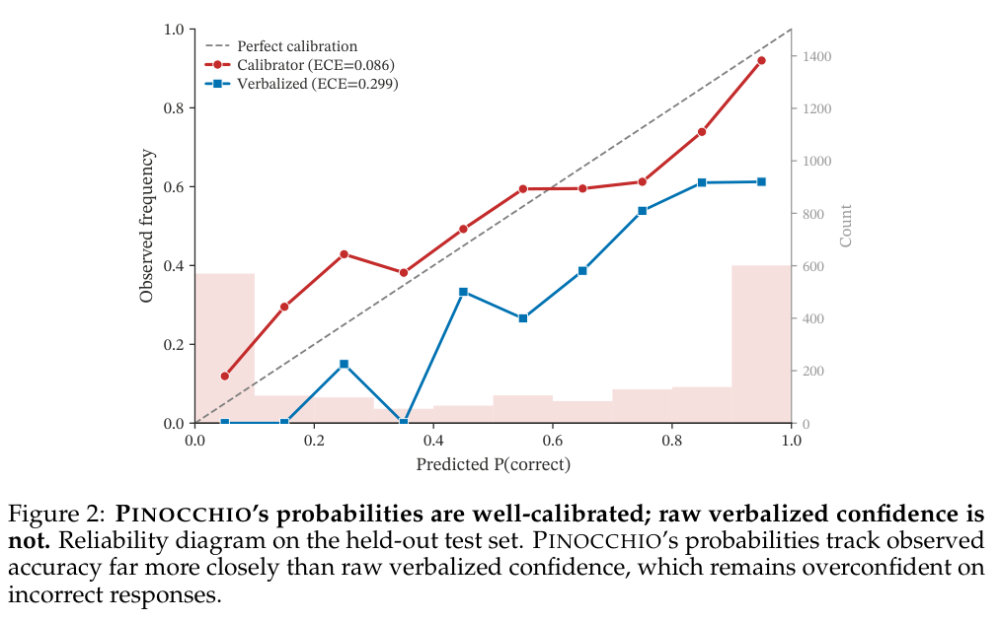

本文补录 **2026-09-23 的推荐日报清单**，于 2026-10-29 核对公开来源。推荐日不等于论文提交日；使用当日及此前已有的指定版本，不混入后续修订。数字为作者在特定条件下的报告，本站未独立复现。

QUIVER 把向量检索下推到 SPARQL 引擎，路径模式研究用可执行参考语义审计答案一致性。Agent 演化与世界模型也面对相似问题：收益能否跨任务、跨时间和观察方式保持？语义工程读者先看查询执行，置信度工具则须同时检查排序与校准。

## 1. Efficient Dense Vector Search within Knowledge Graph Content Embeddings

[原论文](https://arxiv.org/abs/2609.24236v1) · 2609.24236v1，版本提交 2026-09-21 · [PDF](https://arxiv.org/pdf/2609.24236v1)

QUIVER 将张量函数注册、向量解析和 ANN 索引下推到 QLever，把图约束与向量排名放在同一 SPARQL 计划中。扩展 BSBM 与含图像嵌入的 DBpedia 上，加索引的指定查询分别快 355 倍、97.8 倍。比较涉及索引与非索引路线，不是所有 SPARQL 都快数百倍；近似质量、构建与更新仍需验收。

## 2. Same Pattern, Different Answer: A Reference Semantics and Divergence Map for GQL and SQL/PGQ Path Patterns

[原论文](https://arxiv.org/abs/2609.23032v1) · 2609.23032v1，版本提交 2026-09-19 · [PDF](https://arxiv.org/pdf/2609.23032v1)

路径模式审计以十七类构造检查五产品六版本，九类在接受它们的引擎之间有不同答案。二十六项分歧中十五项静默发生，但其中九项属于手册已记录的语言差异，不能统称实现 bug。我的判断是，参考语义、方言无法表达、拒绝执行和真正偏离应分开计数，才能定位互操作边界。

## 3. RRSI: Regularized Recursive Self-Improvement of Agent Harnesses

[原论文](https://arxiv.org/abs/2609.24972v2) · 2609.24972v2，版本提交 2026-09-23 · [PDF](https://arxiv.org/pdf/2609.24972v2)

RRSI 限制 harness 每次改动规模，鼓励未探索路径，并以 critic、pruner 去掉面向基准或高成本低收益的机制。八项评测中，演化集最高增加 14.1 点，五个分布外基准最高增加 4.7 点，策略 token 比无正则演化少约 30%。内外差距仍在，最高值不能当作平均迁移收益。

## 4. WorldCrafter: Consistent Video World Model with Implicit 3D-aware Memory

[原论文](https://arxiv.org/abs/2609.24984v1) · 2609.24984v1，版本提交 2026-09-21 · [PDF](https://arxiv.org/pdf/2609.24984v1)

WorldCrafter 由目标视角决定历史多视图证据如何压入固定 token 预算，在去噪前读取隐式 3D 感知记忆，再结合近期时间上下文。静态和动态场景的分钟级探索支持一致性及相机控制收益。无需显式深度对应并不表示没有几何误差，训练场景、姿态估计和有限容量仍限制长期记忆。

## 5. Pinocchio: Fast Uncertainty Estimates for Black-Box Language Models

[原论文](https://arxiv.org/abs/2609.24881v2) · 2609.24881v2，版本提交 2026-09-22 · [PDF](https://arxiv.org/pdf/2609.24881v2)

Pinocchio 为黑盒回答训练外部正确性校准器，不访问目标 logits、参数或内部状态。v2 摘要在七个来源模型的留出响应上报告 AUROC 0.862，正文表 3 则列 0.863；本篇保留这个原文差异，不拼成新结果。作者另测试十三个未见模型。AUROC 是排序区分，不能保证每个概率可靠，部署仍需校准曲线、分布变化和错误成本检查。

图：外部校准器与模型口述置信度的可靠性图。Kevin David Hayes , Arka Pal , Haosong Zhang , Tom Goldstein , Micah Goldblum，arXiv:2609.24881v2，Figure 2，PDF 第 6 页。[原始图源](https://arxiv.org/pdf/2609.24881v2#page=6) · [CC BY 4.0](https://creativecommons.org/licenses/by/4.0/)。裁剪自原文。

## 6. MobileCybench: Evaluating Agent Vulnerability Discovery via Executable Probes

[原论文](https://arxiv.org/abs/2609.23980v1) · 2609.23980v1，版本提交 2026-09-21 · [PDF](https://arxiv.org/pdf/2609.23980v1)

MobileCybench 以可执行安全属性探针核验漏洞报告，包含十三个 Android 应用、495 个经作者审查的探针；评测发现二十三个此前未报告问题，多数得到维护者确认。回放比关键词判分更贴近属性是否被破坏，但只覆盖预先编码属性，未触发不能证明无漏洞，应用触发比例也不是完整漏洞召回率。

## 7. MotionJEPA: Preventing Temporal Feature Collapse by Capturing Visual Changes in Latent Space

[原论文](https://arxiv.org/abs/2609.23881v1) · 2609.23881v1，版本提交 2026-09-20 · [PDF](https://arxiv.org/pdf/2609.23881v1)

MotionJEPA 用静态分布约束和时差图像嵌入预测，缓解慢特征占优，保留动态信息，无需动作标签或像素重建损失。潜在探针和四环境规划支持动态表示收益。表示更完整不意味着所有任务更好，静态背景干扰、环境与规划器配置仍决定受测范围。

## 阅读说明

本篇纳入 7 项公开论文，核对指定历史来源及文中方法、数字与限制，不代表完整审查所有附录或独立复现实验。模型裁判、私有评测、模拟任务和概念验证均保留各自边界。预印本结论可能随修订变化。
