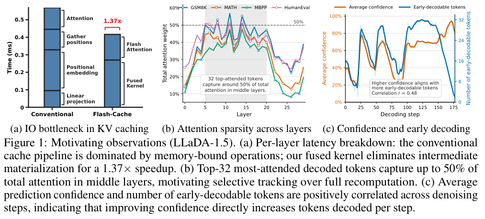

今天横跨数据集成、缓存、分级评审、协作与扩散推理。共同的阅读方法是先定位成本和错误在哪层，再评价替代路径。数据工程看行级句子证据，推理工程看缓存和 I/O，多 Agent 规模结果则必须同时算任务覆盖与总计算量。

## 1. Discovery-Driven Integration of Disjoint Tables via Text

[原论文](https://arxiv.org/abs/2609.26658v1) · 2609.26658v1，版本提交 2026-09-22 · [PDF](https://arxiv.org/pdf/2609.26658v1)

LOKI 从文本句子发现无显式连接键表格之间的行级 join path，通过全局表文对比学习和句级出处物化类型化表。macro typed-pair precision 为 0.982，LLM API 成本最高比直接提示低四十倍。高精确率不是高召回，训练、发现、物化范围及基线调用方式都会影响成本，不能只记一个倍数。

## 2. HySparse2: Hybrid Sparse Attention with Two-Level KV Sharing

[原论文](https://arxiv.org/abs/2609.26368v1) · 2609.26368v1，版本提交 2026-09-22 · [PDF](https://arxiv.org/pdf/2609.26368v1)

HySparse2 用外层 KV Bridging 与内层 KV Reuse 共享缓存：cross-decoder 从 self-decoder 隐状态得到 KV，因此 prefill 可在后者结束，稀疏选择也细化到 token。80B-A3B MoE 的长上下文检索和多轮任务支持收益。这是架构与训练配套设计，不是对任意已训模型无损加速的插件。

## 3. Reinforcing Agents with Collective Skills

[作者官方论文](https://github.com/NVlabs/Skill2Env/blob/9beb0b64a70290f862c8374bbef21f2ac88992ab/paper/Skill2Env_arXiv.pdf) · 固定提交 `9beb0b64a70290f862c8374bbef21f2ac88992ab`，2026-09-21。

Skill2Env 将约 3.4k 条公开 Agent Skills 转成约 8k 个终端环境，配程序测试与行为 rubric。指定 9 月 21 日 PDF 中，Qwen-3.8 27B 经 300 步 DPPO 变体训练，Terminal-Bench 2.1 和私有 S2EBench 分别提高 4.7、4.3 个百分点。这里严格采用固定版本的训练步数与结果。私有基准复核有限，任务收益也不能单独证明价值对齐。

## 4. Agensh: Scaling Organizational Intelligence to 1,024 Agents

[原论文](https://arxiv.org/abs/2609.26781v1) · 2609.26781v1，版本提交 2026-09-22 · [PDF](https://arxiv.org/pdf/2609.26781v1)

Agensh 让 worker 在共享工作区异步认领、共享发现并验证合并，无中央编排。五个最难 ProgramBench 任务上，1 到 128 个 Agent 的平均最终测试通过率由 19.31% 到 28.78%；pandoc 单任务 1 到 1,024 个 Agent 则由 33.89% 到 55.06%。这是固定时间预算的规模实验，不是等总计算成本对照，也不能用单任务代表所有软件工程。

## 5. JEV-as-a-Judge: Accept When Confident, Escalate When Unsure

[原论文](https://arxiv.org/abs/2609.26550v1) · 2609.26550v1，版本提交 2026-09-22 · [PDF](https://arxiv.org/pdf/2609.26550v1)

JEV-as-a-Judge 用只输出决策的低成本 judge 处理高置信样本，不确定项交强模型。普通偏好与证据事实性任务中，与最强对照相差三个百分点以内，费用为其 0.36%；固定级联保留约 99% 的对照准确率。推导检查和精心包装错误仍有缺口，阈值迁移到新任务前必须校准，费用比例也不是级联在任何负载下的保证。

## 6. Flash-dLLM: IO-Aware KV Caching and Parallel Decoding for Fast, Memory-Efficient Diffusion LLMs

[原论文](https://arxiv.org/abs/2609.26796v1) · 2609.26796v1，版本提交 2026-09-22 · [PDF](https://arxiv.org/pdf/2609.26796v1)

Flash-dLLM 联合 KV 缓存与并行 draft-and-verify，融合 kernel 减少 I/O，同一扩散模型兼任起草与验证。相对 Elastic-Cache，GSM8K、HumanEval 指定设置分别加速 5.1、11.0 倍。比较对象是 dLLM 加速基线，不能移作对自回归模型的倍数；batch、输出长度、质量和显存都应核对。下图是动机实验，不是整个方法的架构图。

图：I/O、注意力稀疏与提前解码的动机实验。Quan Nguyen-Tri , Mukul Ranjan , Zhiqiang Shen，arXiv:2609.26796v1，Figure 1，PDF 第 2 页。[原始图源](https://arxiv.org/pdf/2609.26796v1#page=2) · [CC BY 4.0](https://creativecommons.org/licenses/by/4.0/)。仅裁剪页面，保留完整原图、图注和必要标签，未重绘或修改数据，不表示作者认可本解读。该图沿用 CC BY 4.0，本站页脚许可不为其增加非商业或相同方式共享限制。

## 7. ϕ-RIE: From Photorealistic Reconstruction to Interactive Environments

[原论文](https://arxiv.org/abs/2609.26795v1) · 2609.26795v1，版本提交 2026-09-22 · [PDF](https://arxiv.org/pdf/2609.26795v1)

ϕ-RIE 用统一对象身份完成可移动资产构建、原场景移除和背景补全，减少静态 3DGS 转交互环境的错位。五十个 ScanNet++ 场景上，固定保留率的 20mm matched F1 从 0.336 到 0.383。该指标对应选择与注册，不是机器人成功率；遮挡几何与背景补全仍包含不可观测信息。

文中实验结果为论文作者报告，未独立复现。
