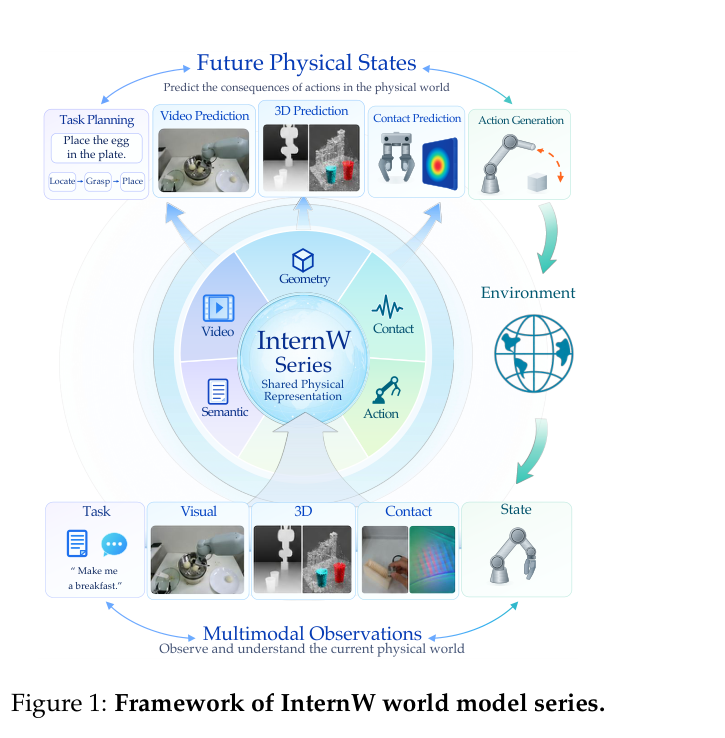

本文补录 **2026-09-25 的推荐日报清单**，于 2026-10-29 核对公开来源。推荐日不等于论文提交日；使用当日及此前已有的指定版本，不混入后续修订。数字为作者在特定条件下的报告，本站未独立复现。

知识图谱不应只检查 RDF 能否解析，语言嵌入也未必区分逻辑关系；机器人方向则需要受控消融辨别预测目标、去噪过程与异步控制。先看六维构建评测和 AVA，再将 InternW0 与 NowWAM 对照。本篇纳入七项可核验历史来源，日期冲突的另一候选暂缓。

## 1. Benchmarking Automated Knowledge Graph Construction from Semi-Structured Data

[原论文](https://arxiv.org/abs/2609.26985v1) · 2609.26985v1，版本提交 2026-09-22 · [PDF](https://arxiv.org/pdf/2609.26985v1)

半结构化数据建图评测同时检查语法有效、语义准确、一致性、简洁性、完整性和 competency question 可回答性。它提供七领域十个专家策展数据集，用两个参考系统展示。价值是连接构建与使用，但十个数据集不覆盖所有 schema 或映射难度，单维分数仍需放回多维诊断。

## 2. Do General NLP Embeddings Capture Ontological Reasoning?

[原论文](https://arxiv.org/abs/2609.00177v1) · 2609.00177v1，版本提交 2026-08-31 · [PDF](https://arxiv.org/pdf/2609.00177v1)

AVA 从 163 个本体构造 171,007 个对比三元组，以层级反转、关系替换和互斥注入检查逻辑敏感语义。超过二十五个嵌入模型的最佳 triplet accuracy 仅 0.739，hard-negative 指标更低；微调向 taxonomy discovery 和 alignment 的迁移有限。语言相似不是逻辑推理，但合成扰动同样不覆盖完整描述逻辑能力。该 v1 提交于 8 月 31 日。

## 3. Memory Attention

[原论文](https://arxiv.org/abs/2609.28399v1) · 2609.28399v1，版本提交 2026-09-23 · [PDF](https://arxiv.org/pdf/2609.28399v1)

Memory Attention 用层特定 token 记忆与上下文 key 构造 value，推理可把归一化折叠成查表和相加，并以 CPU 预取卸载。在匹配训练 token、但增加记忆参数时，语言建模和平均下游表现改善。匹配的是数据预算，不是总参数、带宽或费用；额外记忆容量应与效果一起计入。

## 4. InternW0: A Foundational Physical World Model for Efficient Real-World Interactions

[原论文](https://arxiv.org/abs/2609.27656v1) · 2609.27656v1，版本提交 2026-09-23 · [PDF](https://arxiv.org/pdf/2609.27656v1)

InternW0 让高容量视频专家提供长时域预测，轻量动作专家高速更新，以新观测路由和复用 K/V，并用接触后训练加入力与触觉。约 7,200 小时异构数据含 275 小时真实实验室第一视角数据；真实任务含十五阶段 MOF 合成和五阶段定量移液。阶段数不等于成功率，复杂流程展示也不能替代跨实验室重复验证。图 1 描述 InternW 系列框架。

图：InternW 世界模型系列的多模态反馈框架。Jisong Cai , Yao Mu , Ganlin Yang , Zhe Cao , Zhangzheng Tu , Xing Gao , Kailin Li , Xinyu Zhan , Lixin Yang , Yangkun Zhu , Haoxiang Ma , Ming Zhou , Qiaojun Yu , Yufei Xue , Liqun He , Yifei Yao , Yifan Zhu , Long Ling , Bingqi Jiang , Haoyu Guo , Xueyue Zhu , Bowen Zhou , Bin Zhao , Tianfan Xue , Chunhua Shen , Weinan Zhang，arXiv:2609.27656v1，Figure 1，PDF 第 3 页。[原始图源](https://arxiv.org/pdf/2609.27656v1#page=3) · [CC BY 4.0](https://creativecommons.org/licenses/by/4.0/)。裁剪自原文。

## 5. Generalizable Robotic Insertion with World Models

[原论文](https://arxiv.org/abs/2609.28258v1) · 2609.28258v1，版本提交 2026-09-23 · [PDF](https://arxiv.org/pdf/2609.28258v1)

该插装研究以腕部相机与本体感知训练统一世界模型，最多覆盖九十种几何不同任务。未知几何新物体零样本成功率 56%，无模型基线 7%，增加对象和少量微调进一步有益。结果属于指定平台和对象分布，56% 仍有大量失败，不能当作高可靠工业装配的部署保证。

## 6. Beyond Future Prediction: Denoising as Generative Adaptation for Robot Control

[原论文](https://arxiv.org/abs/2609.28339v1) · 2609.28339v1，版本提交 2026-09-23 · [PDF](https://arxiv.org/pdf/2609.28339v1)

NowWAM 在同一视觉流去噪当前观测并预测动作，不另设未来目标。受控比较中，过去与未来目标近似，删去去噪过程、只留干净终点会降低稳健性。FLUX2-Klein 配置在 LIBERO-Plus 为 87.7%，比未来目标对照高 6.1 点，训练视觉 token 由 784 到 392，step time 由 2.85 秒到 1.63 秒。结论限定该适配路线，不是所有世界模型都无需预测。

## 7. On the Diffusibility of High-Dimensional Latents

[原论文](https://arxiv.org/abs/2609.28473v1) · 2609.28473v1，版本提交 2026-09-23 · [PDF](https://arxiv.org/pdf/2609.28473v1)

RAE 重建微调补回细节，同时改变有效维度和几何；标准 velocity prediction 可能把容量用在信号流形之外的噪声。本文改用 clean-data 即 x0 参数化，把学习集中于信号。多个强重建编码器的文生图结果支持选择，但适用性依赖潜在空间几何，不能推广成 x0 对所有扩散模型更优。

## 暂缓纳入的候选

隐蔽通信候选的 [arXiv v1 记录](https://arxiv.org/abs/2609.32701v1) 最早提交于 2026-09-26，晚于本篇推荐日。未核验到更早作者版本，因此不纳入七项分析，不用后续结果倒填。

## 阅读说明

本篇纳入 7 项公开论文，核对指定历史来源及文中方法、数字与限制，不代表完整审查所有附录或独立复现实验。模型裁判、私有评测、模拟任务和概念验证均保留各自边界。预印本结论可能随修订变化。
