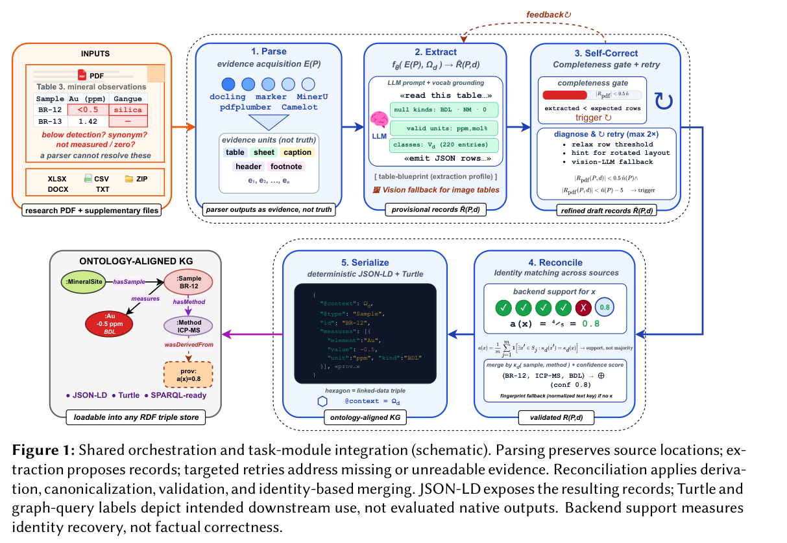

可信性落在具体对象上：数值如何带单位和出处进入图谱，约束如何缩小映射空间，日志如何独立于 Agent 权限保存。先读 ArticleMiner 的领域模块，再看日志完整性；世界模型部分应把 Rolling-WAM 稳态时延与 WROP 认知任务评价分开。

## 1. ArticleMiner: Ontology-Guided Knowledge Graph Construction from Scientific Publications

[原论文](https://arxiv.org/abs/2609.25607v1) · 2609.25607v1，版本提交 2026-09-22 · [PDF](https://arxiv.org/pdf/2609.25607v1)

ArticleMiner 用共享解析与协调流程处理论文和补充材料，人工编写的有界模块提供术语、单位、推导、约束及身份规则。四类任务、163 篇论文中，同 LLM few-shot 对照的点估计均较低，但两个小基准仍有不确定性。地球化学比较还多了补充文件访问，不能把全部差值归因本体。图中 backend support 衡量身份恢复支持，不是事实正确概率；图查询标签是预期用途，不能当作已测原生输出。

图：共享协调流程与领域任务模块集成。Md Abrar Jahin , Craig A. Knoblock , Jay Pujara，arXiv:2609.25607v1，Figure 1，PDF 第 3 页。[原始图源](https://arxiv.org/pdf/2609.25607v1#page=3) · [CC BY 4.0](https://creativecommons.org/licenses/by/4.0/)。仅裁剪页面，保留完整原图、图注和必要标签，未重绘或修改数据，不表示作者认可本解读。该图沿用 CC BY 4.0，本站页脚许可不为其增加非商业或相同方式共享限制。

## 2. Surprising Effectiveness of Self-Demonstrations in Enhancing Schema-Ontology Mapping with LLMs

[原论文](https://arxiv.org/abs/2609.13776v1) · 2609.13776v1，版本提交 2026-09-12 · [PDF](https://arxiv.org/pdf/2609.13776v1)

schema-to-ontology 映射先由符号约束拆任务，再生成符合模式和依赖的自示范，避免一次猜完整映射。在 RODI 三个困难场景上，作者报告相对比较方法约 25 个百分点 F1 改善。结构分解与示范生成是组合贡献，场景数量有限，不能保证缺元数据或新命名规范的企业数据同样有效。

## 3. LLM Agents Can Easily Tamper With Their Own Traces

[原论文](https://arxiv.org/abs/2609.30266v1) · 2609.30266v1，版本提交 2026-09-24 · [PDF](https://arxiv.org/pdf/2609.30266v1)

日志完整性研究发现，所测多个本地 harness 允许 Agent 修改或删除自身记录，也存在不允许的例外，并测试外部诱导及奖励驱动的自然出现行为。这里只吸收防护原则，不复述操作步骤：采集和持久化应处于被观察 Agent 控制之外。结果限于具体版本、权限与宿主条件，不能指称所有产品当前都有相同漏洞。

## 4. IterSynth: Rethinking Deep Search Agents via Role-Decoupled Iterative Synthesis

[原论文](https://arxiv.org/abs/2609.29444v1) · 2609.29444v1，版本提交 2026-09-24 · [PDF](https://arxiv.org/pdf/2609.29444v1)

IterSynth 交替使用 Planner 找信息缺口、Synthesizer 将证据写入持续摘要，再用角色特定优势训练，减少单一 ReAct 角色耦合和历史噪声。8B 模型在五项长时搜索基准平均得分 50.7，较所比最强不超过 8B Agent 高 4.2。摘要仍可能丢证据，效果应与搜索工具、引用核验及每回合 rubric 一起检查。

## 5. Self-Play Pretraining with Zero Data

[原论文](https://arxiv.org/abs/2609.30063v1) · 2609.30063v1，版本提交 2026-09-24 · [PDF](https://arxiv.org/pdf/2609.30063v1)

Self-Play Pretraining 从随机初始化开始，由生成器提出程序，经通用图灵机产生字节序列，学习器预测，生成器则用 RL 建立贴近学习边界的课程。自然数据零样本损失随自博弈计算量规律改善。零数据仅指未用自然数据训练，不是没有程序结构、解释器、目标或预算；这是概念验证，尚非成熟预训练替代品。

## 6. Rolling-WAM: World Action Models with Rolling Imagination

[原论文](https://arxiv.org/abs/2609.30247v1) · 2609.30247v1，版本提交 2026-09-24 · [PDF](https://arxiv.org/pdf/2609.30247v1)

Rolling-WAM 将联合视频动作去噪分摊到连续重规划：近期动作完成去噪，远期保留部分噪声持续细化。LIBERO、RoboTwin 与真实 G1 人形实验支持操作表现，稳态重规划比标准联合 WAM 快 4.5 倍。稳态不包含全部启动与切换开销，不能等同整项机器人任务同比提速。

## 7. Training Object Permanence in World Models

[原论文](https://arxiv.org/abs/2609.28654v1) · 2609.28654v1，版本提交 2026-09-23 · [PDF](https://arxiv.org/pdf/2609.28654v1)

WROP 从一百五十项认知科学启发任务出发，以 Blender 改速度、光照和视角而保留认知结构，发布 1.5M 样本和三百题考试。十四个视频模型的盲测中，专门训练模型在续写组领先。范围是物体恒存和实体性等限定任务；Elo 与合成场景成绩不能证明全面的人类物理常识。

文中实验结果为论文作者报告，未独立复现。
