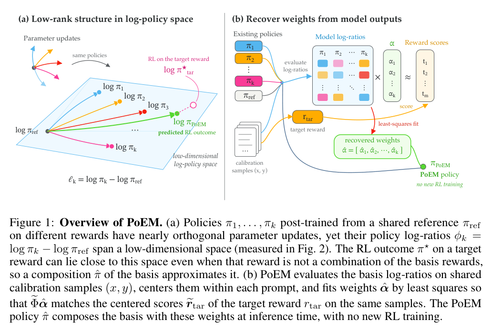

本文补录 **2026-09-27 的推荐日报清单**，于 2026-10-29 核对公开来源。推荐日期不等于论文提交日，以下固定到当日及此前已有的版本，不混入后续修订。数字为作者在指定条件下的报告，本站未独立复现。

一类工作把目标定义清楚：多方约束协商、从演示提取程序、从参考应用发现可回放行为；另一类降低实现成本：策略组合、循环稀疏更新和三维跟踪去重。目标是否正确与执行是否高效需要分别检验。工程读者先看约束获取和 ProgramDistill，后训练读者关注 PoEM 的共享参考策略假设。

## 1. Ontology-Mediated Neurosymbolic Constraint Acquisition from Multiple Stakeholders

[原论文](https://arxiv.org/abs/2609.29876v1) · 2609.29876v1，版本提交 2026-09-24 · [PDF](https://arxiv.org/pdf/2609.29876v1)

本体中介架构把利益相关者软偏好与硬件规格的硬约束统一到 OWL 配置本体，用描述逻辑发现不可满足条件，生成解释供 LLM 与人重新协商，残余冲突再按优先级放松。微电网案例展示了符号规范如何从上游获取，却不是通用有效性的实验性证明。我的判断是，先明确谁有权修改哪些约束，才谈自动协商。

## 2. RAPID: Robot Agentic Programming from Demonstrations

[原论文](https://arxiv.org/abs/2609.30249v1) · 2609.30249v1，版本提交 2026-09-24 · [PDF](https://arxiv.org/pdf/2609.30249v1)

RAPID 从一段人类视觉演示推断可测试规范、动作原语与交互验证环境，再生成和修订机器人程序。对象中心关系表示把策略结构与具体姿态分开。八项接触丰富的非抓取任务、LIBERO-Pro 和真实 Franka 测试支持所测泛化。单次演示仍依赖生成器、轨迹优化与验证器，不是没有先验或可执行范围限制。

## 3. PoEM: Predicting RL Outcomes from Existing Policies

[原论文](https://arxiv.org/abs/2609.30226v1) · 2609.30226v1，版本提交 2026-09-24 · [PDF](https://arxiv.org/pdf/2609.30226v1)

PoEM 用已在不同奖励上后训练的策略近似新奖励的 RL 结果。共享参考策略时，特定奖励线性组合对应 log-policy 的组合；更一般情况依靠经验低秩结构与校准样本估计权重。文本和图像实验支持可行性，无需追加 RL 却仍有基础策略、校准与推理成本，也不保证任意新奖励都在已有策略覆盖内。

图：既有策略 log-ratio 组合与新奖励策略近似。Kimia Hamidieh , Giannis Daras , Antonio Torralba，arXiv:2609.30226v1，Figure 1，PDF 第 2 页。[原始图源](https://arxiv.org/pdf/2609.30226v1#page=2) · [CC BY 4.0](https://creativecommons.org/licenses/by/4.0/)。裁剪自原文。

## 4. FlashLoop: Fast and Memory-Efficient Looped Transformers via Lazy Updates

[原论文](https://arxiv.org/abs/2609.29812v1) · 2609.29812v1，版本提交 2026-09-24 · [PDF](https://arxiv.org/pdf/2609.29812v1)

FlashLoop 利用深循环中更集中的状态与注意力差异，以及可低比特表示的 KV 残差，做稀疏 token 更新、稀疏注意力和量化。所测循环 Transformer 准确率不降，端到端最高快 1.64 倍，KV 最多缩小六倍。最高收益依赖模型、深度和上下文；lossless 是评测描述，不是任意输入下的数学等价保证。

## 5. TrackEverything: Long Horizon Dense Tracking via De-Duplicating 3D Scene Representations

[原论文](https://arxiv.org/abs/2609.30222v1) · 2609.30222v1，版本提交 2026-09-24 · [PDF](https://arxiv.org/pdf/2609.30222v1)

TrackEverything 用世界坐标中的持久三维轨迹表示视频，体素去重避免窗口间重复积累同一表面，只为动态点细化完整轨迹。作者在 40GB 显存内跟踪超过千帧视频的全部可见点，并改善 TAPVid-3D 短片密集跟踪。成本更多随独特几何增长，仍受动态程度、几何规模与相机估计限制，并非与视频长度完全无关。

## 6. ProgramDistill: From Interactive Web Apps to Verifiable Reference-Guided SWE Tasks

[原论文](https://arxiv.org/abs/2609.18805v1) · 2609.18805v1，版本提交 2026-09-16 · [PDF](https://arxiv.org/pdf/2609.18805v1)

ProgramDistill 让 coding Agent 从可交互参考应用发现行为，再修复不完整应用。二十六个应用产生 1,975 项回放验证行为和 4,063 项任务；所测最强系统在完整应用重建的累计流程成功率为 49.2%。任务由自动因式分解与 gold patch 定义，衡量参考行为恢复，不覆盖全部产品设计、可访问性或安全质量。

## 阅读说明

本篇覆盖 6 项公开论文，核对指定历史来源及引用的方法、数字和限制，不代表完整审查每项附录或独立复现实验。案例、模型裁判、模拟任务与研究基准各有适用范围，预印本结论可能随修订变化。
