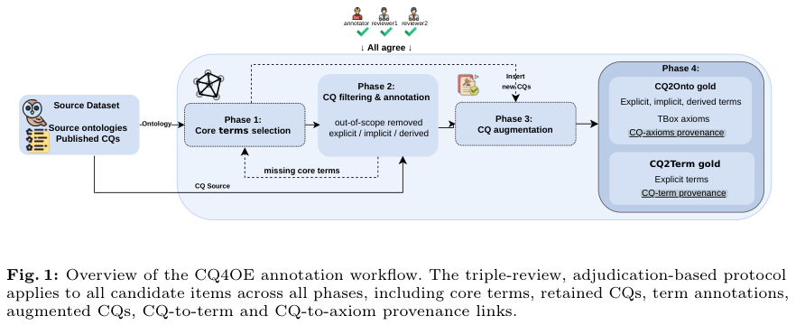

知识表示通过 CQ 出处、企业语义合同与代码分类法接入行动。机器人方法分别保留示范、直接构造潜在计划，Agent 框架则探索最小递归原语。本体工程先看 CQ4OE，企业应用再看语义验收；BPC 的可追溯检索与 RWM 的表示几何适合对照阅读。临床合成基准只作研究证据。

## 1. CQ4OE: A benchmark for assessing LLM-assisted ontology generation from competency questions

[原论文](https://arxiv.org/abs/2609.26029v1) · 2609.26029v1，版本提交 2026-09-22 · [PDF](https://arxiv.org/pdf/2609.26029v1)

CQ4OE 为每条 competency question 记录所需类、属性与公理的出处，分别以 CQ2Term 检查词项、CQ2Onto 检查结构和逻辑，覆盖 99 与 118 个问题。九个 LLM 的比较显示显式术语较易恢复，层级、属性和公理较难。该设计避免词面重合替代本体质量，但 gold 仍取决于领域边界和专家建模选择。

图：多阶段注释、出处与三重审查流程。Jiayi Li , Ziyuan Wang , Daniel Garijo , María Poveda-Villalón，arXiv:2609.26029v1，Figure 1，PDF 第 6 页。[原始图源](https://arxiv.org/pdf/2609.26029v1#page=6) · [CC BY 4.0](https://creativecommons.org/licenses/by/4.0/)。仅裁剪页面，保留完整原图、图注与必要标签，未重绘或修改数据，不表示作者认可本解读。该图沿用 CC BY 4.0，本站页脚许可不为其增加非商业或相同方式共享限制。

## 2. UniDataAgent: An Ontology-Grounded Agent for Enterprise Question-to-Report Automation

[原论文](https://arxiv.org/abs/2609.27257v1) · 2609.27257v1，版本提交 2026-09-23 · [PDF](https://arxiv.org/pdf/2609.27257v1)

UniDataAgent 分离本体获取验证与在线 Question-to-Report：先以业务 skills、受约束生成和专家验收建立版本化语义，再检索合同、协调工具并输出证据关联报告。二十七张企业表上的 40 个业务问题比较中，strict accuracy 为 95.0%，文档 RAG 为 72.5%。这是单企业用例，不能外推成跨企业承诺；语义维护、变更与权限都有持续成本。

## 3. CodeGraph: Open-Taxonomy Knowledge Graph for Source Code with Wikidata Grounding

[原论文](https://arxiv.org/abs/2609.29474v1) · 2609.29474v1，版本提交 2026-09-24 · [PDF](https://arxiv.org/pdf/2609.29474v1)

CodeGraph 从源码提取算法、范式、模式和领域概念，通过确定性 SPARQL、Agent 长尾消歧与层级闭包接入 Wikidata。Stack-Edu 处理形成约 158M 节点、约 1B 类型边，覆盖十四种语言。规模只说明覆盖，不能代表每条标注准确；小型人工 gold 与模型过滤如何校准精确率、长尾概念是否误合并仍需检查。

## 4. Your Transformer Can Hold Two Thoughts at Once: Evidence of Linear Superposition in LLMs

[原论文](https://arxiv.org/abs/2609.29845v1) · 2609.29845v1，版本提交 2026-09-24 · [PDF](https://arxiv.org/pdf/2609.29845v1)

线性叠加研究混合不同文本流输入，观察下一 token 分布是否近似单流分布组合，并用轻量微调恢复训练中减弱的结构。引导解码能从一次前向拆出两条续写。这是特定构造中的叠加证据，不等于整个 Transformer 线性，也不足以推断复杂双任务推理吞吐翻倍。

## 5. Synthetic Hospital: An Open, Verifiable, Physician-Validated Longitudinal EHR Benchmark

[原论文](https://arxiv.org/abs/2609.30027v1) · 2609.30027v1，版本提交 2026-09-24 · [PDF](https://arxiv.org/pdf/2609.30027v1)

Synthetic Hospital 从公开医学教育材料生成 1,268 位纵向合成患者、5,602 次就诊，保留标准本体与来源链。医生盲测区分真与合成记录正确率约 53%；最佳模型严重程度加权 problem-list F1 为 0.73。逼真性不等于临床等效，匹配子集上的医生均值也不能支持真实患者诊疗部署，仍须区分标签可靠性和现实有效性。

## 6. Training-free Behavior Cloning

[原论文](https://arxiv.org/abs/2609.30134v1) · 2609.30134v1，版本提交 2026-09-24 · [PDF](https://arxiv.org/pdf/2609.30134v1)

Behavior Predictive Control 结合动作感知检索、Hankel 动作延续先验与闭式残差校正，无需端到端策略训练。模拟与实机报告拟合从小时降至秒，Jetson Orin Nano 闭环超过 75Hz，动作可追溯到示范窗口。training-free 不免除数据收集和表示设计；示范库覆盖与运行时分布失配仍决定可靠性。

## 7. Harness as a Language: A Minimalist Agent Framework With Maximal Expressivity

[原论文](https://arxiv.org/abs/2609.26891v1) · 2609.26891v1，版本提交 2026-09-22 · [PDF](https://arxiv.org/pdf/2609.26891v1)

JAZ 将 invoke 作为 LLM 在运行时实现的函数原语，允许代码递归调用，输入和交互历史作为变量供代码操作。在指定长时记忆与持续改进任务中，相对 Letta、ACE 有效果和成本收益。最小 harness 是表达能力主张，不是安全隔离证明；任意代码、递归调用仍须外部权限、预算与监控约束。

## 8. Representation World Model: Learning States, Transition and Executable Plans in Representation

[原论文](https://arxiv.org/abs/2609.29171v1) · 2609.29171v1，版本提交 2026-09-24 · [PDF](https://arxiv.org/pdf/2609.29171v1)

RWM 在端点间潜在路径上施加局部逆动力学监督，让表示几何同时编码状态、转移与可执行计划。推理直接构造当前到目标路径并恢复动作，无需递归 rollout 或动作空间搜索。连续控制和机器人操作支持这条替代路线，但可达性、障碍限制及分布外目标仍要逐项验证。

文中实验结果为论文作者报告，未独立复现。
