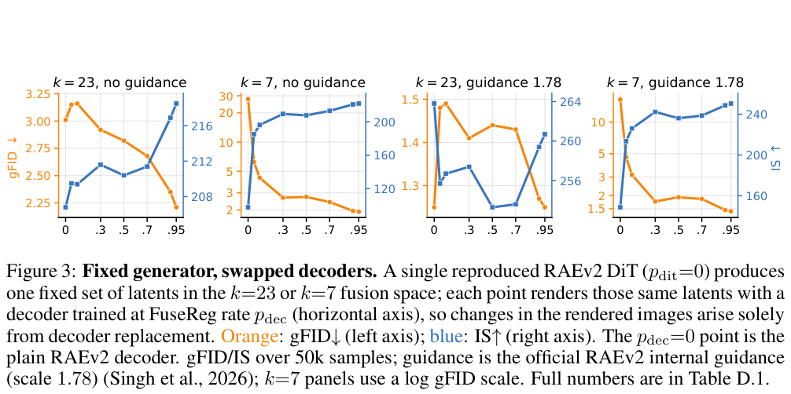

医学层级表示、视觉编码器层融合、长上下文选块都面临接口失配。建议先看 FuseReg 固定生成器的对照与 PISA 的选择复杂度，再看机器人、音视频和安全研究如何验证跨模块连接。HCOE 临床指标只按研究数据集理解，不用于个人医疗判断。

## 1. HCOE: Hyperbolic Clinical Ontology Embeddings from Biomedical Language Models

[原论文](https://arxiv.org/abs/2609.30763v1) · 2609.30763v1，版本提交 2026-09-25 · [PDF](https://arxiv.org/pdf/2609.30763v1)

HCOE 将冻结 BioBERT 表示映射至 Poincaré 球，结合父侧和子侧对比目标、从粗到细的路径聚合编码 ICD、CCS、ATC 层级。作者在关系预测、层级迁移及 MIMIC-IV 死亡、再入院和用药任务中报告最佳比较结果。它是指定数据集的表示学习，不是医学因果模型；患者级划分、稀有类别和外部院区迁移仍须独立审查。

## 2. InternW0-$Δ$: A World Action Model Bridging Predictive Dynamics and Actions with 20K+ Hours of Open Data

[原论文](https://arxiv.org/abs/2609.31394v1) · 2609.31394v1，版本提交 2026-09-25 · [PDF](https://arxiv.org/pdf/2609.31394v1)

InternW0-Δ 在 MoT 中连接视频、动作、冻结 VLM 语义与训练期 4D 几何运动蒸馏；Causal Imprint 让动作专家读取预测表征，推理不用生成未来视频。处理后异构预训练数据超过 20K 小时，口径不同于前代 7,200 小时。原文仍以将来时描述代码、权重与数据开放，处理数据也受许可证限制，不能把计划发布写成完整可用。

## 3. FuseReg: Regularizing Layer Fusion Mitigates the Reconstruction-Generation Gap in Representation Autoencoders

[原论文](https://arxiv.org/abs/2609.31620v2) · 2609.31620v2，版本提交 2026-09-28 · [PDF](https://arxiv.org/pdf/2609.31620v2)

FuseReg 随机抽取编码器层子集训练，降低 decoder 对固定融合的依赖。ImageNet-256、DINOv3-L 中，固定 RAEv2 DiT-XL 生成器只换 decoder，原生 k=23 的 unguided gFID 从 3.01 到 2.21，约降 27%；DiT-Base 两阶段共同正则化的另一配置从 13.96 到 9.93，约降 29%。不同对照不可叠加。固定生成器更清楚地隔离 decoder 作用；图中引导与非引导趋势也并非处处单调。

图：固定生成器下替换 decoder 对 gFID 和 IS 的影响。Hongyang Du , Yunfei Xie , Junjie Ye , Jiawei Yang , Xiaoyan Cong , Haodong Zhang , Yongchao Huang , Haiyu Wu , Zongxia Li , Shihang Gui , Dawei Liu , Runhao Li , Jingcheng Ni , Chen Wei , Randall Balestriero , Yue Wang，arXiv:2609.31620v2，Figure 3，PDF 第 7 页。[原始图源](https://arxiv.org/pdf/2609.31620v2#page=7) · [CC BY 4.0](https://creativecommons.org/licenses/by/4.0/)。仅裁剪页面，保留完整原图、图注与必要标签，未重绘或修改数据，不表示作者认可本解读。该图沿用 CC BY 4.0，本站页脚许可不为其增加非商业或相同方式共享限制。

## 4. Block Sparse Attention with Log-Linear Complexity

[原论文](https://arxiv.org/abs/2609.31093v1) · 2609.31093v1，版本提交 2026-09-25 · [PDF](https://arxiv.org/pdf/2609.31093v1)

PISA 以金字塔 Top-K 从粗到细缩小 key 块候选，避免最终注意力稀疏、选块仍为二次复杂度。分层 LogSumExp 与融合 Triton kernel 提供 O(N log N) 路线，语言建模实验中常识任务相近、检索更好。渐近复杂度不是实际延迟，层级构建、保留预算与硬件常数必须看实测。

## 5. AgentXploit: Autonomous Repository-to-Runtime Red-Teaming for AI Agents

[原论文](https://arxiv.org/abs/2609.31318v1) · 2609.31318v1，版本提交 2026-09-25 · [PDF](https://arxiv.org/pdf/2609.31318v1)

AgentXploit 在授权白盒受控环境中，分开仓库级路径分析和运行验证。十二系统、七十二项可复现漏洞基准，三次运行平均成功率 59.3%；Codex 为 38.4%，匹配 token 预算后为 46.3%。预算匹配改变了差距，必须同时呈现。这里只讨论评测与防护启示，不展开利用步骤，结果不代表任意真实部署的漏洞覆盖率。

## 6. Who Says What: Symbolic Trimodal Binding Mechanisms in Audio-Visual LLMs

[原论文](https://arxiv.org/abs/2609.31193v1) · 2609.31193v1，版本提交 2026-09-25 · [PDF](https://arxiv.org/pdf/2609.31193v1)

音视频研究把说话序列和实体位置视为模态专属符号变量，指出对话绑定错误多来自音画连接错位。现成 active speaker detection 标出当前说话者，无需训练便改善四个对话基准；少于三百步微调又扩展到三项通用任务。效果仍依赖检测器，重叠发言、遮挡与跨镜头身份都可能导致错误绑定。

文中实验结果为论文作者报告，未独立复现。
