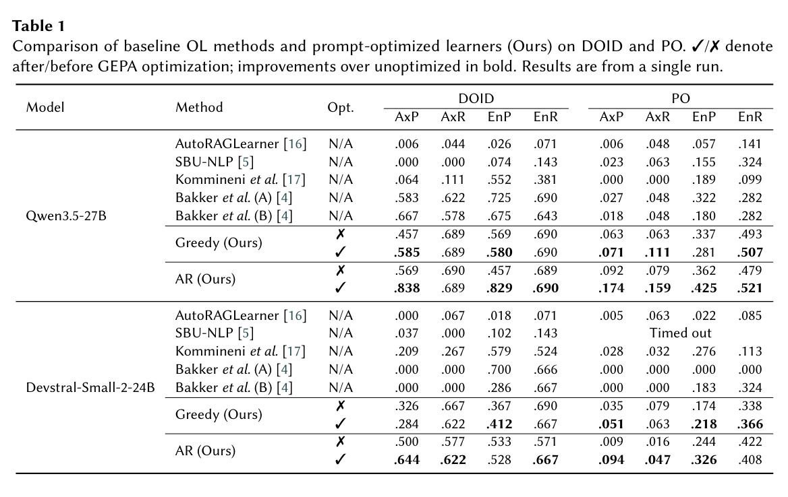
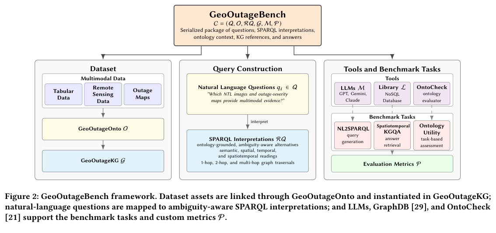
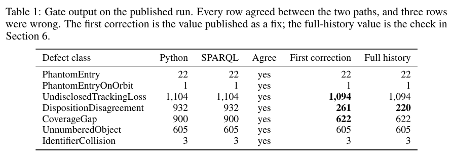
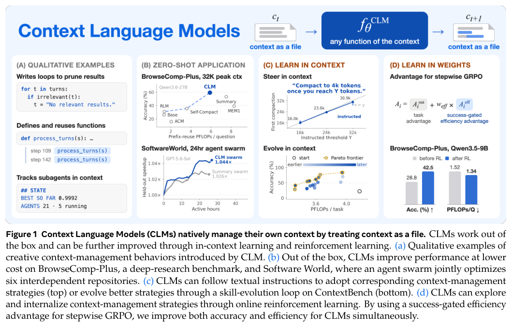
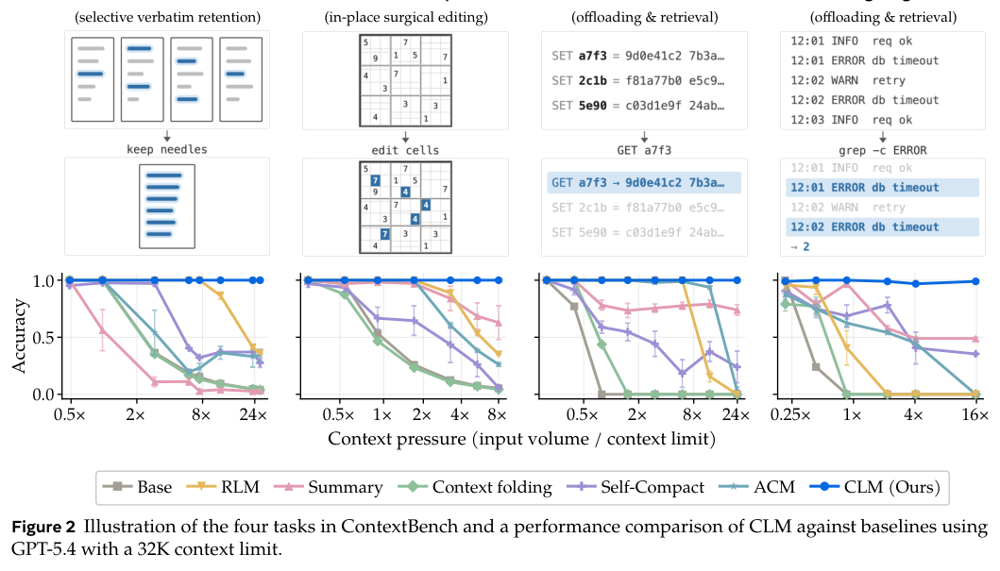
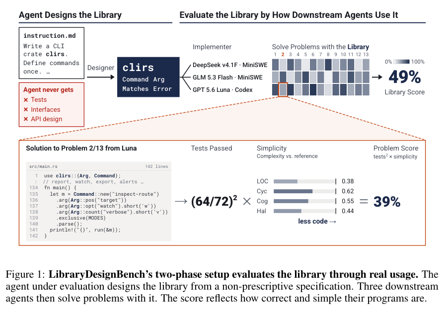
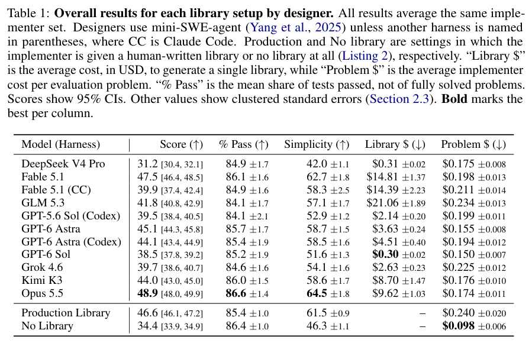
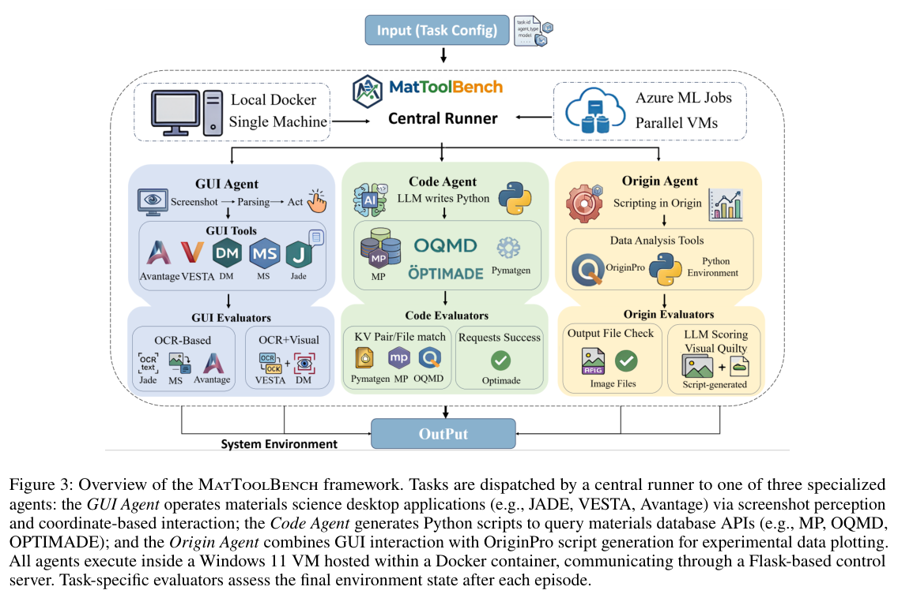

提示词、本体、上下文和工具接口，都在影响模型能否把知识用于实际任务。本期从语义建模与数据验证出发，延伸到 Agent 软件设计、材料科学操作和驾驶世界模型。

## 1. APOLO：把本体学习提示词变成可优化对象

把文本转成本体，难点不只是抽名词，还要让关系和公理在逻辑上成立。APOLO 不先改权重，而是把本体学习拆成模块，让优化器依据结构化反馈修改提示词。

### 方法与问题

作者由专家维护的本体生成文本—本体配对，比较逐块抽取的 Greedy 学习器与利用已有结构的自回归学习器，再通过 DSPy 的 GEPA 优化提示。评分不仅检查实体出现，还用推理器检查公理正确性与覆盖。

### 实验证据

Table 1 的单次 DOID 实验中，Qwen3.5-27B 自回归学习器的 AxP 从 0.569 到 0.838，AxR 则从 0.690 到 0.689，基本不变。这更接近减少错误公理，不能称所有维度显著提升。论文也测植物本体 PO 与 Devstral-Small-2-24B，不同模型和指标的方向并不一致。

### 讨论

可调试接口比一个总分更值得复用：缺实体、无依据公理、语法和一致性可分别反馈给优化器。但原评分不惩罚所有冗余公理，基础本体也可能已被预训练见过。应在未参与生成训练数据的新领域上做多随机种子验证。AxP 不是整体本体质量或下游准确率，本篇只用 9 月 28 日 v1。

图源：Huu Tan Mai , Roman Kochnev , Cuong Xuan Chu , Lukas Lange , Heiko Paulheim , Daria Stepanova，《APOLO: Automatic Prompt Optimization for Ontology Learning》，arXiv:2609.34540v1，Table 1，PDF 第 5 页。[原图出处](https://arxiv.org/pdf/2609.34540v1#page=5) · [CC BY 4.0](https://creativecommons.org/licenses/by/4.0/)。裁剪自原文。

- [APOLO: Automatic Prompt Optimization for Ontology Learning](https://arxiv.org/abs/2609.34540v1) · 2609.34540v1，该版本提交 2026-09-28。

## 2. GeoOutageBench：停电分析里的时空歧义

GeoOutageBench 把停电记录、遥感、天气、风暴事件和地理实体接进时空知识图谱，测试语言模型能否把含糊的问题转成合适的 SPARQL。问题不止是查一个事实，还包含时空邻近、事件共现、多模态证据和假设情景，因而能检查本体是否实际帮助了查询。

*图｜Frakes, Ethan D. 等，GeoOutageBench，[Figure 2（PDF 第 3 页）](https://arxiv.org/pdf/2609.36082v1#page=3)，[CC BY 4.0](http://creativecommons.org/licenses/by/4.0/)。裁剪自原文。*

这套评测分别观察问题解释、本体效用和答案检索，适合定位“查询可以执行，但问错了对象或时间”的失败。它提供的是基础设施韧性分析的领域测试框架；图谱覆盖和问题分类仍限定了能检验的能力，不能用一项回答分数替代真实电网决策效果。

[GeoOutageBench: Benchmarking Ambiguity-aware, Ontology-grounded Geospatiotemporal KGQA for Multimodal Power Outage and Resilience Analysis](https://arxiv.org/abs/2609.36082v1) · 2609.36082v1。

## 3. 两条验证路径，也可能共享同一个语义错误

这篇卫星目录案例比较集合式 Python 计算和 RDF 图上的 SPARQL 查询。两条路径的七个计数全部一致，却有三个计数错误；原因是它们导入了同一组常量，共同误读了上游状态代码。冗余实现检查了代码是否一致，却没有独立检查概念是否理解正确。

*图｜Rovai, Fabio 等，两条验证路径，也可能共享同一个语义错误，[Table 1（PDF 第 3 页）](https://arxiv.org/pdf/2609.37603v1#page=3)，[CC BY 4.0](http://creativecommons.org/licenses/by/4.0/)。裁剪自原文。*

作者进一步用对象级记录追查修正，发现修正本身仍有部分假阳性，原先设计的检查也未发现。这个单一管线案例不能给出所有数据工程的失败率，但提醒人们把独立性追溯到定义、数据和假设，而不只是换一种编程语言或查询接口。

[Independent Verification Paths Are Not Independent: A Case Study of Common-Mode Failure in a Satellite Catalogue Pipeline](https://arxiv.org/abs/2609.37603v1) · 2609.37603v1。

## 4. Context Language Models：让模型编辑自己的上下文

Context Language Models 将上下文表示为文件，允许模型主动更新内容，多 Agent 也可各自维护上下文文件。这样，保留什么、删除什么和如何组织信息，从固定 harness 规则变成可由模型学习的行为；论文同时研究零样本使用、技能优化和在线强化学习。

*图｜Shao, Rulin 等，Context Language Models，[Figure 1（PDF 第 2 页）](https://arxiv.org/pdf/2609.37725v1#page=2)，[CC BY 4.0](http://creativecommons.org/licenses/by/4.0/)。裁剪自原文。*

作者在检索、长时任务和多仓库协作上报告质量与计算收益，并为服务端设计 Suffix Cache Reuse。这里包含模型行为和缓存系统两层改进，不能把所有节省归给文件接口。上下文可编辑还意味着错误删除可能抹掉关键证据，实际使用应单独检查长链依赖与信息恢复。

*图｜Shao, Rulin 等，Context Language Models，[Figure 2（PDF 第 4 页）](https://arxiv.org/pdf/2609.37725v1#page=4)，[CC BY 4.0](http://creativecommons.org/licenses/by/4.0/)。裁剪自原文。*

[Context Language Models](https://arxiv.org/abs/2609.37725v1) · 2609.37725v1。

## 5. LibraryDesignBench：库能实现，还要让别的 Agent 愿意用

LibraryDesignBench 先让一个 Agent 按能力规范设计完整库，再让不同模型家族的使用者 Agent 编写应用，以程序正确性和简洁程度评价设计。242 个专家核验问题覆盖四种语言、15 项库设计任务，测的是下游复用，而不只是库自身通过单元测试。

*图｜Orlanski, Gabriel 等，LibraryDesignBench，[Figure 1（PDF 第 2 页）](https://arxiv.org/pdf/2609.36730v1#page=2)，[CC BY 4.0](http://creativecommons.org/licenses/by/4.0/)。裁剪自原文。*

在 15 项任务中的 11 项，设计者重现了人工生产库的主要抽象，但使用者仍常重复实现已有功能。失败分析把问题更多指向接口僵硬或难用，而非缺少功能；给设计者更明确的使用指导和试用反馈可改善结果。这些发现支持把“调用方是否容易正确复用”纳入库验收。

*图｜Orlanski, Gabriel 等，LibraryDesignBench，[Table 1（PDF 第 7 页）](https://arxiv.org/pdf/2609.36730v1#page=7)，[CC BY 4.0](http://creativecommons.org/licenses/by/4.0/)。裁剪自原文。*

[Can Agents Design Libraries for Agents?](https://arxiv.org/abs/2609.36730v1) · 2609.36730v1。

## 6. MatToolBench：科学软件的难点不只在看懂按钮

MatToolBench 在 Windows 11 虚拟机内运行 10 种材料科学工具，提供 GUI 操作、OriginPro 脚本和数据库代码查询共 204 项任务。领域专家把任务拆成细粒度验收条件，使失败能够定位到具体操作和跨工具产物，而不只是看最后一张截图。

*图｜Wu, Mei 等，MatToolBench，[Figure 3（PDF 第 3 页）](https://arxiv.org/pdf/2609.37053v1#page=3)，[CC BY 4.0](http://creativecommons.org/licenses/by/4.0/)。裁剪自原文。*

论文中最强模型的 GUI 成功率也仅为 25%，代码任务为 45%，显示通用软件成绩并不能直接迁移到专业工作流。作者指出，领域操作知识不足、跨工具交接和只能从视觉读取的关键状态都会导致失败；评判器的一致性成绩也应与 Agent 实际完成率分开理解。

[MatToolBench: Benchmarking Multimodal Agents in Real-World Materials Science Workflows](https://arxiv.org/abs/2609.37053v1) · 2609.37053v1。

## 7. AD-E2E-JEPA：先隔离世界模型的规划能力

AD-E2E-JEPA 用目标条件下的零样本规划比较 JEPA 世界模型：目标由真实未来观测提供，不另训驾驶策略。针对现有模型在效率与规划质量之间的取舍，方法用带 SIGReg 正则的投影器压缩 patch 数量和表示维度，让候选轨迹的潜在 rollout 更便宜。

论文在 NAVSIMv2 同时报告带乘性安全指标和不带该项的分数，并另测投影器对模仿学习的帮助。目标观测、候选轨迹词表和安全计分方式都会改变结果，因此不能把这类受控规划成绩直接解读成开放道路上的自主驾驶可靠性。

[AD-E2E-JEPA: A Joint-Embedding Predictive Architecture For End-to-End Autonomous Driving](https://arxiv.org/abs/2609.34085v1) · 2609.34085v1。

[Figure 1（原文）](https://arxiv.org/pdf/2609.34085v1#page=1)。

## 8. 预训练的泛化能力会不会突然换挡

Generalization Dynamics of LM Pre-training 构造小型评测，发现模型在训练途中可能突然从可泛化的计算切换到记忆、表面模式或听起来合理的答案，随后又恢复。作者称之为 mode-hopping，并指出局部稳定性和检查点平均不足以解释或消除这种变化。

论文提出容量分配视角：泛化机制和较浅的模式竞争有限容量，当前数据窗口可能改变哪一种占上风。它据此尝试选择中间检查点和训练数据，而不是默认最后一个检查点一定最好。这是特定评测套件揭示的训练现象，机制解释仍需要更广模型与任务验证。

[Generalization Dynamics of LM Pre-training](https://arxiv.org/abs/2609.33150v1) · 2609.33150v1。

[Figure 1（原文）](https://arxiv.org/pdf/2609.33150v1#page=1)。
