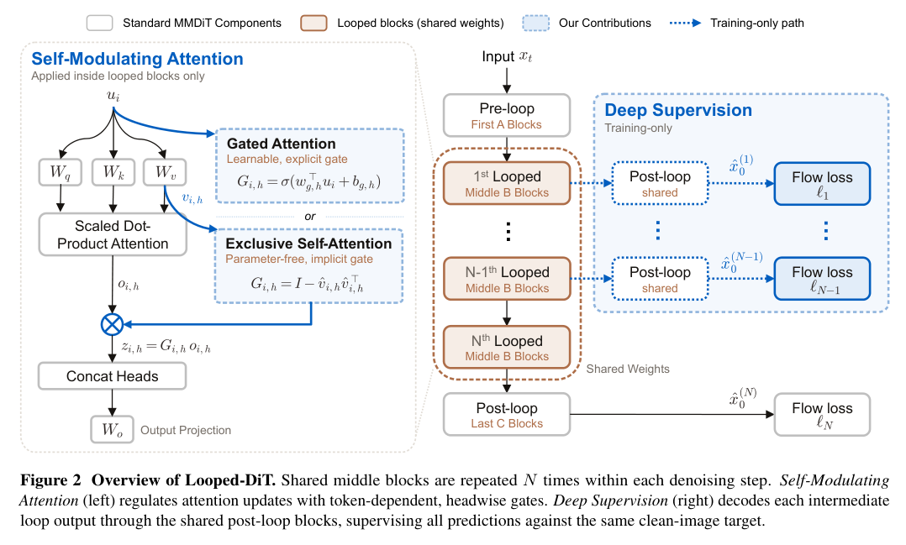
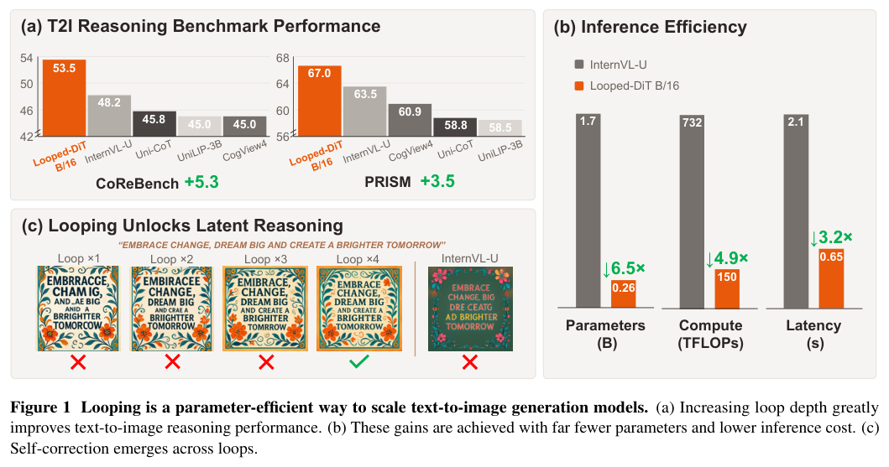
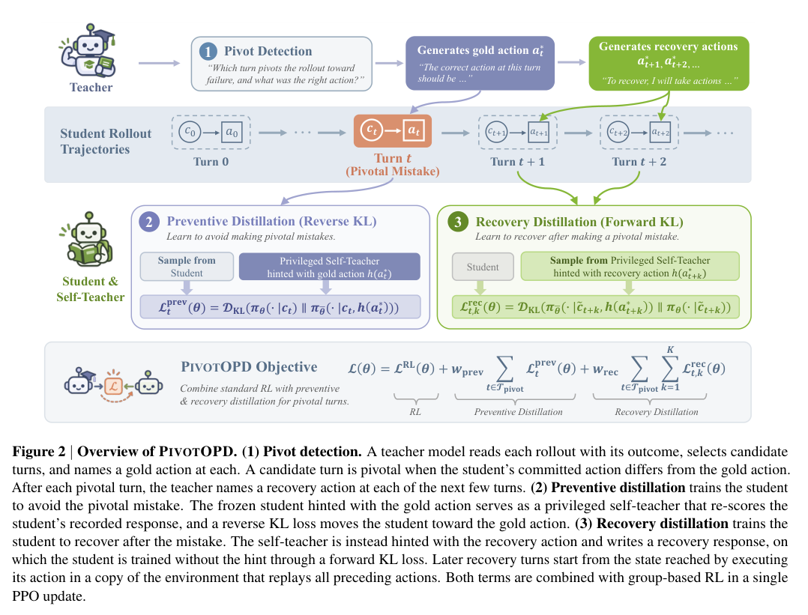
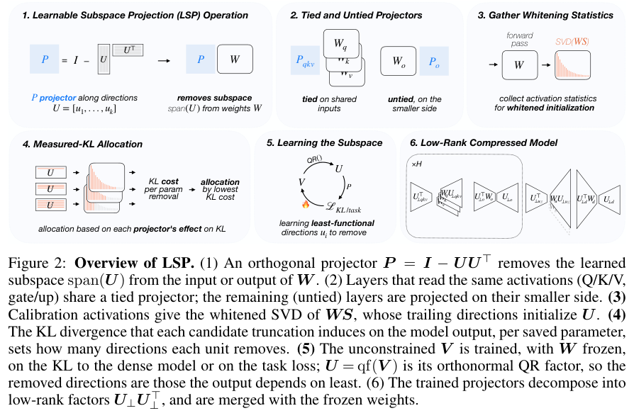
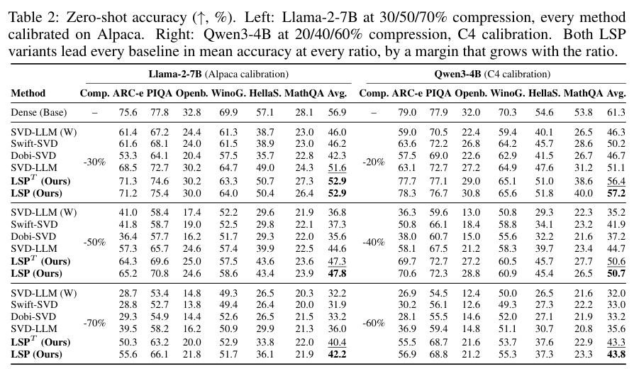

正确的答案需要明确的验证依据，省下计算也需要说明代价发生在哪一层。本期讨论本体推理评测、建筑图谱查询、工业建图，以及 Agent 恢复、循环生成与模型压缩。

## 1. 本体推理评测：先证明干扰项真的错

让模型出题再让模型判题，可能把相同错误写进题目和评分标准。本文先问标准答案从哪里来：正确项锚定 OWL 本体公理，干扰项也接受形式化检查。

### 方法与问题

流水线扰动类定义中的限制、基数和填充类，用 OWL 推理器检查扰动表达式与原公理的关系，之后才做自然语言表述、干扰项筛选和四选一组装。语言流畅和逻辑标签分别处理，避免由 LLM 独自决定二者。

### 实验证据

Pizza、PMDco、DOID 分别产生 112、2,491、15,216 道题。六个模型零样本准确率范围为 41.1%–76.8%，高于 25% 随机基线；这是跨模型、跨设置报告范围，不能当作单模型统一正确率。题量和区分度支持该基准生成路线，却不证明本体知识等同现实真相。

### 讨论

保留题目背后的符号表达式比只存自然语言答案更容易审计。形式检查只针对给定本体内的蕴涵关系；口语化是否保留题意仍要另验，也不能外推临床或工业决策能力。

### 原图入口

[Figure 1，原论文 PDF 第 3 页](https://arxiv.org/pdf/2610.00682v1#page=3)。

- [Ontology-Grounded, Reasoner-Verified Benchmarks for Evaluating LLM Reasoning in Scientific AI](https://arxiv.org/abs/2610.00682v1) · 2610.00682v1，该版本提交 2026-09-30。

## 2. Build2SPARQL：让代码决定查询，模型负责问法

Build2SPARQL 面向 Brick 和 ASHRAE 223P 建筑图谱，由图遍历代码生成并验证 SPARQL，语言模型只负责把查询改写成自然语言。六类查询模式覆盖链、分支、UNION、聚合、OPTIONAL 和属性过滤，再用五种词汇风格表达，减少模型同时编题和编答案带来的耦合。

在 201 个建筑图谱上，管线形成 6,136 条可执行查询和 30,680 个问题。双人检查的 300 题中，语义保持与自然性较高，操作合理性相对较低，说明形式正确仍不保证建筑运维人员真的会这样提问。模型评测中的检索少样本收益，也应放在这类生成数据分布下理解。

[Build2SPARQL: A Large-Scale Text-to-SPARQL Benchmark Dataset for Building Knowledge Graph Querying](https://arxiv.org/abs/2610.00224v1) · 2610.00224v1。

[Figure 1（原文）](https://arxiv.org/pdf/2610.00224v1#page=5)。

## 3. 从法国电网报告到本体和已填充图谱

这项工业文本研究用可本地部署的 7B–32B 开源模型，串起实体关系抽取、RDF 三元组、OWL 本体构建、外部知识补充和图谱填充。重点是把可复用提示策略与 schema 约束放进连续流程，而不是让模型一次性输出所有结构。

作者在 80 份人工标注的私有法语电网事故报告上评估，发现 schema 引导提示改善抽取，量化模型提供效果与开销之间的折中。私有语料和特定工业术语限制了外部复核与迁移；本体或 RDF 能生成，并不表示所有抽取事实及关系已经正确。

[LLM-Guided Ontology-Driven Knowledge Graph Construction from Unstructured Text](https://arxiv.org/abs/2609.31663v1) · 2609.31663v1。

[Figure 1（原文）](https://arxiv.org/pdf/2609.31663v1#page=3)。

## 4. Looped-DiT：增加共享计算深度，而非一味加参数

Looped-DiT 在每个去噪步骤内重复运行共享 Transformer 块，以固定参数量增加计算深度。简单循环并不稳定有效，论文将问题归为中间循环监督弱和注意力更新破坏局部信息，因此加入跨循环深监督与自调制注意力。

*图｜Chng, Yong Xien 等，Looped-DiT，[Figure 2（PDF 第 2 页）](https://arxiv.org/pdf/2609.40305v1#page=2)，[CC BY 4.0](http://creativecommons.org/licenses/by/4.0/)。裁剪自原文。*

作者在匹配参数和匹配计算的设置中比较非循环基线，并观察到更深循环可纠正早期生成错误。与更大模型的比较涉及不同参数和推理预算，不能当作任意模型压缩的保证；“类似潜在推理”的行为描述，也不等于已经证明了通用的视觉推理机制。

*图｜Chng, Yong Xien 等，Looped-DiT，[Figure 1（PDF 第 1 页）](https://arxiv.org/pdf/2609.40305v1#page=1)，[CC BY 4.0](http://creativecommons.org/licenses/by/4.0/)。裁剪自原文。*

[Looped Diffusion Transformer](https://arxiv.org/abs/2609.40305v1) · 2609.40305v1。

## 5. PivotOPD：既阻止关键错误，也学习如何恢复

多轮 Agent 的一次错误会改变后续访问的状态，单纯在正确轨迹上蒸馏难以教会恢复。PivotOPD 定位使任务明显偏离目标的关键错误，由教师给出该步正确动作，并在接下来几轮提供恢复动作；预防与恢复分别采用反向和正向 KL 蒸馏。

*图｜He, Yinghui 等，PivotOPD，[Figure 2（PDF 第 2 页）](https://arxiv.org/pdf/2609.40285v1#page=2)，[CC BY 4.0](http://creativecommons.org/licenses/by/4.0/)。裁剪自原文。*

论文在 ALFWorld、WebShop 和搜索问答上比较多个基线，并探索向软件工程和另一模型家族迁移。重要区别是：避免犯错和走到错误状态后脱困，是两种监督需求。收益仍依赖关键错误的识别、教师动作质量及短期恢复窗口，不能假设任何失败都能被几轮指导修复。

[PivotOPD: Learning to Recover from Pivotal Mistakes in Multi-Turn Agents](https://arxiv.org/abs/2609.40285v1) · 2609.40285v1。

## 6. LSP：联合学习应该删掉哪些权重子空间

Learnable Subspace Projections 在冻结预训练权重时，为线性层或共享输入的层组学习正交投影，用全局输出 KL 或原训练损失联合优化要舍弃的子空间。训练后投影并入标准低秩因子，注意力层还可以只缓存较窄的共享潜变量。

*图｜Bini, Massimo 等，LSP，[Figure 2（PDF 第 3 页）](https://arxiv.org/pdf/2609.40127v1#page=3)，[CC BY 4.0](http://creativecommons.org/licenses/by/4.0/)。裁剪自原文。*

相比逐层按重建误差或激活能量压缩，这个目标能考虑误差如何沿网络传播。论文覆盖语言模型和 ViT，并在高压缩率下观察到更明显优势；解码速度则依赖小 batch 等条件。权重、KV 缓存和端到端延迟是不同成本，评估时需要分别核算。

Table 2 将压缩率与校准集分开比较：Llama-2-7B 使用 Alpaca 校准，压缩 30% 时 LSP 的六任务平均准确率为 52.9%，稠密模型为 56.9%；Qwen3-4B 使用 C4 校准，压缩 60% 时为 43.8%，稠密模型为 61.3%。同压缩率下领先所列基线，并不表示压缩没有质量损失。

*图｜Bini, Massimo 等，LSP，[Table 2（PDF 第 6 页）](https://arxiv.org/pdf/2609.40127v1#page=6)，[CC BY 4.0](http://creativecommons.org/licenses/by/4.0/)。裁剪自原文。*

[Learning Functional Subspaces for Neural Network Compression](https://arxiv.org/abs/2609.40127v1) · 2609.40127v1。

## 7. ID Balancing：用反馈控制稳定极稀疏 MoE

ID Balancing 把不带辅助损失的专家负载均衡写成控制问题：已有方法分别近似积分或比例控制，新方法组合积分与微分项，只在失衡恶化时启动微分修正。目标是在严重或持续加剧的偏载时及时纠正，又不在接近平衡时过度摆动。

论文在 768 个专家、不同 Top-K 稀疏度和模型规模上测量最坏与平均负载违例，同时检查语言建模和下游表现。负载改善反映训练稳定性与利用率，不等于任务准确率按相同比例提高；收益还依赖路由稀疏度、控制设置和训练系统。

[ID Balancing: Stable Training of Extremely Sparse MoE via PID-Based Load Control](https://arxiv.org/abs/2609.39137v1) · 2609.39137v1。

[Figure 1（原文）](https://arxiv.org/pdf/2609.39137v1#page=1)。
