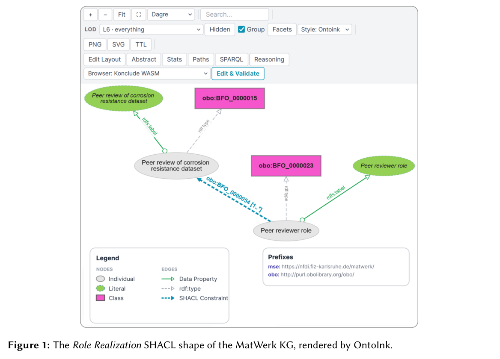

本体若只是一张静态图，通常很难持续约束系统。这里将 OntoInk 的文档与验证流水线，与 OntoPlan 的场景形式化和机器人规划合在同一天阅读。

## 文档与执行的两个接口

OntoInk 是 MkDocs 插件，将交互图、SHACL 验证、OWL DL 推理和内联 Turtle 编辑接入文档即代码流程。它是工具演示，不提供能宣称统一效果增益的基准。作者名按原文为 Jörg Waitelonis。

OntoPlan 将物体、空间、关系与状态统一为符号表示，按任务检索场景，再形式化目标和约束，交给规划器形成可执行计划。两篇的共同点是让符号层进入工程接口，而非只要求模型读懂说明。

## 结果与比较对象

OntoPlan 在五个室内环境、三种规模的 150 个一般任务中，平均成功率 0.89，最高成功率基线 0.27；平均每任务总 token 18.1k，约为最低 token 成本基线的 1/5.6。成功率与费用参照不是同一个基线，不能偷换。该室内场景评测不是现实机器人通用成功率；下图属于 OntoInk，不能误认为 OntoPlan 结果图。

## 我的判断

文档修改能触发验证，任务目标能交符号规划器检查，才能缩小文字合理与系统可执行的距离。真实感知噪声、状态过期及用户澄清成本仍需验证。OntoPlan 仅链接原文，不复制未确认开放转载权限的图。

## 原论文视觉证据

图源：Ebrahim Norouzi , Jörg Waitelonis , Harald Sack，《OntoInk: Interactive Ontology Visualization, Validation, and Reasoning》，arXiv:2610.05945v1，Figure 1，PDF 第 4 页。[原图出处](https://arxiv.org/pdf/2610.05945v1#page=4) · [CC BY 4.0](https://creativecommons.org/licenses/by/4.0/)。裁剪自原文。

## 相关论文

以下为 arXiv 作者稿，收录不代表已完成同行评审。

- [OntoInk: Interactive Ontology Visualization, Validation, and Reasoning](https://arxiv.org/abs/2610.05945v1) · 2610.05945v1，版本提交 2026-10-05；本篇精选深读。
- [POLAR: Ontology-Guided Risk Prevention for Tool-Calling LLM Agents](https://arxiv.org/abs/2610.08082v1) · 2610.08082v1，版本提交 2026-10-06。
- [Base Models Can Reason By Taking a Cue From Training Data](https://arxiv.org/abs/2610.06851v1) · 2610.06851v1，版本提交 2026-10-05。
- [LoGRA: Scaling LLM Reinforcement Learning with Low-Rank Gradient Sketches](https://arxiv.org/abs/2610.06647v2) · 2610.06647v2，版本提交 2026-10-06。
- [H-JEPA: End-to-End Learning of Hierarchical World Models for Visual Planning](https://arxiv.org/abs/2610.06805v1) · 2610.06805v1，版本提交 2026-10-05。
- [Agent in a Bottle: Can LLM Agents Turn Their Capabilities Into Cheap, Scalable Artifacts?](https://arxiv.org/abs/2610.08775v1) · 2610.08775v1，版本提交 2026-10-06。
- [LiFT: Loop Flow Transformers](https://arxiv.org/abs/2610.05538v1) · 2610.05538v1，版本提交 2026-10-04。

- [LLM-Assisted Discovery of Typed Semantic Links for Ontology Network Construction](https://arxiv.org/abs/2610.01393v1) · 2610.01393v1，版本提交 2026-10-01。
- [OntoPlan: An Ontology-Grounded Scene Representation and Agentic Framework for Scalable Robot Task Planning](https://arxiv.org/abs/2610.07649v1) · 2610.07649v1，版本提交 2026-10-06；本篇精选深读。
- [QF3: Fast Flow RL with Filtered Q-Gradients](https://arxiv.org/abs/2610.08789v1) · 2610.08789v1，版本提交 2026-10-06。
- [Sherpa: Teaching LLMs to Teach Adaptively](https://arxiv.org/abs/2610.08778v1) · 2610.08778v1，版本提交 2026-10-06。
- [IdeaAnchor: Teaching LLMs to Turn Literature into Research Ideas](https://arxiv.org/abs/2610.08781v1) · 2610.08781v1，版本提交 2026-10-06。
- [Recursive Game Creator: An Agentic Product-Level Experience-Oriented Game Harness](https://arxiv.org/abs/2610.08621v1) · 2610.08621v1，版本提交 2026-10-06。

### 发表状态

arXiv 来源页将 OntoInk 标为 ISWC 2026 Companion demo 稿、OntoPlan 标为 NeurIPS 2026 接收、POLAR 标为 Findings of AACL-IJCNLP 2026 接收。本文引用的内容仍固定到上列历史版本；这些当前元数据不用于反推 10 月 8 日的接收或正式发表状态，其余条目不补写未核实的会议状态。

## 论文来源

- [OntoInk: Interactive Ontology Visualization, Validation, and Reasoning](https://arxiv.org/abs/2610.05945v1) · 2610.05945v1，该版本提交 2026-10-05。
- [OntoPlan: An Ontology-Grounded Scene Representation and Agentic Framework for Scalable Robot Task Planning](https://arxiv.org/abs/2610.07649v1) · 2610.07649v1，该版本提交 2026-10-06。
