本期十三项研究介绍本体链接与文档、机器人规划、flow 强化学习、适应教学、研究合成、游戏开发、可逆工具、推理提示、梯度压缩、层级世界模型、可复用产物与循环生成。

## 1. 类型化本体链接：关系相似之外，还要说明角色

研究把领域适配 DistilBERT、聚类预筛与 GPT-4o 关系生成组合起来，为三十三个本体发现带类型和理由的跨本体链接。角色映射区分某个概念是工具、过程还是研究对象，避免只把相似名称连接起来。

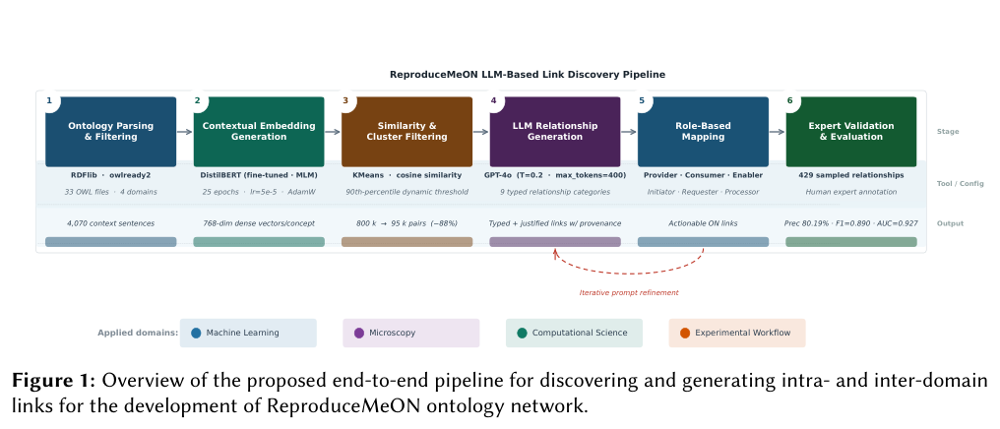

*图｜Hayouni, Nouha 等，[Figure 1（PDF 第 4 页）](https://arxiv.org/pdf/2610.01393v1#page=4)，[CC BY 4.0](http://creativecommons.org/licenses/by/4.0/)。裁剪自原文。*

429 条生成关系中，344 条获专家认可，精确率为 80.19%；跨领域为 75.25%，低于域内的 84.58%。F1=0.890 来自另加五百个容易随机负例的构造集，不能解释为完整本体网络的召回与 F1。第二位标注者仅覆盖二百七十四条，关系理由听起来合理也不代表语义一定正确。

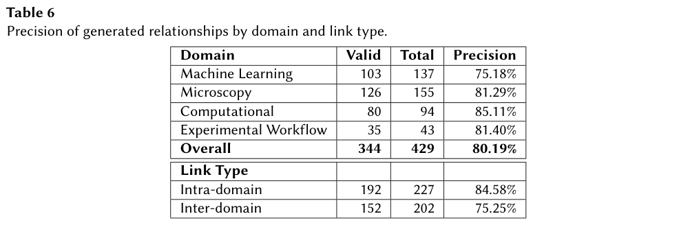

*图｜Hayouni, Nouha 等，[Table 6（PDF 第 11 页）](https://arxiv.org/pdf/2610.01393v1#page=11)，[CC BY 4.0](http://creativecommons.org/licenses/by/4.0/)。裁剪自原文。*

[LLM-Assisted Discovery of Typed Semantic Links for Ontology Network Construction](https://arxiv.org/abs/2610.01393v1) · v1。

## 2. OntoPlan：让场景表示接到可执行规划

OntoPlan 将物体、空间、关系与状态统一为符号表示，按任务检索场景，再形式化目标和约束，交给规划器形成可执行计划。两篇的共同点是让符号层进入工程接口，而非只要求模型读懂说明。

OntoPlan 在五个室内环境、三种规模的 150 个一般任务中，平均成功率 0.89，最高成功率基线 0.27；平均每任务总 token 18.1k，约为最低 token 成本基线的 1/5.6。成功率与费用参照不是同一个基线，不能偷换。该室内场景评测不是现实机器人通用成功率。

文档修改能触发验证，任务目标能交符号规划器检查，才能缩小文字合理与系统可执行的距离。真实感知噪声、状态过期及用户澄清成本仍需验证。

[OntoPlan: An Ontology-Grounded Scene Representation and Agentic Framework for Scalable Robot Task Planning](https://arxiv.org/abs/2610.07649v1)。

## 3. QF3：只在可靠动作维度使用 critic 梯度

QF3 以 flow matching 加 critic 的动作梯度更新在线 off-policy 流策略。一步输出预测偏离回放动作太远时，对应维度的 Q 梯度被截断，减少把不可靠局部价值外推成大幅策略更新；回放、分布式 critic 与批量仿真复用 FastTD3 配方。

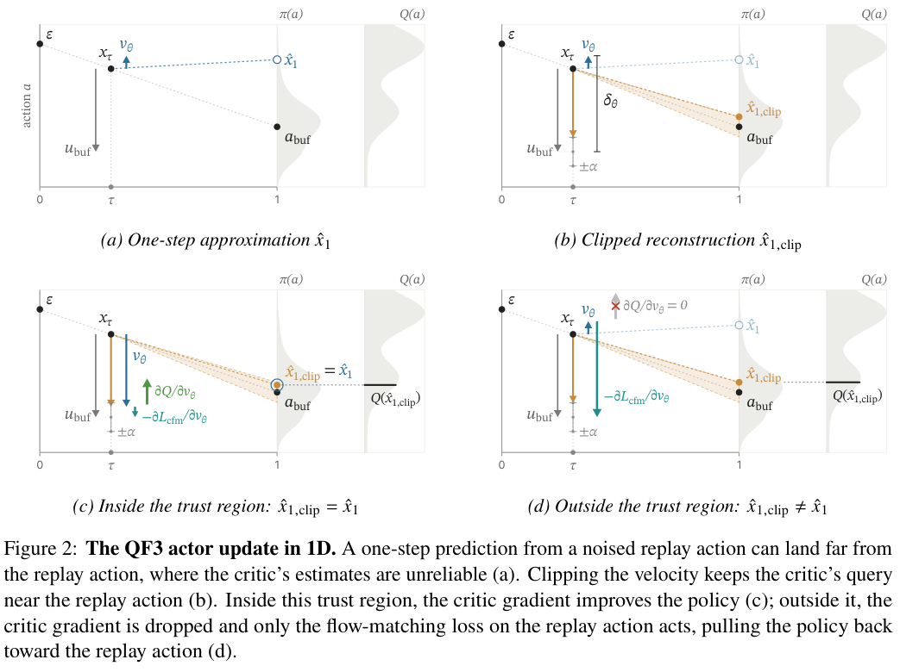

*图｜Kim, Chung Min 等，[Figure 2（PDF 第 5 页）](https://arxiv.org/pdf/2610.08789v1#page=5)，[CC BY 4.0](http://creativecommons.org/licenses/by/4.0/)。裁剪自原文。*

三个种子的 G1 单段舞蹈跟踪中，QF3 约半小时达到五百步完整 episode，FPO++ 约需十倍墙钟时间。舞蹈实验用 L40S，速度跟踪用 A10G；另一方法 FlowRL 的速度测试用 L4，因此未放入该墙钟面板。十倍仅指特定任务与对照，不代表全部机器人训练或真机执行同倍加速。

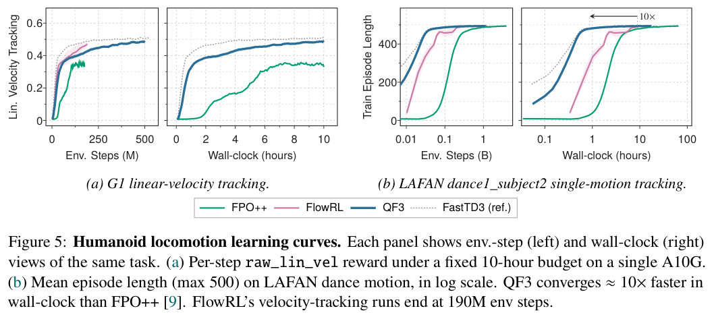

*图｜Kim, Chung Min 等，[Figure 5（PDF 第 8 页）](https://arxiv.org/pdf/2610.08789v1#page=8)，[CC BY 4.0](http://creativecommons.org/licenses/by/4.0/)。裁剪自原文。*

[QF3: Fast Flow RL with Filtered Q-Gradients](https://arxiv.org/abs/2610.08789v1) · v1。

## 4. Sherpa：用学生学会多少来训练教师

Sherpa 用具有不同学习偏好的 LLM 学生模拟教学，教师经历准备、辅导与测验，以学生后续作答改善作为多轮强化学习信号。训练区分无偏好学生与多种偏好学生，检查教师是否真的根据学习者调整解释。

Qwen3-8B 教师、Qwen3-1.7B 学生下，多偏好训练后的七原型平均测验准确率为 69.0%，未训练教师为 48.6%；MathTutorBench 教学回复均分从 52.5 到 79.2。但错误定位从 37.1 降到 30.3。九十六位教师的 960 次判断中，排除平局后的偏好胜率为 79.6%，这是回复偏好，尚非真实学生长期学习收益。

[Sherpa: Teaching LLMs to Teach Adaptively](https://arxiv.org/abs/2610.08778v1) · v1。

[Figure 1（原文）](https://arxiv.org/pdf/2610.08778v1#page=3)。

## 5. IdeaAnchor：把论文之间的合成关系写成监督

IdeaAnchor 从已发表论文提取先行工作的功能角色、互补或冲突关系以及目标合成标准，作为特权训练信息。演示、自蒸馏与强化学习学习怎样连接文献；推理时的检索则补充事实、方程、实验条件与方法细节。

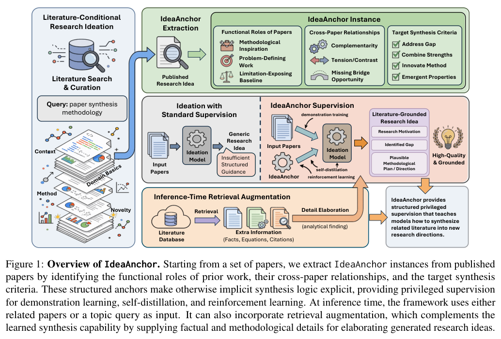

*图｜Chen, Ziyu 等，[Figure 1（PDF 第 1 页）](https://arxiv.org/pdf/2610.08781v1#page=1)，[CC BY 4.0](http://creativecommons.org/licenses/by/4.0/)。裁剪自原文。*

924 个 ICLR 2026 实例中，Qwen3-8B 的标准满足率 CSR 从 10.9% 到 RL 的 24.6%，再加全文检索为 25.6%。另一个六主题、三位研究者盲评的小实验中，总体分从 2.9 到 3.7，满分五分。标准匹配与人类偏好衡量的是想法文本质量，不能当作新发现已经实验成功，也不能用额外检索代替合成方向是否成立。

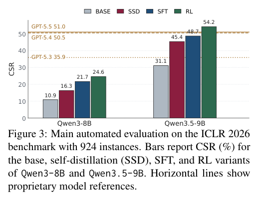

*图｜Chen, Ziyu 等，[Figure 3（PDF 第 7 页）](https://arxiv.org/pdf/2610.08781v1#page=7)，[CC BY 4.0](http://creativecommons.org/licenses/by/4.0/)。裁剪自原文。*

[IdeaAnchor: Teaching LLMs to Turn Literature into Research Ideas](https://arxiv.org/abs/2610.08781v1) · v1。

## 6. Recursive Game Creator：让试玩轨迹参与递归改进

该框架由 Designer、Builder、Player 与 Reviewer 组成。程序化 Player 构建可复用操作策略，收集多种试玩轨迹，Reviewer 再结合轨迹指标、视觉证据和文字偏好选择版本，把运行正确之后的体验问题送回下一轮开发。

GameASG-Bench 上，相同 GPT-6-Astra high 的严格成功由 Codex CLI 的 9/47 到框架的 25/47，即 19.1% 到 53.2%，增加 34.1 个百分点；平均运行检查通过率为 93.4%。这仍低于另一配置 Astra ultra 的 26/47，且部分基线来自原报告。运行检查、人评时长与体验分是不同结果，不能把通过检查直接当作更好玩。

[Recursive Game Creator: An Agentic Product-Level Experience-Oriented Game Harness](https://arxiv.org/abs/2610.08621v1) · v1。

[Figure 1（原文）](https://arxiv.org/pdf/2610.08621v1#page=1)。

## 7. OntoInk：把本体文档与验证接到代码工作流

OntoInk 是 MkDocs 插件，将交互图、SHACL 验证、OWL DL 推理和内联 Turtle 编辑接入文档即代码流程。它是工具演示，不提供能宣称统一效果增益的基准。

图源：Ebrahim Norouzi , Jörg Waitelonis , Harald Sack，《OntoInk: Interactive Ontology Visualization, Validation, and Reasoning》，arXiv:2610.05945v1，Figure 1，PDF 第 4 页。[原图出处](https://arxiv.org/pdf/2610.05945v1#page=4) · [CC BY 4.0](https://creativecommons.org/licenses/by/4.0/)。裁剪自原文。

[OntoInk: Interactive Ontology Visualization, Validation, and Reasoning](https://arxiv.org/abs/2610.05945v1)。

## 8. POLAR：先寻找可执行的逆操作，再允许工具写入

POLAR 用动作类型本体与当前状态两层表示，逆向搜索候选动作的恢复序列，按最弱步骤计算可逆性分，再由决策策略允许或否决操作。评价中的 wrapper 只使用其中一部分模块，结构上可追溯不代表每种请求路由都已实测。

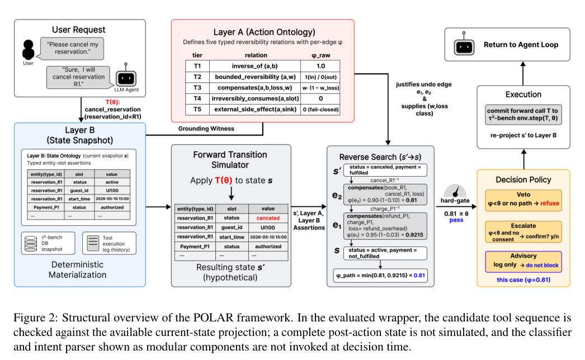

*图｜Kang, Yunju 等，[Figure 2（PDF 第 3 页）](https://arxiv.org/pdf/2610.08082v1#page=3)，[CC BY 4.0](http://creativecommons.org/licenses/by/4.0/)。裁剪自原文。*

六模型、三领域共十八格中，八格平均任务奖励提高。Qwen3-8B 的 airline 从 0.351 到 0.462，retail 却从 0.213 降到 0.113；每格尝试一百五十次并排除错误终止。奖励衡量任务效用，不直接衡量避免了多少伤害；更严格可逆性门槛也可能阻止合法但难撤销的任务。

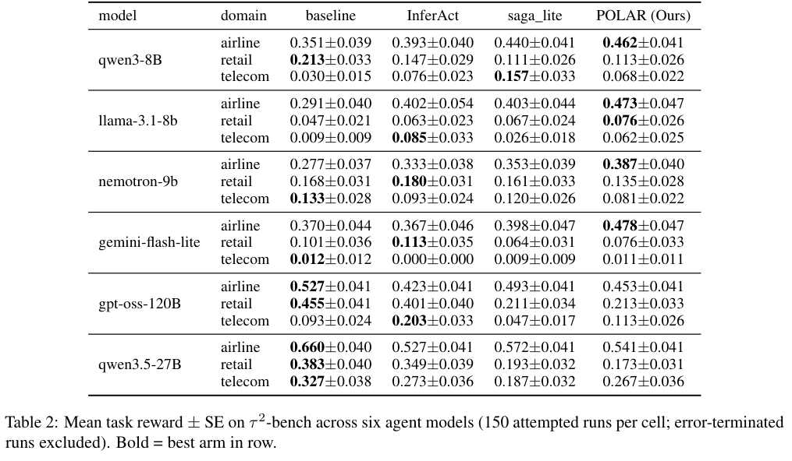

*图｜Kang, Yunju 等，[Table 2（PDF 第 5 页）](https://arxiv.org/pdf/2610.08082v1#page=5)，[CC BY 4.0](http://creativecommons.org/licenses/by/4.0/)。裁剪自原文。*

[POLAR: Ontology-Guided Risk Prevention for Tool-Calling LLM Agents](https://arxiv.org/abs/2610.08082v1) · v1。

## 9. 开头提示 token：训练数据如何唤起不同推理模式

研究先在三十道数学训练题上搜索高概率开头，再用采样答案一致性选择固定 cue，而不读取参考答案。它把“模型是否会生成这个开头”与“给定开头后如何续写”拆开，并通过修改中期训练语料检验因果关联。

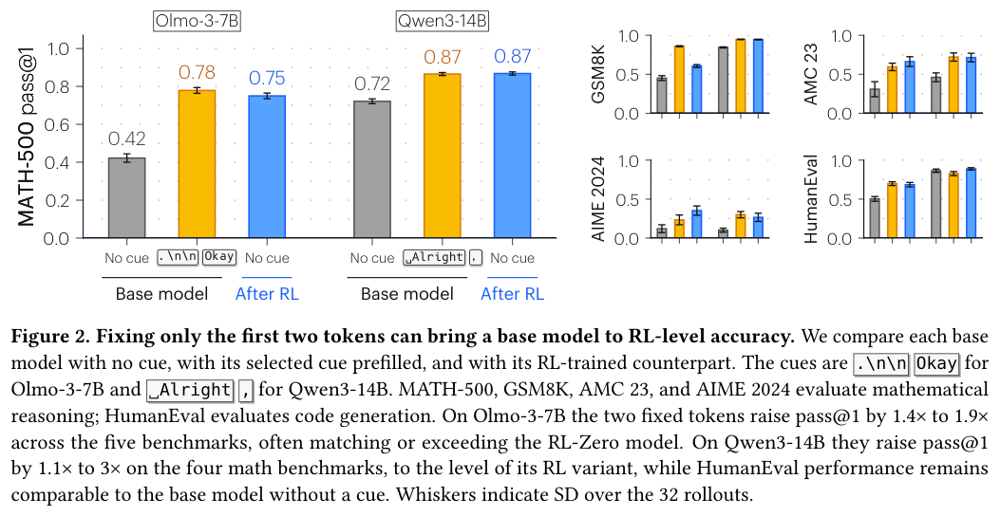

*图｜Wang, Sophie L. 等，[Figure 2（PDF 第 3 页）](https://arxiv.org/pdf/2610.06851v1#page=3)，[CC BY 4.0](http://creativecommons.org/licenses/by/4.0/)。裁剪自原文。*

预填特定开头后，Olmo-3-7B 的 MATH-500 Pass@1 从 42% 到 78%，Qwen3-14B 从 72% 到 87%；图中误差线来自三十二次 rollout。不同模型和 prompt 选出的开头不同，HumanEval 的收益也不一致。修改语料可让普通词成为推理 cue，表明关键是学到的文本关联，而非某个词本身具有普适推理能力。

[Base Models Can Reason By Taking a Cue From Training Data](https://arxiv.org/abs/2610.06851v1) · v1。

## 10. LoGRA：压缩梯度，同时控制预测 KL 步长

LoGRA 用低秩梯度 sketch 保存更新信号与同步信息，再根据预测 KL 估计更新幅度，减少梯度和优化器状态的内存负担。它更新完整模型方向，与只训练少量适配器的 LoRA 不同。

历史 v2 的 7B 三种子设置中，每 GPU 平均显存从 31.82 到 17.29GiB，节省 45.7%；峰值却是 31.85 到 22.26GiB，不能混用。前二百步的最佳 Pass@1 为 72.33%，Dense 为 72.48%，每小时更新 25.73 对 25.28，说明显存下降不等于显著提速。27B 另在八 GPU 单节点持续训练超过一千一百步，Dense 配置内存不足。

[LoGRA: Scaling LLM Reinforcement Learning with Low-Rank Gradient Sketches](https://arxiv.org/abs/2610.06647v2) · v2。

[Figure 1（原文）](https://arxiv.org/pdf/2610.06647v2#page=1)。

## 11. H-JEPA：高层先定子目标，低层再规划动作

H-JEPA 端到端训练多个不同时间尺度的动作条件潜在世界模型。高层保留较慢的状态变化，先朝最终目标规划，再把预测状态交给下一层作为子目标，逐层恢复更细的行动。

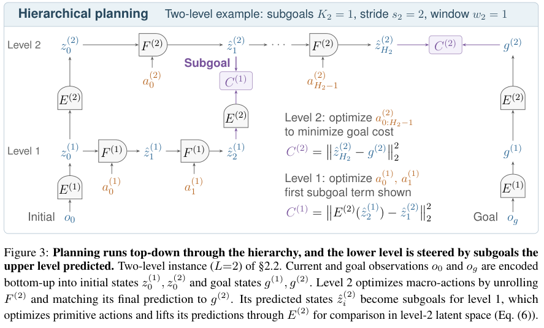

*图｜Zhang, Wancong 等，[Figure 3（PDF 第 4 页）](https://arxiv.org/pdf/2610.06805v1#page=4)，[CC BY 4.0](http://creativecommons.org/licenses/by/4.0/)。裁剪自原文。*

Visual AntMaze 的三层配置把成功率从平坦模型的约 18% 提到 73%，并减少规划 FLOPs；比较报告三个配对种子的标准误。但 Push-T 的三层模型即使增加计算仍表现差，训练时可用转移只有平坦模型的 58%。DROID 的结果属于离线规划保真度，需要逆动力学监督，不能当作同样幅度的真机闭环成功率改善。

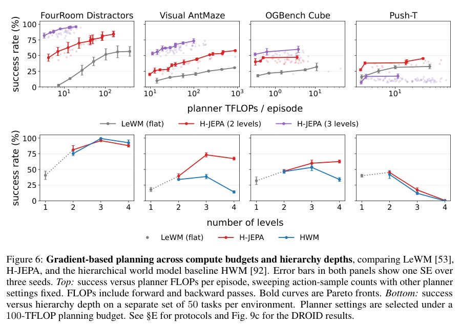

*图｜Zhang, Wancong 等，[Figure 6（PDF 第 6 页）](https://arxiv.org/pdf/2610.06805v1#page=6)，[CC BY 4.0](http://creativecommons.org/licenses/by/4.0/)。裁剪自原文。*

[H-JEPA: End-to-End Learning of Hierarchical World Models for Visual Planning](https://arxiv.org/abs/2610.06805v1) · v1。

## 12. BOTTLED：把反复调用变成可摊销的程序或小模型

BOTTLED 给 Agent 整批无标签任务和固定时间、计算、API 预算，让它自主选择写程序、造标签或训练小模型。评价同时算构建产物与处理整批工作负载的费用，检验前期投资能否换来可重复的便宜推理。

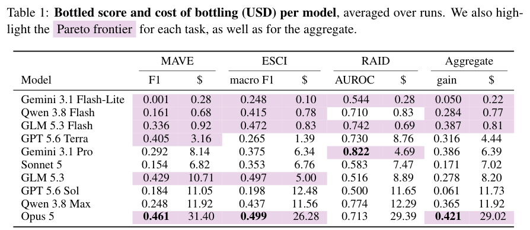

*图｜Sonthalia, Ankit 等，[Table 1（PDF 第 7 页）](https://arxiv.org/pdf/2610.08775v1#page=7)，[CC BY 4.0](http://creativecommons.org/licenses/by/4.0/)。裁剪自原文。*

十模型、三任务、各两次运行中，48/60 次产物分低于原模型零样本分数的 95% 置信区间下界，31/60 次还低于同 token 预算的小模型蒸馏对照。Opus 5 在 ESCI 的产物 macro-F1 为 0.499，费用 26.28 美元；保持约 82% 原性能时报告约 657 倍成本节省。成本依赖批量、单价与产物摊销范围，不能当作无损通用压缩。

[Agent in a Bottle: Can LLM Agents Turn Their Capabilities Into Cheap, Scalable Artifacts?](https://arxiv.org/abs/2610.08775v1) · v1。

## 13. LiFT：共享生成核心，沿连续深度目标增加计算

LiFT 循环使用共享 DiT 核心，每轮监督目标位于初始预测到 flow-matching 目标的直线路径上。连续深度坐标让模型可在不重训时执行比训练更多的循环，而不要求每轮立刻给出最终结果。

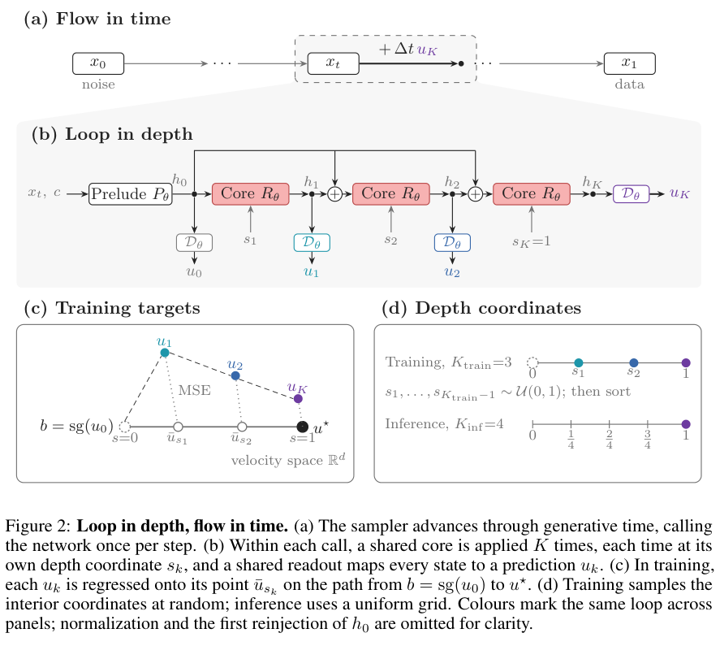

*图｜Derakhshani, Mohammad Mahdi 等，[Figure 2（PDF 第 5 页）](https://arxiv.org/pdf/2610.05538v1#page=5)，[CC BY 4.0](http://creativecommons.org/licenses/by/4.0/)。裁剪自原文。*

ImageNet-256、固定五十积分步下，L/2 R10 从训练两轮时的 FID 20.30 到推理八轮的 10.95；XL/2 R12 从两轮 17.07 到十六轮 9.31。L/2、XL/2 的大核心可超过对应稠密对照，小规模 B/2 仍由稠密模型更好。循环次数与采样步数是不同预算，参数减少也不代表额外循环没有计算成本。

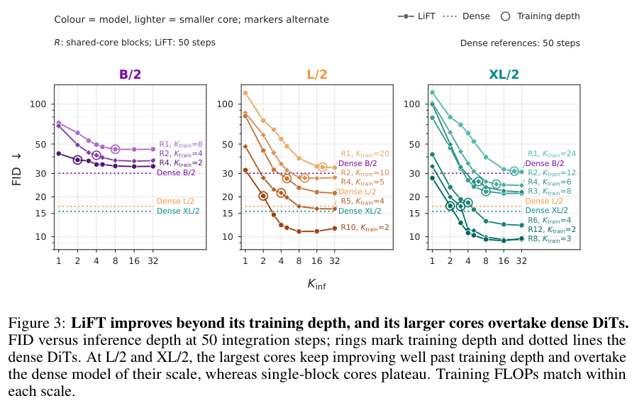

*图｜Derakhshani, Mohammad Mahdi 等，[Figure 3（PDF 第 8 页）](https://arxiv.org/pdf/2610.05538v1#page=8)，[CC BY 4.0](http://creativecommons.org/licenses/by/4.0/)。裁剪自原文。*

[LiFT: Loop Flow Transformers](https://arxiv.org/abs/2610.05538v1) · v1。
