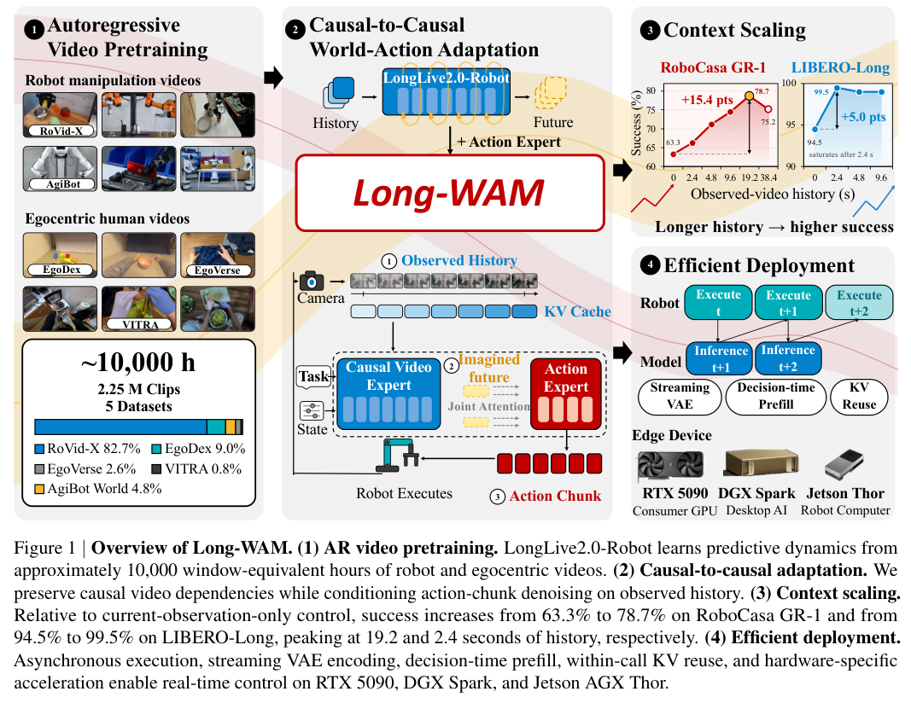
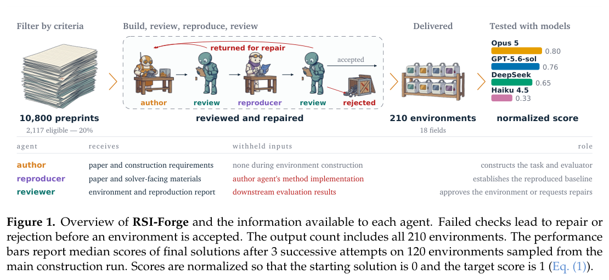

知识如何进入决策，评测如何隔离真正的改进，是本期几项工作的共同问题。实体对齐和设备本体提供语义侧的证据，coding 筛查、研究环境与视频模型则检验长时执行能力。

## 1. Ontology Tower：少量设备实体，深入组织运行知识

Ontology Tower 面向单套工业设备，把测点、物理关系推导量和运行日志中的经验组织成窄而深的本体，再投影为 Agent 可读文本。与覆盖大量建筑类型的通用本体相比，它强调一个设备实体背后需要足够具体的运行知识。

在真实低湿空气处理实验装置记录回放的九项任务中，四个规模不同的模型减少了最容易发生的误判；经验放进本体或提示记录时更常被使用，仅留在搜索工具后的日志里则较少被调用。14 次带不变量安全层的在线运行有 12 次进入目标区间，结果属于该设备与任务范围，也包含外部安全层的作用。

[Narrow and Deep: An Ontology Tower as the Knowledge of an LLM Agent for an Industrial Equipment System](https://arxiv.org/abs/2610.11768v1) · 2610.11768v1。

[Figure 1（原文）](https://arxiv.org/pdf/2610.11768v1#page=5)。

## 2. 实体对齐裁判：隐藏系统答案再判断

如果裁判提前看到系统的匹配或不匹配标签，评分可能变成替既有结论找理由。本文用实体对齐检查这种锚定，而非只比较裁判规模。

### 方法与问题

三个裁判模型、三个数据集与四个对齐系统组成实验，比较提示、标签暴露和反事实标签翻转。关键对照是隐藏待评系统的决定，使裁判只依据实体证据判断。

### 实验证据

标签暴露下 J-ROC-AUC 为 0.12–0.87；无标签协议在名称有区分度的数据上为 0.93–1.00，生物医学实体对为 0.93–0.95。这些是多种组合的范围，并非一个模型的一次前后对照，也不是实体对齐系统自身准确率。102 对实体的盲法双人评估 κ=0.902，支持该机制分析，不等于机器裁判普遍可信。

### 讨论

我会先盲评实体证据，再单独审查系统解释，不把判断、解释和置信度未经控制地一起交裁判。保留标签翻转测试很重要：若只换标签就改变裁判立场，提高模型规模未必解决问题。不同领域与名称特征不能合并为统一成功率。

图源：Vaibhava Lakshmi Ravideshik , Mayank Kejriwal，《Reliability of LLM Judges for Evaluating Entity Alignment》，arXiv:2610.09554v1，Figure 3，PDF 第 8 页。[原图出处](https://arxiv.org/pdf/2610.09554v1#page=8) · [CC BY 4.0](https://creativecommons.org/licenses/by/4.0/)。裁剪自原文。

- [Reliability of LLM Judges for Evaluating Entity Alignment](https://arxiv.org/abs/2610.09554v1) · 2610.09554v1，该版本提交 2026-10-07。

## 3. 后训练前，怎样估计基础模型的 coding 潜力

Before They Can Solve 不要求基础模型从零驱动完整工具循环，而是回放已成功的 Agent 轨迹，寻找累计补丁首次使测试由失败变通过的决定性步骤。在这个上下文中，分别测成功动作的概率、正确补丁多选题和前缀条件下的 pass@K。

十组公开基础模型与后训练模型的比较显示，这三种筛查与后训练后的 SWE-bench Verified 排名较一致。它提供的是选择值得投入训练的检查点的信号，不是因果保证；筛查仍依赖已有成功轨迹及其验证器，也不能替代真正的长时工具执行评测。

[Before They Can Solve: Predicting Post-Training Coding-Agent Performance from Base Models](https://arxiv.org/abs/2610.10478v1) · 2610.10478v1。

[Figure 1（原文）](https://arxiv.org/pdf/2610.10478v1#page=2)。

## 4. Long-WAM：历史更长，还要学会使用历史

Long-WAM 将机器人和第一视角视频的自回归预训练保留到世界动作模型适配中，再用流式观测编码、异步执行和硬件优化降低控制延迟。论文特别区分“输入更多历史”和“模型能利用历史”：双向预训练初始化未从同样的长历史中取得净收益。

*图｜Huang, Wei 等，Long-WAM，[Figure 1（PDF 第 1 页）](https://arxiv.org/pdf/2610.10528v1#page=1)，[CC BY 4.0](http://creativecommons.org/licenses/by/4.0/)。裁剪自原文。*

在 RoboCasa GR-1 上，上下文从 0 增至 19.2 秒时，自回归路线成功率从 63.3% 到 78.7%。这支持预训练时序结构与记忆使用之间的联系；实时硬件时延和真实操作实验则有各自平台条件，不能用单一动作块延迟代表完整机器人任务速度。

[Long-WAM: Scaling the Context of World-Action Models](https://arxiv.org/abs/2610.10528v1) · 2610.10528v1。

## 5. SGF+：把去噪与写入未来上下文的梯度分开

自回归视频模型既要生成当前帧，也要把当前帧写成未来可用的 KV 上下文。SGF+ 发现这两种角色的梯度经常负向对齐，于是使用不同参数承担上下文写入和去噪，同时仍通过因果注意力连接，并沿用原生成目标联合训练。

作者在逐帧和分块生成上报告视觉质量与长时一致性改善，训练仅用短 rollout，却能持续生成更长视频。连续运行时长本身不是整段视频始终一致的质量证明；这项结果更具体地支持，角色不同的计算即使共享目标，也未必适合完全共享参数。

[SGF+: Decoupling Gradient Flows for Autoregressive Video Generation](https://arxiv.org/abs/2610.10429v1) · 2610.10429v1。

[Figure 1（原文）](https://arxiv.org/pdf/2610.10429v1#page=1)。

## 6. RSI-Forge：把论文转成能反复改进的研究环境

RSI-Forge 用构建、复现和评审三个 Agent，将论文转为带自动评估器的可执行环境，并独立重写论文方法作为起点。它提供跨 18 个领域的 210 个环境，其中 90 个经独立领域专家审查，试图减少研究型任务建设对逐项人工工程的依赖。

*图｜Wang, Renxiong 等，RSI-Forge，[Figure 1（PDF 第 2 页）](https://arxiv.org/pdf/2610.09426v1#page=2)，[CC BY 4.0](http://creativecommons.org/licenses/by/4.0/)。裁剪自原文。*

在 120 个环境的连续三次尝试中，模型权重保持不变，只继承代码与笔记，观察到多项迭代改进。专家对防捷径、忠于原论文和任务能否被单一想法耗尽更为谨慎；因此超过重写基线不能直接等同于超过原作者的完整研究成果。

[RSI-Forge: From Research Papers to Environments for Recursive Self-Improvement](https://arxiv.org/abs/2610.09426v1) · 2610.09426v1。
