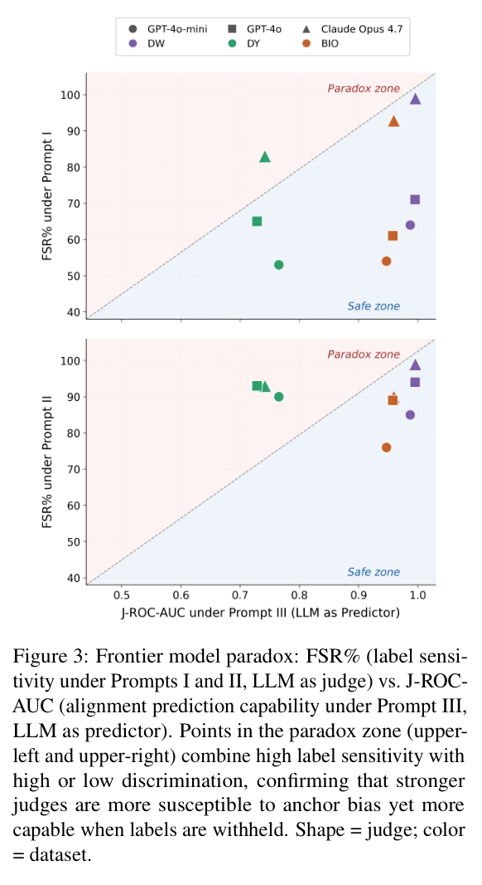

如果裁判提前看到系统的匹配或不匹配标签，评分可能变成替既有结论找理由。本文用实体对齐检查这种锚定，而非只比较裁判规模。

## 方法与问题

三个裁判模型、三个数据集与四个对齐系统组成实验，比较提示、标签暴露和反事实标签翻转。关键对照是隐藏待评系统的决定，使裁判只依据实体证据判断。

## 实验证据

标签暴露下 J-ROC-AUC 为 0.12–0.87；无标签协议在名称有区分度的数据上为 0.93–1.00，生物医学实体对为 0.93–0.95。这些是多种组合的范围，并非一个模型的一次前后对照，也不是实体对齐系统自身准确率。102 对实体的盲法双人评估 κ=0.902，支持该机制分析，不等于机器裁判普遍可信。

## 我的判断

我会先盲评实体证据，再单独审查系统解释，不把判断、解释和置信度未经控制地一起交裁判。保留标签翻转测试很重要：若只换标签就改变裁判立场，提高模型规模未必解决问题。不同领域与名称特征不能合并为统一成功率。

## 原论文视觉证据

图源：Vaibhava Lakshmi Ravideshik , Mayank Kejriwal，《Reliability of LLM Judges for Evaluating Entity Alignment》，arXiv:2610.09554v1，Figure 3，PDF 第 8 页。[原图出处](https://arxiv.org/pdf/2610.09554v1#page=8) · [CC BY 4.0](https://creativecommons.org/licenses/by/4.0/)。裁剪自原文。

## 论文来源

- [Reliability of LLM Judges for Evaluating Entity Alignment](https://arxiv.org/abs/2610.09554v1) · 2610.09554v1，该版本提交 2026-10-07。
