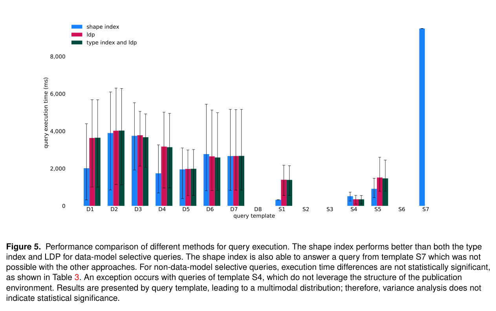

去中心化图查询的瓶颈可能是访问太多无关数据源，而不是三元组匹配本身。本文把 RDF shape 从约束说明变成链接遍历的剪枝地图。

## 方法与问题

shape index 与查询—shape 包含判断决定哪些资源值得访问，主要针对数据模型选择性查询，例如只需帖子和评论。作者用 SolidBench 社交查询比较执行时间、首结果延迟及 HTTP 请求。

## 实验证据

附录 Table 3 中，S1 平均 HTTP 请求比为 0.33，而 S4 为 13.00，后者执行时间也更差。比值是请求数量相对比较方法的口径，不能写成运行时间加速倍数。S4 不利用集合式发布结构，收益因查询模板而异；Table 2 还拒绝了约束越严格请求一定越少、索引越完整执行一定越快两项假设。

## 我的判断

应让元数据与查询形状匹配，按模板检查长尾，并计算维护成本。请求减少也未必同比降低延迟；为不适合的查询保留回退，比宣传跨查询平均倍数更有用。该实验支持指定剪枝策略，不能推出所有分布式图查询受益。

## 原论文视觉证据

图源：Bryan-Elliott Tam , Joanna Van Herwegen , Pieter Colpaert , Ruben Verborgh , Ruben Taelman，《Traveling with a Map: Reducing the Search Space of Link Traversal Queries Using RDF Shapes》，arXiv:2610.11701v1，Figure 5，PDF 第 12 页。[原图出处](https://arxiv.org/pdf/2610.11701v1#page=12) · [CC BY 4.0](https://creativecommons.org/licenses/by/4.0/)。裁剪自原文。

## 论文来源

- [Traveling with a Map: Reducing the Search Space of Link Traversal Queries Using RDF Shapes](https://arxiv.org/abs/2610.11701v1) · 2610.11701v1，该版本提交 2026-10-08。

## 本期其他论文

### QRAKEN：用已填充图模式约束 SPARQL

QRAKEN 从真实 RDF 数据离线蒸馏多跳模式、条件频率、路径相关字面值样例和类—属性共现矩阵，形成紧凑 TTQL。在线生成查询后，再用确定性的语法、词汇和数据模型检查提供修改诊断，避免模型仅凭 schema 猜测实际图中存在的连接。

CK25 上匹配条件的重算与消融显示，TTQL 模式是主要收益来源，修复循环提供补充保护。这里的 strict F1 衡量特定快照与题集上的答案，不能外推到任意开放图谱；论文也指出，把单体 TTQL 注入非常开放的跨领域图谱仍是限制。

[Natural Language Questions as an Interface for Knowledge Graphs: QRAKEN Graph Distillation and Semantic Self-Healing](https://arxiv.org/abs/2610.08095v1) · 2610.08095v1。

### TokenRouter：按请求编排，按模型批处理

TokenRouter 面向 token 级模型路由，解决不同模型进度不同步、请求频繁等待进入 batch 的服务瓶颈。开发者按单个请求描述路由逻辑，运行时为每个模型配置异步子服务器，再用延迟批处理和吞吐模型选择调度参数。

论文比较多种路由算法、负载和模型配对，报告相对已有服务系统的解码吞吐收益。这个倍数属于 token 级路由系统对照，不代表相对任意单模型服务的质量或费用提升；实际采用仍要测路由切换频率、等待时间和硬件配置。

[TokenRouter: Efficient Serving System for Token-Level LLM Routing](https://arxiv.org/abs/2610.12242v1) · 2610.12242v1。

### RSIGym：把自改进需要的服务和预算边界固定下来

RSIGym 将训练、推理、rollout、评估和沙箱作为可复用服务，提供 Data、Harness、Joint 三种改进路线，并统一预算与权限控制。Agent 可以把已接受的修改带入下一轮，避免每次研究都先重建基础设施，也支持同时比较数据与运行框架变化。

评测以五类 benchmark 上剩余性能缺口被关闭的平均比例定义 RSI-Index。论文在每个 benchmark 运行 500 美元平台服务预算下比较研究模型；该指数并非原始平均准确率。选出的系统和研究过程都受预算、起点、候选选择及评估任务影响，不构成无界持续进步的证明。

[RSIGym: A Flexible Environment for Recursive Self-Improvement](https://arxiv.org/abs/2610.10310v1) · 2610.10310v1。

### RoboJEPA：用潜在想象误差研究机器人规模规律

RoboJEPA 在覆盖 12 种机器人形态的数据上训练 JEPA 世界模型，研究模型规模、数据和计算量与潜在 rollout 误差之间的关系。作者用二阶幂律拟合想象误差，并进一步检查它与下游规划表现的相关性，尝试用较便宜的模型指标指导扩展。

论文也展示以单张目标图像规划的真实机器人任务。相关性使想象误差成为有用代理，却不能保证在新的设备、目标分布或感知错误下仍能预测操作成功；规模规律需要连同所用数据混合、拟合范围和规划器一起理解。

[RoboJEPA: Scaling Robotic Latent World Models](https://arxiv.org/abs/2610.10515v1) · 2610.10515v1。

### COAP：用显式状态和可复用代码执行机器人策略

Embodied Turing Machines 提出 Code-Only-as-Policy：代码从相机与本体感知测量、跟踪机器人和环境状态，再据此作决策，部署循环不调用 VLM 或 VLA。不同任务共享库，coding Agent 通过闭环修改库，使每次能力扩展都成为可检查的代码变化。

在 RoboDojo 的 42 项双臂任务中，这套库达到 70.24% 成功率。无需测试时模型调用减少了一类在线成本，但不消除视觉状态估计和控制逻辑的难度；论文也把上限明确放在状态表示精度与代码稳健性上，不能把可复用代码等同于任意场景可执行。

[Embodied Turing Machines: Stateful Code for Robot Recursive Self-Improvement](https://arxiv.org/abs/2610.12369v1) · 2610.12369v1。
