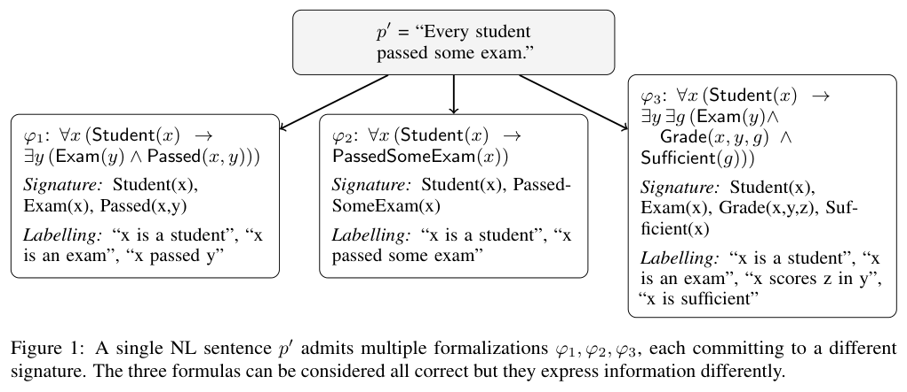
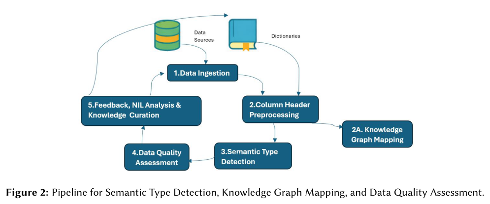
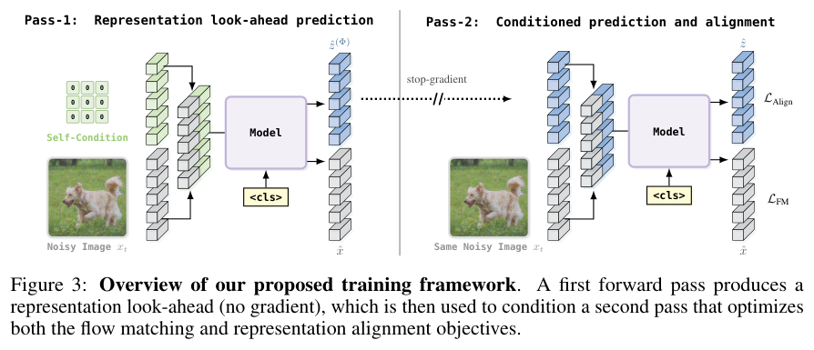

从自然语言到逻辑、从表头到类型、从代码规则到交互世界，本期围绕可检查的中间表示展开。多 Agent 自监督、视觉生成和积木设计也提供了不同层次的能力检验。

## 1. 自然语言到一阶逻辑：先分清抽词项和翻译命题

这篇综述为一阶逻辑自动形式化区分两项任务：Ontology Extraction 决定需要哪些概念、关系与词汇，Logical Translation 则把句子中的量化、否定和关系结构翻成公式。两者混在一起时，模型到底是选错谓词还是翻错逻辑，很难从一个总分判断。

*图｜Brunello, Andrea 等，自然语言到一阶逻辑，[Figure 1（PDF 第 4 页）](https://arxiv.org/pdf/2610.12030v1#page=4)，[CC BY 4.0](http://creativecommons.org/licenses/by/4.0/)。裁剪自原文。*

作者据此整理数据集、指标和微调、提示、验证修正等方法，并讨论本体感知和端到端应用的缺口。它的贡献是任务定义与研究地图，没有提出一个可跨数据集引用的新准确率；评估也不能只看公式可解析，还要检查语义是否保持。

[Natural Language to First-Order Logic LLM-based Autoformalization](https://arxiv.org/abs/2610.12030v1) · 2610.12030v1。

## 2. 只有表头时，如何留下可追踪的语义注释

这项 header-centric 框架针对单元格值不可用或不适合读取的情形，用词汇资源把表头映射到 39 类可解释类型，并保存 token 级 SourceKeywords。类型再触发数据质量规则，结果汇总为轻量、无权重的 HeadersIQ 指标，连接表格准备与知识图谱整合。

*图｜Silva, Marcelo Valentim 等，只有表头时，如何留下可追踪的语义注释，[Figure 2（PDF 第 5 页）](https://arxiv.org/pdf/2610.10541v1#page=5)，[CC BY 4.0](http://creativecommons.org/licenses/by/4.0/)。裁剪自原文。*

评测覆盖约 12 万列表头和多个异构数据集，但 SemTab 的官方严格成绩并不高。作者用盲审分析粒度、别名和本体选择造成的分歧，明确没有将诊断审查改算成更高官方分数。表头线索适合解释与预筛，仍无法替代对真实单元格含义和质量的检查。

[An Explainable Header-Centric Framework for Large-Scale Semantic Table Interpretation and Data Quality Assessment](https://arxiv.org/abs/2610.10541v1) · 2610.10541v1。

## 3. MASS：工作流与共享模型的交替自监督

自我改进最难的是谁来提供可信的改进信号。MASS 用同一个基础模型扮演执行者、评估者与优化者，先搜索多 Agent 工作流，再用轨迹监督微调。

### 方法与问题

内循环调整角色和信息路由，外循环训练共享模型，再以新模型重启搜索。工作流结构成为学习对象，搜索同时受结构约束控制。作者分别检查解题、评估和工作流优化能力。

### 实验证据

Qwen3.6-27B 经两个 MASS 周期，在四个开放研究类基准上的单位输出 token 表现达到基线约 1.2–1.6 倍。这不是原始准确率同比提升。Table 7 同时报告负迁移：Terminal-Bench 2.0 从 37.5±2.2 降至 35.2±1.7，SWE-bench Verified 从 62.6±1.4 降至 61.1±0.6；这些是多次试验均值及样本标准差，不能称所有 Agent 能力提高。

### 讨论

工作流自监督可能学到特定任务的信息组织习惯。下一轮应固定总推理预算、外部评价与保留集，检查跨任务迁移。同模型自评仍可能有共同偏差，保留不利结果是判断闭环是否有效的必要条件。

图源：Hyunin Lee , Jinglue Xu , Jeffrey Seely , Donghyun Lee , Somayeh Sojoudi , Matei Zaharia , Yujin Tang，《Recursive Self-Improvement through Multi-Agent Self-Supervision》，2610.12176v1，Figure 2，PDF 第 3 页。[原图出处](https://arxiv.org/pdf/2610.12176v1#page=3) · [CC BY 4.0](https://creativecommons.org/licenses/by/4.0/)。裁剪自原文。

- [Recursive Self-Improvement through Multi-Agent Self-Supervision](https://arxiv.org/abs/2610.12176v1) · 2610.12176v1，该版本公开于 2026-10-08。

## 4. AgentGarten：规则状态由代码维护，画面由模型生成

AgentGarten 将模拟器或游戏引擎与共享神经渲染器组合：后端维护持久状态和交互规则，渲染器根据统一接口输出视觉观测。它用几何条件适配视频模型，并通过 Adversarial Forcing 让后续预测损失反传到历史编码，兼顾世界状态一致与视觉真实感。

Agent 在这些世界中交互，把经验写成供后续轮次继承的 playbook。论文给出相对传统强化学习的学习效率案例，但轮次与环境交互量并非同一成本单位；代码维护的规则保证也只覆盖已实现状态，不能说明生成画面的每个细节都符合物理。

[AgentGarten: Code Worlds for Evolving Agents](https://arxiv.org/abs/2610.12374v1) · 2610.12374v1。

[Figure 1（原文）](https://arxiv.org/pdf/2610.12374v1#page=1)。

## 5. Dino Forcing：能直接预测的表示，不再单独去噪

Dino Forcing 研究如何利用 DINO 等预训练表示指导 flow matching。它直接预测表示，再让模型以自己的预测为条件生成，替代同时对图像和表示去噪的双轨迹，因而省去第二个 ODE 和表示专属的噪声日程。

*图｜Ghosh, Arijit 等，Dino Forcing，[Figure 3（PDF 第 4 页）](https://arxiv.org/pdf/2610.11751v1#page=4)，[CC BY 4.0](http://creativecommons.org/licenses/by/4.0/)。裁剪自原文。*

作者在 ImageNet 的潜在空间与像素空间生成中报告收敛和 FID 改善。这项简化针对表示引导的生成训练，不意味着图像主生成过程也无需去噪；训练轮数、空间类型和对照模型不同，不能把其中一个收益倍数推广到所有扩散系统。

[Dino Forcing Flow Models: Do not denoise what you can predict](https://arxiv.org/abs/2610.11751v1) · 2610.11751v1。

## 6. BrickBench：积木设计同时接受语义和可搭建性检查

BrickBench 要求 Agent 按文字提示，从离散零件库设计能实际拼装的积木结构。评测分开看物理有效性、提示对齐和设计质量，并以三种规模与零件供应条件控制难度；配套 BrickAgent 支持用代码构建、检查和验证作品。

实验中，领先 Agent 往往能满足可验证的物理和语义要求，但设计仍落后于人工作品。这个差距说明约束全部通过也不等于设计优秀；零件库、规模和评分维度共同决定任务边界，不能仅以一张外观图判断结构可建或创作水平。

[BrickBench: Evaluating Agentic Brick Design](https://arxiv.org/abs/2610.12452v1) · 2610.12452v1。

[Figure 1（原文）](https://arxiv.org/pdf/2610.12452v1#page=1)。
