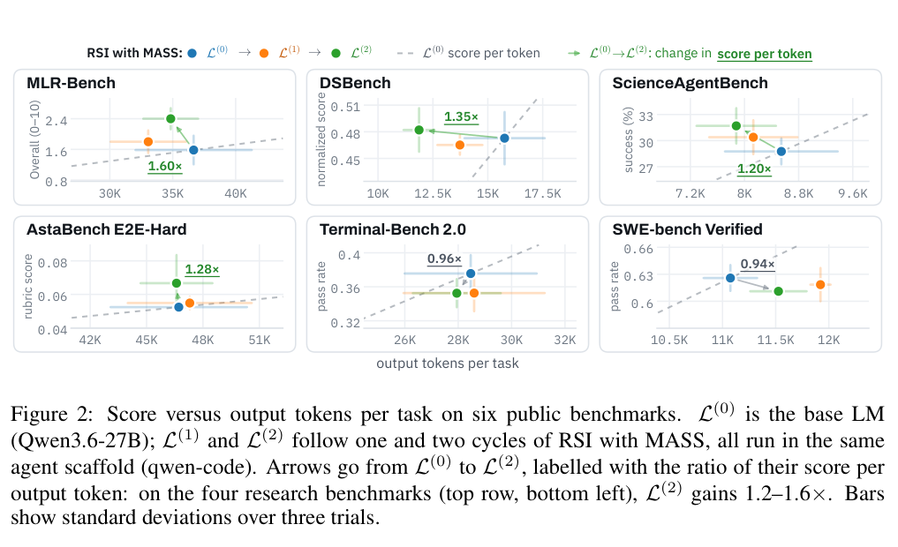

本文补录 **2026-10-11 的精选阅读**，于 2026-10-29 核对公开原文。归档日不等于论文发表日，采用下方历史版本；数字为作者报告，本站未独立复现。

自我改进最难的是谁来提供可信的改进信号。MASS 用同一个基础模型扮演执行者、评估者与优化者，先搜索多 Agent 工作流，再用轨迹监督微调。

## 方法与问题

内循环调整角色和信息路由，外循环训练共享模型，再以新模型重启搜索。工作流结构成为学习对象，搜索同时受结构约束控制。作者分别检查解题、评估和工作流优化能力。

## 实验证据

Qwen3.6-27B 经两个 MASS 周期，在四个开放研究类基准上的单位输出 token 表现达到基线约 1.2–1.6 倍。这不是原始准确率同比提升。Table 7 同时报告负迁移：Terminal-Bench 2.0 从 37.5±2.2 降至 35.2±1.7，SWE-bench Verified 从 62.6±1.4 降至 61.1±0.6；这些是多次试验均值及样本标准差，不能称所有 Agent 能力提高。

## 我的判断

工作流自监督可能学到特定任务的信息组织习惯。下一轮应固定总推理预算、外部评价与保留集，检查跨任务迁移。同模型自评仍可能有共同偏差，保留不利结果是判断闭环是否有效的必要条件。

## 原论文视觉证据

图源：Hyunin Lee , Jinglue Xu , Jeffrey Seely , Donghyun Lee , Somayeh Sojoudi , Matei Zaharia , Yujin Tang，《Recursive Self-Improvement through Multi-Agent Self-Supervision》，2610.12176v1，Figure 2，PDF 第 3 页。[原图出处](https://arxiv.org/pdf/2610.12176v1#page=3) · [CC BY 4.0](https://creativecommons.org/licenses/by/4.0/)。仅裁剪原页面，保留完整图表、图注和必要标签，未重绘或修改数据，不表示作者认可本解读。该图沿用 CC BY 4.0，本站页脚许可不为其增加非商业或相同方式共享限制。

## 原文与核验范围

- [Recursive Self-Improvement through Multi-Agent Self-Supervision](https://arxiv.org/abs/2610.12176v1) · 2610.12176v1，该版本公开于 2026-10-08。

本篇深读 1 篇，仅核对上述方法、图表数字与条件；未将其他候选二手摘要算作已核验结论，也不宣称完整覆盖当天所有论文。
