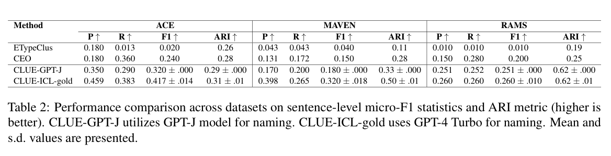
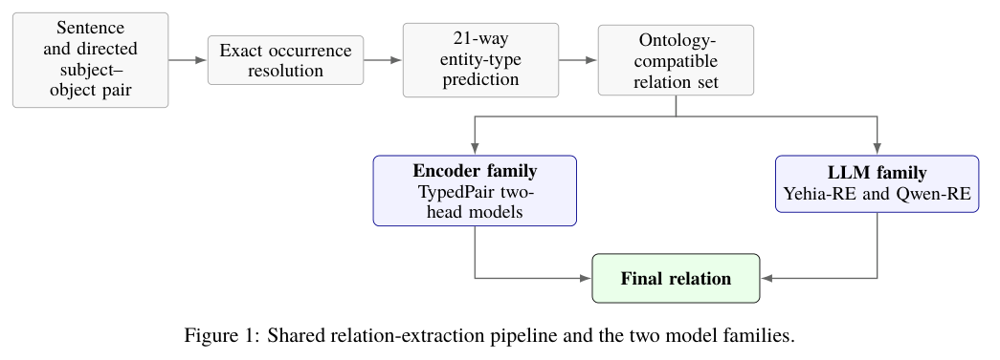
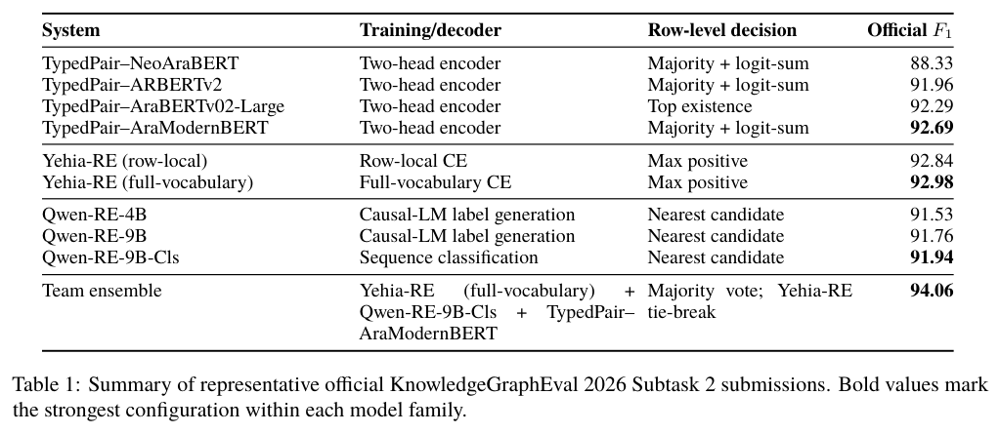
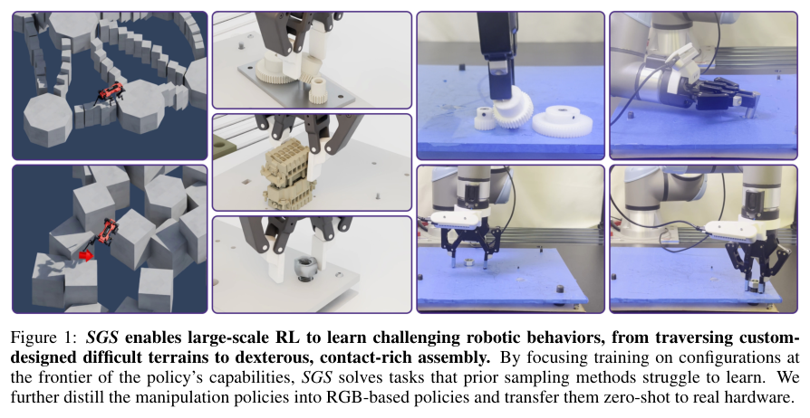
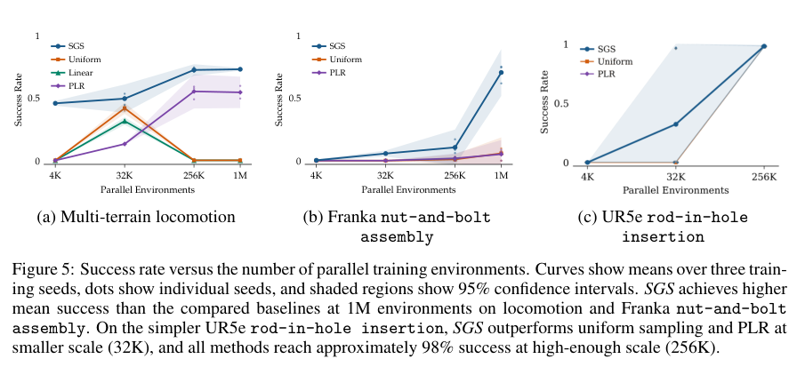

本期把语义结构与学习信号放在一起看：事件簇如何命名，关系预测如何受约束，模型怎样利用实验反馈，以及机器人训练怎样把预算留给可学习的状态。

## 1. CLUE：结合谓词与句子语义归纳事件类型

同一动词可以描述不同事件，不同动词也可能表达同类事件。CLUE 同时保留谓词中心视角与句子语义，再通过对比学习聚类、命名和标注事件类型。

### 方法与问题

流程提取谓词—宾语对，组合两种事件表示，用对比损失区分邻居，最后让语言模型为簇命名。聚类结构与命名阶段使用的标签信息应分开考察。

### 实验证据

Table 2 的 MAVEN 句子级 micro-F1 中，CLUE-GPT-J 为 0.180，CEO 为 0.150；CLUE-ICL-gold 为 0.320。但后者使用 GPT-4 Turbo 与金标签命名示例，不能当作严格零标签条件下的公平增益。论文也在 ACE 与 RAMS 报告 F1、ARI，并单独评估命名质量；这些指标不是同一种能力。

### 讨论

双视角表示对新领域事件本体有启发，但合理的簇不等于稳定的下游分析。应先核对命名阶段标注量，再检查领域迁移、低频事件与簇粒度，避免将标签提示的作用误归为无监督聚类收益。

图源：Pratik Maitra , Lauren Kwon , Qi Li，《CLUE: A Contrastive Learning Framework for Unsupervised Event Type Induction and Annotation》，2610.12580v1，Table 2，PDF 第 7 页。[原图出处](https://arxiv.org/pdf/2610.12580v1#page=7) · [CC BY 4.0](https://creativecommons.org/licenses/by/4.0/)。裁剪自原文。

- [CLUE: A Contrastive Learning Framework for Unsupervised Event Type Induction and Annotation](https://arxiv.org/abs/2610.12580v1) · 2610.12580v1，该版本公开于 2026-10-08。

## 2. 阿拉伯语关系抽取：本体约束与不同模型互补

U4RASD 的 KnowledgeGraphEval 系统从阿拉伯语句子和给定主客体中预测 40 类有向关系或 no_relation。编码器使用带类型实体标记，并分开判断关系是否存在和关系类别；LLM 路线对 Yehia、Qwen3.5 做 QLoRA 微调，并约束可输出的本体关系。

*图｜Abbas, Ahmad 等，阿拉伯语关系抽取，[Figure 1（PDF 第 3 页）](https://arxiv.org/pdf/2610.12742v1#page=3)，[CC BY 4.0](http://creativecommons.org/licenses/by/4.0/)。裁剪自原文。*

Yehia-RE、Qwen-RE 和 TypedPair 的集成在该赛道报告 micro-F1 94.06，单系统表现各有差异。结果支持约束预测与模型互补的组合，但属于指定实体对、关系集合和语言数据；不等于开放文本中已完成实体发现、任意关系归纳或端到端正确建图。

官方提交对比中，团队集成的 F1 为 94.06，最强单模型 Yehia-RE 为 92.98。集成通过多数投票与平票处理结合不同模型；这个差值对应阿拉伯语关系抽取赛题，不能推广为任意语言或本体的效果保证。

*图｜Abbas, Ahmad 等，阿拉伯语关系抽取，[Table 1（PDF 第 5 页）](https://arxiv.org/pdf/2610.12742v1#page=5)，[CC BY 4.0](http://creativecommons.org/licenses/by/4.0/)。裁剪自原文。*

[U4RASD at KnowledgeGraphEval-2026: Ontology-Constrained Encoder and LLM Systems for Arabic Relation Extraction](https://arxiv.org/abs/2610.12742v1) · 2610.12742v1。

## 3. MiMo-V2.6：把 RL 扩展拆到样本、环境和打分

MiMo-V2.6 报告从大规模多模态中训练出发，沿异步批次、更复杂环境与更多 grader 计算扩展强化学习。训练每步处理 1,568 个样本、约 2.7–3.7B tokens，支持最高 1M 上下文，并混合代码、通用、视觉和网络任务的不同 harness。

报告还讨论冻结 MoE 路由器、防 reward hacking 和训练推理一致性，以及用组内 Agent 打分鼓励更短解。它体现的是训练系统与数据、环境、奖励共同扩展，整体曲线不能隔离某个机制的贡献；每步 token 数也不能直接换算成独立任务数或最终服务成本。

[MiMo-V2.6: Scaling Reinforcement Learning Towards Self-Improvement](https://arxiv.org/abs/2610.11959v1) · 2610.11959v1。

[Figure 1（原文）](https://arxiv.org/pdf/2610.11959v1#page=1)。

## 4. 科学 Agent 的选择，来自先验还是实验反馈

这项神经算子适配研究让 LLM 在有限试验预算内选择微调配置，先与随机搜索、贝叶斯优化比较，再用干预区分原因。第一次尚未看到分数的建议已较强，且 PDE 描述会改变所选学习率，表明模型带有任务相关先验。

把已试配置的验证分数重新分配，会改变下一项建议，而保持分数值的文字改写没有类似整体效应，支持模型确实响应反馈。这个设计比只比较最终误差更能说明决策行为；但它验证的是所选 PDE 迁移与配置空间，不能推出所有自动科研过程都能正确利用实验。

[Prior or Feedback? What an LLM Uses When Adapting Neural Operators](https://arxiv.org/abs/2610.12325v1) · 2610.12325v1。

[Figure 1（原文）](https://arxiv.org/pdf/2610.12325v1#page=3)。

## 5. SplitJEPA：不重建图像，也区分不变与变化因素

SplitJEPA 在表示空间同时学习潜在状态及其 invariant、variant 分块，目标是让改变相机或光照这类因素，与真正改变任务状态的因素分开。与依赖重建的解耦路线不同，它不添加观测 decoder，而直接约束潜在预测结构。

论文在平稳高斯预测动力学和满秩变化条件下，证明可在独立分块等距变换意义下识别这些子空间，并用合成系统和机器人操作实验检验。理论中的分布与秩条件是保证的一部分；真实环境不满足时，表示的稳健性仍须实测，不能把“无需重建”当作无条件解耦。

[SplitJEPA: Learning Invariant and Variant Latent Worlds without Reconstruction](https://arxiv.org/abs/2610.12349v1) · 2610.12349v1。

[Figure 1（原文）](https://arxiv.org/pdf/2610.12349v1#page=2)。

## 6. SGS：百万并行环境也需要合适的数据难度

Success Guided Sampling 根据当前成功率，把机器人 RL 的重置配置集中在能力边界附近。它针对的浪费是：均匀采样让大量并行经验来自已经掌握或暂时完全做不到的状态，增加模拟器数量却未必增加有效学习信号。

*图｜Zhang, Octi 等，SGS，[Figure 1（PDF 第 1 页）](https://arxiv.org/pdf/2610.12465v1#page=1)，[CC BY 4.0](http://creativecommons.org/licenses/by/4.0/)。裁剪自原文。*

作者将实验扩到超过一百万并行环境，在多地形四足运动和接触装配中观察到收益，并将部分操作策略蒸馏为 RGB 策略转移实机。这不是仅靠采样就摆脱所有任务工程；重置分布、模拟质量、蒸馏与真实感知仍共同决定迁移能力。

*图｜Zhang, Octi 等，SGS，[Figure 5（PDF 第 7 页）](https://arxiv.org/pdf/2610.12465v1#page=7)，[CC BY 4.0](http://creativecommons.org/licenses/by/4.0/)。裁剪自原文。*

[A Balanced Data Diet: Addressing the Exploration Bottleneck in Mega-Scale RL for Robot Control](https://arxiv.org/abs/2610.12465v1) · 2610.12465v1。
